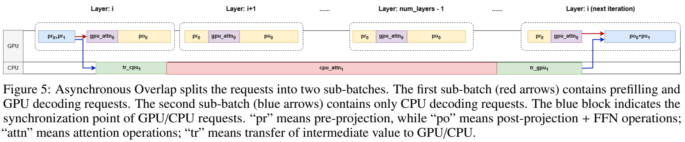
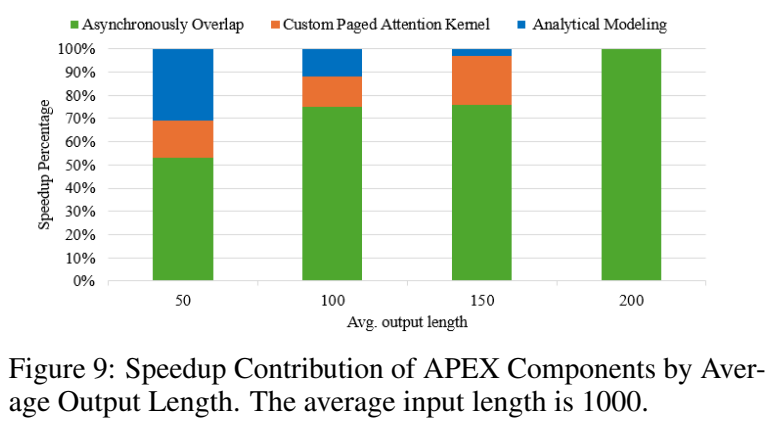

# APEX: Asynchronous Parallel CPU-GPU Execution for Online LLM Inference on Constrained GPUs

来源：[arXiv:2506.03296v4](https://arxiv.org/abs/2506.03296v4) 

**核心价值是重新安排同步点：CPU attention 不必赶在当前 GPU 层结束前返回。** APEX 将能合并的 GPU 线性计算放在同一批次，让 CPU 请求跨 GPU 迭代推进，减少拆批和等待的代价。它比“再加一个更快的 CPU attention kernel”更接近运行时调度研究；当前证据主要来自双路 Xeon 配 T4/A10，而非手机或低并发个人聊天。

## 研究问题与核心思路

### 为什么 NEO 式流水线在 decode 密集负载下可能失效

APEX 沿用 [NEO](../neo/notes.md) 的基本分工：模型线性层和 FFN 留在 GPU，部分请求的 KV cache 留在主机内存，并由 CPU 执行这些请求的 attention。这样释放的是 GPU 的 KV 容量，跨 PCIe 传输的是当前步的 Q/K/V 与 attention 输出，而非每步搬回完整历史 KV。

作者把 NEO 的困难归为三项（§2.3，图 1–3，p.3）：

1. **拆成两个子 batch 会损失线性算子效率。** 在 A10 上对 Llama-3.1-8B 的 profiling 中，单层线性算子在 token 数小于约 256 时耗时变化不大。拆批并不是让每个 token 多算一遍，而是将一次较大的算子调用变成两次小调用；在这一形状区间，两次调用的总耗时可能接近两倍。
2. **CPU attention 太慢，无法塞进短窗口。** 图 3 的示例在 hidden size 2048、序列长 1024、batch 4 下，双 EPYC 7251 CPU 为 3031 μs，V100 为 170 μs。该动机实验不是后文 Xeon+T4/A10 的正式评测平台，不能当作所有 CPU/GPU 的固定速度比。
3. **为了不阻塞 GPU，调度器只能少放 CPU 请求。** 当 GPU 线性计算很短，CPU 可隐藏的工作量也很少，CPU 空闲或系统退回 GPU-only，额外内存没有转成有效吞吐。

APEX 针对的是：权重已能由 GPU 执行，但越来越长的 KV 和在线并发使显存成为瓶颈，而且 decode 占比足够高。它不是用 CPU 权重卸载解决任意超显存模型，也没有提出新的量化算法。

### 与 NEO 的区别在批次组织和请求推进时机

| 方面 | NEO 式非对称流水线 | APEX 的 Asynchronous Overlap（AO） |
| --- | --- | --- |
| GPU 线性计算 | 两个子 batch 分别执行 | 将可共同执行的 GPU/CPU 请求合并，减少重复发起小批线性算子 |
| CPU attention 的窗口 | 由另一个子 batch 的 GPU 工作提供重叠 | 可跨越当前 GPU 迭代，等后续循环到所需层时再接回结果 |
| 同步 | 两个子 batch 的层内依赖限制 CPU 预算 | 到指定同步点检查结果；未完成的 CPU 工作继续等待，GPU 推进其他可运行工作 |
| 策略选择 | 负载感知地比较混合流水线与 GPU-only | 保留 GPU-only/非对称流水线，再加入 AO；用 profiling 与解析条件选择 |

“不拆 batch”应理解为**避免为 CPU 请求单独重复执行一整套小批线性算子**，不是没有 CPU/GPU 两类请求。图 5 本身仍称它们为两个子 batch，并用两种颜色表示；正文与图注的术语不完全一致。（§3.3，p.5）

## 实现路径

### 统一线性计算，attention 分流，结果延后接回

按图 5 和 §3.3–3.4（pp.5–6），执行过程可理解为：

1. 在某层 `i`，GPU 合并执行已就绪请求的 Q/K/V 线性投影。
2. GPU-attended 请求继续在 GPU 上做 attention；CPU-attended 请求把本步 Q/K/V 送到主机，利用主机驻留的历史 KV 做 attention。
3. GPU 不立即等待这批 CPU 输出，而是继续处理自己的请求及后续层。CPU 组在层 `i` 的依赖尚未满足，不能自行跳到下一层。
4. 后续 GPU 循环到合适的同步点时，接回已完成的 CPU attention 输出，并合并执行其 post-projection/FFN。若 CPU 尚未完成，本轮不把它的依赖当作已完成，下一轮再检查。

*原论文图 5，v4，PDF p.5。蓝色组的 `cpu_attn₁` 跨越多个 GPU 层，到下一次循环中的层 `i` 才接回。保留原图及图注；摘图坐标见 [来源清单](resources/asset-sources.yaml)。*

因此，**GPU 不停顿不等于每个请求都以同样速度前进**。运行时必须保存 CPU 请求所处的层、残差/中间结果和 KV 状态，再与 GPU 上其他请求的进度协调。论文 §6 说明当前 CPU attention 仍是按单层成批处理；跨层任务池和更细粒度优先级属于后续设想，不能写成现有能力。

### 解析条件筛选非对称流水线，而不是直接求出 AO 的最优时间

令 `T_l` 为给定 decode batch 的 GPU 单层线性算子时间，`T_a` 为 GPU attention 时间；`N_G`、`N_C` 是相应 GPU/CPU attention 的 token 处理率。参数由离线 profiling 得到，CPU 侧还依赖 batch 和 KV 长度。（§3.2，p.4）

作者近似 GPU-only 的周期为 `T_l + T_a`，非对称双批流水线为 `2T_l + T_a`。比较两者吞吐后得到式 (6)：

$$
\frac{N_G}{N_C} < 2\frac{T_l}{T_a}+3+\frac{T_a}{T_l}.
$$

右侧越大，较慢的 CPU 越有机会补偿拆批开销。论文将 `T_a/T_l` 取在 0.5–1.5，概括 CPU 至少需要 GPU 约 13% 的速度；按上式计算，这一区间的阈值实际约为 **13.3%–17.2%**，随两类 GPU 算子的比例变化。它是这个近似模型下的筛选条件，不是跨模型通用常数。

调度器流程（算法 1–2，p.6）是：

- CPU 队列为空，使用 GPU-only；GPU 能容纳全部请求时优先不引入 CPU。
- 尝试构造非对称流水线候选；若候选无法有效接纳 CPU 请求，转 AO。
- 对 decode-only 候选比较上面的吞吐；有 prefill 时，用式 (7) 增加 CPU 可利用的时间窗口，再按式 (8) 判断。
- 若新 prefill 到达，可优先接纳已经在 AO 下完成部分层的 CPU 请求，减少其剩余执行量。

这套模型显式比较的是**非对称流水线与 GPU-only**；比较失败后选择 AO。论文没有给出同等完整的 AO 端到端时间模型或最优性证明。对混合 prefill/decode，式 (8) 和算法 2 改变了吞吐分母，但未充分解释不同阶段 token 的计数边界，实际移植时应先对齐时间线和完成请求的统计单位。

### CPU kernel 与线程开销决定异步执行是否划算

APEX 在 NEO 框架上做两项工程改动（§4，pp.6–7）：

- **CPU paged attention**：从 NEO 的 ISPC 实现改用 Llamafile 的矩阵乘法 kernel，并将主机 KV buffer 锁页。作者报告小 batch 略慢，大 batch 最多约 2 倍的 kernel 加速，但未给出覆盖所有形状的独立曲线。锁页有利于主机与设备间传输，不等于让完整历史 KV 每轮往返。
- **异步运行时**：Python 主线程发起 CUDA 工作，计算线程通过 Pybind11 调用 C++ attention，并用 `gil_scoped_release` 释放 GIL，使两者真正并行。线程切换和调度仍有成本。

一个对本地服务很重要的条件是：§4.2 的经验规则要求 **CPU 请求数至少达到 GPU 请求数的 8 倍**，才足以摊薄 CPU 线程开销。文中未给出该阈值随 CPU 核数、模型、KV 长度变化的完整依据。低并发交互场景可能根本无法满足它，即使有空闲 CPU 和主存。

作者声明只改变计算位置、保持数学运算与数值精度不变；论文没有逐项列出权重/激活/KV dtype，也没有提出量化格式或校准流程。本次 PDF 未给出 APEX 自身的代码入口，未核对其完整状态机实现，也未运行推理。不能将使用 Llamafile kernel 理解为支持其所有低比特模型格式。

## 实验条件与关键结果

### 实验是双路服务器上的小显存 GPU

| 配置 | T4 平台 | A10 平台 |
| --- | --- | --- |
| CPU | 2 × Xeon Gold 6130，2.10 GHz，各 16 核 | 2 × Xeon Gold 6342，2.80 GHz，各 24 核 |
| 主存 | 180 GiB | 250 GiB |
| GPU / 显存 | NVIDIA T4 / 16 GB | NVIDIA A10 / 24 GB |
| 模型 | Llama-2-7B | Llama-3.1-8B |
| `max_num_batched_tokens` | 800 | 20,000 |

来源：表 1、§5.1，p.7。这是 token 容量上限，不是每轮实际 batch。基线为 vLLM 和 NEO；论文未提供两者版本、CPU 线程/NUMA 绑定、全部 dtype、完整请求长度分布和各实验的实际 batch，因而还不能形成一套精确可重建的配置。

工作负载包括 Azure LLM trace（AZ）、LiveBench（LB）、Dolphin-r1 和 OpenAI Summarization Comparison（OSC）。T4 主要使用 OSC 并改变平均输出长度；A10 使用前三种数据集，另做平均输入 1000 token 的输出长度扫描。图 6 图注称为 synthetic workloads，而正文又以真实数据集描述；长度重采样与到达过程未充分交代。（§5.1–5.4，pp.7–9）

### 区分吞吐、请求平均延迟和归一化基线

下表是**作者报告**，本次没有性能实测。

| 实验 | 条件与结果 | 应如何使用 |
| --- | --- | --- |
| T4 吞吐，图 6a | Llama-2-7B + OSC，平均输出 50/100/150/200 token；正文报告相对 NEO 最高增加 72%，相对 vLLM 最高增加 96% | 图中单位是 token/s；不能等同于固定 TTFT/ITL SLO 下的最大请求率 |
| A10 数据集吞吐，图 6b | Llama-3.1-8B；LB 相对 NEO/vLLM 为 +6%/+22%，AZ 为 +13%/+11%，Dolphin 为 +16%/+20% | 三个数据集的绝对吞吐不同，不应只引用一个“最高加速”代表全部负载 |
| 延迟曲线，图 7 | T4 + OSC、A10 + AZ；图中请求率分别约 0.5–4 和 0.5–3.5 req/s。作者描述 T4 平均每 token 延迟接近 NEO 的一半，A10 略低 | 指每请求完整延迟（含排队）除以输出 token 数，再对请求取平均；不是 ITL，也不是 TTFT 或 P99 |
| 输出长度扫描，图 8 | A10，平均输入 1000 token；50–200 输出区间相对 NEO 约 +5%，长输出时最高约 +37% | 归一化到论文所称 GPU-only baseline；§5.4 未重新明确基线实现，不能自动与图 6 的 vLLM 对照混用 |

图 8 中，APEX 相对 GPU-only 的曲线在中等输出长度达到峰值后下降，而相对 NEO 的优势在长输出下趋于稳定。它支持“减少 NEO 在 decode 密集场景的损失”，不意味着输出越长，系统绝对吞吐或相对 GPU-only 收益就一直提高。

### 消融图给出贡献构成，但缺少清楚的绝对增益口径

图 9 在 T4 + OSC、平均输入 1000 token 下逐步加入 AO、CPU kernel（AK）和解析模型（AM）。正文把 AO 写为 53%–100% 的增益、AK 写为额外 13%–21%、AM 最高 31%；然而原图是**每根柱子都堆叠到 100%** 的构成图，不能据此把三段分别解释成相对 NEO 的独立加速率。（§5.5，p.9）

*原论文图 9，v4，PDF p.9。纵轴为 Speedup Percentage，各柱合计 100%；保留原图以展示其统计口径。*

能较稳妥提炼的结论是：AO 在展示的贡献中占主要部分；输出到 200 token 时，图中 AK/AM 的边际贡献接近零。作者解释为较长时间窗口已能隐藏旧 CPU kernel，且非对称流水线无法接纳 CPU 请求时会直接转 AO，不再经过模型选择。若要量化“换 kernel 究竟快多少”，仍需要三个配置的原始 token/s，而不是从堆叠图相乘或相加。

## 理解、局限与疑问

### 优先研究异步状态机，而不是先抄吞吐数字

对**独显 PC、笔记本和小型工作站**，这篇最值得借鉴的是：线性层尽量合批，慢 CPU 请求异步推进，按实际完成状态接回。关键实现难点是跨迭代的层级进度、残差存活期、KV 所有权、请求退出/取消，以及 GPU-only 与两种混合策略之间的切换。论文没有完整展示这些恢复与状态转换细节，后续实做应先验证正确性和每请求延迟，再扩展并发。

移植到消费级单路 CPU 或笔记本时，不能直接沿用评测中 32/48 个物理核、双路内存子系统和持续功耗预算。**CPU 请求数至少为 GPU 的 8 倍**尤其使它更像高并发服务优化，而不是 batch=1 聊天的直接答案。论文没有能耗或持续运行温度数据，也未以同一机器控制核数/带宽来分离硬件因素。

对 **Jetson/Orin 和高通手机等统一内存设备**，可借用异步依赖调度，但容量与带宽模型要重写：CPU 接管 KV 并不会增加物理内存总量，CPU/GPU 还可能竞争同一 DRAM；独显平台的 PCIe 拷贝和锁页收益也不能照搬。这是基于机制的迁移判断，论文未评测这些设备。

与**量化工程**结合时，权重量化可能释放 GPU KV 容量并缩短线性计算，改变“需要卸载多少”与“能隐藏 CPU 多久”；KV 量化可能减少 CPU 读带宽，却引入解量化及页布局成本。应把实际低比特 kernel、传输字节数与混合策略一起 profiling，不能把量化加速比与 APEX 的比值相乘。

### 阅读时发现的证据缺口

1. **同一版本的峰值口径未对齐。** 摘要和 §5.2 写 T4 相对 NEO 最高 +72%，§8 结论在 long-output settings 下写 +49%，却没有交代 +49% 对应哪一组配置或子集。上表保留主实验段的 +72%，不把两处数字混成统一结论。（pp.1、8、10）
2. **调度模型缺少独立验证。** 没有报告时间预测误差、策略选错频率、profiling 成本和运行时调度开销分布。非对称流水线不满足式 (6)，并不能单凭该式得出 AO 一定胜过 GPU-only。
3. **吞吐趋势的简式不是可靠的加速上界。** p.8 用 `S ≈ ρ_c ρ_t` 描述 CPU/GPU 相对能力与 decode 占比对“speedup”的影响，但未清楚区分总加速比和增量，也未计入同步、传输与其他阶段。若 `ρ_t=0`，总加速比应回到 1 而非 0；该式适合解释定性趋势，不适合直接用于成本预算。
4. **平均指标不足以判断交互体验。** CPU 请求可能跨多个 GPU 循环才能推进，因而需要单独观察 CPU/GPU 两类请求的 TTFT、ITL、P95/P99 和公平性。图 7 的请求平均指标无法排除少数请求变慢。
5. **调度而非近似，不等于已证明所有输出逐位一致。** §3.1 声明保持运算与精度，本文未给出输出质量或数值误差测试表；不同 CPU/GPU attention 实现的累加路径仍需在实际实现中核对。

**我的判断：** 这篇适合跟在 NEO 后读，把问题从“CPU attention 能否隐藏在一层里”推进到“请求能否跨迭代异步执行”。现有证据支持其机制值得实现验证，但要开展可复现比较，应先补齐状态机、真实 batch/精度配置、消融的原始吞吐及尾延迟，而不是从摘要选择一个固定百分比作为目标。
