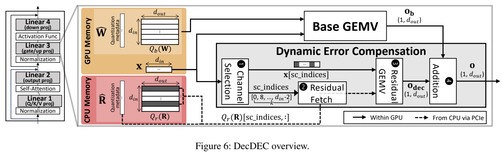
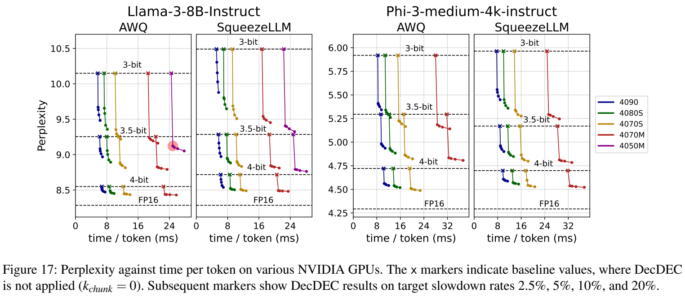

# DecDEC: A Systems Approach to Advancing Low-Bit LLM Quantization

阅读版本：[OSDI 2025 正式论文](https://www.usenix.org/conference/osdi25/presentation/park-yeonhong)，[本地 PDF](resources/decdec-osdi2025.pdf)。已读完整 18 页：PDF p1 为封面，p2–14 为正文，p15–18 为参考文献，无独立附录。下文使用 **PDF 页码**，比书内论文页码 803–819 多一张封面；例如 PDF p13 对应论文 p814。

阅读日期：2026-10-30。重点是低比特格式、主存残差、GPU 内核并行与实际端到端代价。另只读核对了[官方实现](https://github.com/SNU-ARC/DecDEC/tree/5f3f237cf0c2e2a1fbb17fe562bb0e1850ab004b)，固定 commit 为 `5f3f237cf0c2e2a1fbb17fe562bb0e1850ab004b`；未运行模型或基准。

## 研究问题与核心思路

**DecDEC 适合回答“低比特模型已经塞进显存，怎样用很小的延迟代价挽回质量”，而不是“怎样把放不下的整个模型卸载出去”。** 量化基座和激活常驻 GPU，CPU 主存额外存储权重量化残差；每个 decode step 按当前激活幅值选少量输入通道，仅读取这些通道的残差，在 GPU 上计算修正项。（§3–4，p4–8）

设反量化后的基座权重为 $\widehat W$，原权重为 $W$，残差为 $R=W-\widehat W$。概念上的输出是：

$$
y=\widehat W x+(R\odot M(x))x.
$$

实际系统还会把 $R$ 压成 4-bit，因而使用的是反量化后的残差近似 $\widehat R$。$M(x)$ 只保留本 token 选中的输入通道。激活较大的通道会放大量化误差，动态选通道比永远使用校准集得到的固定名单更有效；它仍是有代价的近似补偿，而非精确恢复 FP16 输出。

这里有两个容易混淆的区别：

- **激活用于选通道，不代表激活被量化。** 主实验属于 weight-only PTQ，基座为 3/3.5/4-bit，残差为 4-bit，计算激活沿用浮点格式。
- **CPU 提供存储，不执行残差 GEMV。** 通道选择、远程内存请求、残差乘加和合并都在 GPU 上完成；这与把 attention 或专家计算卸载给 CPU 的方案不同。

*原文 Figure 6，OSDI 2025，PDF p6 / 论文 p807。虚线是经 PCIe 从 CPU 主存读取，两个计算分支都位于 GPU。摘图来源与裁剪记录见 [asset-sources.yaml](resources/asset-sources.yaml)。*

## 实现路径

### 1. 残差压缩与访问布局一起设计

默认残差采用**逐输出通道、对称均匀 INT4**，值域 $[-7,7]$，每个输出通道一个 FP16 scale，离线网格搜索尺度以减小重建误差。残差按输入通道连续存储，使“取一条输入通道对应的全部输出残差”可以合并访问；scale 也连续保存并随读取使用。（§4.2，p6）

这不是在 GPU 上给若干固定权重永久升 bit，而是在 CPU 保存一个额外低比特纠错层，运行时动态选择其切片。主存容量仍有真实成本：若参与补偿的线性层共 $N$ 个权重，4-bit 残差主体约需 $N/2$ 字节，另加 scale、原量化 checkpoint 和运行时对象。论文的近零显存开销不等于近零整机内存开销。

源码 [`cheatsheet.py`](https://github.com/SNU-ARC/DecDEC/blob/5f3f237cf0c2e2a1fbb17fe562bb0e1850ab004b/decdec_setup/cheatsheet.py)确实计算原权重减去反量化权重，转置成按输入通道取行的布局，将 **8 个 nibble 打包到一个 32-bit 整数**，并重排 scale。可选 2/8-bit 残差导出则是 FP16 承载的 fake-quant 数据，用于分析；不能把这些选项当作已经具有对应 packed CUDA 快路径。

### 2. 用 CUDA zero-copy 处理细粒度动态读取

每条残差行通常只有几 KB 到十几 KB。相比每步发起许多小块 `cudaMemcpyAsync`，zero-copy 让 GPU 发出缓存行粒度的主存请求，避免每个小传输的 DMA 设置成本。它省掉的是显式显存 staging，不是 PCIe 字节或 GPU 指令。（§4.3，p6–7）

[`dec_config.cu`](https://github.com/SNU-ARC/DecDEC/blob/5f3f237cf0c2e2a1fbb17fe562bb0e1850ab004b/decdec_extension/dec_config.cu#L187-L237)使用 `cudaHostAllocMapped` 与 `cudaHostGetDevicePointer`，把 packed 残差和 scale 拷到可映射的锁页主存。残差不是按需从磁盘读取；初始化还可能同时保留输入 tensor 和 mapped allocation，因此估算主存峰值不能只算一个残差文件。

为什么占用 GPU 核心发请求仍可划算？论文假设基座 GEMV 是显存带宽受限，少分配一些 SM 未必拖慢它；补偿分支借用闲置计算资源，通过另一 CUDA stream 与基座重叠。如果基座受 L1 或计算吞吐限制，这个假设会变弱。

### 3. 近似 Top-K 避免全局排序

输入激活按 1024 个通道切块，每块选 $k_{chunk}$ 个，因此总选择数约为 $k=k_{chunk}d_{in}/1024$。每个块独立使用 32 个桶，把激活绝对值分桶，从大值桶开始收集；临界桶中若候选过多，则随机选取剩余位置。（§4.3，p7）

桶边界由校准集确定：在预计第 k 大值附近保留较细分辨率，同时给更大幅值保留额外范围。它避免全局同步和精确排序，但存在两种近似：每个 chunk 固定配额可能遗漏集中在一个 chunk 的离群值，桶内随机选取也不保证精确 Top-K。Figure 16 的实验显示，动态近似选择的 recall 约 80%，而静态 Hessian 选通道约 30% 或以下；前者的困惑度曲线接近精确 Top-K。（p11–12）

### 4. 融合的是补偿链路，基座仍是另一条执行分支

通道选择、zero-copy 残差读取、残差 GEMV 和原子加法融合到一个 kernel。选择完的索引与激活进入小型 GPU buffer，通过 cooperative-group 的 grid 同步让所有 thread blocks 看见完整选择集合；随后各 block 按输出维度切分工作，最终原子累加到基座输出。（Figure 10，p8）

**不要把这称为“基座 GEMV 与全部补偿融合成一个 kernel”**：论文的基座 GEMV 与融合补偿 kernel 分别在不同 stream 运行。源码 [`decdec.cu`](https://github.com/SNU-ARC/DecDEC/blob/5f3f237cf0c2e2a1fbb17fe562bb0e1850ab004b/decdec_extension/decdec.cu)可见 `cudaLaunchCooperativeKernel`，并显式要求输入 `batch_size=1`、`seq_len=1`。

按论文极端示例，Llama-3-8B 对最大输入层选择约 10% 通道时，$k=1433$，索引 INT32 与激活 FP16 共 $1433(4+2)=8598$ 字节，约 8.6 KB；各层复用该 buffer。论文据此得出额外显存小于 3-bit 模型大小的 0.0003%。这是额外算法 buffer 的估算，不是包含 CUDA context、allocator、prefill 临时张量和 KV cache 的整机峰值测量。（p8）

### 5. 调参器控制的是线性层总延迟预算

两个核心参数是补偿 kernel 的 thread-block 数 $n_{tb}$ 与每块补偿通道数 $k_{chunk}$。前者过小不能充分利用 PCIe，过大则抢占基座计算资源；后者越大通常质量越好，但越难隐藏传输。（§4.4，p8–9）

调参分两阶段：先搜索统一的最大 block 数限制，粗粒度提升四类投影的补偿量；再固定 block 配置，细粒度增加延迟代价较小的投影的 $k_{chunk}$。若小矩阵补偿连最低成本都无法容纳，可将对应层类型的补偿设为 0。每个模型/设备组合调一次，目标是让全部线性层时间之和不超过预算，**不是直接求模型质量最优解，也不是逐 token 的延迟 SLO 控制器**。

对 3-bit 基座、4-bit 残差，忽略其他开销时，能隐藏的补偿量近似为：

$$
k_{chunk}\approx1024\frac{B_{PCIe}}{B_{GPU}}\frac{3}{4}.
$$

这解释了低端卡反而可能补偿更多通道：其基座读权重较慢，给主存残差传输留出更长窗口。它依赖有效带宽、kernel 行为与 SM 竞争，不能只用宣传带宽决定配置。（§5.1，p10）

### 6. Prefill 与 decode 必须分别看

论文贡献和计时重点是单请求 decode GEMV，没有展示同样的动态补偿如何高效覆盖大 batch prefill。核对的 [`APLinear.py`](https://github.com/SNU-ARC/DecDEC/blob/5f3f237cf0c2e2a1fbb17fe562bb0e1850ab004b/end-to-end/APLinear.py#L36-L48)在序列长度大于 1 时走反量化权重加 `torch.matmul`，而非同一条 DecDEC GEMV 路径。因此长 prompt 的 TTFT、prefill 显存峰值与 decode 的近零额外 buffer 是不同问题。

## 实验条件与关键结果

### 测试范围

| 项目 | 正式论文条件 |
| --- | --- |
| 主模型 | Llama-3-8B-Instruct、Phi-3-medium-4k-instruct（14B） |
| 基座格式 | AWQ 与 SqueezeLLM，3-bit / 3.5-bit / 4-bit；3.5-bit 将一半 decoder blocks 设 3-bit、另一半设 4-bit，按 KL 散度敏感度分配 |
| 残差 | 默认逐输出通道 4-bit；2/8/16-bit 做质量与传输量比较 |
| CUDA 基座 kernel | AWQ 使用 LUTGEMM；SqueezeLLM 使用 Any-Precision LLM kernel |
| 推理管线 | PyTorch + `torch.compile`；单请求 decode，平均 1024 个生成 token 的每 token 耗时；论文未完整给出统一 prompt 长度和各软件版本 |
| 质量指标 | WikiText perplexity；23 项 BBH，启用 CoT；MT-Bench 80 个 responses，由 GPT-4o 评分，报告三次均值 |
| 调参目标 | 线性层时间相对基座增加不超过 2.5%、5%、10%、20%；与实际端到端 slowdown 分开报告 |
| 基准测量 | GPU kernel 使用 Nsight Systems；本文未本机复现 |

主实验硬件（Table 1，p9；带宽为论文列示值）：

| GPU | 显存 | GPU 内存带宽 | PCIe 带宽 | SM 数 |
| --- | ---: | ---: | ---: | ---: |
| RTX 4090 | 24 GB | 1008 GB/s | 32 GB/s | 128 |
| RTX 4080 Super | 16 GB | 736 GB/s | 32 GB/s | 80 |
| RTX 4070 Super | 12 GB | 504 GB/s | 32 GB/s | 56 |
| RTX 4070 Mobile | 8 GB | 256 GB/s | 16 GB/s | 36 |
| RTX 4050 Mobile | 6 GB | 192 GB/s | 16 GB/s | 20 |

另有 RTX 3080/5080 的跨代实验，以及 AWQ Llama-3-70B-Instruct 在 H100/GH200 上的实验（§5.4–5.5，p13–14）。正文没有完整列出主机 CPU、RAM 容量/通道、锁页限额、功耗与笔记本热状态；这些会影响复现时的有效远程访问成本。

### 质量提升不是相对基座更快

*原文 Figure 17，OSDI 2025，PDF p13 / 论文 p814。叉号是未补偿基座，之后的点依次采用 2.5%、5%、10%、20% 目标 slowdown；横轴 ms/token，纵轴 WikiText perplexity，二者均越低越好。*

最有代表性的结果是 **RTX 4050 Mobile 上 AWQ 3-bit Llama-3-8B-Instruct：perplexity 10.15 → 9.12，实际 decode 延迟增加 1.7%**。该配置的调参目标为 2.5%，$n^{max}_{tb}=8$，四类投影的 $k_{chunk}=(55,56,58,55)$。对应 3.5-bit AWQ 基座在这张 6 GB 卡上放不下；其质量对照来自能够运行的配置，而不是同卡成功跑出的基准。（Table 3、Figure 17，p13）

同为 AWQ 3-bit Llama-3、2.5% 调参目标时：

| GPU | $n^{max}_{tb}$ | $k_{chunk}$：QKV / O / Gate-Up / Down | 实际端到端 slowdown |
| --- | ---: | --- | ---: |
| RTX 4090 | 24 | 4 / 4 / 8 / 9 | 1.3% |
| RTX 4080 Super | 6 | 9 / 5 / 9 / 6 | 1.1% |
| RTX 4070 Super | 28 | 25 / 26 / 26 / 26 | 2.0% |
| RTX 4070 Mobile | 16 | 38 / 39 / 39 / 40 | 1.7% |
| RTX 4050 Mobile | 8 | 55 / 56 / 58 / 55 | 1.7% |

低端卡可以利用较长的 GEMV 时间窗口补偿更多通道，但绝对 token 延迟仍可能更高。各卡不能只按“slowdown 小”或“补偿通道多”排名。

其他关键证据：

- **质量收益随原始损失而变。** 3-bit 提升较显著；4-bit 已接近 FP16，增益较小。统一 $k_{chunk}=8$ 时，AWQ Llama-3 perplexity 从 10.15 到 9.63，Phi-3 从 5.96 到 5.53；SqueezeLLM 则分别从 10.49 到 9.93、5.92 到 5.45。（Figure 13，p11）
- **4-bit 残差是传输预算下的选择，不是只追求残差重建精度。** Table 2 按近似相等传输字节比较：少量高精度通道与更多低精度通道的取舍中，4-bit 通常最佳或接近最佳。（p12）
- **质量评测和完整部署覆盖不同。** $k_{chunk}=128$ 用于观察质量上界，不表示各卡都能低开销运行。4050M 上所有 Phi-3 配置 OOM，Llama-3 的 AWQ 3.5/4-bit 与 SqueezeLLM 4-bit 也排除；4070M 上 AWQ Phi-3 4-bit OOM。（p10–12）
- **服务端互连快不保证收益成比例。** GH200 的 NVLink-C2C 为 450 GB/s，H100 的 PCIe 为 64 GB/s，两者 GPU 内存带宽均列为 3.36 TB/s，但收益差距小于带宽比所暗示。作者解释为量化 GEMV 已受 L1 吞吐限制，拿走 SM 会拖慢基座，破坏“空闲 SM 免费补偿”的前提。（§5.5，p14）

官方仓库 README 的性能速览把 AWQ 栏写为 Llama-3 `10.49 → 9.41`、Phi-3 `5.92 → 5.23`，与正式论文中的 AWQ 基线及摘要数字不一致；10.49/5.92 又对应论文里的 SqueezeLLM 基线。本笔记使用正式论文数据，未来复现应固定量化 checkpoint 与 backend，不能直接抄 README 当同一实验。

## 理解、局限与疑问

### 对当前研究方向的价值

**这是很值得优先研究的量化工程论文：质量补偿机制、压缩布局、GPU kernel 和跨总线访问在同一个代价模型中闭环。** 最合适的起点是已经能完整驻留 GPU 的 3-bit 小模型，比较允许 2.5%–5% 延迟预算时，动态补偿能否比增加平均权重 bit 更划算。

- **独显笔记本/桌面：** 场景直接匹配。先确认量化基座 kernel 是 DRAM-bound，再测可用 PCIe/主存带宽和并发 SM 干扰；更快的基座 kernel 反而可能缩小补偿窗口。
- **小型 AI 工作站：** 除显存，还需计入残差主存、锁页分配和初始化峰值。多任务争用总线、GPU 图形负载和电源状态会使离线调参失效；官方运行文档也提醒避开其他 GPU/PCIe 负载。
- **Jetson Orin/高通手机：** 可迁移的是“按当前输入选择少量纠错数据”的思想，不是现成 PCIe 结论。统一 LPDDR 下，基座读权重与补偿读残差可能争用同一内存带宽；NPU 算子和同步能力也不同。论文未在这些设备验证，不给对应硬件标签。

### 解释与后续实验应保留的边界

1. **固定显存预算下改善质量，不等于压缩总系统容量。** 主存残差仍需存储和传输；同等整机内存/能耗约束下，最优策略可能不同。
2. **指标优化不完全一致。** 调参器最大化可补偿量、优先选择低延迟增量，但不同层每增加一个通道的质量收益未必相同。把层敏感度与实测 kernel 成本共同用于预算分配，是清楚且可检验的延伸。
3. **动态近似选择仍依赖离线校准边界。** 应关注领域迁移后的幅值分布、桶拥塞与质量稳定性，而不仅是同分布平均 perplexity。
4. **单 token GEMV 的优势不能直接外推。** 多请求 batching、长 prompt prefill、长上下文 KV 开销会改变运行窗口；现有代码还显式限制补偿入口 batch 和序列长度均为 1。
5. **质量指标并非均单调改善。** MT-Bench 在接近 FP16 的配置中上下波动，作者归因于评分粒度；这不是每项任务都会获益的保证。模型输出质量、端到端延迟、峰值内存和功耗应一起比较。

与 [SqueezeLLM](../squeezellm/meta.yaml) 的关系尤其重要：SqueezeLLM 优化基座的非均匀量化与静态高精度例外，DecDEC 则在推理时动态选择主存残差，两者可以叠加，但要明确实际使用哪套权重表示和 GEMV backend。
