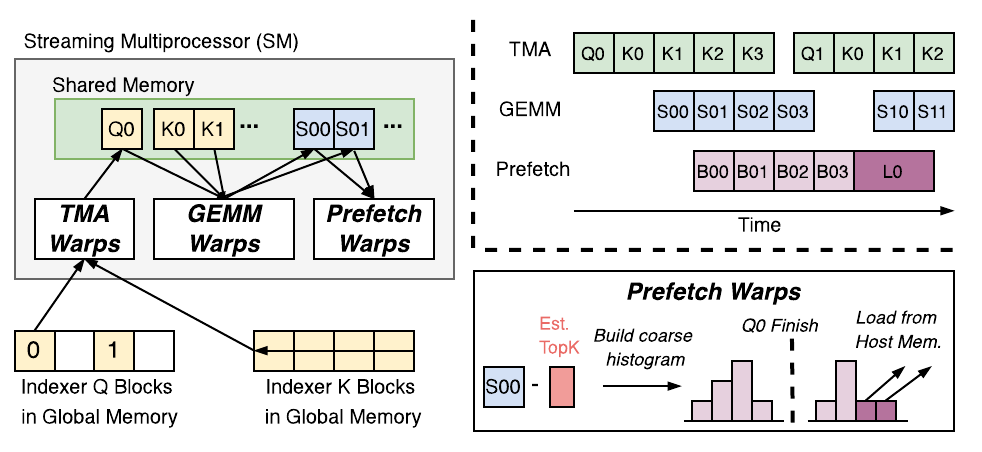
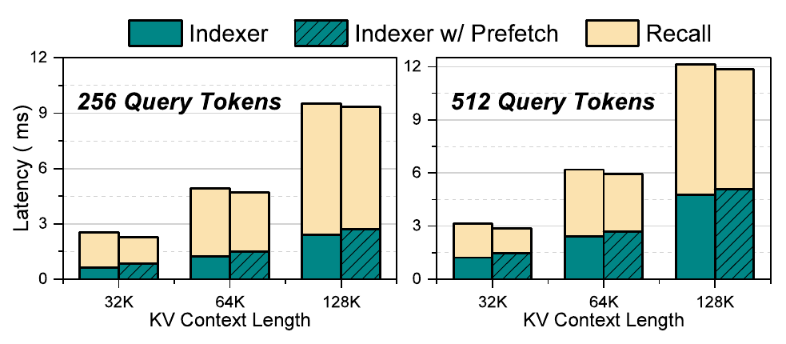

# ECHO: Efficient KV Cache Offloading with Lossless Prefetching for Serving Native Sparse Attention LLMs

来源：[OSDI 2026 正式版](https://www.usenix.org/conference/osdi26/presentation/liu-guangda)（[PDF](https://www.usenix.org/system/files/osdi26-liu-guangda.pdf)）。阅读 §1–8、实验附录 A 及[作者公开代码库的实验说明](https://github.com/sjtu-zhao-lab/ECHO)。关注的问题是：模型已经用了原生稀疏注意力，为什么上线后仍然会卡在显存容量？把 KV 挪去主存，省下来的显存能不能变成吞吐？

## 为什么稀疏 attention 还是会填满 HBM（§1–2）

DeepSeek Sparse Attention（DSA）先用轻量 indexer 给历史 token 打分，稀疏 MLA 只读取 top-k 对应的 KV。每步读得少，历史却还得留着。模型另有一份 indexer 的 K cache，这份也随上下文线性增长。作者在 8 张 96 GB NVIDIA H20 上用 SGLang 运行 AWQ 版 DeepSeek-V3.2（TP8 加 MLA DP8），实测每个数据并行 worker 的 KV 容量约 380K token。100K token 的请求只能同时放 3–4 条，显存先用完，稀疏 kernel 还跑不到高利用率。

把 KV 放去 CPU DRAM 有两个阻碍。一是常规动态分配和释放依赖变长张量或 CPU 决策，会让每层的换入换出打断 CUDA Graph。二是等 indexer 算完全部分数才知道精确 top-k；如果这时才发起主存回读，attention 还得等一轮 PCIe。图 4 的 H20 测量显示，上下文接近 100K token、GPU 池命中 90% 时，indexer 已经长到可以掩盖一部分取回时间。问题变成：能提前搬哪些数据，同时不改模型的选择？

## 缓存管理：逐层换槽位，保留一份主存底本（§3–4）

每个 DP worker 在主存和 GPU 各维护一份池，主存池大得多。Indexer 的 K 常驻 GPU；MLA KV 在主存留底本，GPU 只缓存最近用到或即将用到的部分。各层的 top-k 不同，所以 GPU 槽位逐层管理；主存池只在请求完成时释放。

正反映射、空闲位图、槽位优先级和输出缓冲都是预分配的定长 GPU 张量。分配时用原子计数认领空位；空间不足就先保护当前选中的 token，再取最低优先级的槽位。腾槽时只更新映射，因为主存本来就有底本。回读查到缺失的 token 后，GPU kernel 直接访问映射的主存并搬进新槽位。三项操作都能留在 decode 的 CUDA Graph 内。定长元数据本身也占 HBM：§4.1 给出的代价是每层约 10 MB（主存池 2M、GPU 池 200K token），DeepSeek-V3.2 全模型约 610 MB。

ECHO 支持混合执行，但作者更推荐 prefill/decode 分离：长 prefill 的多个 query 可能合起来选中大量历史 token，挤掉别的请求当前在用的缓存；同时，把新 prefill 的 KV 写到主存也会干扰 decode 回读。在分离模式的实验里，prefill 侧不开启动态卸载，decode 侧收到预计算好的 KV 后先保存到主存。

## 预取阈值可以猜，最终 top-k 不猜（§5）

**Decode 同一 query 内。** 当前步精确排名还没算完，但第 2,048 高的 index 分数往往跟前几步接近。对历史的第 k 高分做指数滑动平均，用它作本步预取阈值；某个分数算出来就能和阈值比较。猜低会多搬，猜高会漏搬，另有全局限额防止过量预取。最后照常计算精确 top-k，缺的 KV 再做一次保证取回。

**Prefill 跨 query 块。** 算完块 i 的索引分数后，不跑完整 radix top-k，先做一轮 256 桶的粗直方图，只取肯定高于临界桶的一部分。第 k 高分的预测值用来平移分数，减少积在临界桶里的 token。块 i 回读这部分时，indexer 同时计算块 i+1；没提前取到的数据仍等精确选择后补齐。

图源：Liu 等，[OSDI 2026 正式版，图 11，PDF 第 11 页（论文页 26）](https://www.usenix.org/system/files/osdi26-liu-guangda.pdf#page=11)。看右上角的时间线：紫色 L0 是为 Q0 取数据，蓝色 S10、S11 是给 Q1 算分。能省下的是两者重叠的那段时间。

这两条路共用一个做法：在 DeepGEMM indexer kernel 里给预取单独分配 warp，让 TMA 搬入 indexer 用的 K、GEMM 计算分数、预取 warp 根据已得分数拉取 MLA KV，尽可能并行。论文所称「无损」，指新增的预取流程只改数据到达的时机，不换掉原生 DSA 确定的 top-k；它没有把稀疏注意力变回全注意力。

## 吞吐能上去，轻负载下的逐 token 延迟仍会增加（§6）

作者测试环境是单节点 8× NVIDIA H20（各 96 GB HBM）、PCIe Gen5（标称 64 GB/s）、1.5 TB 主存。模型是 4-bit AWQ 的 DeepSeek-V3.2-Exp（indexer 与第 0、1、2、60 层未量化）；ECHO、SGLang v0.5.4 用 attention DP8、MoE TP8，vLLM v0.11.1 在该机器上用全 TP8。所有系统都开启 decode CUDA Graph，chunked prefill 固定 2,048 token。ECHO 的 CPU KV 池为 1.8M token，约占 1,000 GB 主存。

| 作者测量 | 结果 |
| --- | --- |
| InfiniteBench，318 条、每条输入 80K–100K token（按论文 §6.1）；PD 分离，预先算好 KV，固定输出 256 token，所有请求同时发出 | 允许使用全部可用 HBM 时，ECHO 的 decode 生成吞吐为 SGLang 的 2.15×、vLLM 的 4.1×（图 12a）。图中平均每步活跃请求数约为 102 对 28 和 1.5；vLLM 并行布局不同。 |
| 同一长输入负载与输出长度，限制 GPU KV 池 | 200K token 池时，ECHO 对 SGLang 的吞吐比为 3.10×；缩至 110K 时为 4.12×（图 13）。两次都在请求同时发出的饱和条件下。 |
| ShareGPT 的 100 条短请求，prefill/decode 混合运行，连续批处理 | 对 SGLang，平均首 token 时延最多增加 7.9%，ITL 增加 2.7%–27.8%；请求率为每秒 0.1–0.2 条时，平均端到端时延增加 15.9%–19.2%（图 15）。正文未给这组短请求的固定输入输出长度。 |
| Decode 预取开关；图 18、19 | 在 32K–128K token、batch 1–8 的微基准中，命中率 90% 时 indexer 与保证取回合计最高约加速 1.51×；同 §6.2 的 InfiniteBench 测试里，仅打开 decode 预取最高多 4% 的生成吞吐。 |

图 17 中，多数层的 GPU 池命中率已达 97%–99%；图 16 里，MoE 又占了整步 decode 时间的约 70%。真正要等回读的时间原本就不多，所以把一段操作加速到 1.51×，并不会让整步生成也快这么多。

## 追加 1K token 时，应该拿图 20 比什么？

图源：Liu 等，[OSDI 2026 正式版，图 20，PDF 第 14 页（论文页 29）](https://www.usenix.org/system/files/osdi26-liu-guangda.pdf#page=14)。每组左柱关闭预取，右柱开启。青色是索引计算，黄色是还需等待的 KV 回读；看总高度才能判断预取赚回了多少时间。

这是论文里最接近 agent 追加输入的实验：已有 32K、64K 或 128K 历史，再处理 256 或 512 个 query token。§6.4.3 报告，开启预取后，**索引加回读**这一段最高约快 1.1×。作者假设不同 query 的 top-k 位置随机分布。真实工具输出的相邻 token 可能反复选到同一批历史页，实际要传多少数据，取决于这些页去重后的并集。上表中 2.15× 的吞吐来自用预计算 KV 的 decode 实验；论文没有测 batch=1、追加 1K 时的端到端首 token 延迟。

若在单张 5090 上做这个实验，值得保留图 20 的开关：固定选页结果和显存预算，只改变何时从 CPU 取页。然后和完整历史逐层双缓冲读取相比，同时看首 token 延迟和 PCIe 字节数。[Janus 的多轮实验](../janus/notes.md)给了一个反例：等精确选择结束再稀疏读取，有时比提前顺序读取整段历史还慢。Janus 从 SSD 读，ECHO 从主存读；两者不能共用一个速度数字。

## 读完之后：先问瓶颈在容量还是时延

这组实验里，把 KV 放到主存后能同时服务更多请求，decode 吞吐达到 SGLang 的 2.15 倍。在 ECHO 上单独打开融合预取，生成吞吐最多再提高 4%。单条短请求用不上多出来的并发容量，却照样要付缓存管理的成本。让请求自然生成到结束还会遇到长尾：少数 DP worker 最后只剩长请求，图 14 的 Code.Run 就比 SGLang 慢 1.74%。

[FreeKV](https://proceedings.iclr.cc/paper_files/paper/2026/hash/5137e40ee586c4f1fc3615cf8cee4f87-Abstract-Conference.html) 用上一 decode 步的信息提议下一步要取的 KV，并在难预测处做细粒度纠错；ECHO 在原模型的 indexer 里找提前量，最后取齐原模型的精确 top-k。[NSA](https://aclanthology.org/2025.acl-long.1126/) 和 InfLLM-V2 是模型注意力机制，ECHO 实验跑的是 DSA，不是这两个方案。§7 只说明块稀疏可改缓存粒度并扩展 GQA 的 KV-head 维度；预取也要求索引器给得出可提前利用的分数，不能把 DSA 的实验数字直接搬过去。

原论文 §6.1 把长负载写作 80K–100K 输入 token，artifact README 则把用于图 12–13 的 318 条样本写成 100K–110K。上表使用正文口径；复测前应先核对那份样本实际按哪种 tokenizer 和过滤规则计数。未下载实验镜像，也未运行作者代码。
