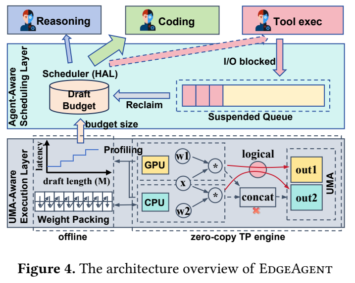
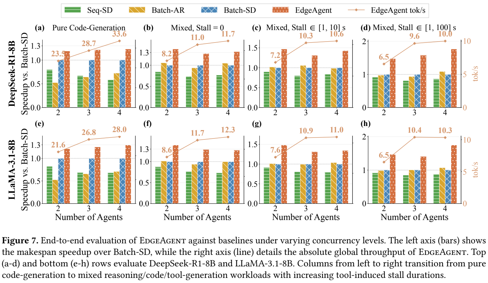

# EdgeAgent: Orchestrating On-Device LLM inference for End-User Multi-Agent Systems on CPU-GPU Unified Memory Architectures

阅读版本：[arXiv:2610.03394v1](https://arxiv.org/abs/2610.03394v1)，2026-10-02；[本地 PDF](resources/edgeagent-2610.03394v1.pdf)。2026-10-30 阅读全文 15 页，正文至 p13，参考文献 p13–15，无附录。下文页码为 PDF 的 1-based 页码。PDF 带 ASPLOS 2027 引用信息，[作者主页](https://dujiangsu.github.io/)确认录用；本次未找到可确认的官方实现入口，未检查源码或运行推理。实验数字均为作者报告。

## 研究问题与核心思路

**这篇最有价值的判断是：统一内存消除了显式搬运的必要，却没有消除共享带宽竞争。** 在普通单 token decode 中，把 CPU 加进来不一定更快；先用推测解码增加一次读权重产生的有效工作，再优化跨设备写结果与调度，才可能把额外算力用起来。

论文针对同一端侧设备上的多个协作 agent：有的在做难预测的推理，有的输出较易预测的代码或工具调用，有的等待外部工具。它把问题拆为两层：

- **执行层：** 在 Apple M4 上，以不同的权重布局服务 CPU SME 和 GPU；两者分列计算，直接写入同一输出 buffer 的不同区域，用逻辑依赖节点替代实际 concat 拷贝。
- **调度层：** 总推测预算固定为 16 个 token slots，用历史接受长度分配给不同 agent；工具等待时让出 slots，保留原地 KV 状态，返回后继续执行。

其收益来源是计算、图执行和服务调度的组合，**不是低比特量化**。本文模型及张量运算均为 FP16。（§2–4，p3–9）

*原文 Figure 4，arXiv v1，PDF p5；原始裁剪及来源坐标见 [asset-sources.yaml](resources/asset-sources.yaml)。HAL 分配的是 draft slots，底层再把验证计算映射到 CPU/GPU。*

### 为什么单 token decode 的 CPU–GPU 并行会失效

Table 1（p4）测的是统一读负载的有效带宽，不能直接当作模型 tok/s：

| 矩阵 K×N | CPU GB/s | GPU GB/s | 同跑 GB/s | 同跑 / GPU |
| --- | ---: | ---: | ---: | ---: |
| 4096×4096 | 66.1 | 54.3 | 73.9 | 1.36× |
| 4096×14336 | 68.9 | 80.3 | 91.3 | 1.14× |
| 14336×4096 | 68.8 | 80.6 | 90.8 | 1.13× |
| 4096×28672 | 71.5 | 88.9 | 93.4 | 1.05× |
| 4096×128256 | 72.0 | 96.7 | 95.4 | 0.99× |

矩阵放大后 GPU 已接近 120 GB/s 标称共享总线的有效上限，CPU 同时读不会使两个带宽简单相加。推测验证把多个候选 token 合成矩阵运算，才能摊薄读权重开销；但候选被拒绝太多时，额外计算同样会浪费带宽。论文在 M4、DeepSeek-R1-Distill-Llama-8B 上展示：结构化任务在 draft length 16 达到 1.69×，继续增加长度收益下降；难推理任务的最佳区间更早出现。（Figure 3，p3）

## 实现路径

### 1. 所有线性投影按输出列切分，attention 按 head 切分

对 $W\in\mathbb R^{K\times N}$，在加载时固定每层的切分比例 $\alpha$，CPU 处理前 $n=\alpha N$ 列，GPU 处理其余列。两者读同一输入 activation，写同一预分配输出的互不重叠列范围；包括 gate/up/down 和 Q/K/V/O 投影。**这里采用列并行，避免了 partial sum 的跨设备归约。** 比例依据各层 K/N 维度来平衡 CPU/GPU 时间，论文没有给出足以独立重建该比例的完整模型与参数。（§3.1.1，p5–6）

Attention core 则按 head 分组：GPU 做 fused SDPA，CPU 做 grouped matmul，各自完成对应 head 的 score、softmax 和 context；随后沿 head 轴合并，再进入列并行 O 投影。

- GPU 权重分片保留线性 SIMT 布局。
- CPU 分片在初始化时重排为 **16×64 FP16 tiles**；重排后释放原 CPU 分片的未打包副本。
- 作者据此说明模型权重只保留一份。这个“一份”描述的是分片权重驻留，不包括草稿模型、KV、activation 和初始化临时峰值，也不是把同一份字节同时解释为两种 layout。

### 2. 零拷贝仍需要明确的完成依赖

普通 concat 会分配新连续数组并拷贝两份结果；直接绕过 concat 又可能让后续算子在生产者未完成时读到旧值。论文改造 MLX C++ 图执行器，提供两个机制：（§3.1.1，p6）

1. **Logical Dependency Barrier：** 在 DAG 上等待 CPU、GPU 两个生产者；物理上仅 alias 已有输出 buffer，不分配或拼接数据。
2. **Heterogeneous Fast Path：** 对这段子图直接并发派发 CPU/GPU 工作，绕过通用调度循环中的保守同步。

它依赖设备的统一地址与一致性域，并且承认 Metal 是弱内存模型。论文说无需额外 hardware fences，同时又要求 producer–consumer 的 happens-before；因此工程上必须落实两个生产者完成到消费者启动的顺序。仅有“写不同列”能够避免写写冲突，**不能代替完成同步**。没有源码时，尚不能确认该 barrier 对应的具体 Metal command completion / event 与 CPU 可见性操作。

### 3. SME 内核把离线布局和在线调度结合

CPU 端将多向量连续 load（`svld1_x4`）与 outer-product accumulation 交错，K 维循环展开，利用四个 ZA tiles；macro-tiling 将活动工作集控制在文中所称 8 MB 有效 L2 范围内。P/E 核速度不对称，用基于 relaxed atomics 的微块工作窃取减少静态分工的尾部等待。（§3.1.2，p6）

这是 FP16 GEMM 和权重重排工程，不是权重压缩或低比特 kernel。与 BNNS 的 kernel 对比排除了离线 packing 时间；端到端 Figure 8 则包含 packing：M4 为 13–16 s，M4 Pro 为 6.2 s，低于对应 makespan 的 5%。短请求或频繁加载模型时，这个固定成本仍值得单独计入。

### 4. HAL 按“接受个数”而非百分比分配预算

令本轮接受 token 数为 $k_i(t)$，Historical Accepted Length 为 $A_i(t)$：

$$
A_i(t)=\gamma k_i(t)+(1-\gamma)A_i(t-1),\quad \gamma=0.3,\quad A_i(0)=4.0.
$$

在每个 agent 先保留 $L_{min}$ 的前提下，把剩余 slots 按 HAL 的 softmax 分配：

$$
L_i(t+1)=L_{min}+\left\lfloor (L_{total}-NL_{min})
\frac{\exp(A_i(t)/\tau)}{\sum_j\exp(A_j(t)/\tau)}\right\rfloor,
\qquad L_{total}=16.
$$

接受比例很高但实际只产出一个 token 的请求，不会仅因比例漂亮就得到很多预算。这里 HAL 是吞吐启发式，不是预测每多给一个 slot 能增加多少接受 token 的边际收益模型。（§3.2.1，p7）

复现所需信息仍不完整：正文没有明确 $L_{min}$、softmax 温度 $\tau$ 的取值、取整后余量如何分配以及超出 $N L_{min}\le16$ 时的准入规则。作者用网格搜索选择 EMA 系数和初值，但未给出完整搜索空间。Figure 6 展示的主要是延迟随 M 的阶梯式增长；选择 16 也参考了 Figure 3 的接受收益，不能只凭延迟曲线说所有 M>16 的计算效率都恶化。

### 5. 工具等待让出计算 slots，不等于释放 KV 内存

调度器在验证步边界检测工具调用，把 agent 移到 suspended queue，收回其 draft slots，分给其他 active agents。KV cache 仅原地冻结元数据并保留，工具返回后通过 offset remapping 恢复，不重新 prefill。（§3.2.2，p7–8）

因此它节省的是复制和重算，不是保证等待期间 KV 不占内存。论文将恢复称为零开销，并在图注中称微秒级切换；未给独立分布测量来支持所有恢复路径都没有调度成本，也未展示内存紧张时 suspended KV 的回收策略。

## 实验条件与关键结果

### 硬件、模型和负载

| 项目 | 论文条件 |
| --- | --- |
| 主平台 | Apple M4：32 GB 统一内存，120 GB/s，CPU 4P+6E，10 核 GPU，SME2 |
| 补充平台 | M4 Pro：64 GB，273 GB/s，CPU 10P+4E，20 核 GPU；主要用于关键消融 |
| 目标模型 | DeepSeek-R1-Distill-Llama-8B；Llama-3.1-8B-Instruct |
| 精度和草稿框架 | 所有模型/张量 FP16；EAGLE-3 草稿生成与验证；未提供完整 checkpoint/版本配置 |
| 并发 | 2、3、4 个 active decoding agents；系统总 draft slots 16，不等于请求 batch 为 16 |
| 软件 | 修改 MLX C++ executor，CPU SME + GPU Metal；未提供完整 OS/MLX/compiler 版本 |
| 基线 | GPU-only Batch-AR；单流 Seq-SD（EAGLE-3）；GPU-only Batch-SD（batched EAGLE-3，固定每请求 draft 16） |
| 工作负载 | 真实数据集 prompt 构成合成 trace，默认推理:代码:工具=1:2:2；不是完整真实工具闭环应用 |
| 到达与等待 | makespan 用 Poisson 到达及 agent 内延迟；峰值吞吐取消到达延迟保持饱和；工具停顿注入 log-uniform [1,10] 或 [1,100] s |

Table 2（p8）的平均 prompt tokens：LongBench 3950、MBPP 36、ToolBench 114；固定 draft 16 时，Llama / DeepSeek 平均接受长度分别为 1.19/1.24、2.67/6.33、2.81/4.98。论文正文的简写 LongBench、ToolBench 对应参考文献 LongBench v2 和 StableToolBench；记录具体数据时不能直接混作早期同名版本。正文未统一提供每请求输出长度、采样参数、到达率、任务总量和随机种子。

默认 1:2:2 混合避免了推理任务最后独占队列的长尾；作者另测 1:1:1 到 1:4:4，HAL 增益随结构化输出占比上升，M4 为 1.058×、1.094×、1.181×，M4 Pro 为 1.087×、1.141×、1.217×（Figure 9，p10）。它显示机制依赖任务可预测性，不能外推成任意 agent 工作负载的固定收益。

*原文 Figure 7，arXiv v1，PDF p10。柱状图左轴是相对 Batch-SD 的 makespan 加速比；折线右轴是 EdgeAgent 的聚合 tok/s。不能把两者混为同一个吞吐加速指标。*

### 对理解机制最重要的结果

| 结果 | 条件与对照 | 解释 |
| --- | --- | --- |
| 33.6 / 28.0 tok/s；1.29× | M4，N=4，纯代码、无工具停顿；DeepSeek / Llama，Batch-SD 基线 | 正文把 1.29× 归到 SME+零拷贝执行层；Figure 7 的加速柱是 makespan，折线才是聚合吞吐 |
| 213.1 → 120.6 s，即 1.77× | DeepSeek，N=4，混合工作负载，注入 [1,100] s 工具停顿 | 含执行层、HAL 与 yield 的完整系统；不是普通 decode 的 1.77× |
| HAL 另增 1.05–1.17× | Figure 8 的对应 UMA-aware 配置上，M4/M4 Pro，N=2–4 | 分步消融优于把完整增益全部算给张量并行 |
| 1024-token prefill 达 304.5 tok/s，约 1.31× | CPU+GPU vs GPU-only；GPU 约 232 tok/s，CPU 约 132 tok/s | 利用计算密集区间；§4.3.1/图注未明确该单项使用两个目标模型中的哪一个 |
| 4096-token TTFT 21.0 → 16.2 s | 同一 prefill 对照，GPU-only vs CPU+GPU | 约 22.9% 延迟下降，不是 31% 延迟下降 |
| 19 → 85 GFLOPS，4.47× | down projection 14336×4096，M=1，自定义 SME vs BNNS，排除离线 packing | 单 GEMM kernel 结果，不能当端到端加速 |
| 639.3 GFLOPS → 2.07 TFLOPS，3.24× | 同投影 M=4096，与 BNNS 比较 | 大 M prefill kernel；2.07 TFLOPS 约为论文 2.3 TFLOPS 峰值的 90% |
| 881 tokens：434 → 388 s，1.12× | 三 agent，HAL vs uniform draft=16，Figure 13 | 此例展示动态预算；固定每请求 16 与总预算 16 的计算量并不相同 |
| 286 → 238 s；9.9 → 11.4 tok/s | 三 agent，有工具等待，yield vs no-yield，Figure 14 | 时长比例约 1.20×，吞吐比例约 1.15×；原文未解释两指标的统计分母差别，不能互相换算 |

来源：§4.2–4.5，PDF p9–13。Figure 11 另显示 4096×14336 投影、M=128 时 concat 0.90 ms 降为 barrier 0.04 ms，约 2.8 ms 计算之上得到约 1.31× 单投影收益；小 M 的 barrier 仍为 0.29–0.39 ms。这里的零拷贝是零数据拼接，不是零同步耗时。

## 理解、局限与疑问

### 对当前研究方向的价值

**优先读它来理解统一内存上的异构执行，而不是寻找现成量化实现。** 与 [FreeToken](../freetoken/notes.md) 的 CPU 主存—PCIe—独显模型不同，EdgeAgent 的 CPU/GPU 共享总线：少一次复制很重要，但额外并发读可能直接抢占 GPU 带宽。它与 [HeteroInfer](../heteroinfer/meta.yaml) 的关联更直接，适合比较不同 SoC 上的算力/带宽比例、切分粒度与后端约束。

- **Orin / 高通：** 可移植的思路是先实测共享带宽饱和、按实际 kernel 性能选切分比例，再把独立结果写回与消费者完成依赖表达清楚。不能把 M4 的 SME2、Metal 一致性语义或 16-slot 最佳点原样复制。本文没有 Orin、高通或 NPU 实验。
- **独显 PC / 工作站：** HAL 和工具让出 slots 的策略有可借鉴性；零拷贝输出 buffer 的 UMA 前提不成立，仍需传输和同步成本建模。论文 §5 也区分了这两层的可迁移性。
- **量化工程：** 低比特会减少权重流量，同时加入 unpack/scale 和可能不同的 CPU/GPU 最优布局；其影响需要重新测量。论文 FP16 结果只能帮助提出这个问题，不能证明量化后仍保留相同加速。

### 复现前最应确认的条件

1. **固定预算对照。** Batch-SD 是每请求 16，EdgeAgent 是全局 16。已有比较回答整个系统设计谁更快；若要单独衡量 HAL，应再对齐全局总预算，与全局 16 的均分策略比较。Figure 8、9 也未完整交代这个等预算细节。
2. **吞吐公平性。** HAL 用接受数量而非边际收益，已多获预算的 agent 容易积累更高 HAL；$L_{min}$ 能防止完全饿死，却不构成延迟公平或 deadline 保证。文中没有每请求尾延迟/公平性分布。
3. **内存与同步的可执行证据。** 需要实际 barrier/alias 生命周期、CPU/GPU 完成事件、KV 暂停/恢复路径，以及整机峰值内存。仅共享物理内存不自动保证无需缓存维护或同步。
4. **真实服务边界。** 合成停顿和 prompt 混合能隔离调度机制，但不包含所有真实工具返回后的新上下文、输出分叉与用户交互。也未报告功耗、热稳态及能耗/token，手机部署收益不能仅用 tok/s 判断。

论文已足以支撑“先提高有效算术强度，再做 UMA 感知执行”的研究方向；要把它当作可直接复用的工程组件，下一步关键是取得实际 MLX 改造和测试配置，而非只复刻 HAL 公式。
