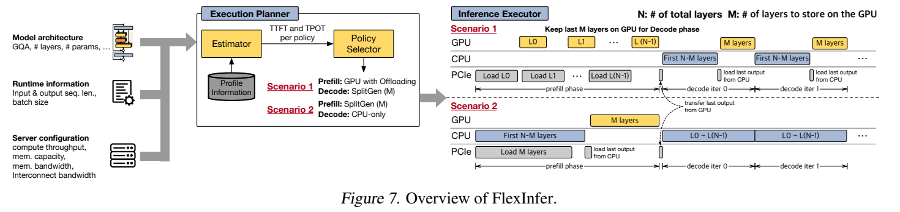
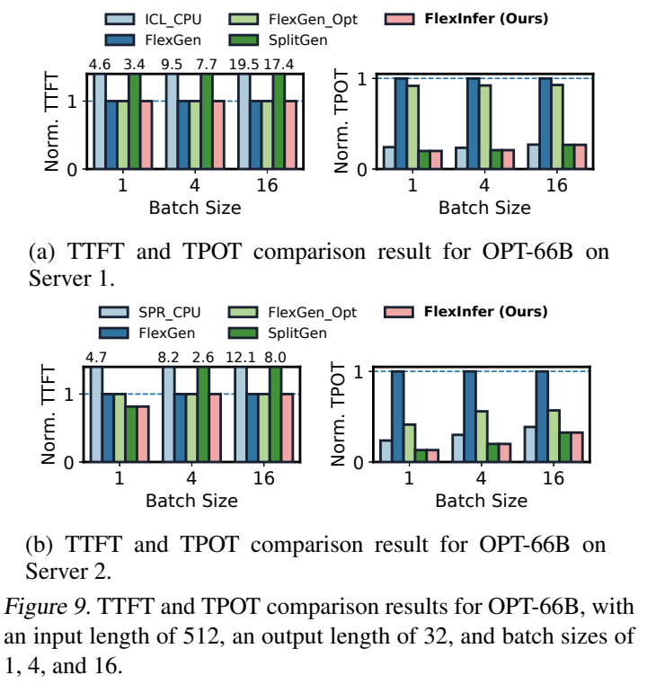

# FlexInfer: Flexible LLM Inference with CPU Computations

来源：[MLSys 2025 发表页](https://proceedings.mlsys.org/paper_files/paper/2025/hash/698cfaf72a208aef2e78bcac55b74328-Abstract-Conference.html) · [本地 PDF](resources/flexinfer-mlsys2025.pdf)。阅读范围：发表版全文 14 页，正文至 PDF 第 11 页，余下为参考文献；无附录。以下页码均指 PDF 页码。整理日期：2026-10-30。

**最值得带走的结论：GPU 放不下模型时，prefill 和 decode 不必采用同一种执行策略。** 在权重每轮都要经 PCIe 搬入 GPU 的条件下，让 CPU 直接计算一部分层，可能比让更快的 GPU 等数据更划算。FlexInfer 的主要贡献是根据硬件和请求形状分别选策略，而不是设计新的量化方法。

## 研究问题与核心思路

### 问题出在反复搬运，而不只是显存容量

论文针对主机内存能容纳模型、单张 GPU 显存不足的部署。传统逐层卸载把权重与 KV cache 留在 CPU 内存，运行时再搬到 GPU。即便将下一层传输与当前层计算重叠，decode 的计算窗口仍可能短于传输时间，留下大量显式等待。

作者用 OPT-66B、LLaMA2-70B，在输入 1024 token、输出 32 token、batch 1–32 的条件下分析 FlexGen：A100 平台暴露出的 PCIe 传输占总时间约 89.2%–97.6%，H100 平台约 86.3%–96.2%，具体区间随模型变化。这些比例针对论文的全主机驻留基线配置，不是所有 GPU 推理的通用比例。（§3.1，图 3，pp.3–4）

CPU 的优势是就地访问容量较大的内存；GPU 的优势是高计算吞吐。prefill 同时处理输入序列，通常值得承担搬运成本换取 GPU 算力；decode 每步每序列只增加一个 token，在反复搬权重的基线下，CPU 的低搬运成本可能胜过 GPU 的计算优势。AMX 提高 CPU 的矩阵计算能力，因而会改变策略切换边界。（§3.2，图 4–5，pp.4–5）

### 三种策略，分别为两个阶段选择

| 策略 | 权重与计算如何分配 | 主要代价与适用条件 |
| --- | --- | --- |
| CPU-only | 所有层、权重和 KV cache 在 CPU 侧 | 没有 CPU–GPU 数据搬运，但长输入或大 batch 时 CPU 计算容易成为瓶颈 |
| GPU with offloading | 全部层在 GPU 上算，权重及 KV 按需从主机搬入 | 可重叠计算与传输，但 GPU 很快时仍可能被 PCIe 限制 |
| SplitGen | 前 `N−M` 层由 CPU 计算，后 `M` 层由 GPU 计算；尽量让后者常驻显存 | decode 不再反复传 GPU 部分的权重，只在分割边界传激活；prefill 仍可能被 CPU 前段拖慢 |

SplitGen 的 CPU **真正执行完整 decoder 层**，不是只承担存储或只计算 attention score。它也不是把同一层的矩阵乘法拆成 CPU/GPU tensor parallelism；同一请求依次经过 CPU 前段和 GPU 后段。这里主要重叠的是数据搬运与计算，不能从“异构执行”直接推断两端一直同时计算。（§4，图 6，pp.5–6）

## 实现路径

### Planner：分析模型，再用离线测量修正硬件峰值

Execution Planner 输入包括模型层数、参数规模、GQA 等结构信息，输入/输出长度与 batch，以及 CPU/GPU 算力、内存容量、内存带宽和互连带宽。它估算每种策略的 TTFT 与 TPOT，再分别选择 prefill、decode 策略。不同形状的实际效率来自离线 profiling，而不是直接把峰值 TFLOPS 当作可达到的吞吐。（§5.1–5.2，pp.6–7）

*原论文图 7，PDF p.6。Scenario 1 在 GPU 卸载式 prefill 后保留尾部层，decode 改用 SplitGen；Scenario 2 则从 SplitGen prefill 切换到 CPU-only decode。原图摘取，未改写图中数据。*

估算模型的关键结构是：

- **设备内的每层时间**按计算量除以有效算力，加上数据量除以有效内存带宽估算。有效性能含离线测得的效率因子。
- **GPU 卸载的每层时间**取 GPU 计算/访存时间与 PCIe 传输时间两者的较大值，表达理想重叠后的关键路径。
- **SplitGen prefill**先重叠 CPU 前段计算和 GPU 尾部层的初始加载，再加上边界激活传输与 GPU 后段计算：`max(CPU前段计算, GPU尾部权重加载) + 边界传输 + GPU后段计算`。
- **SplitGen decode**尾部权重已在显存中，关键路径成为 `CPU前段计算 + 边界传输 + GPU后段计算`，少了每步重载整片权重的项。

以上按 §4.3 的时间线解释机制；论文完整解析式见 §5.2 的式 (1)–(3)，p.7。`M` 取可装入显存的最大层数，容量判断还须容纳该部分的 KV cache 和执行所需空间。

“动态”在这里主要指根据请求形状、硬件和阶段选策略。论文没有给出面向请求到达/退出、持续 batching、尾延迟 SLO 的在线调度实验，不能把它等同于完整在线服务调度器。

### Executor：阶段切换时同时处理权重和 KV 的位置

以“GPU 卸载 prefill → SplitGen decode”为例：

1. prefill 逐层在 GPU 运行，用独立 CUDA stream 搬下一层数据。
2. 将最后 `M` 层的权重及其生成的 KV cache 留在 GPU；前 `N−M` 层的权重和 KV 留在 CPU。
3. 每个 decode step 先在 CPU 跑前段，把边界激活交给 GPU，再跑显存中的尾部层。

因此，策略切换并非仅修改一个“使用 CPU”的开关；权重驻留、KV 所有权、跨设备激活、同步时机都必须配套。（§5.3，p.7）

实现基于修改后的 Hugging Face 与 Intel Extension for PyTorch（IPEX），CPU 端使用针对 Ice Lake AVX-512 或 Sapphire Rapids AMX 的优化 kernel，GPU 通信使用独立 CUDA stream。实现支持 OPT 和 LLaMA 模型家族。（§3.2、§5.4）

表 3 以 **BF16 算力**描述硬件，但 §6.1 没有逐项列明权重、激活、KV 的 dtype，也没有完整列出软件版本。精确复现时需要补齐这些配置。本文没有提出低比特格式、校准方法或量化 kernel；其工程价值是可与量化结合的放置与调度层。

## 实验条件与关键结果

### 两个平台都是双路服务器，不是消费级 PC

下表按原论文表 3、§6.1（p.8）整理。CPU/GPU 算力均为 BF16 口径；CPU 算力按基频计，内存带宽由 STREAM 测量，PCIe 带宽是单方向标称值。

| 条件 | Server 1 | Server 2 |
| --- | --- | --- |
| CPU | 2 × Xeon 8352Y，Ice Lake，无 AMX | 2 × Xeon 6454S，Sapphire Rapids，有 AMX |
| CPU 算力 | 9.0 TFLOPS | 144.2 TFLOPS |
| 主机内存 / 带宽 | 256 GB / 311.8 GB/s | 512 GB / 407.8 GB/s |
| GPU / 显存 | A100 / 40 GB | H100 / 80 GB |
| GPU 算力 / 显存带宽 | 312 TFLOPS / 1299.9 GB/s | 756 TFLOPS / 1754.4 GB/s |
| CPU–GPU 互连 | PCIe 4.0，32 GB/s | PCIe 5.0，64 GB/s |

默认模型为 OPT-30B、OPT-66B、LLaMA2-70B、LLaMA3-70B；输入 512 token、输出 32 token，batch 扫描 1、2、4、8、16、32。比较 CPU-only、FlexGen、FlexGen Opt、SplitGen 和 FlexInfer。FlexGen 基线把所有权重及 KV 放在 CPU 内存；FlexGen Opt 则利用可用 GPU 容量放置部分权重、激活及 KV。论文 p.8 脚注明确计入初始权重加载时间，因此不能直接当作长期常驻服务的稳态延迟。

### 获益主要来自 decode，但 prefill 不能被拖慢

以下均为**作者报告**，减幅相对于同平台 FlexGen；本次未运行性能复现。

| 比较 | 实验条件与来源 | Server 1 | Server 2 |
| --- | --- | --- | --- |
| FlexInfer 平均 E2E 延迟减幅 | 四个模型，默认长度，batch 1–32；图 8、§6.2 | 75% | 76% |
| FlexGen Opt 平均 E2E 延迟减幅 | 同上 | 23% | 50% |
| SplitGen 平均 E2E 延迟减幅 | 同上 | 37% | 61.7% |
| FlexInfer 平均 TPOT 减幅 | OPT-66B，输入 512、输出 32，batch 1/4/16；图 9 | 77.7% | 79.6% |
| FlexInfer TTFT 变化 | 同上 | 与 FlexGen 相当 | 减少 6.6% |
| FlexInfer 平均 E2E 延迟减幅 | 四个模型，batch 16，输出 32，输入 128–1024；图 10、§6.4 | 72.9% | 70.2% |
| FlexInfer 平均 E2E 延迟减幅 | OPT-66B，batch 16，输入 512，输出 128–1024；图 12、§6.5 | 73.3% | 70.5% |

75%/76% 是**延迟降低比例**，不是额外提升 75%/76% 的吞吐。图 8 主要展示归一化延迟，不能据此反推出绝对 token/s。论文也没有用固定 TTFT/TPOT SLO 下的服务容量来评价在线吞吐。

*原论文图 9，PDF p.9。每个服务器都归一化到自身 FlexGen；输入 512、输出 32，batch 为 1、4、16。大于图中纵轴范围的 TTFT 用柱顶数值标注。*

图 9 的重点不是所有柱子都下降，而是 **CPU-only/SplitGen 虽能降低 decode 的 TPOT，却可能显著增加 TTFT**。FlexInfer 在 Server 1 的 prefill 选择 GPU 卸载路径，保住 TTFT，再在 decode 使用更少搬运的策略；有 AMX 的 Server 2 则能在部分形状下更积极利用 CPU。（§6.2，pp.8–9）

图 11 提供了机制上的直接证据：OPT-66B、batch 16、输入 512、输出 32 时，FlexGen 的 decode PCIe 流量标为 141.5 GB，而 SplitGen/FlexInfer 标为 0.3 MB，反映“反复搬权重/KV”转为“传边界激活”。该图纵轴写的是 per token，但配置包含 batch 16，跨系统比较前需要确认统计粒度是一个 batch 的 decode step 还是单序列 token。不能把这两个数直接当作个人聊天 batch 1 的流量。（§6.3，图 11，p.10）

## 理解、局限与疑问

### 对当前研究方向的价值

**优先把它当作离散 CPU–GPU 平台的分阶段调度基线。** 从论文机制推断，最适合迁移的不是某个固定切层比例，而是“为每个阶段估算计算、访存、搬运，再选执行位置”的方法。PC、独显笔记本和小型工作站仍有 PCIe 与显存约束，但其 CPU 内存通道、AMX 支持、功耗上限和持续带宽与双路 Xeon 差别很大，需要重新测量效率因子，不能沿用论文中的胜负边界。

对量化工程，一个有价值的扩展是把 **精度/格式也放进策略成本模型**：压缩权重会降低 PCIe 流量、提高可驻留层数 `M`，但增加解包/反量化代价，并可能改变 CPU 与 GPU kernel 的相对效率。只把权重字节数乘以压缩率不够；应将量化后的实际 kernel 吞吐、KV 容量和阶段切换成本一起计入。以上是基于本文机制的研究延伸，不是作者已经验证的实验结果。

Jetson/Orin、高通手机等统一内存设备不具备本文这种独立 CPU DRAM 与 GPU 显存之间的同型 PCIe 搬运路径。可以借鉴阶段感知放置，但要重新分析共享 DRAM 带宽竞争、缓存一致性、同步和功耗；论文没有在这些设备上评测。

### 哪些问题还需要确认

1. **基线与工作负载范围。** 最大收益相对于全主机驻留的 FlexGen；论文提供了更合理的 FlexGen Opt 对照，但未报告与当前低比特 CPU/GPU 后端在相同精度、内存预算和服务目标下的比较。实验是给定长度和固定 batch，未覆盖请求混合、取消或长时间连续服务。
2. **估算器本身缺少误差与开销评测。** 文中解释了离线效率修正，却没有给出 profiling 成本、各策略预测误差、选错策略的损失或 planner 运行时间。若输入/输出长度不预知，尤其是实际生成长度变化，策略如何调整也未充分展开。
3. **SplitGen 解析式的记号需要澄清。** p.7 式 (1) 的 CPU decode 访存项显式包含 `D_KVCache`；式 (3) 的 SplitGen CPU 部分却只写 `D_Decode`，GPU 部分仍显式包含 KV 项。实现时要确认 CPU 侧 KV 访问是否已并入 `D_Decode`，不能照抄后漏计。式 (3) prefill 的传输项与 §4.3“加载后 M 层”的文字描述也需要统一计量范围。
4. **可复现信息尚不完整。** 本次阅读的发表版未提供 FlexInfer 自身的代码入口；参考文献里的 IPEX 链接不是 FlexInfer 实现。软件版本、张量 dtype、CPU 线程/NUMA 绑定、显存容量分配和加载计时边界都应作为后续复现的明确输入。

**我的判断：** 这篇论文适合建立“CPU 计算是否值得做、prefill/decode 是否应分开”的系统模型。若目标是手机/Orin 或实用低比特推理，应把量化格式与真实内核性能加入模型，而不是直接移植作者在 A100/H100 上的层切分结果。
