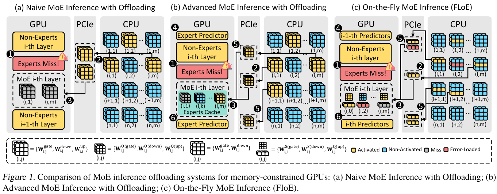
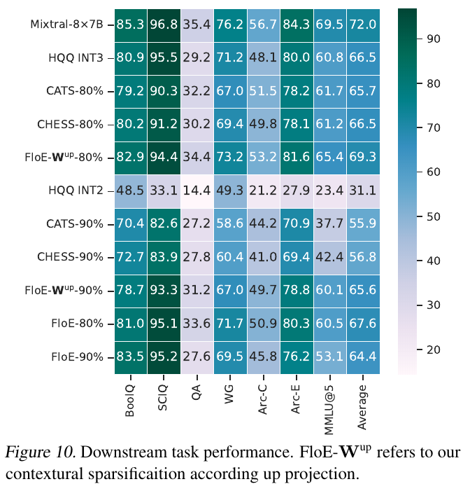

# FloE: On-the-Fly MoE Inference on Memory-constrained GPU

> **阅读版本**：ICML 2025 / PMLR 267，24 页；阅读日期：2026-10-30。已读正文及附录 A–F，并核对关键公式、图表原页。下文页码均为 1-based PDF 页码，与本版印刷页码一致。
>
> **来源**：[发表页](https://proceedings.mlr.press/v267/zhou25j.html) · [本地 PDF](resources/floe-icml2025.pdf) · [作者代码](https://github.com/zju-stu-lizheng/FloE)。实验数值来自论文；实现部分另有只读代码检查，未运行推理。

## 研究问题与核心思路

**FloE 最值得学习的是：把量化和动态稀疏化分配给不同矩阵，再把这种表示变成实际少搬数据、少做计算的执行路径。** 它面向显存放不下完整 MoE、但主存可以存放专家权重的单卡推理，重点是 batch = 1 的解码。非专家权重常驻 GPU，专家主体留在 CPU DRAM，需要时搬入。问题从显存容量转为 PCIe 传输延迟：论文举例，Mixtral-8×7B 的一个 FP16 专家超过 300 MB，PCIe 4.0 ×16 搬运约 15 ms，而 RTX 3090 上计算约 5 ms（§3.1，p.3；这是动机示例，不是后文压缩后专家的时延）。

FloE 同时处理两种稀疏性：路由器只选择少数专家；被选中的专家内部也有很多幅值很小的中间激活。第二种稀疏性才是本文减少专家搬运量的关键。

*原文 Figure 1，ICML 2025 发表版，PDF p.3。图中的小块表示专家矩阵或其被选择的部分；FloE 预取的是压缩、稀疏后的专家内容。原图来源与裁剪参数见 [asset-sources.yaml](resources/asset-sources.yaml)。*

### 为什么量化 up，而稀疏化 gate / down

一个 SwiGLU 专家的计算为：

$$
y=\bigl[\operatorname{SiLU}(xW_{\mathrm{gate}})\odot(xW_{\mathrm{up}})\bigr]W_{\mathrm{down}}.
$$

FloE 先计算完整的 up 输出 $v=xW_{\mathrm{up}}$，用 $|v_j|\ge t$ 选择中间通道，只计算对应的 **gate 列和 down 行**。在 PyTorch 的转置权重布局中，具体行列方向会相反；要保留的是同一个中间神经元关联的两个权重向量。

- **up：HQQ INT2 权重量化，仍需完整参与投影。** up 输出既用于计算又用于决定稀疏掩码，不能把它与 gate / down 一样全部按掩码跳过。
- **gate / down：保留较高精度，利用上下文动态稀疏性。** 本次检查的实现使用 FP16 计算与权重缓冲区。这里的“激活稀疏”是把低幅值通道置零，不是激活量化。
- **阈值需要离线数据。** §3.2 的式 (6) 使用通用语料采样得到每个专家绝对激活值的经验分布，再取目标稀疏率对应的分位数。因此 HQQ 无需校准数据，不等于整个 FloE 无需数据准备。

直接按 down 的输入裁剪，质量通常更稳，但要先完成 gate、up、SiLU 和逐元素乘法，只能节省后面的 down；按 up 输出裁剪可以同时省去 gate 和 down 的工作，而且其线性映射方便提前预测。这是质量与执行依赖之间的取舍（§3.2，pp.4–5）。附录 A 在随机权重、激活分布及独立性等假设下分析期望输出误差，支持 down 输入裁剪优于 up 输出裁剪、up 又优于 gate 的排序；实际模型的任务准确率仍需实验判断。

**“9.3× 压缩”不能理解为整个主存模型缩小 9.3 倍。** 按三个矩阵同大小、gate / down 使用 FP16、两者各保留 10%、up 使用 INT2，忽略 scale / zero / 索引等开销，所需有效权重字节数相对原专家约为：

$$
\frac{3}{2/16+0.1+0.1}\approx9.23.
$$

这是帮助理解论文约 9.3× 数字的理想化核算：主存中的 gate / down 仍须保留完整内容，以供不同 token 选择；运行时还有非专家参数、KV cache、预测器和缓冲区。公开代码还把量化 up 放到 GPU，不是每步把三个矩阵一起搬运。

## 实现路径

### 先预测下一层需要什么，再重叠传输与计算

只有压缩不够：若必须等待下一层真实输入，才能完成路由、up 投影、选择通道和传输，依然会串行等待。FloE 利用相邻层输入 hidden states 的相似性，在当前层执行时预测下一层的需求（§3.3，pp.5–6）。

| 对象 | 论文方法 | 准备与运行代价 |
|---|---|---|
| 下一层激活哪些专家 | 根据前层 hidden state 和专家选择轨迹训练小型 MLP，按层调整规模，约 32K–2M 参数 | 需要预测器训练与参数存储；预测错误会产生额外加载 |
| 专家内部保留哪些通道 | 复用下一层的 up 矩阵，用当前 hidden state 提前做投影，预测掩码 | 不新增专用预测矩阵，但仍有投影、选通道与同步成本 |

论文在 ShareGPT 的 100 条、长度 256 的序列上分析相似性；§3.3 报告专家预测平均 precision 为 0.88，通道预测平均 recall 为 0.95。Figure 4 图注把两种预测器的名称写反，以上采用正文和图例的对应关系。早层预测较弱，也不能由“平均 recall 0.95”推出所有 token 的关键通道都不会漏选。

公开的 `PipelineLLM` 使用多个 CUDA stream 和双缓冲区，真实路由与预取专家不一致时进入冲突重载路径。预取没有消除全部等待：需要计入预测、CPU 选取、H2D 传输、stream 同步及错误重载，才能判断是否值得重叠。

### 稀疏 kernel 与内存布局各自解决什么

**GPU 计算路径**（Algorithm 1、§3.4.1，p.6）：基于 Triton 的稀疏 GEMV 只读取掩码选中的 gate / down 权重；将 gate 投影、SiLU 和逐元素乘法融合，减少中间结果读写及 kernel launch；down 权重转置以便连续访问。它是稀疏浮点计算路径，不能直接当成“INT2 Tensor Core kernel”。

**CPU → GPU 传输路径**（§3.4.2、Figure 5，p.7）：

1. 将同一个中间神经元对应的 gate 列和 down 行在 DRAM 中相邻放置，基础连续块从 `d_hidden × 元素字节数` 变为其两倍。
2. 多线程配合 AVX-512，把离散的已选通道组装进 pinned memory。
3. 通过多个 CUDA stream 异步搬到 GPU，使组装、传输和 GPU 计算尽量重叠。

这部分 CPU 工作主要是选择、打包和搬运；不同于把专家矩阵乘法交给 CPU 执行的 Fiddler。减少 PCIe 字节数也不等于减少全部主存流量：从完整专家权重 gather、写入 pinned buffer 都需要 CPU 内存带宽。

### 公开代码能确认到哪一层

以下检查针对作者仓库 `main`，访问于 2026-10-30；它补充论文，但不能自动视为论文实验配置的完整快照。

| 文件 | 观察到的实际路径及条件 |
|---|---|
| [`start.py`](https://github.com/zju-stu-lizheng/FloE/blob/main/start.py) | 有 HQQ 量化模型加载、`PipelineLLM` 转换和 `llm.generate` 计时入口。注释中的首次量化示例只量化 `experts.w3`，配置 `nbits=2, group_size=64`；激活计算 dtype 为 FP16。当前激活的是 `HQQBackend.PYTORCH`，`prepare_for_inference` 被注释，不能因 `backend = "gemlite"` 变量就认定已启用 GemLite 的低比特融合 kernel。 |
| [`modeling/convert.py`](https://github.com/zju-stu-lizheng/FloE/blob/main/modeling/convert.py) | 将各专家的 HQQ up 模块放在 GPU，gate / 转置 down 按层留在 CPU 或常驻 GPU；创建 pinned 缓冲区与两个 `CachedMLP`。卸载路径使用 up 输出绝对值的 `topk` 固定选择通道，再 `copy_(..., non_blocking=True)`。`CachedMLP.forward` 使用压缩后矩阵的 PyTorch matmul；GPU 常驻专家被切换到另一条 `kernel_forward` 路径。不能把所有专家计算都统称为同一个 Triton 稀疏 kernel。 |
| [`kernel/kernels.py`](https://github.com/zju-stu-lizheng/FloE/blob/main/kernel/kernels.py) | 能看到掩码读取、gate / SiLU / 乘法融合和转置 down 的 Triton 实现；这是稀疏计算证据，不足以单独证明 HQQ 的打包格式在端到端计时中由某个专用 INT2 kernel 直接消费。 |
| [`modeling/pipelinellm_cpu.py`](https://github.com/zju-stu-lizheng/FloE/blob/main/modeling/pipelinellm_cpu.py) | 有专家预测、双缓冲、stream 与预测错误重载。`start.py` 当前传入 `start_ep_idx=1, end_ep_idx=0`，不启用该区间内的学习式专家预测分支，其他分支复用 router 预测。prefill 也有独立处理，不能用 decode 的微基准解释完整首 token 延迟。 |
| [`data_transfer/ptest.cu`](https://github.com/zju-stu-lizheng/FloE/blob/main/data_transfer/ptest.cu) | 提供 AVX-512、多线程、pinned memory 和多 stream 传输测试；本次读到的是独立 C++/CUDA 测试入口，而 Python 缓存路径使用 PyTorch 选择和拷贝。未建立该传输微基准与默认 Python 生成入口使用完全相同数据通路的证据。 |

启动脚本中的模型、HQQ checkpoint、阈值和数据集路径均需配置；本地模块导入布局也需整理。README 所列环境为 Python 3.10.16、Transformers 4.47.0、PyTorch 2.5.1、HQQ 0.2.3。**它提供了可追踪的端到端生成实现，但目前不能当作已经替用户验证的即装即用后端。** 论文的阈值式稀疏、代码卸载路径的 top-k、学习式预测器启用范围，以及传输实现是否一致，是对齐论文性能前最重要的配置问题。

## 实验条件与关键结果

### 主实验是单卡、小 batch、短输入输出

| 项目 | 论文报告的条件 |
|---|---|
| 模型 | 正文 §4 全部测试使用 Mixtral-8×7B；附录的其他 MoE 主要用于敏感性分析 |
| GPU / 显存 | RTX 3090，物理显存 24 GB；Figure 6 设 12 GB 显存预算，Figure 8 扫描 12–24 GB |
| 主机 | 64 核、2.3 GHz CPU，256 GB DRAM，PCIe 4.0；没有给出 CPU 具体型号 |
| 工作负载 | ShareGPT，batch = 1，输入长度 32 / 64 / 128 token，输出长度 128 / 256 / 512 token |
| 指标 | 平均输出 tokens/s，5 次运行取平均；不是在线多请求吞吐、p99 延迟或能耗 |
| FloE 精度 | up 使用 HQQ INT2；gate / down 动态稀疏、较高精度。正文未清楚绑定 Figure 6 每组速度与 80% / 90% 稀疏率配置，不能自行把最快速度配给质量最好的一行 |
| 比较对象 | DeepSpeed-MII 使用 FP16 卸载；Mixtral-Offloading 使用专家预测、缓存及量化；Fiddler 使用 CPU–GPU 协同；Mixtral-GPU 将专家矩阵用 HQQ INT2 压缩，使模型整体驻留 GPU，作为速度参考 |

来源：[§4.1 / p.7](resources/floe-icml2025.pdf#page=7)、[Figure 6 / p.8](resources/floe-icml2025.pdf#page=8)。公开脚本的默认计时区间覆盖 `llm.generate`，不能直接解读成剥离 prefill 的纯 decode kernel 吞吐；论文也没有提供可分离的 TTFT / TPOT 表。

### 48.7×、约 2×、12.6× 是三个不同层次的结果

- **端到端生成，12 GB 预算**：FloE 相对 DeepSpeed-MII、Mixtral-Offloading、Fiddler 的平均加速分别为 **48.7×、2.60×、3.14×**。48.7× 的分母是 FP16 专家卸载的 DeepSpeed-MII，混合了数据表示、搬运和执行路径差异，不是对同质量、同量化精度基线的普遍提升。
- **相对 GPU 驻留 INT2 参考**：平均达到 Mixtral-GPU 的 **91%** 速度，最高 **95%**；该参考的七任务平均分只有 31.1，不能把它当作 FP16 质量的性能上界。Figure 8 在输入 64 / 输出 256 下，24 GB 时 FloE 达到参考的 **1.01×**。Figure 8 横轴是 VRAM；图注中的 “DRAM usage” 与正文局部措辞不一致，此处按显存预算理解。
- **最低显存**：摘要称可在 11 GB 显存运行；主实验图从 12 GB 开始。11 GB 是部署容量陈述，不是 Figure 6 已提供的实测点。
- **传输微基准**：选取一个专家 gate 的 20% 通道及对应 down 权重，重复 20 次；最佳 chunk 为每线程 50 列，达到 PCIe 4.0 实际峰值带宽的 **88%**，相对朴素 PyTorch 传输快 **12.6×**（Figure 7，p.8）。这不是完整生成再加速 12.6×。

单专家计算的 Table 1（p.8）包含完整 up GEMV、融合 SiLU、稀疏 gate / down；使用 C4 的 500 token，80 次预热、200 次计时。以 0% 稀疏为基线，90% 稀疏时：

| GPU | 0% 稀疏时延（ms） | 90% 稀疏时延（ms） | 作者列出的加速 |
|---|---:|---:|---:|
| H100 | 0.169 | 0.103 | 1.64× |
| A100 | 0.253 | 0.155 | 1.63× |
| A6000 | 0.524 | 0.263 | 1.99× |
| RTX 3090 | 0.542 | 0.283 | 1.92× |

即使跳过 90% 的 gate / down 通道，也只有约 1.6–2× 的专家计算加速：完整 up、launch 和其他固定开销仍在。它恰好说明“有效稀疏率”不能直接换算成实际加速比。

### 质量损失是主要取舍，MMLU 比平均数更敏感

LM Evaluation Harness 评估七项任务：ARC-E、ARC-C、BoolQ、SciQ、OpenBookQA、Winogrande 为 zero-shot，MMLU 为 5-shot。以下将 Figure 10 与 Table 3 的准确率统一写成百分数；“平均下降”列为本笔记相对原始模型 72.0 的百分点差值。

| 方法 | 七任务平均（%） | 平均下降（百分点） | MMLU 5-shot（%） |
|---|---:|---:|---:|
| 原始 Mixtral-8×7B | 72.0 | — | 69.5 |
| HQQ INT3 | 66.5 | 5.5 | 60.8 |
| HQQ INT2 / Mixtral-GPU 参考 | 31.1 | 40.9 | 23.4 |
| FloE-Wup，80% 稀疏，仅按 up 输出稀疏化 | 69.3 | 2.7 | 65.4 |
| FloE-Wup，90% 稀疏，仅按 up 输出稀疏化 | 65.6 | 6.4 | 60.1 |
| 完整 FloE，80% 稀疏 + up INT2 | 67.6 | **4.4** | **60.5** |
| 完整 FloE，90% 稀疏 + up INT2 | 64.4 | **7.6** | **53.1** |

来源：[Figure 10 / p.9](resources/floe-icml2025.pdf#page=9)、[Table 3 / p.22](resources/floe-icml2025.pdf#page=22)。

*原文 Figure 10，ICML 2025 发表版，PDF p.9。图中 FloE-Wup 与完整 FloE 是不同配置。另有一处原文内部不一致：CHESS-80% 的平均分在该图写为 66.5，Table 3 写为 65.7；本笔记不使用该数值判断 FloE 的优势。*

需要保留的判断：

1. 摘要的 “4.4%–7.6%” 实际对应 **4.4–7.6 个百分点**。若改算相对下降，则约为 6.1%–10.6%，不能混用。
2. 完整 FloE 的 MMLU 从 69.5 降到 60.5 / 53.1，即下降 **9.0 / 16.4 个百分点**；这比“平均损失较小”的概括更影响研究和知识类应用。
3. 与单纯稀疏化相比，再给 up 加 INT2，80% 配置的平均分额外降低 1.7 个百分点，MMLU 降低 4.9 个百分点；量化和稀疏化的代价不能合并后就省略。
4. 完整 FloE-80 的平均分比 HQQ INT3 高 1.1 个百分点，但 FloE-90 低 2.1 个百分点。因此“FloE 始终比 INT3 质量好”不成立。
5. 附录 Table 4 的 “FloE-80% / 90%” 使用 MMLU 65.4 / 60.1，与 Table 3 的 **仅稀疏化**行吻合，而非完整 FloE 的 60.5 / 53.1。其 GSM8K、HumanEval 数据不宜直接归到“up INT2 + 稀疏化”完整方案，需先确认该表配置。

## 理解、局限与疑问

### 对本仓库研究方向的价值

**对独显台式机、显存受限笔记本、小型工作站，FloE 很值得优先研究。** 它把矩阵敏感性、低比特存储、稀疏 kernel、主存布局和预取流水线放进同一个问题，符合“必须有真实推理实现”的量化工程方向。最可迁移的原则不是固定使用 INT2，而是：保留决定掩码所需的完整投影，对可动态省略的矩阵优先稀疏化，再按照实际传输块和访问粒度设计存储。

但实验主机是 **64 核 / 256 GB DRAM**。普通 PC 或笔记本的 CPU 内存带宽、核心数、AVX-512 支持及 PCIe 连接不同，打包可能先成为瓶颈；主存仍需容纳未永久裁剪的专家权重。比较这类机器时，应关注 H2D 字节量、CPU gather / pack 时间、GPU 空等和最终 token/s，而不只看 CUDA kernel 时延。

**对 Jetson Orin 等统一内存平台，借鉴点主要在选择性访存和融合执行，不是照搬 CPU→PCIe→独显流水线。** CPU / GPU 共享物理内存后，仍有内存带宽、缓存一致性和访问模式问题，但原文的 pinned 中转、AVX-512 打包和 PCIe 重叠不再是同一套成本结构。高通设备还需要适配其 GPU / NPU 执行后端；本文没有这些设备上的实测，不能由 RTX 3090 结果推断手机收益。

### 结论适用边界与继续阅读时要抓住的问题

- **质量目标先于极限稀疏率。** 90% 稀疏 + INT2 的 MMLU 损失很大。若目标是研究辅助或知识问答，80% 配置、提高 up 位宽，或对部分层降低稀疏率更值得作为候选；这些是后续实验方向，不是本文已证明的最佳配置。
- **batch = 1 的 GEMV 成果不自动推广到服务吞吐。** 多 token / 多请求可能选中不同通道，掩码并集会变密；原文没有大 batch、在线并发或长上下文 KV 压力下的完整曲线。
- **阈值与预测误差需要分开。** 稀疏化本身是有损近似，预测还会带来漏选和错误加载。论文给出平均预测指标，代码实现了专家重载；目前没有独立对齐出“真实输入选出的通道”和“预测通道”对最终质量各贡献多少误差。
- **敏感性外推比系统外推更有限。** 附录 B–E 检查了 Llama-3-8B 和更多 MoE 的裁剪 / 量化敏感性；例如 Table 8 中 Mixtral 的 INT2 up / gate / down 困惑度分别为 6.177 / 6.245 / 14.36，支持避免极低比特 down。它没有展示这些其他模型完整跑 FloE 的端到端加速。
- **复现的首个关键问题是配置对应关系。** 需要把 Figure 6 的稀疏率、HQQ 配置、GPU 常驻层、学习式预测器和传输后端绑定到同一运行配置，再将吞吐与 Table 3 对应质量一起比较。仅跑通默认 `generate` 或单个传输微基准，还不能确认重现了论文所称的 48.7×。

本条适合归入 **MoE 专家卸载 / 动态稀疏 / 混合精度权重量化 / 算子融合 / 内存布局 / 解码加速**，不应归作激活量化、KV cache 量化或统一内存设备已验证实现。
