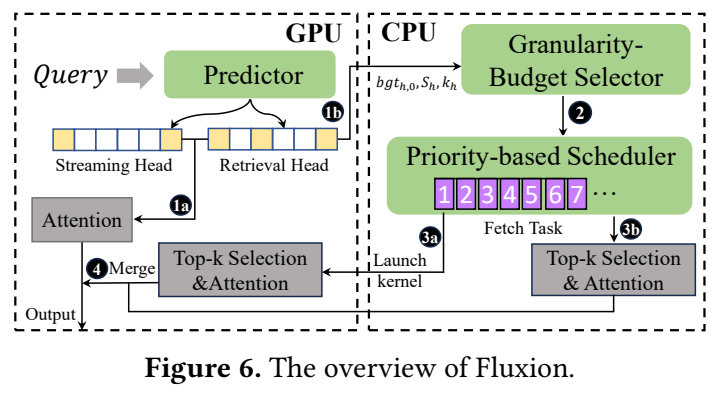
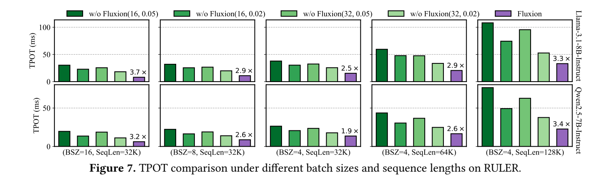

# An Efficient Hybrid Sparse Attention with CPU-GPU Parallelism for Long-Context Inference

阅读版本：[arXiv:2605.07719v1](https://arxiv.org/abs/2605.07719v1)，2026-05-08；[本地 PDF](resources/fluxion-2605.07719v1.pdf)。2026-10-30 已读全部 16 页：正文 p1–12、参考文献 p13–14、附录 A p15–16。下文页码均为 PDF 页码。系统名为 **Fluxion**；PDF 首页确认六位作者。未找到可确认的官方代码入口，未运行模型；实验数字来自论文。

## 研究问题与核心思路

**Fluxion 研究的是：KV 已在主存时，怎样让“少算 attention”真正变成更低的解码延迟。** GPU-only 稀疏 attention 仍需把选中 KV 经 PCIe 取到 GPU；固定 CPU attention 则容易让 GPU 等待 CPU 的 Top-K 和稀疏计算。它把三个决定合在一起：每个 head 到底需要多少 KV、以多大的逻辑块选择、交给 CPU 还是 GPU 执行。

它不是 KV 量化，也不是永久丢弃大部分历史 KV。完整历史仍由主存保留，稀疏预算控制当前 query 实际参与 attention 的部分；以后其他 query 仍可能选到此前没用的块。其主要优化阶段为 decode。（§2、§4，p2–6）

方法分三层：

1. **按 attention 输出误差分配预算。** 高 attention score 不一定带来高输出贡献，尤其 sink token 的 value 范数很小时。
2. **逐 head 联合选择块粒度与预算。** 粗粒度减少 Top-K 元数据扫描，但为保持质量通常需要取更多 KV；两者不能分开调参。
3. **按任务代价动态分工。** CPU 与 GPU 从统一优先队列领取 head/group 任务，不把全部主存 attention 固定交给 CPU。

*原文 Figure 6，arXiv v1，PDF p6。保留原图与图注；来源、页码及裁剪坐标见 [asset-sources.yaml](resources/asset-sources.yaml)。*

## 实现路径

### 1. 把默认驻留集合与检索集合分开

所有方法均在 GPU 保留 initial 64 tokens 与最近 256 tokens，主存保存其余 KV 及 Quest 风格的逐维 min/max 元数据。附录 A 进一步说明，decode 新生成 KV 追加到 GPU 缓存，所以运行时 GPU 集合还包含已生成 token；不能把常驻 KV 永远算成固定 320 tokens。（§8.1、附录 A，p8、p15）

- **Streaming head：** 仅用 GPU 默认集合即可满足预测的误差条件，跳过主存 Top-K 与 attention。
- **Retrieval head：** 仍需从主存 KV 中选择块，执行结果再与默认集合的 attention 输出合并。

Streaming/retrieval 是随 query 改变的运行时属性，不是一次离线标记后永久固定。逻辑选择块可为 16/32/64/128 tokens，并不要求跟随每次选择重排底层物理 KV 存储。（§2.1、§5，p2、p6–7）

### 2. 输出误差是离线标签，在线由小模型预测

对 head $h$，离线枚举稀疏配置，寻找满足下式的最小预算：

$$
\frac{\|o_h(b,g)-o_h\|_2}{\max_{h'}\|o_{h'}\|_2}\le\tau.
$$

其中 $o_h$ 为完整 attention 输出，$o_h(b,g)$ 为预算 $b$、块大小 $g$ 下的稀疏输出。分母使用本层所有 head 的最大输出范数，而不是每个 head 自己的范数；小贡献 head 因而可以承受更大的相对误差。（式 2，p6）

这个条件约束的是 **O projection 之前的 head 输出**，没有显式乘上各 head 对应的 $W_O$。它比 attention score 覆盖率更贴近输出，但仍是最终模型质量的代理目标，不是最终 logits 的误差保证。

Retrieval head 的预算随粒度近似为：

$$
b_h(g)=b_{h,0}+k_h\log_2 g.
$$

GPU 上的 0.112M 参数前馈网络，从 41 维特征预测 $b_{h,0}$、$k_h$ 和 streaming 标志。41 维包括层/head 身份、KV 长度和分布统计、QK 交互、attention 贡献、query 动态、prefill 预算及跨 head 输出特征。（§5.2，p6–7）

附录 A 的关键工程细节是**避免为了预测再遍历主存 KV**：prefill 缓存最后一个 query 作为 anchor，预计算 KV 矩、anchor 输出及多个粒度下的预算。decode 更新当前 query 与 GPU 集合的特征；主存段 LSE 通过预计算矩和近似正态分布估计，而不读取全部 host KV。训练数据的标准化统计在推理时复用，特征提取使用 CUDA Graphs。（p15–16）

这种低成本来自近似和额外准备工作。Anchor 随生成过程变旧、任务分布改变或 LSE 矩近似失准时，预算预测可能失效；论文没有给出长时间生成中的持续误差监测/回退方案。离线标签的误差界也不会自动变成预测模型每次输出的硬保证。

### 3. GQA 内共享粒度，预算仍逐 query head 计算

共享同一 KV 的 GQA group 使用同一块粒度，避免不同 head 对共享 KV 采用不兼容的选择方式。选择器枚举四种粒度，最小化访问量代理：

$$
V(g)=2\frac{L_{cpu}}{g}+2L_{cpu}\sum_{h=1}^{G}b_h(g).
$$

第一项是 Quest min/max 元数据，第二项是所选 KV。该式省略共同的 head dimension、元素字节数等因子，**不是直接以字节计的完整传输量**。不同 head 选中 KV 的并集难以预知，论文用各 head 预算之和作为上界；重叠较多时可能高估真实代价。（式 3，p7）

减小 $g$ 会增加元数据和 Top-K 工作；增大 $g$ 则可能因选择不够精细而增加所需 KV。以数据量而非只以 FLOPs 为目标，正是这篇最有用的软硬件结合点。它仍未完整建模排序开销、UVA 访问形态和 CPU/GPU 不同 cache 行为。

### 4. 同一组 attention 可以原地算，也可以搬到 GPU 算

任务粒度是一个 decoding batch 中的 GQA group；MHA 是 $G=1$ 特例。全 streaming group 不入队，其他 group 按 $V(g)$ 从大到小排序，CPU/GPU 各自完成当前任务后领取下一任务。（§6，p7）

CPU 路径在主存执行 Top-K 和稀疏 attention，仅把结果返回 GPU；GPU 路径通过 UVA 读取选中 host KV 后计算。UVA 是统一虚拟寻址，**不代表 CPU 和独显共享同一物理内存，也不消除 PCIe 流量**。较大任务优先、剩余任务填空，减少静态分配留下的长尾。

实现部分报告约 2K 行 Python + 3K 行 C++/CUDA；其余算子复用 Hugging Face Transformers。CPU 使用 FBGEMM/OpenMP，GPU 使用多 CUDA streams、优化的 FlashDecoding 和 Top-K kernel；另留一个 CPU core 做调度与 CUDA launch，并保证取任务的原子性和执行同步。（§7，p8）

**CPU ISA 描述有待澄清。** §7 称 BF16 计算使用 AVX-512，但 §8.1 测试 CPU 写的是 EPYC 7V13。AMD 对 [EPYC 7003 的技术说明](https://www.amd.com/content/dam/amd/en/documents/epyc-technical-docs/white-papers/overview-amd-epyc7003-series-processors-microarchitecture.pdf)描述 Zen 3 / AVX2，[Zen 4 官方说明](https://www.amd.com/en/blogs/2022/amd-ecosystem-poised-and-ready.html)才增加 AVX-512 支持。这两处配置不能直接组成一个已确认可运行的执行路径；需要作者说明真实 CPU 型号、FBGEMM dispatch 和 BF16 转换/累加方式。当前没有公开源码核验来消除这个矛盾。

## 实验条件与关键结果

### 实验覆盖和预测器训练分开看

| 项目 | 论文条件 |
| --- | --- |
| 硬件 | 云服务器，AMD EPYC 7V13、24 CPU cores、220 GB 主存；估计内存带宽 57 GB/s；A100 80 GB；PCIe 4.0 理论峰值 32 GB/s |
| CPU 配额 | 20 cores 用于 sparse attention，另有专用调度 core |
| 模型 | Llama-3.1-8B-Instruct、Qwen2.5-7B-Instruct；GQA 分别每 KV group 对应 4/8 个 query heads |
| 精度 | 实现章节称 BF16 CPU 计算，理论估算使用 BF16/FP16；没有低比特量化，也未完整列出所有 GPU/模型张量 dtype |
| 质量评测 | LongBench 14 项，输入 >8K；L-Eval 13 项开放式任务，输入 >3K；RULER 13 项，每任务 100 条，8K/16K/32K/64K/128K |
| 固定长度效率 | RULER；(batch, context)=(16,32K)、(8,32K)、(4,32K)、(4,64K)、(4,128K) |
| 混合长度效率 | 两个区间 [16K,64K] 与 [32K,128K]，各取 8 条均匀采样长度，20 次运行；正文对两组是否合入同一 16 请求 batch 的措辞不够清晰，Figure 8 将区间分开报告 |
| 基线 | 同一 hybrid attention 管线去掉 Fluxion 优化；固定块 16/32、预算 2%/5%；initial/local/Quest 元数据相同 |
| 效率指标 | TPOT，作者定义为平均每个输出 token 的端到端时间；未完整报告输出 token 数、逐请求与批聚合归一化细节、软件版本和尾延迟 |

训练使用 **LongBench V2** 中 50 条至少 128K tokens 的样本，另留一条不重叠测试序列；每隔 4K tokens 取 segment，每 segment 随机取 8 个 decode steps。Llama 数据约 12.5M 训练、256K 测试 head 样本。它们高度共享序列、层和 head 结构，不能理解为 12.5M 个独立真实请求。论文为避免训练集重叠，不在 LongBench V2 上报告最终任务精度；结果表使用较早的 LongBench。（§7–8，p8）

### 质量损失：均值小不等于所有任务不受影响

下面是 Tables 2–4（p9）的均值；Δ 为绝对分数差，而非相对百分比。

| 评测 | Qwen FULL → Fluxion | Δ | Llama FULL → Fluxion | Δ |
| --- | ---: | ---: | ---: | ---: |
| LongBench | 43.34 → 43.21 | −0.13 | 45.02 → 45.04 | +0.02 |
| L-Eval | 27.90 → 27.66 | −0.24 | 30.90 → 30.64 | −0.26 |
| RULER，五种长度均值 | 74.07 → 72.53 | −1.54 | 85.81 → 85.03 | −0.78 |

摘要的“最坏平均下降 0.26”只覆盖前两类真实任务均值，**不能扩展成全部三个 benchmark 的最坏下降**。Qwen 的 LCC 单项下降 2.03 分，HotpotQA 下降 1.87 分；RULER 8K 下降 2.06 分。RULER 128K 上 Qwen 的 FULL 本来就只有 25.74，Fluxion 为 24.94；较小差距不表示该长度下已具备很强的任务能力。

### 速度来自联合改变配置与执行，不是单个调度器的倍率

*原文 Figure 7，arXiv v1，PDF p10；纵轴 ms，倍率对照固定 (block=16, budget=5%) 基线。图保留所有配置，避免把最快低质量基线与质量较强基线混为一谈。*

| Batch / context | Llama TPOT 加速 | Qwen TPOT 加速 |
| --- | ---: | ---: |
| 16 / 32K | 3.7× | 3.2× |
| 8 / 32K | 2.9× | 2.6× |
| 4 / 32K | 2.5× | 1.9× |
| 4 / 64K | 2.9× | 2.6× |
| 4 / 128K | 3.3× | 3.4× |

固定 (16,5%) 是作者选出的**质量最强固定配置**，不是最快配置；(32,2%) 通常更快但质量更低，Figure 7 中仍慢于 Fluxion。这个比较说明联合设计给出了更好的质量—速度折中，但不是等 KV 字节预算的纯执行加速，也不是对官方 Quest、RetrievalAttention、KTransformers 或 vLLM 优化栈的直接排行榜。正文没有给出 Fluxion 在每个 workload 下的实际平均预算、流式 head 比例和数据字节数，尚不能完整解释倍率中各部分的来源。

Table 5 在 Qwen、batch=4、32K 下，平均每 attention 层 GPU idle 从 **2.33 ms / 70.65%** 降为 **0.78 ms / 45.78%**；128K 时仍有 73.14% idle。减少 GPU 等待是有直接测量的，但 CPU/PCIe 的资源不平衡没有完全消失。

### 消融支持哪些机制

- **输出贡献预算：** Llama、32K 下，按每 head 相对误差 10% 配额的 TPOT 为 13.65 ms，采用跨 head 贡献归一化后约 8.07 ms，精度接近。（Figure 9a，p10–11）
- **粒度与 streaming 跳过：** 动态粒度方案约 9.5 ms，再加 streaming head 跳过降到约 8 ms；两者均有独立收益。（Figure 9b）
- **动态调度：** 混合长度下优于不并行、按 head 数均分和按长度静态分配，但图中没有提供足够精确的数值供重建完整系列。（Figure 9c）
- **预测器代价：** 在 batch=1/2/4/8、16K–128K 的矩阵中占 1.9%–8.2%；单请求、16K 是 8.2%。这不是所有端侧短上下文场景都可忽略的成本。（Figure 10a）
- **误差阈值：** $\tau=0.10$ 在作者消融中取得较好折中；放宽到 0.20 时质量下降明显。它是选定 workload 的经验参数，不是普适质量保证。（Figure 10b）

## 理解、局限与疑问

**优先把它作为“稀疏预算与异构调度共同设计”的参考，而不是现成低比特引擎。** 与 [HeadInfer](../headinfer/notes.md) 的按头完整 KV 搬运不同，它会近似选择 KV；与 [NEO](../neo/notes.md) 的请求级卸载不同，它在更细的 head/group 层面动态决定执行位置。公平比较必须同时计入质量损失和选择器自身代价。

- **独显 PC/工作站：** 问题模型最相近，但论文是 A100 + 20 个 attention CPU cores + 220 GB 主存。更少核心、更小 RAM、不同 PCIe 和功耗条件会改变 Top-K/attention/传输占比；论文没有消费卡或笔记本实测。
- **Orin/高通统一内存：** 可借鉴按输出贡献分配工作和动态 head 粒度，但 host-to-device PCIe 成本模型不直接成立。CPU 与 GPU/NPU 争用共享 LPDDR 时，额外并行未必增加可用带宽。本文没有对应硬件/后端证据。
- **量化工程连接点：** KV 量化会同时改变元数据比例、解包开销、CPU/GPU 内核吞吐和近似误差。将其与 Fluxion 叠加应重建 $V(g)$ 和质量目标，不能直接把原模型的预测器接到低比特 KV 上。

最值得验证的是两个问题：

1. **固定质量后，预测带来的净收益有多大？** 应同时记录每 head 的实际预算、被跳过比例、错判 streaming 的分布、prefill 准备成本和生成过程中的 anchor 漂移，而不仅看平均 TPOT。
2. **实际字节量是否足以选执行位置？** GQA 的跨 head 选块重叠、CPU cache 命中、GPU UVA 非连续访存和元数据 Top-K 都会使同样 $V(g)$ 对应不同耗时；采用轻量实测反馈可能比单一数据量排序更稳健。

复现首先需要作者的代码与实际 CPU dispatch、预测器权重、生成长度及指标归一化配置。另一个来源细节是正文 RULER 引用 [24] 指向了同名风格但不同用途的 RuleR 数据回收论文；应按本文列出的合成长上下文任务和长度核对评测实现，而不要直接用该参考文献找到的数据集。
