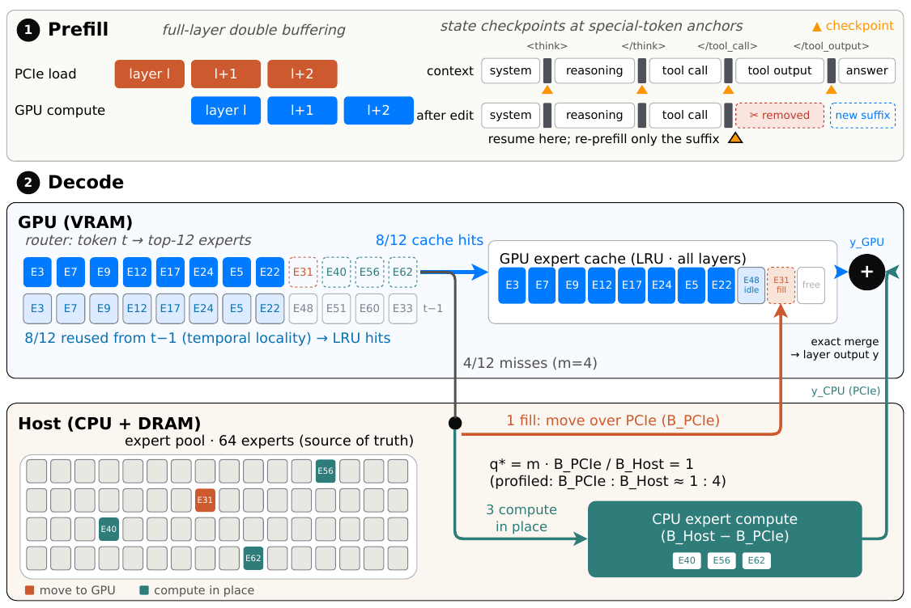
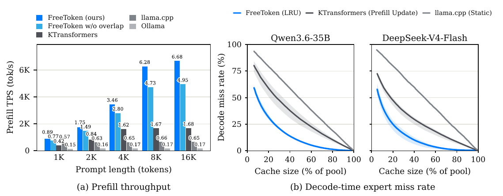

# FreeToken: Efficient Edge-Native MoE Serving with Bandwidth-Adaptive Execution

## 研究问题与核心思路

**最值得借鉴的是把专家权重的格式、CPU/GPU 执行、PCIe 传输和服务状态缓存放在同一个运行时里设计。** GPU 放不下 MoE 的全部专家，并不意味着每次缺失都必须搬到 GPU：一部分专家可以直接在 CPU 上计算，另一部分搬入 GPU 缓存并服务后续 token。怎样分配这两部分，取决于真实内核和互连的带宽，以及两者对主存的争用。

- 阅读版本：[arXiv:2608.16157v1](https://arxiv.org/abs/2608.16157v1)，2026-08-17；[本地 PDF](resources/freetoken-2608.16157v1.pdf)。已读全文 16 页：正文 p1–13，参考文献 p14–16，无独立附录。以下页码均为 **PDF 的 1-based 页码**。
- 阅读日期：2026-10-30。
- 另对[官方代码](https://github.com/FlashML-org/FreeToken/tree/ecbbce457769a75810df83517250cd3ce3263ea5)做了只读核对，固定为 `ecbbce457769a75810df83517250cd3ce3263ea5`（2026-10-29）。下文将这份代码与论文 v1 分开说明。
- 未运行模型、基准或精度实验；性能数字均来自论文。

### 它针对的是独显本地服务，而非所有“端侧”设备

论文的主要场景是带 NVIDIA 独显的笔记本、台式机和工作站：专家全集保存在主存，GPU 留下一部分专家及其他模型状态。MoE 的稀疏激活降低每 token 计算量，却没有消除权重容量和跨 PCIe 搬运瓶颈。例如论文使用的 DeepSeek-V4-Flash 有 284B 总参数、13B 激活参数，43 层中每层从 256 个 routed experts 中选择 6 个；全部专家仍远大于 32 GB 显存。（§1–2，p1–5）

FreeToken 主要联合解决三个问题：

1. **Prefill 和 decode 的权重访问不同。** 长 prompt 会触及大量专家，适合按整层顺序流入；decode 只有少量活跃专家，需要缓存和 CPU/GPU 分工。
2. **Agent 多轮请求反复进入 prefill。** 工具输出裁剪、thinking 块删除会修改历史；对混合 attention/recurrent 模型，仅保存 KV 不足以恢复可复用前缀。
3. **显存需求会随运行改变。** 专家缓存、KV、recurrent state 和执行工作区竞争容量，静态分配难以兼顾首 token 延迟与 decode 速度。

*原文 Figure 2，arXiv v1，PDF p6。图中的 top-12、8 个命中、4 个缺失及 1:4 带宽比是机制示例，不是三个评测模型的统一配置。图中文字保留原样；裁剪来源见 [asset-sources.yaml](resources/asset-sources.yaml)。*

## 实现路径

### 1. 主存专家池是真实来源，GPU 缓存跨层共享

CPU 保留完整 routed-expert 权重池；非专家参数常驻 GPU。GPU 使用跨所有 MoE 层的全局专家缓存，每个 slot 对应完整的 `(layer, expert)`，包括计算这个专家所需的多个权重/scale bank。命中更新 LRU，填入缺失专家时淘汰旧 slot；分到 CPU 执行的专家不改变 GPU 驻留状态。（§3，p5–8）

这里所谓 semantic-aware expert caching，核心是利用 router 的时间局部性：连续 token 往往重复访问同层的近期专家。论文中的缓存机制是共享 LRU，不是另训一个语义预测器。

### 2. Prefill 用两个整层缓冲，避免逐专家碎片化加载

长序列 prefill 的专家覆盖率高，于是提前搬入下一层全部专家，不必等到下一层 router 产生结果后再发起零散传输。两块整层缓冲交替使用：GPU 算第 $l$ 层时，PCIe 搬第 $l+1$ 层；它们来自同一专家池，保留的专家可以继续为 decode 提供缓存。（§3.1，p5–6）

这需要显存容纳至少两个完整层的专家。当容量不足时，论文系统退回按需加载，而非假设双缓冲始终可用。Prefill 在不同模型/卡上可能计算受限，也可能传输受限；论文 Qwen3.6 的长 prompt 实验主要是**计算被传输掩盖**，流水后仍贴近传输下界。

### 3. Decode 的 $q^*$：把缺失专家拆成“搬过去算”和“原地算”

对一层当前 decode step，令 $\mathcal H$ 为命中 GPU 缓存的专家，$\mathcal M$ 为去重后的缺失专家，$m=|\mathcal M|$。缺失集合分为：

- $\mathcal F$：经 PCIe 填入缓存，随后在 GPU 计算；$q=|\mathcal F|$。
- $\mathcal C$：直接读主存权重，在 CPU 计算；数量为 $m-q$。

GPU 最终计算 $\mathcal H\cup\mathcal F$，CPU 计算 $\mathcal C$，按原有 routing 权重合并输出。全部选中专家都参与计算；没有通过丢弃专家或替换成另一个专家来换速度。（§3.2，p7–8）

论文对单个完整专家的字节数记为 $S$，两种实测带宽为：

- $B_P$：pinned 主存专家到 GPU 的有效传输带宽；
- $B_H$：CPU MoE 专家内核的有效处理带宽，而非 DRAM 厂商标称带宽。

关键假设是 PCIe DMA 和 CPU 算专家读取同一主存，DMA 占满链路后 CPU 只剩下 $B_R=\max(B_H-B_P,0)$。在 $B_H>B_P$ 的连续近似下：

$$
T_{\mathrm{fill}}(q)\approx\frac{qS}{B_P},\qquad
T_{\mathrm{cpu}}(m-q)\approx\frac{(m-q)S}{B_H-B_P}.
$$

平衡两支耗时得到：

$$
\frac{q}{m-q}\approx\frac{B_P}{B_H-B_P},\qquad
q^*\approx m\frac{B_P}{B_H}.
$$

以上对应 p7 式 (1)–(4)。实现将 $q^*$ 离散化，并在存在缺失时保留至少一次填充，避免 CPU 一直算而 GPU 缓存永远不热。带宽在目标部署硬件上 profile；每步缺失数变化，因此每步分工也变化。论文没有声称每步重新测硬件带宽。

**它是简洁的调度近似，不是所有执行开销的全局最优解。** 推导省略了 GPU 计算、启动/同步、激活传输和不同专家大小的影响；填入哪个专家还由缓存策略决定。$B_H$ 是内核有效带宽，直接减去 $B_P$ 尤其依赖两者确实争用同一饱和主存资源。$B_H$ 接近 $B_P$ 时应趋向全部搬运；非正剩余带宽不能直接代入 CPU 耗时式。

#### 当前代码已经改进了这个带宽模型

2026-10-30 核对的代码中，[`benchbw.measure_overlap_bw`](https://github.com/FlashML-org/FreeToken/blob/ecbbce457769a75810df83517250cd3ce3263ea5/python/freetoken/moe/benchbw.py#L593-L650)会同时运行 CPU GEMV 与 PCIe gather，测量二者争用时的实际带宽。[`bench_profile.fetch_fraction`](https://github.com/FlashML-org/FreeToken/blob/ecbbce457769a75810df83517250cd3ce3263ea5/python/freetoken/moe/bench_profile.py#L116-L128)优先使用：

$$
q/m=\frac{B_{P,\mathrm{overlap}}}
{B_{P,\mathrm{overlap}}+B_{CPU,\mathrm{overlap}}}.
$$

只有缺少并发测量时才回退到 $B_P/B_H$，并把比例限制到不大于 1。源码解释了原因：CPU 内核单独运行时若没有吃满 DRAM，简单减法会高估 DMA 对它的影响。这一变化直接支持“用真实内核和并发测量建模”的工程方向；论文 v1 的结果不能当成这份后续实现的性能验证。

### 4. 把 CPU 分支接进 CUDA Graph，而不是每层回 Python 调度

GPU 上完成专家去重、命中/缺失判断、分工、淘汰和路由到 slot；固定形状的工作缓冲配合 device-side 有效计数，避免动态长度迫使执行回到主机。多 bank 复制共享同一专家 ID 列表，淘汰候选用一次扫描发现，而不是为每个缺失重新扫描缓存。（§4，p8–9）

CPU 分支使用固定 pinned 输入/输出和持久任务描述符。CUDA Graph 包含 D2H、提交 CPU 任务的 host function、GPU 专家路径、同步及 H2D 结果节点；实际专家计算在绑定物理核的 C++ 线程池执行。这里的 graph-compatible 是把跨设备协同纳入执行图，CPU GEMV 本身仍在 CPU 上运行。

### 5. Agent 状态复用依赖“保留下来的精确前缀”

Full-attention KV 由 radix prefix tree 管理；recurrent 层则需要保存整个 recurrent state 的检查点。检查点占用大，不能给每个 token 都保存一份，因此优先放在 `<think>`、`</think>`、`</tool_call>`、`</tool_output>` 和对话轮次边界。（§3.1，p6–7）

当 agent 删除或替换历史块时，找到编辑后仍有效的最深检查点：KV 复用对应前缀，recurrent 层恢复同一位置的状态，再处理后续 token。边界检查点更可能落在工具框架真正编辑的位置。它利用的是**精确前缀保留**，不是含义相似的两段文本可以共用状态；若检查点早于实际编辑处，中间没有检查点的有效片段仍可能重算。检查点按 LRU 回收，预算独立于 KV 池。

### 6. 弹性显存与权重文件格式也是执行路径的一部分

- **动态显存划分：** 在 scheduler 安全点重建专家缓存，更新专家/KV 预算，必要时重新 capture 执行图；无需重启 engine 或重新读入完整 CPU 权重池。其代价不能简单等同于“零停顿”。（§3.3，p8）
- **FTW：** 预打包为最终 bank 布局，专家维度用 `layer × experts_per_layer + expert` 扁平索引；多个 bank 的同一行共同构成完整专家。加载时按精确大小并行直接 I/O 到最终 host layout，然后 pin，避免先清零巨量锁页内存再覆盖。（§4，p8–9）
- **主存锁页的边界：** 论文说明若完整专家池不能 pin/register 给 DMA，则回退到 pageable 主存上的纯 CPU MoE，非专家部分仍在 GPU，仅传激活、路由和结果。这个模式解决可运行性，但不再拥有论文混合搬运快路径的同一性能条件。（§4，p9）

### 7. 量化工程：格式支持要一路落实到缓存、复制和 CPU/GPU 内核

论文用 BF16、MXFP4、NVFP4 的真实权重推理，CPU 内核具有 SIMD 与内核内反量化；不是只报告量化误差或用完整 FP16/BF16 权重模拟容量。FTW 和专家 slot 必须把 scale 与 packed weights 一起按内核消费布局组织。（§4–5，p8–10）

为确认实际路径，进一步只读检查了固定 commit 的实现：

| 实现对象 | 读到的具体证据 | 适用范围 |
| --- | --- | --- |
| DeepSeek MXFP4 专家 | [`mxfp4.py`](https://github.com/FlashML-org/FreeToken/blob/ecbbce457769a75810df83517250cd3ce3263ea5/python/freetoken/layers/quantization/moe/mxfp4.py#L14-L61)使用 `uint8` 打包两个 E2M1 值、每 32 个值配 E8M0 scale；[`fused_ds_fp4.py`](https://github.com/FlashML-org/FreeToken/blob/ecbbce457769a75810df83517250cd3ce3263ea5/python/freetoken/moe/fused_ds_fp4.py#L37-L129)直接从 slot banks 读 packed 权重，调用 decode/prefill 内核，并按 checkpoint 规则对激活做 FP8 round-trip | 权重压缩真实存在；W4A8 的数值语义不等于每一步都采用原生 FP4×FP8 硬件指令。源码中 decode 输入可用 BF16 承载已量化/恢复的 FP8 数值 |
| NVFP4 CPU 路径 | [`nvfp4.cpp`](https://github.com/FlashML-org/FreeToken/blob/ecbbce457769a75810df83517250cd3ce3263ea5/python/freetoken/kernel/csrc/cpu_moe/kernels/nvfp4.cpp#L8-L68)直接读取 nibble、E4M3 block scale 与 global scale；[`Nvfp4Format`](https://github.com/FlashML-org/FreeToken/blob/ecbbce457769a75810df83517250cd3ce3263ea5/python/freetoken/kernel/csrc/cpu_moe/kernels/nvfp4.cpp#L355-L439)将 gate/up/down 接到这些点积；有 W4A16 内核内反量化及 VNNI 可用时的 int8 激活路径 | 当前运行路径会受 CPU ISA 影响；不能把全部 CPU 执行统称为 BF16 激活或原生 FP4 乘法 |
| NVFP4 GPU 路径 | [`nvfp4.py`](https://github.com/FlashML-org/FreeToken/blob/ecbbce457769a75810df83517250cd3ce3263ea5/python/freetoken/layers/quantization/moe/nvfp4.py)包含原生 bank 的 Triton 路径、Marlin W4A16、FlashInfer SM12x W4A16，以及需 checkpoint 静态激活 scale 的 W4A4 prefill 选择；各 backend 把 load-time pack 与 forward 配对 | 架构、CUDA/依赖和 CPU 可读布局会限制选择，尤其重排后的 GPU 专用布局不能默认用于同一 CPU hybrid 路径；这些是后续代码能力，不用于补写论文未报告的实验精度 |

对量化研究最有用的接口是：**压缩后每专家字节数、scale 布局、CPU 内核有效带宽、GPU 内核路径、cache slot 的复制粒度需要一起确定。** 改一种量化格式会同时改变传输量、cache 容量、CPU 解包开销和可选 GPU kernel，$q^*$ 的参数也必须随之重测。论文没有把 KV-cache 量化作为贡献；它对 KV 的重点是复用和容量管理。

## 实验条件与关键结果

### 模型、硬件和精度

论文宣称支持 20 多种 MoE 模型；正文定量评测主要覆盖下列 **3 个模型**，没有为所有支持模型给出相同实验。（§5.1，p9–10）

| 模型 | 总参数 / 激活参数 | 论文实验权重格式 | 用途 |
| --- | --- | --- | --- |
| Qwen3.6-35B-A3B | 35B / 3B | 主实验及非笔记本跨硬件实验为 BF16；4060 Laptop 用官方 NVFP4 | 四种 agent 工作负载、prefill/缓存分析、跨消费级 GPU |
| DeepSeek-V4-Flash | 284B / 13B | 原生 MXFP4 专家，各基线消费 bit-exact 相同专家块 | RTX 5090 上的四种工作负载 |
| GLM-5.2 | 753B / 40B | NVFP4 routed experts；checkpoint 433 GB | RTX PRO 6000 上的数学工作负载展示 |

下表转录 Table 1（p10）。显存按论文的 GB 标记，DRAM 按 GiB；$B_P$、$B_H$ 均为 GB/s，分别是实测 host-to-device 专家传输、CPU 专家内核有效带宽。

| 系统 | GPU / 显存 | PCIe | CPU（表中线程数） | 主存类型 / 容量 | $B_P$ | $B_H$ |
| --- | --- | --- | --- | --- | ---: | ---: |
| 5090 server | RTX 5090 / 32 GB | 5.0 ×16 | 2× Xeon Gold 6459C（32） | DDR5 / 180 GiB | 52.7 | 77.3 |
| 4090 server | RTX 4090 / 24 GB | 4.0 ×16 | 2× Xeon Platinum 8358P（32） | DDR4 / 240 GiB | 25.1 | 63.2 |
| 3090 server | RTX 3090 / 24 GB | 4.0 ×16 | 2× Xeon Gold 6330（28） | DDR4 / 180 GiB | 25.3 | 56.7 |
| 5090 desktop | RTX 5090 / 32 GB | 5.0 ×16 | Ryzen 9 9950X3D（32） | DDR5 / 192 GiB | 49.0 | 53.8 |
| 4060 laptop | RTX 4060 Laptop / 8 GB | 4.0 ×8 | Core i9-13900H（20） | LPDDR5 / 32 GiB | 11.8 | 47.5 |
| PRO 6000 | RTX PRO 6000 / 96 GB | 5.0 ×16 | Xeon Platinum 8559C（48） | DDR5 / 512 GiB | 51.5 | 178 |

三台租用服务器的线程数和 DRAM 是**容器配额**，不等于实际用满这些线程。论文 §5.1 p9 写每次 serving/bandwidth measurement 限 6 个线程且绑定 NUMA；§5.2 p10 又写主实验 Qwen 为 6 线程、DSV4 为 **8 线程**。该处原文不一致，不能自行统一成 6；复现实验应核对作者的对应运行配置。

### 工作负载、长度和指标

| 场景 | 请求内容与轮次 | 长度/并发信息 |
| --- | --- | --- |
| W1 math | AIME，长 CoT，无工具，单轮 | decode 主导；未统一报告固定输入/输出 token 数 |
| W2 coding | OpenCode 处理 SWE-bench issue，真实执行工具，3 个脚本化用户轮次 | 要生成 reference gold patch；各引擎 agent 轨迹会分叉 |
| W3 native-protocol coding | 同一 issue，Claude Code 经各引擎 Anthropic-compatible endpoint | 会发起并发 subagent 请求，session 增至 56–65k tokens；未给统一固定并发数 |
| W4 email/calendar | OpenClaw mailbox kit，13 个固定用户轮次 | 约 24.5k-token 系统上下文下限；关闭 120 秒 idle watchdog，以免慢引擎无法被计时 |

基线是 llama.cpp、Ollama、KTransformers、MoE-Infinity，各自只在支持的配置上运行。主实验权重格式对齐：Qwen BF16，DSV4 原生 MXFP4 专家块一致。指标为**逐请求平均 decode tok/s**和**逐请求平均 TTFT**；不是固定 batch 的集群总吞吐。论文因 agent 轨迹分叉而不比较跨引擎的整场 wall-clock 总时长。（p10）

实验没有统一给出每轮生成上限、实际输出长度、固定 batch/并发数和所有基线版本；因此应把结果解释为这些 harness 运行中的交互体验，而非完整并发服务容量曲线。

### 关键结果及其边界

| 结果 | 对照与条件 | 如何理解 |
| --- | --- | --- |
| Qwen decode 77–83 tok/s；DSV4 22–25 tok/s | RTX 5090 主实验、四工作负载；分别为对应工作负载最强基线的 1.8–2.3×、1.5–1.9× | 多轮场景中保持了较稳定逐请求速度；不能直接换算成总请求容量 |
| Agent decode 与 W1 差异在 12% 内 | FreeToken 的 W2–W4 对各自 W1 | 说明长上下文、多轮进入 prefill 时 decode 较稳定；仍需看 TTFT |
| 多轮 6 个模型×工作负载组合中，5 个平均 TTFT 最低 | Qwen/DSV4 × W2/W3/W4；Qwen W3 是 KTransformers 的 GPU-prefill 方案更好，W1 短孤立 prompt 偏向 llama.cpp | FreeToken 不是每个 TTFT 场景均获胜 |
| 所有主实验 cell 的最慢 turn 都低于 44 s | llama.cpp、Ollama、KTransformers 各自在某 cell 达 232、179、946 s | 这是观测到的最坏 turn，不是统计意义的 p99 或通用 SLO 保证 |
| MoE-Infinity 只完成 W1，8.8 tok/s | 长 prompt 因逐专家 prefill staging 容量中断，bundled server 不跨请求保留 KV | `×` 表示不可服务/未完成，不应当作 0 tok/s 纳入平均 |
| 4060 Laptop 达 39.3 tok/s | Qwen NVFP4、W2；五种消费级平台中，对最快基线的加速依次为 laptop 1.8×、3090 1.3×、4090 1.3×、5090 server 1.9×、5090 desktop 2.1× | 笔记本为低比特，其他 Qwen 列为 BF16；“达到 4090 的 92%”不是同精度硬件比较 |
| GLM-5.2 达 14.9 tok/s，llama.cpp 为 7.3 tok/s | PRO 6000 96 GB + 512 GiB，数学 W1；平均 TTFT 7.5 s 对 7.8 s | Figure 5 最右列与前五列不是同模型/工作负载。KTransformers 的 CPU kernel 不支持该 NVFP4 布局，需更大 host storage，未完成此配置 |

来源：§5.2–5.3，p10–13，Figures 3–5。GLM 对比使用相同专家权重；KTransformers 所需约 753 GB–1.5 TB 是论文对其可用专家存储路径的说明，不是 GLM NVFP4 checkpoint 本身的大小。

### 两个更能解释机制的实验

*原文 Figure 4，arXiv v1，PDF p12。左：RTX 5090、Qwen3.6-35B BF16 的 prefill；右：相同 routing trace 回放，曲线为 W1–W4 均值、阴影为 min–max。单位和对照在下表、下文保留，即使本地摘图未同步也可阅读。*

Figure 4(a) 的 FreeToken 与关闭 overlap 的数值如下；图上标值以千 tok/s 为单位：

| Prompt tokens | 1k | 2k | 4k | 8k | 16k |
| --- | ---: | ---: | ---: | ---: | ---: |
| 完整 FreeToken（k tok/s） | 0.89 | 1.75 | 3.46 | 6.28 | 6.68 |
| 关闭 overlap（k tok/s） | 0.77 | 1.49 | 2.80 | 4.73 | 4.95 |

关闭 overlap 后，4k/8k/16k 的 throughput 相对完整系统下降约 19%/25%/26%。Qwen BF16 专家池约 64.4 GB，除以 $B_P=52.7$ GB/s 得约 **1.22 s** 的整池搬运下界，与论文报告的 8192-token chunk 耗时 1.19–1.22 s 接近。它说明流水把计算隐藏得较好，但没有消除必须搬的字节。（p11–12）

Figure 4(b) 回放相同 routing traces，在每个模型内对齐各策略的专家缓存容量。论文报告 RTX 5090 实际服务配置占 **Qwen 专家池的 37%、DSV4 专家池的 11%**，对应：

| 策略 | Qwen miss rate（37% 容量） | DSV4 miss rate（11% 容量） |
| --- | ---: | ---: |
| FreeToken：LRU | 16% | 39% |
| KTransformers：prefill 更新 | 41% | 59% |
| llama.cpp：静态放置 | 62% | 89% |

这是缓存策略的 trace replay 对比，不是重新测了一遍三个引擎端到端吞吐；它较好地隔离了“同样容量能否跟上当前 working set”。论文没有进一步给出 $q^*$、semantic anchors、弹性显存分别对最终 TTFT/吞吐的完整消融，不能把所有收益都归到带宽公式上。

## 理解、局限与疑问

### 对当前研究方向的价值

**优先把它作为独显 PC/笔记本上的 MoE 低比特推理工程参考。** 它覆盖了 packed 权重、真实 CPU/CUDA 路径、缓存 slot 和服务端状态管理，能连接“量化减少字节”和“减少的字节真的改变延迟”这两件事。

- **台式机/独显笔记本：** 最直接的借鉴路径是固定一种模型和格式，分别测 CPU 专家内核、H2D gather 及二者并发带宽，再决定是否值得 hybrid。论文桌面 5090 的 $B_H=53.8$ 与 $B_P=49.0$ 很接近，CPU 并非天然提供巨大额外吞吐；笔记本的 PCIe ×8 与小显存则更突出搬运、缓存和低比特之间的取舍。
- **小型 AI 工作站：** 低比特专家主存常驻把显存容量问题转为主存容量、pinning、NUMA 和带宽问题。753B 的示范仍需要 512 GiB 主存与 96 GB GPU，不能据此认为普通 32 GiB 主存机器可运行同模型。
- **Jetson Orin/高通统一内存：** 可借鉴“实测并发争用”“缓存状态跨请求复用”“量化布局与执行后端共同设计”。但论文的两级主存/独显和 PCIe DMA 分流假设不直接成立：共享 LPDDR 下 CPU、GPU/NPU 争用的资源、复制/映射、缓存一致性和功耗约束不同，应重新建立模型。CUDA Graph、x86 SIMD/线程亲和性、NVIDIA 专用量化内核也不能原样移植到高通；本文没有这些设备的实验，因此不标 `memory/unified`、`hardware/jetson-orin` 或 `hardware/qualcomm`。

### 需要保留的解释边界

1. **模型精度与数值执行要分开。** 论文强调保留原 routed computation、使用对齐权重格式，能排除跳专家等机制；它未提供充分的逐路径精度/任务质量消融。当前源码还包含不同激活处理路径，未来复现时应记录实际 dispatch，不能只写“FP4”。
2. **多组件系统的效果不能归因给单一公式。** 双缓冲与缓存有单独证据；$q^*$、前缀/状态复用、graph-compatible 调度和弹性容量的独立贡献仍不完整。
3. **论文与当前实现已有实质演化。** 最值得跟进的是并发带宽测量对原剩余带宽公式的修正。比较或复现时要固定 commit、模型 checkpoint、kernel backend 和 CPU 线程数，避免拿新代码结果解释旧论文表格。
4. **服务规模仍有信息缺口。** 当前实验重在具体 agent harness 的每请求体验；固定并发扫描、请求到达分布、功耗、热降频、长期稳态及缓存重分配停顿没有形成完整报告。对手机或有限电源设备，这些条件会直接改变是否值得使用 CPU 协同。

### 后续阅读时最值得追问的两个问题

- 同一低比特布局下，减法近似 $B_H-B_P$ 与并发实测策略在哪些 CPU/内存/PCIe 组合上给出不同决策？这能把“异构有帮助”的泛泛判断变成可检验的瓶颈模型。
- 专家 cache 多占 1 GiB 带来的 decode 收益，是否抵得上减少 KV/recurrent checkpoint 后增加的 prefill？FreeToken 把这些状态放入同一系统，但论文尚未用充分消融回答长期多轮服务中的最优预算。
