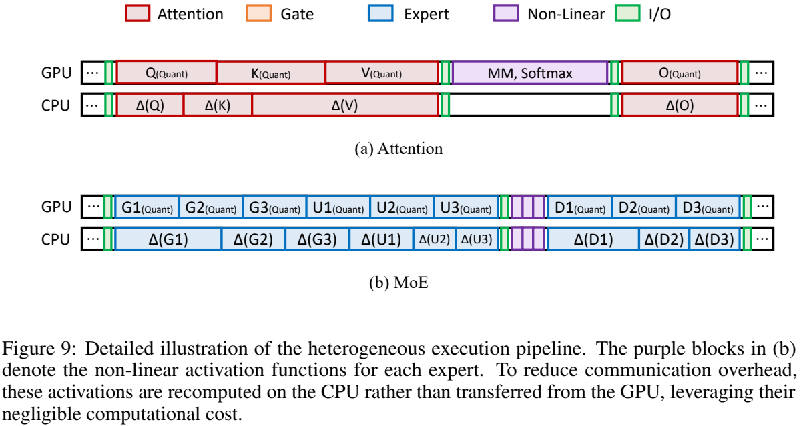
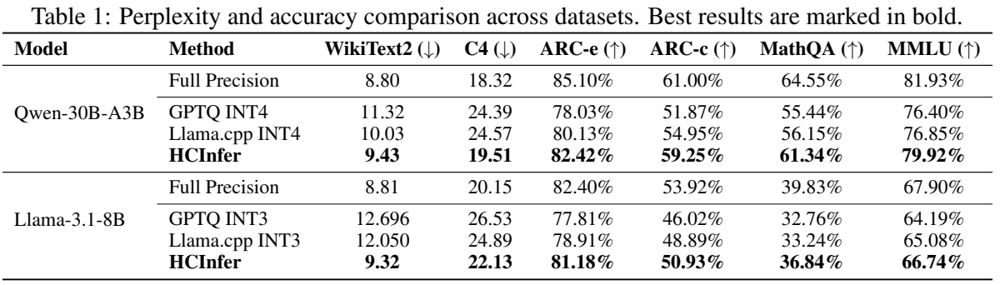

# HCInfer: An Efficient Inference System via Error Compensation for Resource-Constrained Devices

阅读版本：[arXiv:2605.05819v1](https://arxiv.org/abs/2605.05819v1)，2026-05-07

## 研究问题与核心思路

**HCInfer 把“量化后损失的质量”转化为一个可调节的 CPU 工作量。** 低比特主干完整常驻 GPU，权重量化误差的低秩因子存于主存；每个计算窗口内，GPU 算主干，CPU 算补偿，然后合并结果。它希望用 GPU 执行期间的时间窗口换取更多质量恢复，而不占用显存存放补偿参数。（§3–4，p3–7）

令原权重 $W\in\mathbb R^{d\times k}$，反量化主干为 $\widehat W$，残差 $\Delta W=W-\widehat W$，则：

$$
Y=XW\approx X\widehat W+(XA_r)B_r,
\qquad A_r\in\mathbb R^{d\times r},\ B_r\in\mathbb R^{r\times k}.
$$

其中 $r$ 决定补偿能力与 CPU 成本；低秩因子由残差 SVD 构造。这是量化误差重建，不是训练一个任务适配 LoRA。正文 p5 将 $B_r$ 维度写作 $r\times rk$，上式按矩阵乘法相容性写为 $r\times k$。

### 具体的低秩残差构造方法

**三类信号转成各矩阵的补偿秩，而不是给所有矩阵统一的 rank**

#### 三类动机，分别变成三类分配信号

**① 奇异值分布 → 可恢复性 $V_i$。**
论文把矩阵 $i$ 的残差奇异值分成显著集合 $\mathcal S_i$ 和剩余集合 $\mathcal R_i$，以两组奇异值均值的比值衡量显著程度，再在层内归一化： 

$$
\varphi_i=
\frac{\operatorname{mean}_{\sigma\in\mathcal S_i}\sigma}
{\operatorname{mean}_{\sigma\in\mathcal R_i}\sigma},
\qquad
V_i=\operatorname{Norm}(\varphi_i).
$$

它回答的是：**这个矩阵的误差，是否适合用少量低秩分量恢复？**

**② 输出误差敏感度 → 矩阵分数 $S_i$ 和层分数 $S_l$。**
单独量化一个矩阵，测最终输出分布相对全精度模型的 KL 散度，层内归一化得到 $S_i$；再单独量化一整层，得到层级 KL 散度 $D_l$，构造 $S_l$：最敏感的 top-$K$ 层取 1，其余层按 $D_l/\min_{m\in\mathcal T}D_m$ 缩减。

它回答的是：**这个矩阵的误差，修复后对最终输出有多重要？**

**③ MoE 路由 → 当前专家分数 $G_{i,e}$。**
对当前激活的 $k$ 个专家，论文用路由权重 $g_e$ 设置 $G_{i,e}=k g_e$，使路由权重更大的专家获得更高补偿优先级。 

#### 合成优先级，再换算成 rank

前两类信号先组合，MoE 情况再乘上路由分数；论文给出的优先级是： 

$$
P_i=\operatorname{Norm}(V_iS_i)\,S_l,
$$

$$
P_{i,e}=k g_e\operatorname{Norm}(V_iS_i)\,S_l.
$$

随后，系统根据硬件确定一个**标准秩** $r_{\mathrm{std}}$：CPU 补偿计算加通信的耗时，仍能被 GPU 主干计算覆盖的最大 rank：

$$
r_{\mathrm{std}}=\max\{r:T_{\mathrm{CPU}}(r)+T_{\mathrm{comm}}\le T_{\mathrm{GPU}}\}.
$$

最终按优先级缩放并向下取整，得到实际补偿秩：

$$
\boxed{r_i=\lfloor P_i r_{\mathrm{std}}\rfloor}
$$

MoE 专家则使用 $P_{i,e}$。所以它不是只按“误差大小”分配，而是综合考虑**好不好修、修了重不重要、当前专家贡献多大，以及硬件允许修多少**。 

#### *为什么不对所有不在同执行窗口的矩阵都选择标准秩？*

>按照论文的分析，标准秩为可以被GPU计算重叠的最大硬件可用秩，而对于不在同一执行窗口的矩阵，计算时完全可以使用标准秩而不是动态的减小秩。

**论文给出的解释为**：不是“大秩不好”，而是“所有矩阵都取大秩可能不划算”；动态分配的价值，是同一预算下把 rank 花在更有用的位置。

### 与 [DecDEC](../decdec/notes.md) 的关键差别：

| 问题 | HCInfer | DecDEC |
| --- | --- | --- |
| 主存存什么 | 低秩补偿因子池 | 按输入通道布局的 4-bit 残差 |
| 谁计算补偿 | **CPU** 执行两次低秩乘法 | **GPU** 通过 zero-copy 读取主存残差并乘加 |
| 运行时选择什么 | 每个矩阵的秩，MoE 中结合路由权重 | 当前激活幅值较大的输入通道 |
| 主要隐藏对象 | CPU 计算、激活传输与进程同步 | PCIe 远程残差读取、补偿 kernel 与 SM 竞争 |
| 完整驻留条件 | 量化主干须放进 GPU，补偿池放进主存 | 量化主干须放进 GPU，压缩残差放进主存 |

两者不是互相测过的同配置胜负比较；HCInfer 引用了 DecDEC，但没有把它放进实测基线。

## 实现路径

### 双进程复用，而不是每个算子重新启动 CPU 任务

GPU 主进程执行量化算子并组织流程，长期存活的 CPU worker 独立加载补偿池。两者用 Python `multiprocessing` 共享内存、共享变量和事件协调：GPU 侧写入激活并触发事件，随后计算主干；CPU 完成补偿后写回结果，GPU 等待完成事件再相加。（附录 A.1–A.2，p13–15）

这里的共享内存是进程通信机制，**不是 CPU/GPU 统一物理内存，也没有消除 PCIe 传输**。论文没有给出 pinned buffer、具体 D2H/H2D API、CPU BLAS/SIMD 内核、线程数及数据类型。所谓 GPU process 应理解为管理 CUDA 执行的主机进程，不能照字面说操作系统进程运行在 GPU 上。

CPU worker 自己维护层号、投影类型等状态，以减少反复发送元信息；伪代码在窗口内逐个矩阵计算补偿。正文提到 Q/K/V 的并行独立性，但不能据此认定它实现了三个独立 CPU 并发内核。GPU 主干与 CPU 补偿可重叠，依赖点仍需同步。

### 按依赖划分共享补偿窗口

*原文 Figure 9，arXiv v1，PDF p14，保留图例和原图注。绿色为 I/O，紫色为非线性计算。*

- **Attention：** Q/K/V 共用输入，因此一次分发激活，把三个补偿分支放进同一窗口；O 投影依赖 attention 输出，需要单独窗口。
- **Dense FFN：** gate/up 共用一个窗口；非线性之后的 down 另开窗口。
- **MoE：** 先 router，再把所有激活专家的 gate/up 组织成一个窗口，所有 down 组织成另一个窗口。CPU 预算可以跨专家分配，不再按专家完整地逐个串行切换。

窗口合并同时降低传输次数、事件次数和过细任务开销。Figure 9 图注还说 CPU 会重算廉价非线性以减少传输；正文 §4.2.2 则描述 GPU 完成非线性、在 down 阶段发送中间激活。论文未完整说明 CPU 何时获得重建非线性输入所需的量化主干结果，因此这部分数据依赖与实际传输量仍需代码确认。

### 先测硬件窗口，再分配秩

基本约束是：

$$
r_{\mathrm{std}}=\max_r\{T_{\mathrm{CPU}}(r)+T_{\mathrm{comm}}\le T_{\mathrm{GPU}}\}.
$$

正文用矩阵重要性乘以标准秩，附录进一步将它解释为**整个补偿窗口的总 CPU 预算**。预算必须随矩阵形状、GPU kernel 和输入长度变化；不能把一台 4090 上的 rank 直接移植到笔记本 CPU。（§4.3，p6–7；附录 B，p15–20）

重要性分数结合三项：

1. **可恢复性 $\mathcal V_i$：** 从残差奇异值谱中区分显著与剩余部分，比较其均值，再归一化。
2. **输出敏感度 $\mathcal S_i,\mathcal S_\ell$：** 离线把单个矩阵或整层换成量化版本，观察输出分布 KL 散度；对最敏感的 top-K 层保留最大权重，其他层按比例折减。
3. **MoE 路由 $\mathcal G_{i,e}=k g_e$：** 本次激活 $k$ 个专家时，按归一化路由概率 $g_e$ 调整补偿份额。

由此计算：

$$
\mathcal P_{i,e}=\mathcal G_{i,e}\,
\operatorname{Norm}_{\mathcal W}(\mathcal V_i\mathcal S_i)\mathcal S_\ell,
\qquad \widetilde r_{i,e}=\mathcal P_{i,e}r_{\mathrm{std}}.
$$

“动态”并不意味着每 token 重新 SVD 或跑完整 KL 校准；可恢复性、敏感度在部署前测定，运行期主要结合当前专家激活和已确定预算选择因子子集。

附录 B.1 给出的具体版本与正文简写有差别：奇异值切分用归一化谱的二阶差分，阈值 0.01；归一化范围是补偿窗口；先分配显著子空间，再分剩余部分；最终 rank 对齐到 $\{0,8,16,32,\ldots\}$。正文则写最大化方差差异、层内归一化和向下取整。实现时应优先参考附录的详细描述，但需要代码来确定最终规则，不能混拼成一个作者已验证的算法。

### 对“低比特实现”的证据到哪一层

论文报告基于 Transformers 4.57.1、GPTQ 的 INT4/INT3 主干，在 GPU 调用低比特算子，CPU 计算低秩补偿；这比只做质量模拟更接近完整推理系统。然而没有公开代码可检查实际 packing、group size、矩阵 layout、kernel dispatch 或因子 dtype，故本条不添加 `evidence/packed-weights`、`evidence/kernel` 标签，也不自动将 INT4 写成 W4A16。论文没有把激活量化或 KV-cache 量化作为贡献。

## 实验条件与关键结果

### 设备与工作负载

| 项目 | 论文条件 |
| --- | --- |
| 硬件 | RTX 4090 24 GB + Intel i9-10980XE + 256 GB DRAM，PCIe Gen3 ×16 |
| MoE | Qwen-30B-A3B（引用 Qwen3 技术报告），GPTQ INT4，使用 24 GB GPU |
| Dense | Llama-3.1-8B，GPTQ INT3，**在同一 4090 上把可用显存限制到 8 GB** |
| 纯量化基线 | GPTQ、llama.cpp，GPU-only，无补偿 |
| 全精度卸载基线 | vLLM 0.20.0、llama.cpp 0.3.20、Accelerate 1.13.0；版本按论文原文记录，未核查其实际运行配置 |
| 质量 | WikiText2、C4 perplexity；ARC-Easy、ARC-Challenge、MathQA、MMLU accuracy |
| 长度扫描 | 输入 32/64/128 tokens，输出 64/128/256 tokens，共 9 组（Figure 6） |
| 指标缺口 | 吞吐单位 token/s，但未完整定义计时边界、batch、并发、质量评测 shot/prompt、CPU 线程与内存峰值；不能补设为 batch=1 |

8 GB 实验模拟的是显存容量，不是 RTX 4060 Laptop 的算力、带宽、PCIe、散热或功率，不能当作真实低端笔记本测试。（§5.1，p7）

### 质量恢复与速度使用不同基线

**“最高 10.4×”相对全精度卸载，“质量最高提高约 5.2”相对纯量化；它们不是同一基线上的双重收益。** 引言报告保留至少 85% 的纯量化吞吐，即补偿仍可能降低约 15% 吞吐。（p3、7–9）

*原文 Table 1，arXiv v1，PDF p9。下表由原表逐项相减，accuracy 的差值单位为百分点（pp），不是相对百分比。*

| 模型 / 对照 | ARC-E | ARC-C | MathQA | MMLU |
| --- | ---: | ---: | ---: | ---: |
| Qwen：HCInfer − llama.cpp INT4 | +2.29 pp | +4.30 pp | +5.19 pp | +3.07 pp |
| Qwen：HCInfer − Full Precision | −2.68 pp | −1.75 pp | −3.21 pp | −2.01 pp |
| Llama：HCInfer − llama.cpp INT3 | +2.27 pp | +2.04 pp | +3.60 pp | +1.66 pp |
| Llama：HCInfer − Full Precision | −1.22 pp | −2.99 pp | −2.99 pp | −1.16 pp |

llama.cpp 是 Table 1 中这四个任务上更好的纯量化基线；HCInfer 的确恢复了部分损失，但仍没有全面回到全精度。Llama 的 Figure 5 标注 ARC-C `+3.0%`、MathQA `+4.1%`，与 Table 1 的差值不符，且正文重复前者；没有说明这是不同配置。本笔记以明确列出的 Table 1 数值计算质量增量，不把两处混为一组实验。

困惑度同样应按数据集比较：Qwen 的 WikiText2/C4 从 llama.cpp 的 **10.03/24.57 → 9.43/19.51**，而全精度是 8.80/18.32；Llama 从 **12.050/24.89 → 9.32/22.13**，全精度是 8.81/20.15。

主要系统结果：

| 结果 | 条件与解释 |
| --- | --- |
| Qwen 2.3–2.8×，Llama 8.4–10.4× | Figure 5 三个任务的端到端吞吐，相对全精度 offloading；Llama 使用人为限制的 8 GB 显存 |
| Qwen 1.9–2.2×，Llama 6.0–8.2× | Figure 6 的输入/输出长度组合，相对全精度卸载；输出较长时更有利，作者承认 CPU 多 token prefill 效率较低 |
| 3.7–8.0× | Figure 7 相对“补偿权重存在 CPU、用到再搬到 GPU 算”的朴素方案，不是相对无补偿 GPTQ |
| 接近固定 rank-32 质量而吞吐更高 | Figure 8；动态跳过部分矩阵减少通信与算子开销，不意味着所有固定秩配置均被质量支配 |

### 消融与 profiling 的可用范围

附录 Table 2 报告参考 rank 向量 `(0,0,64,32,32,16,32)` 为 accuracy 59.25%、吞吐 6.960 token/s；把第三项升到 128 后为 59.78%、6.574 token/s。前者与主表 Qwen ARC-C 相同，但附录没有完整重述模型/任务和向量映射，因此只保留作者的原配置关系，不自行补全。

附录 C.1 说在总 rank 不变下比较扰动，但上述两个向量总和分别为 **176 和 240**，并非所有行都等预算。Table 2 吞吐相对变化也有算术不符：6.935 对 6.960 应为 **−0.36%**，表中写 `+0.7%`。因此该表支持“不同分配有不同质量/速度取舍”，不能支持所有邻近方案均在公平预算下被严格支配。

Table 3 的 iteration 行为总耗时 128.33 ms、CPU 67.99 ms、GPU 87.04 ms、通信 3.10 ms、重叠 57.54 ms。直接相加减得到 **100.59 ms**，与 total 相差 27.74 ms；可能还有未列入的算子/等待，但原表未解释。窗口行的 CPU 合计为 101.57 ms，也不等于 iteration 的 67.99 ms。Table 4 则把单层 gate/up 通信列为约 1.1–1.3 ms，而 Table 3 对整个该类窗口列 1.08 ms。缺少统一聚合定义，故不据此拟合整模型 CPU/GPU 代价模型或宣称通信可以忽略。（p20–22）

## 理解、局限与疑问

### 最值得保留的是补偿窗口，而不是“免费纠错”的概括

同一输入下多个投影共享一次传输，并把预算分配到收益更大的矩阵，是清楚的工程切入点。CPU 的总补偿池可以很大，而每次仅读取选中 rank 的因子；选择低秩而不是完整残差，把每个矩阵约 $dk$ 的运算/读取改成 $r(d+k)$。但小 rank 的两次乘法、共享内存、事件和 PCIe 仍有固定成本，只有 GPU 窗口足够长时才可能隐藏。

论文把量化主干概括为 compute-bound、补偿概括为 memory-bound。这是待测的硬件状态，不是量化或低秩结构自动保证的结论；小 batch decode 的主干仍可能带宽受限。更快的 GPU kernel 会缩短补偿窗口，CPU 更弱或输入更长也会改变最优 rank。

### 比例分配的“最优性证明”存在明确缺口

附录 B.2 由线性预算 $\sum_i r_i\le r_{\mathrm{std}}$ 与线性化目标 $\sum_i g_i r_i$，断言贪心等价于 $r_i\propto g_i$。这个推论一般不成立：取 $g=(2,1)$、预算 1，比例分配 $(2/3,1/3)$ 的收益为 $5/3$，而 $(1,0)$ 为 2。若边际收益随 rank 递减，贪心应持续更新边际收益，也不能直接推出固定比例。

因此应把该公式视为有消融支持的敏感度启发式，而非已证明最优分配。另一个实现问题是向最近的 2 次幂对齐可能突破总预算：两个连续 rank 各为 6、预算 12 时，分别对齐到 8 会变成 16。论文未给出对齐后的预算修复规则；这会直接影响“补偿总能被隐藏”的条件。

### 对目标设备的价值

- **独显桌面/工作站：** 与论文场景直接对应。研究重点是把补偿 rank 的质量收益与实际窗口耗时共同建模，再与 DecDEC 的“GPU 读取稀疏残差”作同模型、同质量、同内存预算的比较。当前论文没有完成这项比较。
- **独显笔记本：** 需要真实移动 CPU、内存带宽和功耗条件；4090 限显存的结果不能替代。补偿池的主存峰值也未报告，256 GB 实验机器不能代表 16/32 GB 笔记本。
- **Orin/高通统一内存：** 两条分支可能争用同一 LPDDR，而非利用独立显存与主存带宽。可以迁移窗口化思想，但 CPU/GPU/NPU 后端、缓存一致性与同步成本需要重建；本文没有这些设备实验。

**阅读优先级：适合作为 DecDEC 之后的对照论文；若现在就要动手复现，先从已有公开 kernel 和完整代码的 DecDEC 入手更稳妥。** HCInfer 的架构方向值得研究，当前落地依赖是公开实现、明确的 rank 配置/数据布局，以及能解释 Figure 5、Table 1 和附录 profiling 口径的实验记录。
