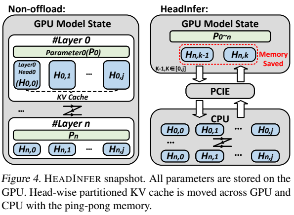
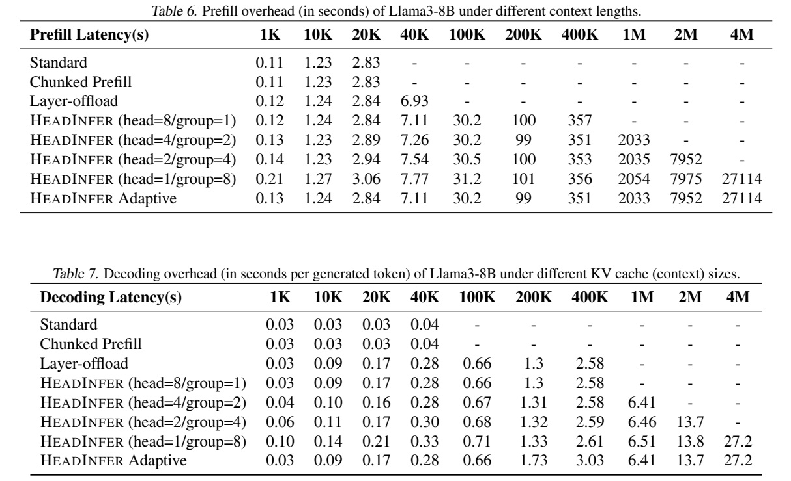

# HeadInfer: Memory-Efficient LLM Inference by Head-wise Offloading

阅读版本：[arXiv:2502.12574v1](https://arxiv.org/abs/2502.12574v1)，2025-02-18；[本地 PDF](resources/headinfer-2502.12574v1.pdf)。已读正文及附录 A–E，共 24 页；下文页码均为 PDF 的 1-based 页码。另于 2026-10-30 静态核对[作者代码](https://github.com/wdlctc/headinfer)的主运行路径，未运行模型或复现实验。

## 研究问题与核心思路

HeadInfer 解决的是：**权重已能放进独显，但长上下文 KV cache 放不下时，怎样用主机内存换取更长的上下文容量。** 它不是将 attention 交给 CPU 计算，也不是 KV 量化。CPU 保存大部分完整 KV，GPU 只容纳当前及预取的头／头组，仍在 GPU 上执行完整 attention。（§3–4，pp.3–5）

同一层不同 attention head 在输出拼接前可分别计算，因此无需让所有层、所有头的 KV 同时驻留显存。论文将峰值内存问题分成三个维度：按序列分块 prefill，压低临时激活；按层卸载 KV；进一步按头卸载，缩小每次搬运和驻留的工作集。**按头切分减少的是峰值显存，不会减少完整 dense attention 所需的历史 KV 总量或总计算量。** 基础方案不丢 token、不截断 head、不改变 KV 精度，数学上保留原 attention；不同 kernel 调度仍可能产生浮点舍入差异。

对本仓库最有价值的结论是“可行容量与交互速度要分开评价”：单张 RTX 4090 能容纳 4M 上下文的运行状态，但论文同时报告约 **7.53 小时 prefill、27.2 秒／输出 token**；它首先是一种超长上下文的容量方案。（表 3，p.8；表 6–7，p.12）

## 实现路径

### 1. KV 留在 CPU，计算仍在 GPU

权重常驻 GPU。外层依次处理 prefill chunk 和 Transformer layer，内层按 KV head 或头组执行：准备对应 Q/K/V，取得该组历史 KV，在 GPU 上完成 attention，收集输出，最后拼接并执行输出投影。对 GQA，应按 **KV head 数**计算缓存，不能把 query head 数直接代入。公开 Llama 实现也是将一个 KV head 配对的多个 query heads 一起交给 FlashAttention。（§4，p.5；[mp.py](https://github.com/wdlctc/headinfer/blob/main/headinfer/mp.py)）

传输采用 ping-pong 缓冲：计算当前组时预取下一组，并将已完成组的 KV 返回主机。主机预分配与 GPU 双缓冲用于控制分配和传输开销；细粒度不是“GPU 上永远只放一个头”，重叠传输时还需要另一块缓冲。（图 4，p.5；图 10，p.21）

来源：论文 v1 图 4，PDF p.5，原图裁切。左侧保存全部层的 KV；右侧显示 GPU 双缓冲及 CPU 中的完整 KV。裁切记录见 [asset-sources.yaml](resources/asset-sources.yaml)。

### 2. 为什么“128 GB KV → 1 GB”不代表内存总需求消失

设 batch 为 $B$，层数为 $L$，上下文长度为 $S$，每层 KV 头数为 $H_{KV}$，head dimension 为 $d$，每元素字节数为 $b$。完整缓存大小为：

$$
M_{KV}=2BLSH_{KV}db.
$$

其中 2 表示 K 与 V。对 Llama-3-8B，取 $B=1,L=32,H_{KV}=8,d=128,b=2$，以及 $S=1,048,576$，得到 **128 GiB**。单 KV head 的缓存为 0.5 GiB，两个缓冲合计约 **1 GiB**。因双缓冲存在，实际缩减因子约 128，而不是只用 $1/(LH_{KV})$ 推得的 256。这是对论文附录 A.3 内存账的显式单位复算；论文表中标为 GB，K/M 长度的写法也不完全统一。（pp.14–15）

1M 长度的表 10 给出：标准方案权重 15.08、KV 128、激活 64，总计约 207 GB；HeadInfer 权重仍为 15.08、GPU KV 1、激活 0.625，总计约 16.7 GB。**KV 的全机总量仍为 128 GB**，只是大部分转移到主机内存。16.7 GB 是估算，作者报告实际 prefill 峰值约 17.0 GB；标准 207 GB 不是在 24 GB 卡上跑出来的测量值。（图 1，p.1；§6.3，p.7；表 10，p.15）

### 3. Head 分组是在显存和调度开销之间取舍

把所有头拆得最细，会增加 kernel launch、同步和小传输开销。论文以 Llama-3 的 8 个 KV heads 为例：较短上下文合成 1 组；500K–1M 用 2 组；1M–2M 用 4 组；2M–4M 用 8 组，即每组只剩 1 个 KV head。相邻区间是作者给出的调度示例，不是对任意 GPU 都成立的阈值。（§4，p.5）

这里应区分两个配置：**1M 下“1 GB GPU KV”的最细粒度配置，与自适应延迟表中的较大头组配置不同**，不能把最小显存和最快延迟直接拼成同一次实验结果。表 7 的自适应行在 200K/400K 也并非所有固定分组中最快，因此适合把它理解为容量约束下的分组策略，而不是已证明的最优调度器。（表 6–7，p.12）

### 4. Prefill 能较好掩盖传输，decode 通常不能

论文的 roofline 用近似 $T\approx\max(T_{compute},T_{memory})$ 描述理想重叠。完整 prefill 的 attention 计算随序列长度近似二次增长，而 KV 传输近似线性增长，因此长输入时有机会用计算隐藏 PCIe 传输。decode 每步只有一个新 query，计算与读取历史 KV 都随历史长度线性增长，算术强度低，容易被 PCIe 限制。（§5，p.6；附录 C，pp.18–19）

这是一组带条件的分析：充分异步重叠、足够的有效带宽、合适的 kernel 利用率，以及没有显著同步／分配开销。**实际使用 chunked prefill 时，当前 query chunk 长度也决定计算／传输比**；固定 chunk 后，仅增加历史长度并不保证传输更容易隐藏。按头切分同时缩小计算和传输量，理想算术强度不变，实际利用率却可能下降。论文采用约 10K token 的 prefill chunk 取得折中。

表 12 标题为 RTX 4090，却在 head-wise offload 的部分 prefill 单元格列出 312T，而同表通常列 165T；图 5 图内峰值标注的单位也与纵轴不一致。因此本笔记采用“prefill 可算力受限、decode 易链路受限”的机制判断，不把这些单元格当作可靠的实测吞吐率。（pp.6、18）

### 5. 公开实现与论文实验的对应范围

静态核对的[main.py](https://github.com/wdlctc/headinfer/blob/main/main.py)使用 BF16、`flash_attention_2`，将模型放到 CUDA，然后 patch attention。prefill 输入来自 `torch.randint`；decode 通过 `mp_simulate_decode` 预造缓存。[mp.py](https://github.com/wdlctc/headinfer/blob/main/headinfer/mp.py)中该函数用零张量填充长 KV，随后主程序反复执行单 token forward，而不把采样结果作为下一个生成 token。因此这是**性能／容量测试入口**，不能代替真实长 prompt 的生成质量测试。

所查 attention 主路径采用逐 KV head 的 Python 循环；`head_group` 虽被设置，该 forward 并未消费它，未在这条路径中看到论文的自适应分组逻辑。[cache.py](https://github.com/wdlctc/headinfer/blob/main/headinfer/cache.py)实现 CPU/GPU 搬运和 CUDA stream 同步。代码足以定位“按头切分—FlashAttention—卸载缓存”的工程接口，但仅运行这个入口不能认定已复现论文的分组消融、所有质量基准或完整在线生成服务。

论文正文称质量评测模型为 `Llama-3-8B-Instruct-Gradient-1024k`，当前代码 checkpoint 字符串为 `gradientai/Llama-3-8B-Instruct-Gradient-1048k`。以上代码观察对应 2026-10-30 的 `main` 分支，不直接追溯为论文投稿时的实验脚本。

## 实验条件与关键结果

### 硬件、精度和比较口径

主要实验使用单张 RTX 4090，batch 1，通常为 BF16 权重／激活／KV，prefill chunk 约 10K；对照包括标准 HuggingFace 推理、chunked prefill、4-bit KV 量化和 layer-wise KV offload。作者报告主机有 **1 TB RAM**，长上下文实验给 KV 约 **512 GB CPU 内存预算**，PCIe 4.0 ×16 配合 pinned memory，实测单向传输约 **25 GB/s**。（§6.1、§6.3，pp.7–8）

硬件描述有需澄清之处：p.7 写 4×64 核 EPYC 7B13，表 3 写 7V12；p.7 还把 RTX 4090 显存写成 HBM3，而 [NVIDIA 官方规格](https://www.nvidia.com/en-us/geforce/graphics-cards/40-series/rtx-4090/)为 24 GB GDDR6X。实际主机／NUMA 拓扑应以可确认的实验配置为准，不能从该描述构造无歧义的复现机器。

### 容量收益：分块与按头卸载各有贡献

对 Llama-3-8B，表 3/5 的最大可运行上下文为：

| 配置 | 最大上下文 | 应怎样理解 |
| --- | ---: | --- |
| Standard | 25K | 权重、激活和完整 KV 均占显存 |
| Chunked prefill | 30K | 只控制激活，完整 KV 仍留显存 |
| 4-bit KV quantization | 45K | 改变 KV 精度的对照组 |
| Layer-wise offload 基线 | 45K | 论文的独立基线，并非所有组合优化都已启用 |
| HeadInfer，8 heads × 1 group | 550K | HeadInfer 框架内，分块配合整层头组卸载 |
| HeadInfer，4 heads × 2 groups | 1100K | 更小的驻留 KV 工作集 |
| HeadInfer，2 heads × 4 groups | 2100K | 同上 |
| HeadInfer，1 head × 8 groups | 4096K | 最细粒度，受主机 KV 预算等限制 |

来源：表 3、5，p.8。判断“按头切分本身”贡献时，应优先比较 **550K → 4096K，约 7.45×**，而不是把 25K/45K → 4M 的全部收益都归因于 head granularity。主机 RAM 不够时，显卡有余量也无法达到表中的长度。

70B 的结果另有条件：表 4 用 **8×RTX 4090 做 pipeline parallel**，10K chunk 支持 950K，5K chunk 支持 1000K；不能概括为一张 4090 运行 70B 百万上下文。（p.8）

### 延迟：prefill 近似不变，decode 可能明显变慢

下表摘取同一论文附录表 6–7 的关键点，prefill 是该长度输入的总处理秒数，decode 是每输出 token 的秒数：

| 上下文／配置 | Prefill | Decode |
| --- | ---: | ---: |
| 20K，Standard | 2.83 s | 0.03 s/token |
| 20K，HeadInfer Adaptive | 2.84 s | 0.17 s/token |
| 1M，HeadInfer Adaptive | 2033 s，约 33.9 min | 6.41 s/token，约 0.156 token/s |
| 4M，HeadInfer Adaptive | 27114 s，约 7.53 h | 27.2 s/token，约 0.0368 token/s |

这支持“降低显存峰值、让原本 OOM 的输入可处理”，但不支持“对已有可运行输入全面加速”。20K 的 prefill 基本不变，decode 却从约 33 token/s 降到约 6 token/s。表 7 的 layer-offload decode 项甚至覆盖其 prefill 基线跑不下的长度，结合公开代码的模拟缓存入口，应把这些数据理解为分阶段性能证据，不能默认每个单元格都来自完整真实 prompt→自由生成流程。

来源：论文 v1 表 6–7，PDF p.12，原表裁切。原文正文也报告 1M 时约 516 prefill token/s、0.15 decode token/s；表中存在固定分组与自适应配置，引用时应保留配置和单位。

### 质量证据：百万长度检索、实际任务与 4M 容量不能混为一谈

- **LongBench v2**：503 道选择题。受显存限制，各方法采用不同截断上限：Standard 25K、chunked 30K、layer offload 45K、HeadInfer 1024K。表 1 总分分别为 28.4、28.2、29.0、30.2；long 组分别为 25.9、25.9、26.9、30.6。HeadInfer 能读到更多上下文是合理收益来源，但这些分数不能单独验证“同一输入下零精度损失”。数据集长短分组按 **words** 划分，与模型 token 上限不是同一个单位。（§6.2，p.7）
- **SCBench**：作者报告最长 500K、平均约 227K token。表 2 的变量跟踪任务 HeadInfer 为 42.0，layer offload 为 8.4；这个大差异同样伴随截断范围不同，应作为长输入可访问性收益来理解。（p.7）
- **Needle-in-a-Haystack**：图 6 展示到 1024K 的检索热图，作者称与标准推理相当。它是含人工插入目标的长文本检索测试，提供百万上下文的有限质量证据；图中只展示 HeadInfer 的热图，未给逐样本数值误差或完整成对输出比较。（p.13）
- **RULER**：13 个合成任务，每种长度 2600 个样本，测试至 128K。表 9 中单 needle 检索可保持 100%，但 128K 时 MK3 为 56.6、变量跟踪为 54.68、common-word extraction 为 0.10，复杂任务并不因显存充足而自动保持质量。表 9 主要给出 HeadInfer 随长度变化的结果，不是所有方法在同长输入上的等价性验证。（pp.13–14）

因此证据层次是：**4M 有容量与延迟结果；约 1M 有 NIAH 检索以及不同截断上限的任务评测；更复杂的系统化 RULER 测试到 128K。** 论文未给出 4M 真实长文问答质量结果。公开零 KV／随机 token 的性能入口也不能填补这一缺口。

## 理解、局限与疑问

### 对独显工作站有直接启发，对统一内存设备要改写问题

这套设计适合“显存紧、主机 RAM 大、接受较高首 token 延迟”的离线长上下文任务。普通独显笔记本或 64/128 GB RAM 台式机首先受主机容量约束：BF16 的 1M Llama-3-8B KV 本身约 128 GiB，尚未计运行时与其他内存开销。论文虽然只用一张消费级 GPU，整机的 1 TB RAM 条件并不等同于一般消费级 PC。

对 Jetson/Orin、手机 SoC 等统一内存设备，CPU 与 GPU 共享物理内存，不能像独显系统一样通过“搬到 CPU”获得另一池独立的大容量 RAM。按头计算、分块和减少峰值工作集仍可能有用，但需要重新分析共享内存带宽、cache、一致性及运行时的复制行为；本文没有这些平台上的测量，不能直接移植 128× 显存缩减或 PCIe roofline 结论。

### 与量化工程的结合点是 KV 数据路径，不只是标签叠加

基础 HeadInfer 保留 BF16 KV，不能标成已实现 KV quantization。若后续结合低比特 KV，潜在收益同时包括降低主机容量、PCIe 字节量和 GPU 缓冲需求；关键是**在压缩态跨 PCIe 传输，并将解包／反量化与 attention 合适地融合**。若先在 CPU 解压再传输，PCIe 收益会丢失；若 GPU 单独反量化的中间缓冲过大，也会吃回节省的显存。这是基于其数据路径的工程推论，不是本论文的联合实测结果。

权重量化则可能为 KV 缓冲让出更多显存，但论文所查主路径会按头切分并重绑定 `q_proj/k_proj/v_proj.weight`；量化线性层的 packed weight 和算子接口不一定能直接兼容。不能仅替换模型加载精度就假定得到可运行的组合系统。

论文的另一扩展是与 DuoAttention 组合：streaming heads 只保留短窗口、留在 GPU；retrieval heads 保留完整历史并卸载。表 14 在 1M、50% sparse 配置下将 prefill 从 2054 s 降至 1152 s、decode 从 6.51 降至 3.28 s/token。这个结果引入了稀疏截断，应与基础方案的完整 attention 分开；该表未同时给出同配置的质量结果。（附录 D，pp.18–22）

### 继续研究时最值得确认的三件事

1. **公平的组合基线**：用相同 chunk、相同 KV 精度和相同上下文，对比整层卸载与按头卸载，分开记录 GPU 峰值、主机峰值、prefill 总时长和逐 token 延迟。表 5 已说明只看独立 layer-offload 基线会高估 head-wise 的独立贡献。
2. **论文配置与代码的对应**：公开入口是随机输入与零 KV 的分阶段测试；需要能对应论文的真实 prompt、分组策略、质量脚本及 checkpoint，才可讨论完整复现。长缓存 forward 成功与长上下文真实生成质量属于不同验收项。
3. **量化基线身份**：§6.3 将 4-bit KV 对照称为 KIVI，附录 A.3 却引用 Hooper 等人的 KVQuant。两处不一致，在没有进一步配置证据前，表中只能称“论文的 4-bit KV 基线”，不宜据此断言某一具体量化系统只能支持 45K。（pp.7、15）

整体判断：HeadInfer 是值得收录的 **KV 存储调度／卸载工程**论文。它把层级卸载的工作集进一步压到头级，并清楚暴露了“显存容量—主机内存—PCIe 带宽—交互延迟”之间的交换关系。后续最有价值的方向是减少 decode 的有效搬运字节量，同时保留可核验的长输入质量，而不是只追求最大可分配的上下文数字。
