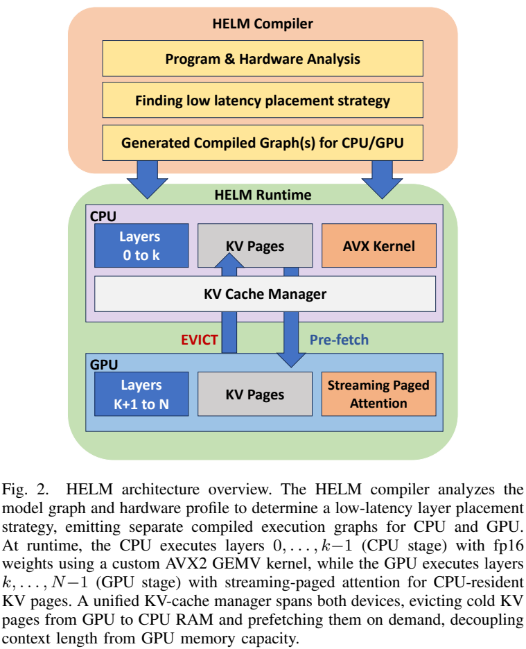
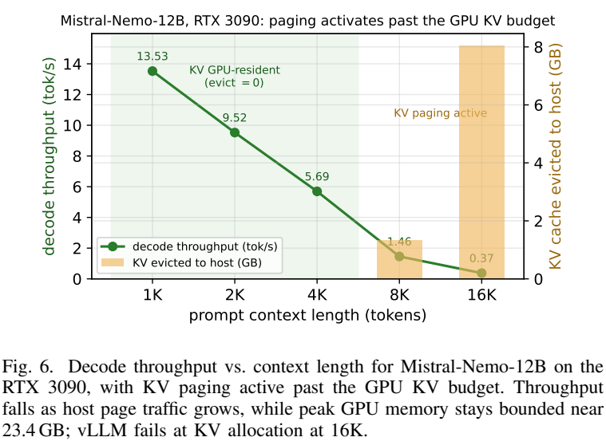

# HELM: Compiler-Guided Heterogeneous Execution for Large Language Models on Memory-Constrained Systems

阅读版本：[作者公开的 IEEE TCAD 2026 论文](https://mpslab-asu.github.io/publications/papers/Khedkar2026CASES.pdf)，[本地 PDF](resources/helm-tcad2026.pdf)。已读全部 14 页：正文 §I–VIII 至 p13，参考文献及作者简介 p13–14，无附录。本文采用三位作者的期刊论文，不混用 Shashwat Pandey 的同名硕士论文。以下页码为 PDF 的 1-based 页码。阅读日期：2026-10-30。

另只读检查[官方源码固定版本](https://github.com/MPSLab-ASU/HELM/tree/ea62f8dfd5c4a6a0183d91eb01d375a2b52c8d03)的划分器和 KV 路径。实验数字来自作者；未运行模型或基准。

## 研究问题与核心思路

**HELM 最值得借鉴的是“让权重留在能容纳它的设备上，并把实际 CPU 内核能力写进划分成本”；最需要警惕的是把容量扩展当成低延迟。** 它面向单张 NVIDIA 独显加主存、模型权重超过显存的稠密 LLM，用 CPU 执行前面一段层、GPU 执行后面一段层，避免每个生成 token 再搬一遍主存权重。

这是一种**顺序异构执行**：同一 token 先过 CPU，再传隐藏状态，最后过 GPU。两段没有同时计算同一个 token，也没有已实现的跨 microbatch 流水。模型权重固定后，另用分页 KV 和流式 attention 处理上下文增长。（§IV，p4–8）

相对于只移动权重的卸载，核心取舍是：CPU 就地计算是否比 PCIe 搬权重再 GPU 计算更便宜？相对于手工 `llama.cpp --n-gpu-layers`，它的目标是自动选择层边界，并把 KV 分页纳入同一运行时。**低比特权重不是本文已实现的能力**，量化扩展列为未来工作。

*原文 Figure 2，作者公开 TCAD 版，PDF p4；原始图与图注裁剪。图上的两设备不表示 CPU/GPU 层同时执行；来源、裁剪坐标见 [asset-sources.yaml](resources/asset-sources.yaml)。*

## 实现路径

### 1. 分析模型和硬件，再生成固定设备子图

编译链依次是 FX tracing → HELMGraph IR → block 级参数/激活/KV 成本标注 → 硬件 profiling → 划分搜索 → 重建设备专用 `torch.fx.GraphModule` → CPU 线性算子补丁。（§IV-A，p4–7）

划分单元含 embedding、每个 Transformer block、输出投影，所以 $L$ 层有 $U=L+2$ 个单元。`cpu(43u)+cuda(23u)` 的 43 是 **partition units**，不是 43 个 Transformer 层。初始化按子模块将权重放到目标设备，避免先完整加载到主存再移动造成额外峰值。

编译后的 token 循环只执行固定子图和边界激活传输，不做动态重划分。“静态图”这里主要指固定 FX 子图和设备位置，不应自动理解成所有算子已融合成一个 CUDA kernel。

### 2. 成本模型要与真的 CPU GEMV 对齐

对连续 CPU→GPU 分割点 $k$，模型优化的是：

$$
T_{\rm plan}(k)=T_{\rm CPU}(k)+T_{\rm GPU}(k)+T_{\rm comm},
\qquad T_{\rm comm}=\ell_{\rm link}+\frac{BHd_{\rm sz}}{B_{\rm link}}.
$$

每个设备内部又把线性投影与 attention 分开，各取计算时间和内存流量时间的最大值再相加。权重读取随参数量增长；KV 读取随 batch、层数、KV head 数和上下文增长。Qwen3-8B 的例子中，每层 FP16 权重约 386 MB，而 batch=1 的边界激活仅 8192 bytes。它减少的是反复搬权重，不是让 CPU 线性算子免于读主存。（式 2–17，p5–6）

硬件参数的证据层次不同：

- **实测：** CPU/GPU sustained memory bandwidth、prefill GEMM 吞吐、双向 pinned PCIe 大块传输率。
- **推导/估计：** decode 计算率用约 1 FLOP/byte 乘内存带宽；L3 容量查询得到，L3 带宽取 DRAM 带宽的 3 倍。不是每个分母都来自真实模型内核计时。
- **额外常数：** 每 block 调度开销加到所有候选上，不改变 argmin。论文中 CPU 越少的可行候选越快，选中边界与 VRAM 可行性下限重合；复杂成本模型的额外价值需与“最少 CPU 层的可行方案”区分。

关键工程修复是 CPU FP16 线性层：F16C 把半精度权重转 FP32，AVX2 FMA 乘加并用 FP32 累积；这不是原生 FP16 FMA。作者 i7 上的 PyTorch fallback 约 3.7 GB/s，自定义 GEMV 约 50 GB/s，对照实测 DRAM 约 45 GB/s，报告约 13× kernel 加速。Prefill 则转 FP32 调 MKL `cblas_sgemm`，报告约 21×。这些是内核对照，不是全系统统一的加速倍数。（§IV-A5，p7）

### 3. 搜索空间有明确边界

枚举 all-GPU、所有连续 CPU-prefix/GPU-suffix 分割、all-CPU；论文将搜索描述为 $O(L)$，不是搜索所有 DAG 或任意 tensor parallel 拆分。固定顺序使输出投影优先留在 GPU，也只保留一次层边界跨设备传输。§VII-E 对同样层数的 1/3/7 次边界消融表明更多交错没有收益，但**没有充分证明所有细粒度并行方案都不可能更快**：并行执行可改变关键路径，而 HELM 的测量仍是串行阶段。

论文式 18 在启用 KV offload 时不把完整 KV 计入 GPU 可行性预算；实际仍需要 resident tail、当前 attention 和预取临时空间。当前代码已在 [`StrategySelectorConfig`](https://github.com/MPSLab-ASU/HELM/blob/ea62f8dfd5c4a6a0183d91eb01d375a2b52c8d03/helm/compiler/optimization/strategy_selector.py#L17-L39)要求 `kv_reserve_tokens>0`，并传给每个候选的成本估计。做容量规划时应采用有效实现预算，不能把公式简化成 GPU 上不需要任何 KV 空间。

### 4. KV offload 保留全上下文，但要把远端页面再读回来

GPU-stage 的 KV 按层分页，旧的完整页移入 pinned host memory，当前尾页留在 GPU。Attention 仍需要每个历史 token，不是 KV eviction 式的永久丢弃，也不是稀疏 attention。GPU 用 online softmax 跨页维护最大值、分母、加权 value 和，每读新页重标定已有累计量，最后统一归一化。（§IV-B，p7–8）

这带来两类不同的跨设备流量：

1. 层边界的隐藏状态：每 token 一次，很小。
2. **已卸载 KV 页面：每次对应 GPU 层 attention 都要重新读回**，可随 context 增长而支配 PCIe。

因此论文“仅一次 activation 传输”的表述适用于权重划分路径，不能作为开启 KV 分页后的总流量描述。其成本公式主要按设备内带宽估计 attention，没有完整体现持续回读的 KV PCIe 代价；长上下文分页活跃区间需要额外建模。

### 5. 当前源码与论文机制之间有需要核对的实现细节

在固定 commit 的 [`kv_offload.py`](https://github.com/MPSLab-ASU/HELM/blob/ea62f8dfd5c4a6a0183d91eb01d375a2b52c8d03/helm/runtime/kv_offload.py#L86-L186)中，decode 分三路：预分配 contiguous buffer 的 SDPA；全 GPU page 拼接后的 SDPA；存在 host page 时的 streaming 路径。不能把全 GPU fast path 的速度归功于 PCIe 分页重叠。

[`kv_cache.py` 的 mixed-residency 路径](https://github.com/MPSLab-ASU/HELM/blob/ea62f8dfd5c4a6a0183d91eb01d375a2b52c8d03/helm/runtime/kv_cache.py#L579-L662)确实使用独立 copy stream、逐页 event、`wait_event` 和 `record_stream`，并以 FP32 做 online softmax。但是它先为**全部 CPU 页面**提交 H2D copy、转 FP32，并把 GPU tensor 引用存入 `kv_bufs`，之后才逐页消费；这不是仅保留两个页面的有界双缓冲。由代码可见，临时显存可能随回读页面总量增长，不能只看长期 KV page pool 的 watermark 来推断实际峰值。未实测这个版本的峰值；也不能据此否定另一版本的论文实验。真正部署长上下文前，这比“支持多少 token”的标称值更值得优先核查。

此外，论文描述默认 page size=512，所查 `KVOffloadConfig` 及 `from_model` 的函数默认是 64；调用者可以覆盖它，复现时需记录实际传入值，不能仅使用类默认值代替论文配置。当前 README 的依赖与路由说明也已演进，论文数字和当前 main 不应自动视为同一执行版本。

## 实验条件与关键结果

### 设备、精度与对照

| 平台 | CPU / 主存 | GPU | 说明 |
| --- | --- | --- | --- |
| 笔记本 | Core i7-13700H，14 核，16 GB DDR4 | RTX 4060 Laptop，8 GB | 主表只测试能装下的 Qwen3-4B/8B；其他模型不能凭 GPU 型号推断可运行 |
| 服务器 | EPYC 7H12，64 核 / 128 线程，125 GB DDR4 | RTX 3090，24 GB | 论文的 3090 结果不等于普通双通道桌面 CPU 的结果 |
| 大显存平台 | 24 vCPU，60 GB RAM，未给 CPU 型号 | L40S，48 GB | 绝大多数小模型完全放得进显存 |

正文主评测覆盖 Qwen3-4B/8B/14B/32B、LLaMA-2-13B、LLaMA-3.1-8B、Mistral-Nemo-12B、OLMo-2-13B、Gemma-2-9B/27B。一般为 FP16；**Gemma-2 各后端均 BF16**，不要照抄 Table II 的统一 FP16 表头。（§V，p8–9）

主表基线为 vLLM 0.17.1（memory utilization 0.90）、Accelerate `device_map=auto`、DeepSpeed ZeRO-Inference CPU offload。后两者完整版本及全部运行软件条件未在正文集中给齐；作者 artifact 提供额外环境，但后续版本不能替代论文运行版本。默认 input=128、output=128、batch=1，10 次独立请求取 p50；指标是单请求 decode tok/s 与 TTFT，不是在线服务总吞吐或 p99。

### decode 更快，TTFT 经常更慢

以下转录 Table II（p9）的代表项，TTFT 单位为秒：

| 平台 / 模型 | HELM tok/s / TTFT | Accelerate tok/s / TTFT | 论文对最快可行基线的 decode 倍率 |
| --- | ---: | ---: | ---: |
| 4060 / Qwen3-4B | 18.8 / 0.340 | 5.7 / 0.201 | 3.3× |
| 4060 / Qwen3-8B | 3.8 / 6.3 | 0.6 / 1.6 | 6.3× |
| 3090 / Qwen3-14B | 8.1 / 4.7 | 1.3 / 0.782 | 6.1× |
| 3090 / Qwen3-32B | 1.8 / 11.7 | 0.2 / 5.3 | 9.1× |
| L40S / Qwen3-32B | 4.8 / 6.5 | 0.5 / 2.2 | 10.4× |

倍率来自未四舍五入数据，不能拿表中仅一位小数的数值强行重算后“纠正”。6.2× 是 **9 个 overflow 配置**的几何平均，不是所有模型/硬件组合均值；失败的 OOM、初始化错误和 KV 分配失败也不是零吞吐样本。

当权重可以完全放到 GPU，论文的 HELM 路径会借助 vLLM，其速度通常与 vLLM 相同；这些 cell 不能用来证明 HELM 自己的编译后端达到同等吞吐。Mistral-Nemo-12B / 3090 则是 embedding 在 CPU、全部 Transformer block 在 GPU 的特殊近全 GPU 配置。（Table II 注释及 §VI-A）

Qwen3-32B / 3090 的 CPU-heavy 固定划分在 input=128/256/512/1024/2048/4096 时，TTFT 依次是 **11.7/14.7/22.2/51.2/105.2/243.1 s**（Figure 4，p10）。Decode 优化不能代替 RAG 或长文摘要场景的响应时间优化。

### 最公平的部署对照还要看 llama.cpp 与低比特

Table IV（p11）在同一 RTX 3090、LLaMA-2-13B、input=output=128 上报告：

| 配置 | 精度 | decode tok/s |
| --- | --- | ---: |
| HELM 自动划分 | FP16 | 10.6 |
| llama.cpp，手工扫描最佳 `ngl=34` | FP16 | 9.78 |
| llama.cpp，`ngl=20` | FP16 | 4.29 |
| llama.cpp，`ngl=20` | Q4_K_M | 13.1 |
| llama.cpp，全部 GPU | Q4_K_M | 74.5 |

HELM 对最佳手调同精度配置约 **1.08×**（10.6/9.78），其价值有自动化与长上下文管理，不能沿用对 Accelerate 的 6.2× 宣传数字。Q4 全 GPU 则约为 HELM FP16 的 7.03×；精度目标不同，但对用户实际选型非常重要：若质量允许，先用成熟量化使模型留在 GPU，可能比未量化异构更合适。该表没有给出完整 Q4 对 FP16 任务质量评测。

### 容量扩展是真实目标，分页后的速度必须单列

Figure 5（p11）主要报告**最大输出长度**，不是相同长输入下的推理速度：4060 上 Qwen3-8B 为 HELM 4K vs Accelerate 128；3090 上 Qwen3-14B 为 32K vs 128，得到 256×；9 个有可行 baseline 的 Qwen3 组合几何平均 5.9×。这些最大值也不保证以交互速度生成。

*原文 Figure 6，作者公开 TCAD 版，PDF p13；Mistral-Nemo-12B / RTX 3090，横轴是 prompt context，而非 Figure 5 的最大输出长度。*

Figure 6 的 input context=1K/2K/4K/8K/16K 时，decode 为 **13.53/9.52/5.69/1.46/0.37 tok/s**。4K 以内 KV 仍驻 GPU，超过预算后分页；16K 的 evicted volume 为 8.1 GB，累计 prefetch 584 GB，GPU 峰值仍约 23.4 GB。这个结果直接显示以 PCIe 流量换容量的代价。（§VII-F，p12–13）

另一个受控 LLaMA-2-13B 实验 watermark=1536 MiB：context=2560 时，每步已需回读约 214 MiB KV（约 225 MB），远大于 10 KB 的层边界激活；context=3072 时速度不足 resident 峰值 9.6 tok/s 的一半。精确 attention 仍然要读所有被卸载页面。

### 消融解释要与实际对照对应

- **KV offload 开关的加速不全来自 offload。** 全 GPU 时未发生分页，关闭它会退回逐步拼接的 Hugging Face DynamicCache；报告的 51–79% 下降主要是缓存路径差异。全 GPU paged SDPA 对 contiguous SDPA 的差别仅约 2.2–2.3%。（§VII-B/C）
- **AVX2 内核支撑成本模型假设。** 关闭后，CPU-heavy 的 4060 Qwen3-8B、3090 Qwen3-32B 吞吐分别下降 87.6%、87%；全 GPU 基本无影响。不能把这当成任意 CPU 上的固定收益。（§VII-D）
- **页面不是越小越好。** Table V 在实际分页配置上，较大页减少调用开销；默认 512 是受测内存约束下的可用大页，不是普遍最优点。2080 Ti 的 p256 未运行，不能补成平滑曲线。（§VII-G）
- **编译开销一次性。** 3090 Qwen3-32B 共 15.7 s，其中硬件 profiling 13.2 s，图分析 1.8 s，warm kernel JIT 0.73 s；划分搜索和图构建各低于 0.01 s，所有受测配置编译低于 60 s。第一次冷 JIT 的完整耗时不能由 warm 数值直接推断。（§VI-C）

## 理解、局限与疑问

### 与已有论文的关系

与 [FlexInfer](../flexinfer/notes.md) 的 SplitGen 一样，HELM 的关键是连续整层 CPU→GPU、权重驻留、跨边界传激活；区别是 HELM 将重点放在 FX 编译、可测成本模型和 x86 CPU kernel，并把这套划分固定用于 prefill/decode。FlexInfer 的阶段策略切换更直接面对 prefill 与 decode 的不同瓶颈。两文没有同平台同模型的直接对照，不能据其各自倍率排名。

与 [NEO](../neo/notes.md) 不同，HELM 允许整个模型权重超过 VRAM；NEO 主要将部分请求的 attention 与 KV 放到 CPU，GPU 仍承担线性层。与 [HeadInfer](../headinfer/notes.md) 相似的是，KV 卸载扩展容量后仍由 GPU 读回并计算的部分会受到链路约束。

### 对当前研究方向的建议

**把 HELM 当作未量化稠密模型的自动放置与成本建模参考，而不是优先替换成熟低比特后端的部署方案。** 它最适合研究“同一种低比特格式下，真实 CPU/GPU kernel 带宽如何改变最优放置”。本文本身没有量化 kernel，需另行扩展打包格式、CPU 解包计算和 GPU 后端；简单把字节数除以 4 不足以预测新系统。

- **独显笔记本/桌面：** 4060 笔记本有直接实测，但主存只有 16 GB 的容量限制和 3.8 tok/s 的 Qwen3-8B 速度需一起看。3090 数字来自 EPYC 主机，不能套到双通道消费级 CPU。
- **小型工作站：** 静态驻留降低权重搬运，代价是 CPU 层在每个 token 的串行关键路径上。增加内存容量不一定增加内存带宽。
- **Jetson Orin/高通统一内存：** 论文没有这些设备实验。AVX2/F16C、独立 VRAM 与 PCIe 模型均不直接适用；共享 LPDDR 下还需刻画 CPU/GPU/NPU 的带宽争用与功耗限制。

后续最有价值的两个问题是：

1. 当联合优化 TTFT、生成长度与真实分页流量时，最少 CPU 层是否仍然最好？论文的 decode-only 固定计划没有回答长 prompt 与长输出之间的折中。
2. 能否用有界预取窗口保持 KV 临时显存上限，同时让 PCIe 与 attention 重叠？所查源码一次保留全部预取 GPU buffer 的生命周期，是验证长上下文能力时需要先检查的具体实现点。
