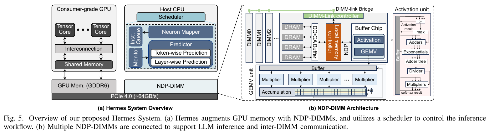
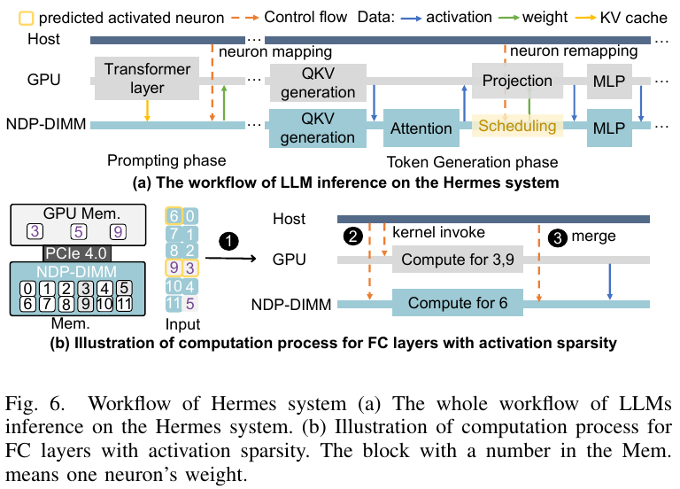

# Make LLM Inference Affordable to Everyone: Augmenting GPU Memory with NDP-DIMM

论文中的系统名为 **Hermes**。本文依据 [arXiv:2502.16963v1](https://arxiv.org/abs/2502.16963v1)（2025-02-24，HPCA 2025）阅读整理；已读正文第 I–VII 节及参考文献，当前版本无附录。下文页码均为 [本地 PDF](resources/hermes-2502.16963v1.pdf) 的 1-based 页码。

**阅读判断：这篇最值得借鉴的是“按计算强度分配神经元，再在线修正”的调度设计。完整性能收益依赖新增 NDP-DIMM 硬件；对现有 PC 的近期工程工作，优先参考软件调度，而不是把它当作可直接部署的 CPU 卸载框架。**

## 研究问题与核心思路

当模型放不进独显，普通卸载把权重留在主存，再经 PCIe 搬到 GPU 计算。Hermes 认为，冷神经元体积大、使用频率低，即使只搬实际激活的部分，PCIe 流量仍会占据主要时间。它把问题改为：**让冷神经元在存储它的 DIMM 附近计算，只传激活和结果，不反复搬权重。**（§II–III，p.3–4）

这里的“神经元”是权重矩阵中的一行或一列，并不是 MoE 的完整专家。作者观察到约 20% 的热神经元承担约 80% 的计算，而其余 80% 冷神经元只承担约 20%。以单位权重承载的计算量比较，二者之比为 `(0.8/0.2)/(0.2/0.8)=16`。GPU 承担计算密集的热部分，容量大、算力有限的 NDP-DIMM 承担冷部分。（§I、III-A，p.2、4）

该分布会随输入变化：作者在 LLaMA2-70B 上观察到约 52% 的初始热神经元在推理中表现出活动变化；固定映射因此不足。Hermes 使用三层决策：离线初始化 GPU/DIMM 放置，在线调整热/冷划分，再在多个 DIMM 之间平衡冷神经元负载。（§III-B、IV-B–D）

## 实现路径

### 1. NDP-DIMM 不是普通内存条的软件模式

*原文 Fig.5，PDF p.6，摘自上述 arXiv v1。右侧的 GEMV、activation 和 DIMM-link 都是新增硬件。*

作者选择 center-buffer-based 设计：每个 DIMM 的计算单元能访问本 DIMM 的全部数据，同时保留正常内存访问功能。它包含：（§IV-A，p.5；Table II，p.9）

- **GEMV 单元**：每 DIMM 一个 NDP core，256 个乘法器、归约累加树、256 KB buffer，设计频率 1 GHz；正文描述其 FP16 数据路径。
- **Activation 单元**：为 ReLU、softmax 配备指数、加法、乘法及归约等单元。
- **DIMM-link**：DIMM 间的额外点对点互连，8 条 25 Gb/s lane，合计 25 GB/s，用于直接迁移冷神经元。
- **主机调度器**：CPU 执行预测、监控和映射，发出 GPU kernel 与 NDP 命令；论文采用 PIM-SYCL 编程模型，GPU 侧调用如 `cudaLaunchKernel` 的接口。

因此，CPU 在 Hermes 中主要是控制方，冷神经元的矩阵运算由 NDP core 执行；把这部分换成普通 CPU 计算，对应的是论文的 **Hermes-host 基线**。

### 2. Prefill 与 decode 的放置不同，KV cache 也下沉到 DIMM

*原文 Fig.6，PDF p.6。图中 prompting 对应 prefill，token generation 对应 decode。*

Prefill 全部在 GPU 上按传统卸载方式执行，并记录神经元活动。结束后，仅保留选出的热神经元在显存中。Decode 每层按如下流程执行：（§IV-A.2，p.5–6）

1. **QKV projection**：GPU 计算热神经元，NDP-DIMM 计算冷神经元，结果在 DIMM 侧合并。
2. **Attention**：放在 NDP-DIMM 上执行，KV cache 也位于 DIMM，释放显存。
3. **输出 projection**：论文认为该部分不能利用所需的激活稀疏性，交给 GPU；DIMM 此时空闲，调度器利用这个窗口调整神经元放置。
4. **MLP**：再次按热/冷划分协同计算，在 DIMM 侧归约结果。

CPU 插入同步屏障保证 GPU/NDP 计算完成后合并。GPU 往往先完成，其结果传输可被 DIMM 计算覆盖。这是依赖两侧时长关系的重叠窗口，不是取消了同步或数据移动。

### 3. 三层调度各解决一个问题

**离线放置解决初始负载。** 作者用 C4、Pile 的 128 个样本采集激活频率，结合单神经元计算时间、存储容量与同步开销建立 ILP。其核心目标是最小化各层关键路径之和：

$$
\min \sum_l \max\left(T_{\mathrm{GPU},l},\max_j T_{\mathrm{DIMM}_j,l}\right),
\qquad T_{\mathrm{GPU},l}=T_{\mathrm{compute},l}+2T_{\mathrm{sync}}.
$$

设备容量约束限制权重放置；PuLP 求解约需 110 s，作为一次离线准备，不在逐 token 路径中求解。（§IV-B，式 1–7，p.6–7）

**在线预测解决热集合漂移。** 每个神经元维护 4-bit 状态 `s1`：激活时加 4，未激活时减 1，状态范围为 0–15；prefill 的激活频率用于初始化。另用离线相关表记录前一层最相关的两个神经元，令其中已激活的数量为 `s2`，按 `s1 + 6*s2 > 15` 预测当前神经元是否激活。热神经元划分另用阈值 `Th=10`。DIMM 保留全部权重副本，热神经元进入 GPU 时可直接覆盖较冷的显存槽，不必将被淘汰权重写回。（§IV-C，Fig.7–8，p.7–8）

**窗口重映射解决 DIMM 间倾斜。** 每 5 个 token 统计活动，按各 DIMM 的活动负载排序，配对最忙与最闲的 DIMM，再经 DIMM-link 迁移活跃冷神经元。窗口避免每 token 都迁移，目标是减少最慢 DIMM 对整层的拖累。（§IV-D，Algorithm 1，p.8–9）

### 4. 主要前提是激活稀疏性，不是低比特量化

OPT 使用原生 ReLU；LLaMA2 和 Falcon 使用将 SiLU/GELU 替换成 ReLU 的 SparseLLM 模型，QKV 生成前还加入 ReLU。稀疏性因此依赖模型版本和结构改动，不能把结果直接视为原始稠密 checkpoint 的无损加速。（§II-B、V-A.3，p.3、9–10）

文中的 **4-bit 是预测器状态，不是 W4 权重量化**。NDP 运算单元按 FP16 描述，论文没有给出 W4/W8 权重打包、反量化 kernel 或 KV 量化方案。对量化工程的启发在于：压缩权重会同时改变传输量、设备计算时间和热点放置，映射代价模型需要随精度一起调整；这是由架构推导的研究方向，不是本文已完成的实验。

## 实验条件与关键结果

### 测量、仿真和综合分别支持什么

| 部分 | 论文采用的方法与条件 | 结果的含义 |
| --- | --- | --- |
| GPU | RTX 4090，24 GB；Nsight Compute 测量 kernel 性能 | GPU 部分有实际测量 |
| NDP-DIMM | 修改 Ramulator 2.0 的内部仿真器；8 × 32 GB DDR4-3200，即 256 GB | NDP 与完整异构系统性能包含模拟部分 |
| NDP core | RTL 实现，Synopsys Design Compiler，TSMC 7 nm 综合 | Table II 报告每 core 面积开销 1.23 mm²，未展示量产 DIMM 的整机实测 |
| GPU/DIMM 通信 | 论文设 PCIe 4.0 带宽为 64 GB/s | 实际部署应区分方向、有效传输带宽及并发竞争 |
| 工作负载 | ChatGPT prompts、Alpaca；输入与输出长度均固定 128；batch 1–16 | 结果主要覆盖短输入、短输出、小 batch |

来源：§V-A、Table II，p.9–10。论文称指标为端到端生成吞吐（tokens/s），性能拆解也计入 prefill；不应把这些数值当成纯 decode kernel 吞吐。

### 先看可比的 CPU/GPU 协同基线

下表摘录 Fig.9–10 的 **batch=1** 结果；输入/输出均为 128 token。Hermes-host 使用 RTX 4090 + i9-13900K，CPU 内存带宽按 89.6 GB/s 配置。它和 Hermes 都使用热/冷神经元思路，区别在于冷部分由 CPU 还是 NDP 执行。（§V-A.2、V-B，p.9–10）

| 模型 | Hermes-host（tokens/s） | Hermes（tokens/s） | 两者之比 |
| --- | ---: | ---: | ---: |
| OPT-66B | 4.24 | 20.37 | 4.80× |
| LLaMA2-70B（ReLU 变体） | 1.97 | 13.75 | 6.98× |
| Falcon-40B（ReLU 变体） | 5.58 | 30.02 | 5.38× |

倍率由图中已四舍五入的数值相除得到。LLaMA2-70B 的 Hermes-base（有 NDP、无激活稀疏性）为 2.45 tokens/s，说明 13.75 tokens/s 同时依赖 NDP 和稀疏执行，不能全部归因于增加内存带宽。

原文有一处图间不一致：Falcon-40B 的 batch 1，Fig.10 标注 Hermes-host 为 5.58、Hermes-base 为 4.34，而 Fig.11 对应标注为 4.34 和 5.37 tokens/s。上表按 Fig.10 记录，不跨图合并这组基线。

与纯搬运权重的基线相比，倍率更大：Fig.9 的 OPT-66B 中，Accelerate、FlexGen、改造成卸载系统的 Deja Vu 分别为 0.04、0.09、0.16 tokens/s。论文报告跨 batch 的平均收益为相对 FlexGen **148.98×**、相对 Deja Vu **75.24×**；这些数值来自受 PCIe 搬运限制的基线，且 Fig.11 中后两者只在 OPT-66B 上有结果，Falcon/LLaMA 对应位置为 N.P.，不能把 75.24×写成对所有模型或现代量化推理框架的统一收益。（§V-B，Fig.9、11，p.9–11）

### 消融比 headline 更能解释收益来源

- 离线映射相对随机映射改善 **1.63×**；再加在线热/冷调整改善 **1.33×**；再平衡 DIMM 冷神经元改善 **1.29×**。这是 Fig.13 的 **MLP block 调度消融**，不直接等于端到端收益。（§V-C，p.10–11）
- 作者报告预测准确率约 **98%**、内存占用小于 **1 MB**；LLaMA-7B 的状态表为 **232 KB**，相关表未单独列出大小。预测器运行时开销低于 **0.1%**。（§IV-C、V-D，p.8、11）
- LLaMA2-70B 从 batch 1 的 **13.75** 到 batch 16 的 **57.02 tokens/s**，后者是 batch 吞吐，不是每条请求的输出速率。（Fig.11，p.11）
- 加速 decode 后，prefill 占 batch 1 执行时间约 **33.01%**。NDP 从 8 个增至 16 个时，LLaMA2-70B 收益已趋于饱和；继续堆 DIMM 不能解除 GPU 侧瓶颈。（§V-D–E，p.12）
- 与 5 × A100-40GB-SXM4 的 TensorRT-LLM 相比，在同样 128/128 长度下，Hermes 吞吐为其 batch 1 时的 **79.1%**、batch 16 时的 **24.4%**。这更适合说明“小 batch 的成本/吞吐折中”，而非替代高吞吐服务器。文中的约 2,500 美元成本是作者估算，未列出 NDP 制造、整机集成与量产成本明细。（§V-F，Fig.17，p.12–13）

## 理解、局限与疑问

### 对当前研究方向的价值

**独显台式机/笔记本：** 可直接借鉴“CPU/GPU 双侧计算时间取最大值”的代价模型，以及热状态、相关性和迁移开销驱动的放置策略。实际 CPU 内存带宽、NUMA 和 PCIe 条件必须重新测量。NDP 内部带宽与 DIMM-link 是该论文额外引入的硬件能力，普通内存条没有这些计算和通信路径。

**CPU/GPU 共用 DRAM 的端侧设备：** 热/冷划分和负载均衡仍有参考价值，但其主要矛盾会从 PCIe 权重搬运转为共享带宽竞争、不同执行单元的 kernel 效率与同步。不能在保持 Hermes 带宽假设不变的情况下，把独显结果迁移到 Jetson 或手机。

**量化与稀疏协同：** 本文提供了一个有用的系统分解方式，但量化后权重能否更多驻留显存、稀疏 gather 是否抵消低比特 kernel 收益、两侧是否支持相同数值格式，都尚未在本文中验证。当前索引应归在稀疏推理、异构卸载、近数据处理和体系结构仿真，而不是权重/KV 量化实现。

### 影响复用的证据缺口

1. **模型质量的条件不完整。** 正文称结构改动后的精度损失小于 1%，但本版本没有给出相应逐任务质量表；也未清楚展开预测漏报后的补算或回退路径。“98% 预测准确率”不能代替生成质量评估。（§IV-C、V-A.3）
2. **通信配置需要核实口径。** 文中统一用 PCIe 4.0 64 GB/s，但未充分说明单向/双向和实测有效带宽；复用延迟模型时应把 GPU→DIMM、DIMM→GPU 和 DIMM-link 分开计入，而不是共用一个峰值。
3. **短上下文结果不足以说明长上下文能力。** Attention/KV 被放在 DIMM 是明确的数据流设计，但实验长度仅 128/128；KV 增长后的容量、带宽和延迟曲线没有展开。（§V-A.4）
4. **Algorithm 1 不能直接照抄。** 原页将 DIMM 负载降序排序后，循环条件却写为 `Z_id ≤ Z_(J-id)`，与从重载侧向轻载侧迁移的文字意图相反；迁移后也没有显式更新负载。实现时需依据负载均衡目标补全停止条件和状态更新。（p.9）

本次完成论文阅读与图表核对，未执行推理复现。两张原图的版本、页码和裁剪参数见 [图表来源清单](resources/asset-sources.yaml)。
