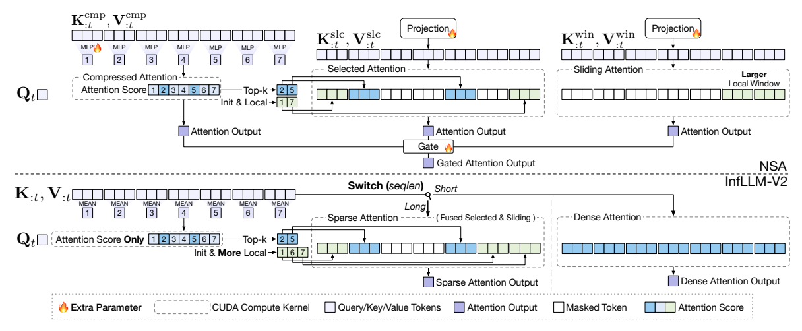
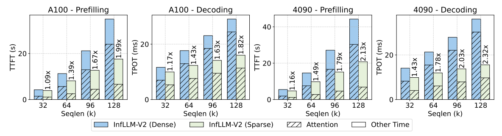

# InfLLM-V2: Dense-Sparse Switchable Attention for Seamless Short-to-Long Adaptation

读的是 [ICLR 2026 正式版](https://proceedings.iclr.cc/paper_files/paper/2026/file/716e60181e1782f5bd0a629033f85310-Paper-Conference.pdf)，范围为正文第 1–5 节与附录 B–D。主要看两个问题：怎样从已有的短序列稠密模型改出可训练的稀疏注意力？长序列省下的计算，扣掉选块之后还有多少？下文结果均为作者报告，未运行代码。

## 1–2. 先把短序列模型训好，再改注意力

已有的稠密模型往往先在短序列上预训练，再用少量长文本继续训练。直接套上免训练稀疏规则，省得越多，质量越容易掉；为稀疏模式从头训练，又用不上已有的稠密检查点。论文选了中间路线：保留已有的一套投影权重，在长序列微调中换掉注意力的可见范围。

作者以 NSA 为对照。NSA 把压缩、选块、滑窗三路注意力的输出做门控混合；把一个单路稠密层换成这套结构，就得重新适配新增的投影与门控。InfLLM-V2 借用了 NSA 的块稀疏和组内共享选块，但保留一套 KV 投影、一次注意力输出。初版 InfLLM 则是免训练的块检索方法，在这篇论文里是另一个基线。（第 1–2 节，图 1，PDF 第 2 页）

## 3. 同一套权重，两条注意力路径

**先定能看哪里，再算输出。** 短序列仍走标准的稠密 GQA。长序列里，每个 query token 都能看开头的块和当前附近的块，再从较早的其余块里按分数选 top-k。局部块已经涵盖滑窗，不必单独再算一路滑窗注意力。压缩分支只负责打分；最终的 softmax 和加权求和只做一次，用的是选中块里的原始 K、V。因为 top-k 的离散索引不给压缩 MLP 提供梯度，作者直接用无参数的池化；索引用到的 K 仍来自随长文本微调更新的共享投影。（§3.1–3.2，图 2–3，PDF 第 3–5 页）

图 2 InfLLM-V2 的压缩分支只给块打分，不再单独输出注意力结果。

**块分数从重叠小窗口来。** 一个 64-token 块若只取一个均值，局部的强相关信号容易被摊薄。论文先用窗口宽度 32、步长 16 对 K 做平均池化；用单个 query token 的各个头分别和这些摘要打分、归一化，再把同一 GQA 组的分数相加。最后对连续的 5 个摘要分数取最大值，步长为 4 个摘要，得到与 64-token 注意力块对齐的分数。同组 query 头因此读同一批 KV 块，选块仍随 query token 变化，不必等一个 query 块凑满才做决定。（§3.3，式 4–7，PDF 第 5–6 页）

**别把逐头分数矩阵写出片上 SRAM。** 先算完每头的 softmax 再回显存求和，会写出约 $h_q n^2/16$ 个分数，其中 $h_q$ 是 query 头数，$n$ 是序列长度。作者把头组求和放进 CUDA kernel，只写每组一份结果；实验设置每组 16 个 query 头。每头的归一化必须先做，所以 kernel 扫两遍 K 摘要：先用更粗的 128-token 窗口、64-token 步长近似 log-sum-exp（LSE），再用原来更密的摘要重算并归一化分数。粗扫的位置约是细扫的四分之一，打分工作量因此约为单次细扫的 1.25 倍，而不是两次细扫的 2 倍。这里近似的是**选块分数**，不是最终稀疏注意力的归一化。论文的算法 1 到组内求和为止，未把后续最大池化和 top-k 都融合进这个 kernel。（§3.4、附录 B，PDF 第 6、15–16 页）

## 4. 从同一个 8B 检查点接着训

### 实验怎么对齐

作者先用 4k-token 序列训练稠密 GQA 8B 模型（32 个 query 头、2 个 KV 头、头维度 128；预训练共 8 万亿 token，每批 800 万 token），再用 50 亿 token 继续训练，覆盖 0–4k、4–12k、12–24k、24–32k 四个长度段，各段 token 数相同。稀疏配置每个 query 最多看 96 块：开头 1 块、近处 32 块、检索 63 块，合计 6,144 个可见 KV token。FullAttn 用同样的长文本训练配置；NSA 对照组将原投影复制给三路，用的是第三方 Triton 实现。图 5 里，NSA 在切换时损失跳升，InfLLM-V2 的曲线更贴近 FullAttn。这个对照回答的是**同一稠密检查点如何转成稀疏**，不能代替 NSA 从头训练的结果。（§4.1，图 5，PDF 第 7–8 页）

### 平均分稳住了，单项仍有差异

| 任务（作者报告） | FullAttn | NSA | InfLLM-V2 稀疏 | InfLLM-V2 切回稠密 |
| --- | ---: | ---: | ---: | ---: |
| RULER，32k-token 输入，平均分（越高越好） | 84.26 | 59.92 | 82.62 | 88.32 |
| LongBench，六类任务宏平均分（越高越好） | 42.30 | 37.10 | 42.54 | 42.49 |
| LongPPL，困惑度（越低越好） | 2.06 | 4.24 | 2.12 | 2.00 |
| 长推理，数学与代码五项平均分（越高越好） | 42.79 | 37.28 | 42.66 | 40.53 |
| 通用任务，七项零样本平均分（越高越好） | 67.41 | 60.63 | 未报告 | 66.76 |

数据来自表 1–4（PDF 第 7–9 页）与附录 C（PDF 第 16 页），各行按论文的评分口径列出。长推理评测另在数学和代码推理数据上微调；正文未逐项列明任务评测的硬件、batch 和输出长度。摘要里的“保留 98.1% 和 99.7%”可分别由 RULER 与长推理表中的稀疏/FullAttn 平均分相除得到，不能当作每项任务的保底。例如 RULER 的 MK3 从 92.00 降到 62.00，MV 却从 82.00 升到 98.50。短序列通用任务的 66.76 也略低于微调前 SHORT 的 67.73；“能切回去”不等于每项分数不变。

### 内核收益和整模型收益分开看

在 batch=1 的内核实验里，作者把选块与稀疏注意力一起计时。128k-token 序列、可见 16 块（1,024 个 KV token）时，相对 FlashAttention-2，InfLLM-V2 在 A100 和 RTX 4090 分别为 7.4×、9.3×；换成质量实验用的 96 块（6,144 个 KV token），分别为 3.1×、4.0×。NSA 在图 6 的内核对照未计滑窗。表 5 同样在 128k-token 序列、16 个可见块下测选块，把两次细扫改为一粗一细后，A100 从 75.36 ms 降到 56.59 ms，RTX 4090 从 83.26 ms 降到 59.04 ms。（§4.3，图 6 和表 5，PDF 第 9 页）

整模型测试另有一组数：8B 模型、W4A16、batch=1、可见 96 块，以同模型的稠密模式为基线。128k-token 上下文下，按稠密/稀疏耗时算加速比，A100 的首 token 时间（TTFT，秒）和解码每 token 时间（TPOT，毫秒）分别为 1.99×、1.82×；RTX 4090 分别为 2.13×、2.32×。图 7 未注明生成 token 总数。在较短的 32k-token 上下文下，RTX 4090 的 TTFT 加速比只有 1.16×，A100 为 1.09×。实际部署更该看这条随输入长度变化的曲线，而不是图 6 里最稀的那根柱子。（§4.3，图 7，PDF 第 9 页）

图 7 柱形区分注意力耗时和其余耗时；标注的倍率比较的是两种模式的总耗时。

## 5. 适用边界

块预算减少的是每次注意力读取的 KV 量，不是 KV 的驻留容量。未来 query 还可能选到当前跳过的块，不能据此把缓存按 6,144 token 封顶。论文的选块仍要扫历史 K 摘要；融合减少了中间读写，没有消除长 prefill 中这部分随序列增长的开销。

附录 D 的表 7（PDF 第 16 页）也给了选预算的线索：保持开头 1 块和近处 32 块，检索从 31 块加到 63 块，RULER 由 76.14 涨到 82.62；再加到 95 块，只到 84.89。这个转折点属于作者的模型、数据与块大小。若要在端侧评估，我会先用目标设备测不同上下文长度下的 TTFT、TPOT、显存峰值，再找稠密/稀疏的切换点。W4A16 是作者的速度测试配置，不是本方法对 KV 做了低比特量化。

实现入口见 [OpenBMB CUDA 仓库](https://github.com/OpenBMB/infllmv2_cuda_impl)和[长序列基础模型卡](https://huggingface.co/openbmb/InfLLM-V2-Long-Sparse-Base)。模型卡列出的稀疏路径是 Transformers 和 CPM.cu；同一卡片把 vLLM、SGLang 列在稠密路径，不能按“模型能加载”就记成跑通了稀疏推理。
