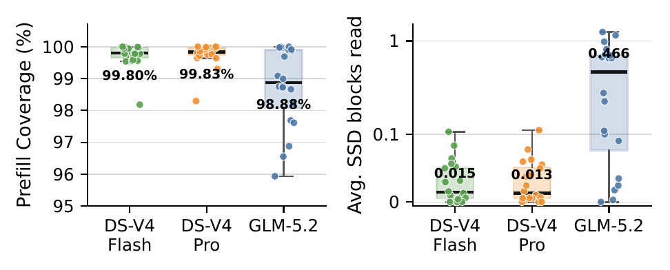
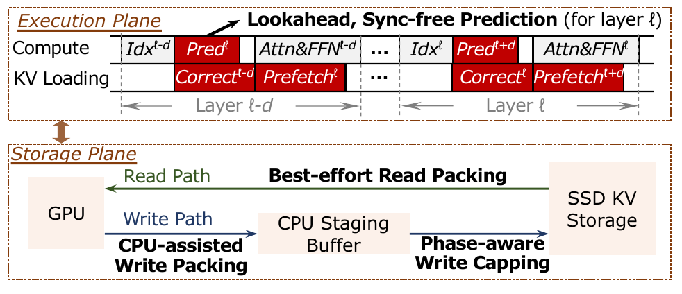

# Efficient Agentic LLM Serving over SSD-based Sparse KV Storage

来源：[arXiv v1，2026-09-29](https://arxiv.org/abs/2609.36938v1)。重点读了 §2–5 的访问路径、三组 agent 轨迹和对照实验，并核对了[作者的代码说明](https://github.com/WenhaoHe02/Janus)。这里关心的是工具返回之后的那次前向计算：历史 KV 已经在 SSD 上，本轮新来的约一千个 token，要把多少旧数据搬回显卡？

## 一轮调用里，读旧 KV 最多的是哪一步？

Agent 把工具结果接到会话末尾。模型只对新增 token 做前向计算（append prefill），但其中每个 query 都可能访问很久以前的 token。即使每个 query 只选少量历史，整段输入要读的也是所有选择的**并集**。只测生成一个 token 要取多少页，容易低估这一轮的开销。

| 轨迹（论文表 2，各列分别取中位数） | 轮前历史 / token | 本轮新增输入 / token | 本轮输出 / token |
| --- | ---: | ---: | ---: |
| SWE-Bench-Pro 生成的轨迹 | 77K | 901 | 228 |
| Terminal-Bench 生成的轨迹 | 131K | 1.3K | 404 |
| 合作方提供的轨迹 | 70K | 2.2K | 216 |

作者从轨迹里抽了 20 轮。图 2 左边问的是：**decode 需要的历史 KV，有多少在本轮 append prefill 时就已经读进显存？** 三个模型的图中标注分别为 99.80%、99.83%、98.88%。分母是 *decode 用到的历史 KV*，不是整段历史。这个结果说明后续生成大多能复用刚读进来的数据；它没有告诉我们 prefill 可以跳过多少历史，更不是显存峰值测量。

图源：He 等，[arXiv v1，图 2，PDF 第 5 页](https://arxiv.org/pdf/2609.36938v1#page=5)，按 [CC BY 4.0](https://creativecommons.org/licenses/by/4.0/) 裁取原图。

## 提前读可以猜，attention 真正用到的 KV 必须取齐

设目标层为 ℓ。在前面第 ℓ−d 层，Janus 先拿当时的隐藏状态，运行一次**目标层自己的索引器**。它为每个新增 token 预测一组历史位置，再把各组取并集，向 SSD 发出预读。等真正执行到 ℓ 层，原模型照常算精确选择；预测漏掉的项先补读，再执行 attention。稠密层的 KV、索引器用的 key 等可事先确定的数据则按层预取，不经过这一步猜测。

图源：He 等，[arXiv v1，图 4，PDF 第 6 页](https://arxiv.org/pdf/2609.36938v1#page=6)，按 [CC BY 4.0](https://creativecommons.org/licenses/by/4.0/) 裁取原图。上半图的 Correct 是补读缺页；下半图的 CPU 缓冲区用于打包写回，不能把它当成实验中历史 KV 的主存储。

提前太远有个陷阱：不同 token 的预测越来越分散，并集越摊越大。即便把真正要用的页都猜中了，也可能白读许多页。因此图 5 同时看召回率和精确率。作者在两款 DeepSeek-V4 上提前 2 层，在 GLM-5.2 上提前 4 层。8 张卡各自预测、读取自己负责的历史分片，不必为一次投机读取先等全局 top-k。单卡没有这份并行算力，预测本身花的时间要重新计。

读和写也有不同的安排。读侧把地址相邻的选中块合成一条命令，减少请求数，不把中间没选的块一并读走。写侧由 CPU 把零散 KV 页拼好再顺序写盘，避免在 GPU 上打包时和模型抢计算资源。遇到读请求时再限制后台写带宽，让下一轮的首 token 不必排在一串写请求后面（§4.3）。

## 只读选中的页，为什么还可能输给全读？

作者在一台 8×H200（每卡 141 GB）服务器上，用 vLLM 运行 DeepSeek-V4-Flash、V4-Pro 和 GLM-5.2，权重与 KV 均为 FP8。机器装有 1 TB 主存和 8 块 7.68 TB NVMe SSD，但为考察 SSD，实验把可用主存限制在 16 GB，LMCache 也只用 SSD。图 11 单独执行每条追加请求，按历史长度和追加占比分组；下表是三组轨迹的 TTFT 加速比，长度分布见上表。它不是固定 batch 的吞吐测试。

| 对照（§5.2，图 11） | Janus 平均 / 最高加速 | 这个对照能说明什么 |
| --- | ---: | --- |
| Tutti：GPU 发起 I/O，载入全部历史 KV | 1.22× / 1.57× | 整段读取有冗余，但可以早发起，部分传输能藏在计算里。 |
| LMCache：由 CPU 发起 I/O，实验设为 SSD-only | 1.85× / 3.69× | 差别包括 I/O 路径和读多少数据，不能把全部收益归给预测。 |
| Janus-base：同样稀疏读取，等精确选择后才发起 | 1.27× / 1.71× | 最能看出提前读的价值。若选完才读，作者发现不少请求甚至比 Tutti 全读更慢。 |

图 13 改测带排队的服务请求。相比 Janus-base，Janus 的 P95 TTFT 加速为 1.01×–1.68×；各方案每个输出 token 的耗时（TPOT）相差约 3%。受益的是工具返回到模型再次开口的那段时间。以上是作者报告的结果，未在本地运行。

## 用这篇论文设计单卡对照

[作者实现](https://github.com/WenhaoHe02/Janus)要求 Linux、Hopper（`sm_90`）和 Tutti 的 NVMe 读路径。若目标是 5090 加普通主存，适合借的是它把“选哪几页”和“何时读页”分开测试的办法，不必先移植整套 SSD 后端。

[ECHO](../echo/notes.md) 把一次主存回读藏在同层下一块 query 的索引计算后面；Janus 面对更慢的 SSD，从前几层就开始读。两者都能保留**原生稀疏模型**的选择。若给 Qwen 的 full-attention 层另加选页器，补齐“选中但没预取”的页只能纠正搬运遗漏，不能纠正选页器漏掉的重要信息。任务成功率要单独测。

在 RTX 5090 上，我会先让同一条 64K 或 128K 历史停在 CPU，把同一段 1K 工具输出分别送入两条路径：一条用双缓冲逐层顺序搬运，完整计算 attention；一条先选页，再只搬选中页。记录每层去重后的页数、实际 PCIe 字节数、峰值显存和整轮 TTFT。只有第二条路径的页并集确实小、质量也能接受，才值得继续比较“等选完再取”和“提前预取”。这样才能分清是少读起了作用，还是把读取挪出了等待时间。
