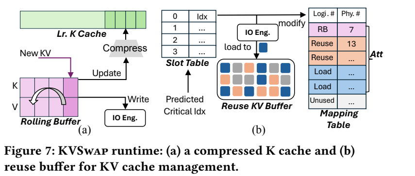
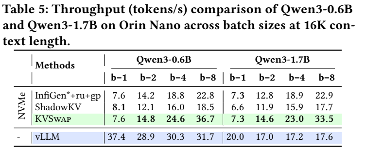

# KVSwap: Disk-aware KV Cache Offloading for Long-Context On-device Inference

- 主读版本：**MobiSys 2026 正式发表版**，[DOI](https://doi.org/10.1145/3745756.3809234)、[大学机构库](https://eprints.whiterose.ac.uk/id/eprint/240121/)、[本地 PDF](resources/kvswap-mobisys2026.pdf)。已读实际 14 页，正文 PDF p1–12、参考文献 p13–14，印刷页 723–736；下文页码默认指此 PDF 的 1-based 页码。
- 正式版正文仍引用附录 A/B，但这份 PDF 未附这些页。另读已有 [arXiv v2](resources/kvswap.pdf) 的正文与附录 A/B（17 页，附录 p16–17），只将其参数搜索细节作为明确标注版本的补充。正式版新增 Orin Nano、128K、跨域和多程序实验，不能用旧预印本代替这些证据。
- 阅读日期：2026-10-30。另只读检查了[官方实现](https://github.com/hwhwz23/KVSWAP-CODE)的评测说明及关键模块；未运行模型或基准。

## 研究问题与核心思路

**这是统一内存设备上“把 KV 放到磁盘后，怎样仍然有效解码”的系统工作。** CPU 与 GPU 共用物理内存时，把 KV 从 GPU 分配区搬到 CPU 分配区不能解决总容量不足。KVSwap 把完整 KV 放到 NVMe/eMMC，内存只保留用于预测的低秩 K 摘要、当前需要的 KV 以及少量复用/新生成缓冲。（§1–3）

困难不只是磁盘带宽低：按单个 head/token 零散读取，会把名义带宽进一步浪费在大量小请求上。论文实测 512-byte 随机读取时，NVMe 和 eMMC 都不足各自峰值带宽的 6%。因此，KV 选择粒度必须与存储布局、预取和 attention 内核一起设计。（§2.3，p3，Figure 2）

核心链路是：**低秩摘要预测下一层需要的 token 组 → 按连续块预取 → 复用命中组 → GPU 对选中的原始 KV 做稀疏 attention**。磁盘保留完整历史，可在后续 step 重新取回；这不同于永久删除历史 KV，也不同于把实际 attention 的 KV 量化成 2/4-bit。

## 实现路径

### 低秩 K 只负责找索引，不替代实际 attention 的 K

把 K 从多头形式展平为 $K_{\mathrm{flat}}\in\mathbb R^{N\times(H_{kv}d)}$，离线对采样 K 做 SVD，取投影 $A\in\mathbb R^{(H_{kv}d)\times r}$。运行时保存 $K_{lr}=K_{\mathrm{flat}}A$，压缩比为 $\sigma=H_{kv}d/r$。对 query head $h$，借用其对应 KV head 的投影切片：

$$
Q_hK_{g(h)}^\top\approx (Q_hA_{g(h)})K_{lr}^\top.
$$

这样不必先恢复完整 K 才能计算预测分数。低秩误差主要影响“选哪些 KV”，选中后实际 attention 仍读取磁盘上的原始 KV；因此可以比直接用低秩重建 K 做 attention 更激进地压缩预测元数据。（§3.2–3.3，p4–5，式 1）

跨层预取以第 $i-1$ 层输入近似第 $i$ 层输入，提前生成下一层 query 的近似值。**正式版明确前两层使用精确输入**，之后才使用上一层近似：浅层隐藏状态相似度低，不能将所有层一概提前预测。（§3.3、§6.1）

### 分组选择换取真实 I/O 带宽

先聚合各 head 的预测分数，再对连续 $G$ 个 token 的组取最大分数，Top-K 选出 $M$ 组。默认 $MG=400$；这是每条序列所选 token 位置数，实际 KV 数据量仍乘以 KV head 数、维度和 K/V 两份数据。

磁盘布局把同一组所有 heads 的 K/V 连续放置。更大的 $G$ 减少碎片请求，但同样 $MG$ 下，可独立挑选的组更少，可能把重要 token 与不重要邻居绑定起来。正式版实验使用 NVMe 的 $G=4$、eMMC 的 $G=8$；这不是跨磁盘通用常数。（§3.3、§3.6、§5.1）

### 两种缓冲分别解决复用与新 token 正确性

*原文 Figure 7，MobiSys 2026，PDF p5 / 印刷 p727；原图及原图注裁剪，来源与坐标见 [asset-sources.yaml](resources/asset-sources.yaml)。*

- **Rolling buffer（RB）**：新生成 token 尚未凑满一个 $G$ 大小的组时，仍留在内存并参与 attention。凑满后写盘、更新摘要。否则最近 token 会在组预测中暂时消失。
- **Reuse buffer**：保留之前从磁盘加载的热点 KV 组，避免下一 step 重读。论文描述固定槽位和 FIFO 替换；slot table 跟踪命中。
- **逻辑映射表**：把复用命中、磁盘新加载和 RB 中的 KV 接入 PagedAttention，使 attention 按逻辑块访问，而不是要求历史 KV 的原物理位置连续。（§3.4，p5–6）

正式版 §3.6 补充了实际路径：约 5K 行 Python 扩展 FlexGen，使用 PyTorch 算子和 vLLM PagedAttention；Linux `io_uring` 做异步磁盘 I/O，**CPU pinned staging buffer** 中转磁盘和 GPU 分配区。统一物理内存不意味着软件路径自动零拷贝；miss 数据批量搬入连续区域，再更新映射，避免大量零碎复制。

### 离线参数搜索，而非运行时万能调度器

搜索在给定 KV 内存上限、最大上下文和 batch 下，联合选择 $G,\sigma,M,C$（$C$ 为复用容量）。作者报告调优少于 30 分钟，结果写 JSON；它是质量、容量、吞吐之间的贪心局部搜索，不是全局最优证明。（§3.5，p6）

**arXiv v2 附录 A 的补充细节：**预先建立压缩率/投影和复用容量/命中率查表，默认用 C4 的 20 个采样 batches；对 batch、上下文及参数组合 profile 单层，用插值补点。先找满足容量的压缩率，再找可掩盖 I/O 的最小分组；必要时增大复用容量、重新调整压缩率。允许部分 I/O 未被掩盖的松弛系数，防止为了完全 overlap 过度损害质量。运行时查对应配置，缺少精确点时使用最近的配置。该附录来自 v2，不将其具体默认值自动视为已核对正式版代码的全部行为。

### 官方实现核对到哪里

以下是 2026-10-30 对官方 `main` 的只读检查，未固定不可变 commit，也未执行：

| 模块 | 直接读到的内容 | 对工程使用的意义 |
| --- | --- | --- |
| [`methods.py`](https://github.com/hwhwz23/KVSWAP-CODE/blob/main/engine/src/methods.py) | `lr_proj2_mh` 低秩多头预测；head 聚合、组内 `amax`、`topk` | 分组预测有具体计算路径，不只是论文伪代码；这里 head 聚合用 mean，固定 head 数时与 sum 的排序等价 |
| [`cache_manager.py`](https://github.com/hwhwz23/KVSWAP-CODE/blob/main/engine/src/cache_manager.py) | 默认 `float16` CUDA KV buffer、逐层 RB、命中 mask、block tables、`PagedAttention.write_to_paged_cache` | 已落实实际缓存布局和内核接口；检查到的替换逻辑按当前命中集合找可写槽位，不能仅凭论文的 FIFO 一词推断此版本所有容量配置的行为 |
| [`uring_io.py`](https://github.com/hwhwz23/KVSWAP-CODE/blob/main/engine/src/diskio/uring_io.py) | 独立读写 ring、SQPOLL、512-byte 对齐断言、group offset、批量提交和 CPU worker 亲和性 | Linux I/O 与布局的耦合是真实工程要求，不是将路径改成手机目录就能移植；默认 `do_fsync=False`，磁盘 backing store 也不等于断电可恢复的持久化保证 |

[评测说明](https://github.com/hwhwz23/KVSWAP-CODE/blob/main/README.md)把质量测试与 Orin 吞吐测试分开；[质量说明](https://github.com/hwhwz23/KVSWAP-CODE/blob/main/quality/README.md)推荐 A100 80 GB 服务器，部分评分使用外部 judge API。不能把全部质量测试的运行设备写成 Orin。下载代码时还要注意官方仓库含大量 Git LFS 数据；阅读本论文无需下载模型或运行其安装脚本。

## 实验条件与关键结果

### 先区分物理 RAM、KV 配额与模型权重

| 项目 | 正式版报告的条件 |
| --- | --- |
| 主平台 | Jetson AGX Orin，12 核 Arm Cortex-A78、2048 CUDA cores、64 GB 统一内存 |
| 补充平台 | Jetson Orin Nano，6 核 CPU、1024 CUDA cores、8 GB RAM |
| 存储 | NVMe 实测约 1.8 GB/s、eMMC 约 250 MB/s；未实测 UFS |
| 软件 | JetPack 6.2、Linux 5.15.148-tegra、CUDA 12.6、PyTorch 2.7 |
| 模型 | Llama-3.1-8B-Instruct、Llama-3.2-3B-Instruct；Qwen3 系列（Nano 0.6B/1.7B，其他实验 4B/8B/14B）；Qwen2.5-VL-3B/7B、InternVL3-14B |
| 数值精度 | 文中容量例与 KV 条目按 16-bit 浮点计算，代码缓存默认 FP16；§4 未统一列出每个 checkpoint/算子的 dtype，不把所有模型概括为已核对的 W16A16 配置 |
| 任务 | RULER 32K；LongBench/NIAH 4K–32K；MLVU 视频上下文 22K–32K；另有 128K、跨域及长输出实验 |
| 吞吐指标 | decode 总 tokens/s，连续生成 1000 tokens，5 次不同随机输入运行取均值；batch 1–16，Nano 1–8 |

来源：§4，p6–7。**310 MiB / 120 MiB 是单条 batch 元素的 KV 管理预算，不是整个模型的内存占用。**在 Llama3-8B、32K 下，Setting A 分别约为完整 KV 的 1/13 与 1/34；Setting B 固定所有卸载方法总 KV 配额为 2000/800 MiB，再允许各方法用其最大 batch。vLLM 则使用权重/工作区之外的全部可用 RAM，Llama3-8B 配给 31 GiB KV；不是与 KVSwap 等配额的基线。

基线也经过适配：InfiniGen/ShadowKV 改为磁盘卸载；Loki 的近似 attention 被嵌入预测器。`*` 表示增加 head 聚合，`+ru` 加复用，`+gp` 加分组。它们在此处的表现不能直接解释为各原始服务器系统的固有效率。

### 吞吐提升主要在容量受限的批量路径，不是单请求普遍更快

下表取正式版 Table 4（p9）的 **32K、AGX Orin、Llama3-8B**，单位为总 tok/s：

| 方法 | NVMe b=1 | NVMe b=8 | NVMe b=16 | eMMC b=1 | eMMC b=8 | eMMC b=16 |
| --- | ---: | ---: | ---: | ---: | ---: | ---: |
| KVSwap | 6.9 | 35.6 | 46.8 | 6.0 | 15.7 | 10.9 |
| ShadowKV | 6.4 | 21.5 | 26.2 | 3.0 | 3.8 | 3.4 |
| InfiniGen*+ru+gp | 5.1 | 15.4 | 19.1 | 5.0 | 12.1 | 10.1 |
| vLLM（无磁盘，较大 KV 配额） | 9.2 | 20.8 | 23.2 | 9.2 | 20.8 | 23.2 |

NVMe 上 b=16 相对 ShadowKV 为 $46.8/26.2\approx1.79\times$；eMMC b=8 相对 ShadowKV 为 $15.7/3.8\approx4.13\times$，但相对新增的 `InfiniGen*+ru+gp` 只有 $15.7/12.1\approx1.30\times$。因此摘要的“4.1×”必须跟具体基线一起引用。eMMC 增大到 b=16 反而更慢，说明磁盘吞吐已饱和。

*原文 Table 5，MobiSys 2026，PDF p9 / 印刷 p731，NVMe、16K 上下文。保留原表标题、单位、两个模型和所有 batch。*

Nano 更能说明交互与批处理的区别：Qwen3-0.6B，b=1 时 KVSwap **7.6** 对 vLLM **37.4 tok/s**；b=8 时变成 **36.7** 对 **31.7 tok/s**。Qwen3-1.7B 对应 b=1 **7.3 vs 20.0**、b=8 **33.5 vs 17.6**。能用更小 KV 内存完成批量请求，并不代表单人聊天延迟更低；也不能把总 tok/s 当作每个请求的速度。

### 保留质量代价，而不只写“无损”

正式版 Table 2（p9）把变化列标作 relative loss (%)，但各项表现为相对原始百分比分数的直接差值，例如 InfiniGen 的 MQ 从 98.8 降去 98.8；下表按**分数点差/百分点**保留这些值，不再除以基线冒充同一种指标。

| Llama3-8B 配置 | RULER 平均分变化（Full 91.6） | LongBench 平均分变化（Full 54.2） |
| --- | ---: | ---: |
| KVSwap NVMe，1/13 KV 预算 | −2.6 | −0.6 |
| KVSwap eMMC，1/13 | −4.4 | −1.1 |
| KVSwap-t NVMe，1/34 | −5.6 | −2.4 |
| KVSwap-t eMMC，1/34 | **−22.9** | −2.7 |

最紧预算的 eMMC 在 RULER 多查询/多值任务上损失很大，平均分约为 $91.6-22.9=68.7$。正文“保持可用质量”的概括不应遮蔽这个条件；更粗的磁盘分组对任务质量有实际影响。

正式版新增的结果也要分开看：

- **128K**：Llama3-8B、每条序列 1 GiB KV 预算，S1/S2/MK1 得分 87/87/85，Full-KV 为 100/100/97；主要证明在此配额下的长度支持与检索质量，未提供同条件吞吐。（Table 6，p10）
- **跨域校准**：Qwen3-8B thinking，C4-profiled 在 MATH-500 / LiveCodeBench-v5 得 92.0 / 55.7，Full-KV 为 92.4 / 56.9；与 in-domain adapter 最大差 0.8 点。这支持两个任务上的迁移，不是任意分布保证。（Table 7，p10）
- **长输出**：LongBench-Write 筛选后 59 个样本、最高约 30K decode tokens；Qwen3-8B 下 KVSwap 每条 350 MiB、得分 4.28/5，SnapKV 约 4.2 GiB、4.14/5。此比较重点是后续生成 KV 的增长，不能当作等内存算法优劣排行。（§6.3，p12）
- **资源争用**：AGX Orin、Llama3-8B、b=8、16K，与 CPU 软件视频解码共跑时吞吐下降 17.2%/15.0%（NVMe/eMMC）；与 GPU YOLO11x 共跑下降 48.1%/28.2%。实验刻意不用 NVDEC/VIC/DLA，揭示的是争用条件，不代表所有常规视频播放都如此。（§5.7，p10）

### 消融解释了收益来自哪里

- 在 QMSum/MuSiQue 的 100 个输入中，复用率为 75.3%–81.2%，相对关闭复用，NVMe 吞吐提升 2.0–2.1×，eMMC 提升 3.8–4.0×。（Table 8，p11）
- 关闭复用后单独改变 $G$，NVMe 从 1.8 到 19.1 tok/s、eMMC 从 0.1 到 4.2 tok/s，同时三个 RULER 子任务平均质量从 88.8 降到 83.3；分组收益与复用收益不可重复相乘当成端到端加速。（Figure 12，p11）
- 单层延迟分解：b=8、32K、NVMe，完整 KVSwap 为 6.9 ms，其中计算 2.2、未被掩盖的 predictor 1.1、复用操作 1.0、磁盘 I/O 2.6 ms。这里不是整模型 token 延迟，也不是“预测完全免费”。（Figure 13 / §6.2）
- 310 MiB KV 预算的分解为低秩 K 256、reuse 50、RB 与 CPU staging 共约 4 MiB；120 MiB 时低秩 K 变为 64 MiB，其余基本不变。预算减少主要压缩预测摘要，不是改变原始 KV 的位宽。（§6.2）

## 理解、局限与疑问

**对当前方向，优先把 KVSwap 当作 Jetson 上“存储布局—KV 预测—异步 I/O—attention”联合设计的参考。** 相比仅报告 KV 稀疏率的算法，它给出了真实磁盘、缓存管理和 PagedAttention 接口。最值得研究的是同一质量约束下，组大小、复用容量与磁盘实际随机读取性能的联合选择。

1. **它解决的是 KV 容量，不是权重放不下。** AGX 主实验使用 64 GB RAM；小于 500 MiB 的数字只是 KV 管理预算。正式版 Nano 的实测模型是 0.6B/1.7B，不是把 8B FP16 模型直接塞进 8 GB 设备。
2. **压缩摘要和低比特量化应分开。** 实际 KV 原件仍在磁盘，低秩只用于预测，选择误差仍会改变 attention 输出。§7 提议与权重/KV 量化组合，但未报告完整联合实现；因此本条不加 KV2/KV4 或 weight-quant 标签。
3. **可移植机制不等于现成手机后端。** Orin 与 NVMe/eMMC 有实测；UFS 仅讨论相似特征，高通手机没有实验。CUDA/PagedAttention、Linux `io_uring`、pinned staging 与运行权限都需要在手机平台重新落实。
4. **吞吐与交互延迟需要不同决策。** 如果 KV 原本能放进 RAM，b=1 更可能应保留内存路径；如果批量长上下文会导致内存容量或 attention 扫描成本饱和，磁盘选择性回读才更有价值。本文的主要速度结果不覆盖 TTFT、在线排队尾延迟或每 token 的 p99。
5. **正式版仍有口径待澄清。** §5.4 写 KV 内存比为 12.3×–30.7×，但 Table 1 给出 vLLM 31 GiB 与 2000/800 MiB，直接相除是约 15.9×/39.7×（也是 v2 的文字值）；可能涉及实际占用与配额口径，但文中未解释，引用时保留原条件，不自行统一。正式 PDF 首页 reference format 写 16 pages，实际文件为 14 页且未含附录；附录引用在本笔记中明确指向 v2。
6. **长期运行成本仍未定量解决。** 公开实验没有形成设备功耗、闪存写放大/寿命、存储持续争用和热降频的完整测量。主存摘要也随上下文增长，并非常数内存；128K 三项检索实验不证明任意超长任务都能维持同样质量与速度。

后续最值得验证的是：在固定任务质量下，低比特 KV 是否让更多热点留在 RAM、从而改变最优 $G$ 和 reuse 容量；以及量化后的字节数是否小到重新触发小块读放大。这里需要联合测量实际 I/O 和解包/attention 路径，不能只比较压缩率。
