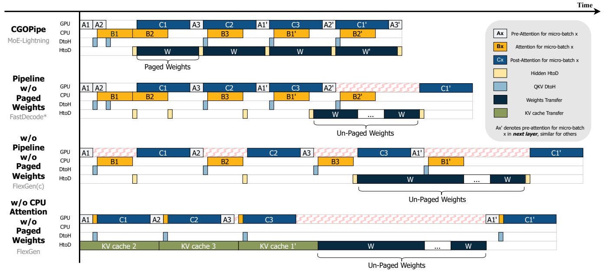
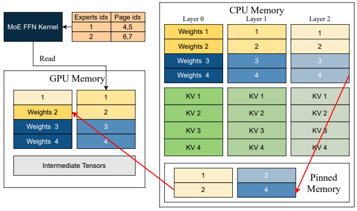

# MoE-Lightning: High-Throughput MoE Inference on Memory-constrained GPUs

## 研究问题与核心思路

**这篇值得学习的是离线 MoE 的计算—搬运协同：既用总 batch 摊薄权重传输，又让较大的 GPU microbatch 与 CPU attention、分页传输衔接起来。** 它面向显存有限、但主存足以容纳模型的机器，目标是尽快完成大量请求，不是改善单人聊天的逐 token 延迟。

- 阅读版本：[ASPLOS 2025 作者版 PDF](https://pschafhalter.com/papers/2025-asplos-moe-lightning.pdf)，[本地副本](resources/moe-lightning-asplos2025.pdf)，共 15 页；阅读正文 §§1–8、附录 A–C，核对参考文献。下文页码均为 PDF 的 1-based 页码。
- [正式发表页](https://doi.org/10.1145/3669940.3707267)；[作者项目页](https://pschafhalter.com/moe-lightning/)；首次预印本为 2024 年，本文依据 2025 年正式发表版本。
- 本笔记的实验数字均来自论文，未运行实现。

### 问题不只是“模型能否装下”

MoE 每个 token 只激活部分专家，但完整权重仍然很大。把权重和 KV cache 放入主存、逐层流送到 GPU，能够降低显存需求，却容易出现两个问题：

1. **总 batch 不够大，权重传输不能被充分摊薄。** 加大 batch 又增加主存中的 KV cache，最终受主存容量限制。
2. **传输都异步了，GPU 仍会空等。** 下一层的大块权重与当前 microbatch 急需的 attention 输出共用 CPU→GPU 通路；长传输会挡住小而紧急的中间结果。

作者组合了两项设计：CGOPipe 把 CPU、GPU、I/O 安排成细粒度流水线；分层 Roofline 模型 HRM 决定算子放置、batch、microbatch，以及权重/KV 的驻留比例。CPU 在这里主要承担 decode attention，GPU 保留投影和专家 FFN；不是按专家热度把冷专家交给 CPU 计算的方案。（§§1–4，pp.1–8）

## 实现路径

### 1. 区分总 batch `N` 与 GPU microbatch `μ`

论文的 `N` 是完整模型一次前向处理的 token 数，decode 时每个请求贡献一个新 token，因此对应总请求 batch；`μ` 是一次 GPU kernel 处理的 microbatch token 数。逐层执行时，同一层权重被这一批 microbatch 复用。

- **增大 `N`**：提高每次 CPU→GPU 权重搬运的复用率，但增加 KV cache 的主存占用。
- **增大 `μ`**：提高 GPU FFN kernel 的算术强度，但需要更多瞬时显存。
- **静态驻留更多权重**：减少传输，却挤占 microbatch 的空间，可能降低 GPU 侧可达到的吞吐上限。

因此，“尽可能把权重塞满显存”和“尽可能加大总 batch”都不是完整的优化策略。（§3.3，pp.5–6）

### 2. Prefill 在 GPU；decode 把 attention 留在 KV 所在的 CPU

整体沿用 FlexGen 式 layer-major / zigzag 顺序：加载一层权重，处理该层的多个 microbatch，再进入下一层。

| 阶段/子任务 | 主要执行位置与数据流 |
|---|---|
| Prefill | 全部计算在 GPU，产生的 KV cache 卸载到 CPU；本文没有另做 prefill 调度优化 |
| Decode PreAttn | GPU 执行 LayerNorm、QKV projection；QKV 结果传到 CPU |
| Decode attention | CPU 使用本地主存 KV cache 计算 attention；不包含 QKVO 线性投影 |
| Decode PostAttn | CPU attention 输出传回 GPU；GPU 执行 O projection 和 MoE FFN |
| 下一层权重 | 从 CPU 分页预取，与当前层计算及中间结果传输交叠 |

文中 §4.1 用 “softmax part” 指 attention 部分；结合 §3.3 排除 QKVO、§5.1 的 CPU GQA kernel 和 KV 所在位置，应理解为 attention 子块的 CPU 执行，不能简化为“仅把 softmax 一个算子搬到 CPU”。（pp.5、7–8）

### 3. CGOPipe：让大块权重给紧急的小传输让路

§4.1 区分四类传输：

- `D1`：QKV，GPU→CPU。
- `D2`：attention 输出，CPU→GPU；当前计算链马上就要用。
- `D3`：下一层权重，CPU→GPU；较大，但可以提前搬运。
- `D4`：历史 KV，CPU→GPU；attention 放在 GPU 时才需要反复发生。

相反方向的传输可以并行，同方向传输顺序执行。采用 CPU attention 后，反复搬运历史 KV 的 `D4` 被消除，但若把 `D3` 当成一个完整的大传输，它仍会堵住 `D2`。

**Paged weights 将要搬运的权重切成 `n` 页，`n` 对应该流水线的 microbatch 数量，在权重页之间穿插 `D2`。** GPU 依次处理当前 microbatch 的 PostAttn 和后续 microbatch 的 PreAttn，与 CPU attention、权重预取重叠；Algorithm 1 提前两个 microbatch 发起 CPU attention 工作。异步任务之间仍通过同步原语维护真实依赖，并非无条件同时运行。（§4.1，pp.6–8）

*原论文 Figure 6，ASPLOS 2025 作者版，PDF p.7。上行为 CGOPipe；黄色小块是 CPU→GPU 的 attention 输出，深色长块是权重传输，红色波纹是 GPU 空转。图示同时改变了 attention 放置、分页和流水线，不能把上下行差异归因于单一优化。原图裁剪来源见 [asset-sources.yaml](resources/asset-sources.yaml)。*

### 4. 分页背后仍有实际内存成本

附录 A.1（pp.12–13）给出的实现细节：

- GPU 为被卸载的层权重安排大小约为 `2 × sizeof(W_L)` 的双缓冲；`W_L` 是一层中存放于 CPU、需要搬运的那部分权重，不是整个模型。
- 权重经 **CPU 普通内存 → pinned memory → GPU**；前一页的 DMA 与后一页的普通内存到 pinned staging 拷贝重叠。
- MoE FFN kernel 通过页表访问专家对应的权重页。Figure 11 的“每个专家两页”是示意，不代表所有模型固定采用相同页大小。
- 因而应同时计算驻留权重、双缓冲、激活与 KV 的容量，不能只用模型参数量推算显存是否够用。

*原论文 Figure 11，ASPLOS 2025 作者版，PDF p.13。页表将专家映射到 GPU 权重页；CPU KV 保留在主存，权重通过 pinned staging 进入 GPU。图中层号和颜色用于说明传输重叠关系。*

### 5. HRM：用跨层带宽把“在哪里算”纳入 Roofline

对算子 `x`，在设备 `i` 计算并从内存层级 `j` 获取数据时，论文式 (7) 的性能估计为：

$$
P_x^i \approx \min\left(P_{\rm peak}^i,\ B_{\rm peak}^i I_x^i,\ B_{\rm peak}^{j,i} I_x^j\right).
$$

`I_x^i`、`I_x^j` 分别按访问各自层级的字节数计算，单位 FLOP/byte；带宽为 byte/s，因此右侧三项都是 FLOP/s。它同时考虑设备算力、本地内存带宽、跨设备带宽；这是上界式性能模型，而不是实测吞吐恒等式。（§3.2，pp.4–5）

对主存权重、GPU FFN 的例子，可分为三段：

1. **低于 `P1` 对应的算术强度**：搬到 GPU 后受互连限制，可能不如在数据所在的 CPU 计算。论文明确把只有一两个 prompt 的延迟敏感应用列为这种情况，建议考虑静态分层放置。
2. **`P1` 到 `P2` 之间**：GPU 值得用，但仍受权重传输限制；增大 `N` 或增加权重 GPU 驻留可提高吞吐。
3. **到达 `P2` 附近**：由当前 `μ` 下的 GPU kernel 能力限制，继续加大 `N` 的收益很小；需要重新平衡 `μ`、驻留权重和容量。

对 attention，增加请求数时 FLOPs 与 KV 字节数基本同比增长，算术强度不会像 FFN 权重复用那样随 batch 明显提高。Figure 4 以 context=512、L4 示例分析 FP16/INT4 KV，两者仍落在有利于 CPU attention 的区域。**这里的 INT4 是理论数据流分析，脚注明确计算仍用 FP32，不能据此认定系统实现或评测了 INT4 KV attention。**（§3.3，pp.5–6）

策略搜索变量为 `(N, μ, A_g, F_g, r_w, r_c)`：attention/FFN 是否在 GPU，以及权重/KV 的 GPU 驻留比例。以 §4.2 正文为准，`A_g` 表示 attention，`F_g` 表示 FFN；Table 1 的两项排列容易混淆。主要实测配置为 `A_g=0, F_g=1`。

每层 decode 的近似时间为：

$$
T_{\rm layer}\approx\max\left(T_{\rm CPU\to GPU},T_{\rm CPU},T_{\rm GPU}\right),\qquad
T_x\approx\max\left(\frac{\mathrm{bytes}_x}{B},\frac{\mathrm{FLOPs}_x}{P}\right).
$$

对应式 (12)–(14)，反映理想重叠后的最长阶段。字节数/FLOPs 来自理论计数，峰值算力和带宽由 profiling 得到；作者用它比较策略的相对优劣。附录 B.2 报告给定模型、硬件和负载后，**离线 MILP 搜索少于一分钟**，不是每次请求到来时重做求解。（p.8、p.13）

### 6. 变长请求与多卡支持

- 附录 A.2 的离线 batching：先按 prompt 长度降序排序，再将长请求放入当前 token 总量最少的 microbatch，同时满足请求数和包含生成长度的 KV 预算。它消除不必要的 padding，也改善 microbatch 间的负载均衡；不是在线 continuous batching 算法。
- 单节点多 GPU 使用 tensor parallelism。增加总显存与带宽后重新选择策略，而不是固定单卡 batch 等比例放大。
- 实现基于 PyTorch、vLLM、SGLang，使用 Python/C++，CPU GQA kernel 基于 Intel MKL。论文并没有提供足以固定整个软件栈的版本组合。（§§4.3–5.1、附录 A，pp.8–9、12–13）

## 实验条件与关键结果

### 硬件、负载与比较口径

以下取自 Tables 2–3（p.9）；多卡显存是卡数合计，主存不是显存。

| 设置 | 模型 | GPU / 总显存 | CPU / 主存 |
|---|---|---|---|
| S1 | Mixtral 8x7B | 1×T4 / 16 GB | Xeon 2.30 GHz，24 核，192 GB |
| S2 | Mixtral 8x7B | 1×L4 / 24 GB | Xeon 2.20 GHz，24 核，192 GB |
| S6 / S7 | Mixtral 8x22B | 2×T4 / 32 GB；4×T4 / 64 GB | Xeon 2.30 GHz，32 核，416 GB |
| S8 / S9 | DBRX，132B，16 experts | 2×T4 / 32 GB；4×T4 / 64 GB | Xeon 2.30 GHz，32 核，416 GB |

| 负载 | Prompt 平均 / 最大 token 数 | 输出 token 数 |
|---|---:|---:|
| MTBench | 77 / 418 | 32、64、128、256 |
| HELM Synthetic Reasoning | 242 / 256 | 50 |
| HELM Summarization | 1693 / 1984 | 64 |

MTBench 的 80 个问题被复制到数千个，构造离线批处理。指标为 **生成 token 总数 ÷（prefill + decode 总时间）**，单位 tokens/s；不是纯 decode tokens/s，也不是单请求流式输出速度。

基线包括 FlexGen、启用 CPU attention 的 FlexGen(c)，以及 **DeepSpeed Zero-Inference 0.14.3**。由于 FlexGen 将 prompt pad 到 batch 中最大长度，作者提供 **MoE-Lightning(p)** 作为同样 padding 的对照；不带 `(p)` 的完整版本还包含变长请求处理。

主实验的权重、激活、KV 数据类型没有完整列明；CPU SKU、CUDA/PyTorch/vLLM/SGLang 具体版本也未完整交代。不能用 Figure 4 的 FP16/INT4 理论例子替代实测精度配置。Figure 7 大多数设置未列各方法 `N/μ`，已给出的 batch 证据见下述 Tables 4–5。

### 1. 最高 10.3× 包含去 padding 收益

从 Figure 7（p.9）选取可核对的单卡结果：

| 配置 / 输出长度 | FlexGen | FlexGen(c) | DeepSpeed | MoE-Lightning(p) | MoE-Lightning |
|---|---:|---:|---:|---:|---:|
| S1 / 128 | 9.5 | 7.2 | 7.8 | 30.1 | 97.73 |
| S1 / 256 | 9.6 | 6.8 | 6.7 | 33.9 | 96.7 |
| S2 / 64 | 34.9 | 18.9 | 13.3 | 67.4 | 294.5 |

数值单位均为 tokens/s。由图中数字计算：

- S1、输出 128：完整版本 `97.73 / 9.5 ≈ 10.29×`，与论文最高 **10.3×** 一致；同 padding 对照为 `30.1 / 9.5 ≈ 3.17×`。
- S1、输出 256：同 padding 为 `33.9 / 9.6 ≈ 3.53×`，对应论文 **3.5×** 的摘要口径。

因此，10.3× 是这组负载下整套系统相对 FlexGen 的收益，不能当作 CPU attention、分页权重或 kernel 本身的加速倍数。也没有在线 TTFT、ITL 或 SLO 数据可将它转换为聊天延迟改善。

### 2. 策略选得好还不够，执行时序也要改变

Table 5（p.11）固定 **S1、Mixtral 8x7B、MTBench、生成 128 token、padded**，给出了更有解释力的消融：

| 实现 / 策略 | `μ` | `N` | 吞吐 tokens/s |
|---|---:|---:|---:|
| FlexGen / 原策略 | 8 | 1112 | 9.5 |
| FlexGen / 作者策略 | 36 | 504 | 16.816 |
| FlexGen / 作者策略并增大 `N` | 36 | 1116 | 20.654 |
| MoE-Lightning(p) | 36 | 504 | 30.12 |

换策略使 FlexGen 达到原吞吐的约 1.77 倍；继续增大总 batch 为约 2.17 倍；CGOPipe 下同样 `μ=36, N=504` 达到约 3.17 倍。这支持“放置和 batch 选择 + runtime 调度”需要共同优化。MoE-Lightning 的 `N` 仅为原 FlexGen 的约 45%，但**batch 缩小比例不等于总主存缩小比例**，因为权重等固定占用仍在。

### 3. 长 prompt 的收益较小，不能只看短输入结果

Table 4（p.10）中的 Summarization：prompt 平均 1693、最大 1984，输出 64 token。下表 `N` 由原表 `μ × (N/μ)` 计算。

| 设置 / 方法 | `μ` | microbatch 数 | `N` | 吞吐 tokens/s |
|---|---:|---:|---:|---:|
| S1 / FlexGen | 3 | 92 | 276 | 3.868 |
| S1 / MoE-Lightning(p) | 4 | 19 | 76 | 4.520 |
| S2 / FlexGen | 8 | 36 | 288 | 7.140 |
| S2 / MoE-Lightning(p) | 8 | 36 | 288 | 12.393 |

S1 的总 batch 为基线的约 `1/3.63`，吞吐达到基线的约 1.17 倍；S2 同 batch 达到约 1.74 倍。长输入同时增加 prefill 峰值显存、KV 容量和 attention 工作，短输入 MTBench 上的峰值倍数并不适用。类似地，生成长度增加既摊薄 prefill，也增加 KV/attention 开销，吞吐可能先升后降。（§5.2，pp.9–10）

### 4. CPU attention 的价值取决于主存/互连带宽比

Figure 9（p.11）比较 L4 与 24 核、2.20 GHz Xeon 上的单层操作：`μ=32/64/128/256`，context=128–2048。作者测得 **CPU attention 比把相应 KV 从 pinned 主存搬到 GPU 快 3–4×**，与其示例 CPU 内存带宽约 100 GB/s、CPU→GPU 约 32 GB/s 的差距相符。

这是“CPU attention vs. KV 搬运时间”的比较，**不是 CPU attention kernel 比 GPU attention kernel 快 3–4×**。context 和 `μ` 足够大时，CPU attention 仍会变成最长阶段，需要更高主存带宽或减少 KV 访问。

### 5. 多卡提高容量，允许换到更有利的策略

- Mixtral 8x22B、MTBench、padded：从 2×T4 到 4×T4，MoE-Lightning(p) 吞吐提高 **2.77–3.38×**（Figure 7，S6/S7）。
- DBRX、不 padding：同样 2→4 张 T4，四种输出长度下提高约 **2.1–2.8×**；例如输出 128 token 时 **29.67→82.98 tokens/s**（Figure 8，p.10）。

超线性结果反映容量扩大后 batch/驻留策略的改善，不代表任意模型或 GPU 加倍都能获得同样扩展率。实验为单节点；附录 C 明确 HRM 尚未计入 GPU–GPU 与多节点通信。

Figure 10 的“2×A100-80GB、改变 CPU 能力和 CPU–GPU 带宽”是**模型驱动的硬件参数扫描**，不是这些硬件组合的实测结果。作者也说明该缩放不反映真实硬件升级；其中 CPU 容量/带宽的符号单位排列与 Table 1 不一致，不宜直接拿该段数值重建实测配置。（§6.3，pp.11–12）

## 理解、局限与疑问

### 对当前研究方向的价值

**独显台式机 / 小型工作站：优先借鉴分页 I/O 与双层 batch 的设计。** 如果工作是离线生成数据、跑评测或批量摘要，GPU 显存不足而主存足够，本文与目标场景直接相关。更值得移植的是“不给紧急中间结果制造长传输阻塞”，而不是直接照搬服务器上的最优 `N/μ`。实验用到 192/416 GB 主存；常见笔记本或 32/64 GB 台式机可能先被完整权重及 KV 容量限制，本文又不支持磁盘 offload。（附录 C，p.13）

**统一内存端侧：HRM 的分析方法有用，现有执行划分不能直接套用。** Jetson Orin、高通手机等共享物理内存时，CPU/GPU 通常争用同一套 DRAM 带宽，显式 PCIe 搬运不再是同样的瓶颈；还要考虑同步、缓存一致性与共享带宽。需要按真实内存层级重新计数和测带宽，才知道 CPU attention 是否划算。本文没有在这类设备上验证收益。

**量化工程：适合作为量化部署的成本模型，不是量化实现论文。** 以下是依据机制得到的研究判断：

- 权重量化减少权重页字节数，会移动 HRM 的传输瓶颈与平衡点；但解包/反量化成本和 kernel 的有效吞吐也会变化，不能只把权重大小除以压缩率。
- KV 量化减少主存 attention 的读流量与容量需求，可能解除 CPU 瓶颈；若需在 CPU 或 GPU 反量化，也可能改变最优放置。
- 若量化后的全模型已经能驻留显存，逐层流送权重的必要性显著下降，应该重新选择基线和系统路径。

这些方向需要真正可用的 packed format、CPU/GPU kernel 与调度结合才能验证；本文没有给出 W4A16/W8A8 或量化 KV 的端到端实验、精度损失和格式兼容性证据，因此不据 Figure 4 添加 `precision/kv4` 或量化 kernel 标签。

### 结论成立的边界与复现缺口

1. **重叠模型不是无开销调度器。** 式 (12) 使用最长阶段估计，实际还受流水线首尾、launch/sync、pinned staging、NUMA 和线程资源影响。论文主要用 attention/FFN 建模；绝对时间与真实 kernel 有偏差。单节点通信尚未进入模型，对更强 GPU 或多卡不能只套峰值算力。
2. **“CPU attention 更好”有硬件和负载条件。** 互连更快、主存更慢或上下文更长，都可能改变结论；其余情况下系统搜索空间仍允许 GPU attention。低 batch 场景下，论文自己建议考虑静态权重放置。
3. **可执行复现目前缺少官方 artifact 和完整配置。** 元数据记录的作者主页代码链接 [caoshiyi/FastMoE](https://github.com/caoshiyi/FastMoE) 在本次收录核查时返回 404；没有将第三方 fork 当作官方代码。全文足以理解方案，但尚无法核对页大小、完整精度配置、MILP 实际目标实现与基线适配细节。
