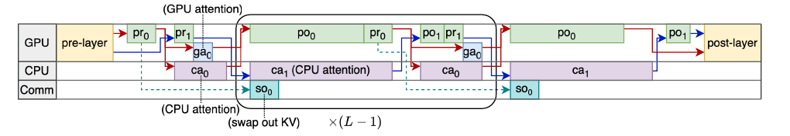
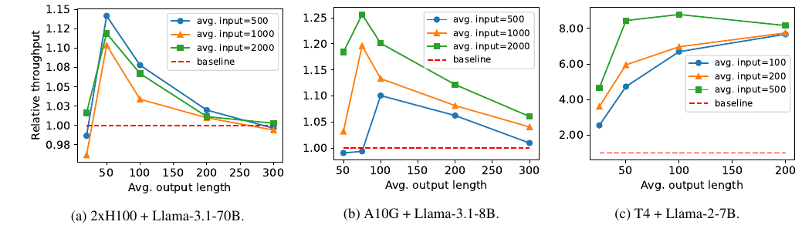

# NEO: Saving GPU Memory Crisis with CPU Offloading for Online LLM Inference

来源：[MLSys 2025 发表版](https://proceedings.mlsys.org/paper_files/paper/2025/hash/66a026c0d17040889b50f0dfa650e5e0-Abstract-Conference.html) · [本地 PDF](resources/neo-mlsys2025.pdf)。本文阅读范围为正文 §1–8、附录 A–C；下文页码均为 PDF 页码，从 1 开始。另于 2026-10-30 只读核对了官方代码的示例、权重加载及评测配置，没有运行模型。

**最值得保留的思路：卸载的决策单位是请求，卸载内容是整条请求的 KV cache 和 decode attention；权重及线性层仍在 GPU。** NEO 用少量 CPU attention 填充 GPU 计算期间的空闲，而不是把所有 attention 推给 CPU。它适合“权重放得下，但 KV cache 挤压 batch”的在线服务，解决的不是“模型权重放不进显存”。

## 研究问题与核心思路

### 显存不足为什么会表现为算力浪费

在线推理通过合批提高权重矩阵乘的利用率，但每条活跃请求都要保存持续增长的 KV cache。显存先耗尽时，GPU 还没有达到能充分利用计算单元的 batch。仅把 KV 放进主存、每层再搬回 GPU，会把瓶颈转成 PCIe 传输；把读 KV 的 decode attention 也移到 CPU，才避免反复搬运整段历史。（§2，pp.2–3）

CPU 在这里有两个作用：提供主存容量，并真实执行 decode attention。GPU 先计算当前 token 的 Q/K/V，将它们交给 CPU；CPU 读取驻留主存的历史 KV、完成 attention，再把 attention 输出返回 GPU。GPU 保留权重，继续输出投影和 FFN。prefill attention 仍在 GPU，因为其矩阵计算更密集。（§3.1，pp.4–5，Fig.3）

这利用的是 **CPU 与 GPU 的内存带宽差距小于算力差距**，并非 CPU 能替代 GPU 做全部 Transformer 计算。论文以 A10G 和现代 x86 服务器的示例说明这一点；实际获益还取决于模型的 KV heads、上下文长度与可用 CPU 内存带宽。（§2.2，p.3）

### 从全部卸载到部分卸载

| 方案 | 请求与设备的安排 | 主要问题或作用 |
| --- | --- | --- |
| 简单卸载 | 所有 decode attention 在 CPU，其他计算在 GPU | 两端轮流等待，缺少有效重叠 |
| 对称流水线 | 两个相近的 decode 子 batch，交错执行 GPU 线性层和 CPU attention | GPU 剩余显存未用于 KV；CPU attention 可能比 GPU 线性层长；忽略 prefill 与初始 KV 搬运的重叠机会 |
| NEO 非对称流水线 | GPU 保留部分请求的 KV 和 attention，其余请求交给 CPU；两个子 batch 承担不同工作 | 同时利用两边的内存，限制 CPU 负载，并用较长的 GPU 工作遮蔽 CPU attention |

这里的“部分”是**部分请求**：已 prefill 请求的 KV 要么整体驻留 GPU，要么整体驻留 CPU，不是在同一请求内部按 head 或 token 切一半。（§3.1，p.4）

## 实现路径

### 1. 用不对称的两个子 batch 组织重叠

- **batch-0**：所有 prefill、所有 GPU decode，以及少量 CPU decode。它有较长的 GPU 线性计算段。
- **batch-1**：大部分 CPU decode。它有较长的 CPU attention 段、较短的 GPU 线性计算段。
- 将 batch-1 的 CPU attention 放进 batch-0 的 GPU 计算窗口；反向窗口容纳 batch-0 的少量 CPU attention。
- 新 prefill 请求若要转为 CPU 请求，每一层生成 KV 后就开始传输，避免等整次 prefill 完成才搬运。只有 batch-0 需要 GPU attention，也减少了相应 kernel 的启动次数。（§3.1，pp.4–5）

原文 Fig.5，PDF p.5。红/蓝箭头分别对应两个子 batch；`pr` 为 QKV 前投影，`po` 为输出投影与 FFN，`ga/ca` 为 GPU/CPU attention，`so` 为 prefill KV swap-out。原图裁剪来源和坐标见 [摘图清单](resources/asset-sources.yaml)。

### 2. 每轮都比较混合执行与 GPU-only

调度器管理 prefill 等待队列、GPU decode 队列、CPU decode 队列。设层数为 $L$，$T_{l0},T_{l1}$ 为两个子 batch 每层的线性算子时间，$T_{ga0}$ 为 batch-0 的 GPU attention 时间，$T_{ca0},T_{ca1}$ 为 CPU attention 时间。忽略占比较小的层外开销，论文估计：

$$
T_{\mathrm{iter}} \approx L\left[\max(T_{l0},T_{ca1})+
\max(T_{l1}+T_{ga0},T_{ca0})\right].
$$

尽量满足 $T_{ca1}\le T_{l0}$、$T_{ca0}\le T_{l1}+T_{ga0}$，使 CPU 不拖住 GPU，并以迭代时间除以 batch 大小 $T/x$ 比较候选方案。算子时间来自离线 profiling，对其他长度做线性插值。（§3.2，p.6）

调度顺序是：先安排已有 GPU decode，按显存余量迁移 KV；再接纳 prefill；然后在上述时间约束内加入 CPU decode；必要时删减会产生 CPU KV 的 prefill，使两端更平衡。最后生成 GPU-only 候选，与双子 batch 候选比较预计吞吐，选较优者。CPU 忙不过来的请求留到下一轮，而不是无限扩张 CPU batch。（附录 A，p.14）

因此，**“有 CPU 可用”不等于“本轮就应卸载”**。两个子 batch 也占用运行时显存；如果卸载带来的容量增益太小，拆批可能反而降低 GPU 效率。论文报告调度开销低于 3 ms/轮，其实验中的轮次时间为数百毫秒；这个比例不能直接套到低并发、短轮次的本地聊天。（§3.2，p.6）

### 3. PACPU 和运行时工程才让流水线落地

实现基于 SwiftLLM，NEO 部分约 4K 行 Python、1.5K 行 C++。PACPU 是自定义 CPU paged-attention 扩展，用 ISPC 生成向量化代码，处理按 block table 索引、非连续存放的 KV。核内用 SIMD 和连续访问减少指令开销；核间把 KV block 工作均分给线程，再合并局部 attention 输出。（§4，p.7）

Python/GIL 和 kernel 启动也会侵占重叠窗口。作者将多数 Triton-JIT kernel 换成 CUDA C++，报告 Llama-3-8B 的启动开销从 **1.2 ms/层降至 0.6 ms/层**。这不是单纯添加一个 CPU attention 算子就能取得的收益。（§4，p.7）

多 GPU 版本用 Ray actor 持有模型分片，通过 PyTorch/NCCL 做 tensor parallel；每个 actor 管理对应 KV heads 的 CPU cache 分区，避免跨 CPU 的 KV 交换。论文提到 ISPC 可面向 AVX2、AVX512、Arm Neon 编译，但实际评测设备是 x86 CPU 加 NVIDIA GPU，未给出手机或 Jetson 的测量。（§4–5.1，p.7）

### 4. 代码入口与论文版本需要对齐

本次对 [官方仓库](https://github.com/NEO-MLSys25/NEO)的只读核对发现：

- [`examples/example.py`](https://github.com/NEO-MLSys25/NEO/blob/master/examples/example.py) 开头明确说明是**对称流水线演示**。复现论文应使用 `evaluation/reproduce-fig6c.py`、`evaluation/reproduce-fig10a.py`，不能用演示脚本验证非对称策略。
- [`swiftllm/worker/weight.py`](https://github.com/NEO-MLSys25/NEO/blob/master/swiftllm/worker/weight.py) 要求权重在 CUDA 上并按传入 dtype 转换；[`buffer.py`](https://github.com/NEO-MLSys25/NEO/blob/master/swiftllm/worker/buffer.py) 的 attention 输出和 residual buffer 使用 FP16。论文没有低比特权重/激活/KV 的量化方案，也未统一列出每组实验的全部 dtype；不能把这些代码片段扩大成“全部张量均 FP16”的结论。
- [`config-a10-8b.json`](https://github.com/NEO-MLSys25/NEO/blob/master/evaluation/configs/config-a10-8b.json) 写的是 **Llama-3-8B**，而正文多数图注写 **Llama-3.1-8B**；附录 C 也使用 Llama-3-8B。复现实验需记录实际 checkpoint，不能将两者混称为“8B”。
- T4 公开配置的 `max_num_seqs=512`、`max_num_batched_tokens=832`；A10 的对应上限为 `1024`、`20480`。它们是容量上限，不是在线曲线每轮的实际 batch。（[T4 配置](https://github.com/NEO-MLSys25/NEO/blob/master/evaluation/configs/config-t4-7b.json)，上述 A10 配置）

## 实验条件与关键结果

### 先分清在线负载曲线与离线吞吐比

| 主实验组合 | 主机资源与约束 | 工作负载 |
| --- | --- | --- |
| T4 + Llama-2-7B | AWS g4dn.4xlarge；表 1 记为 Xeon P-8259CL 8 核、64 GB RAM | OSC 摘要数据，较短请求 |
| A10G + Llama-3.1-8B | 默认 g5.4xlarge；EPYC 7R32 8 核、64 GB RAM | Azure Code（AC）线上 trace |
| 2×H100 + Llama-3.1-70B | 使用 8×H100 HGX 主机中的两张卡；整机 Xeon 8462Y+ 64 核、2 TB RAM，但实验限制在单个 NUMA 节点，即全机约 1/4 内存容量和带宽 | AC trace |

来源：§5.1，表 1，p.7；模型名称按正文保留，公开 artifact 的 8B 名称差异见上节。

在线请求按 Poisson 过程到达。图 6 的纵轴是**每条请求完整延迟除以输出 token 数，再在请求间取平均**：它含 prefill、执行和排队影响，不等于连续 token 间隔 ITL，也不是 TTFT。合成实验则将输入和输出长度分别均匀采样于标称长度的 90%–110%，不是每个请求都等长。（§5.1–5.2，p.8）

| 比较 | 条件、基线及作者报告 |
| --- | --- |
| 在线吞吐，Fig.6 | 相对 vLLM，在平均每 token 延迟 2 s 时，2×H100+70B 的可承受请求率高 **14.3%**，A10G+8B 高 **6.40%**；T4+7B 在 1 s 时报告高 **563%**。这些是各自数据集和延迟阈值下的结果。（§5.2，p.8） |
| 合成负载吞吐，Fig.9 | 基线是 **GPU-only NEO/SwiftLLM**，不是 vLLM。H100、A10G 的标称输入长度为 500/1000/2000，输出扫描 25–300；T4 输入为 100/200/500，输出扫描 25–200。§5.4 报告峰值增幅分别为 **14%、26%、750%**。（p.9） |
| CPU 资源敏感性，Fig.10a | 同一 A10G，g5.2/4/8/16xlarge 的峰值增幅依次为 **12.2%、13.3%、29.7%、79.3%**，相对同硬件 GPU-only NEO。该实验标称输入 1000、输出扫描 50–400；更强的 CPU/主存配置能延长有利的卸载区间。（§5.5，pp.9–10；官方复现实验说明） |
| 基线自身差异，Fig.10b | 在 AC 数据一次性提交的两卡 70B 实验中，SwiftLLM 吞吐比 vLLM **低 8.8%**。相对 SwiftLLM 的增幅不能直接当作相对 vLLM 的增幅。（§5.5，p.10） |

原文 Fig.9，PDF p.9；三个面板的纵轴范围不同，红虚线为同配置 GPU-only NEO。长输出并不保证持续变快：CPU attention 随 KV 增长，系统逐渐更多地退回 GPU-only。图中的少量点低于 1，正文将其归因于迁移开销及 profiling 预测误差。

**数字表述有两处要保留口径。** §5.2 的“高 563%”按增幅换算是 6.63 倍，但同段又概括为“近 6 倍”；§5.4 的 T4“增幅 750%”按该口径为 8.5 倍总吞吐，摘要则使用“7.5× higher”的措辞。笔记保留正文百分比及对应图，不把摘要的倍数与 Fig.6 的在线阈值混用。精确重画曲线应取原始 traces，而非从图片估计小数。

FastDecode+ 是作者在自身框架中实现的比较版本，借用了 NEO 的非对称流水线和调度，但把所有 decode attention 都卸到 CPU；它不是原论文所用多台远端 CPU 的整套系统。在 2×H100+70B、标称输入 2000 的输出长度扫描中，长输出使 FastDecode+ 逐步跌至 GPU-only 基线的 60% 以下。这组消融支持“限制 CPU 负载”的价值。（§5.1、§5.3，pp.7–9，Fig.8）

## 理解、局限与疑问

### 对当前研究方向的价值

**独显 PC/小型工作站：优先借鉴算子放置与调度，而不是照搬加速倍数。** 当权重已驻留 GPU，主存有余量，且有足够并发形成互补子 batch 时，NEO 提供了很清楚的实现基线。消费级双通道内存的有效带宽、CPU 启动和同步开销可能与服务器差很多；应重新测量 GPU 线性段、CPU paged attention、QKV/O 传输和 prefill KV 搬运时间。batch=1 聊天不一定有第二组工作可以遮蔽 CPU。

**Jetson/高通等统一内存设备：需要重写资源模型。** 这里的主机和独显具有独立的容量/带宽域；统一物理内存不会因“把 KV 放给 CPU”就增加总容量，CPU 与 GPU 还可能竞争同一 DRAM 带宽。可迁移的是按实际算子时间决定执行位置、保留 GPU-only 路径的思路；容量增益和独立带宽叠加不能直接继承。这是依据机制的迁移判断，论文没有评测这些设备。

**与量化工程的结合需要重新寻找平衡点。** 权重量化释放显存后，GPU 本身能容纳更多 KV，卸载的容量收益可能变小；GPU 线性计算缩短，也可能压缩可隐藏 CPU attention 的窗口。KV 量化则会降低主存读取量，却增加解量化和数据布局成本。最有价值的后续问题是“量化后的哪个环节成为瓶颈”，而不是把量化加速比与 NEO 加速比相乘。上述是研究推断；本论文没有联合低比特实验。

### 实验边界与值得追问的点

1. **不应把保持平均延迟理解成所有请求都更快。** 论文自己观察到中等负载下 NEO 延迟稍高：更大 batch 的执行时间和主动迁移开销，尚未被排队时间的下降抵消。实时服务还需关注 TTFT、ITL、尾延迟和请求公平性。（§5.2，p.8）
2. **退回 GPU-only 只是一个候选，不是性能下界保证。** 离线 profiling 的误差、已发生的 swap 和拆批成本会使 NEO 局部略慢于基线，Fig.9 已展示这些点。（§5.4，p.9）
3. **CPU 带宽是重要因素，但敏感性实验并非只改变带宽。** g5 各档同时改变核数、内存容量和 CPU KV 配额；作者将峰值趋势主要解释为带宽作用。针对本地机器做因果拆分时，还应控制线程数、NUMA 放置与 KV 容量。（§5.5，pp.9–10）
4. **“免费 CPU”是云计费语境。** 同一云实例的 CPU 已包含在价格中；独立购置 PC 和工作站要计入 CPU/内存成本、电耗和散热。论文没有完整的能效测量，§6 的能效讨论不能作为 tokens/J 实验结论。（p.11）
5. **当前 artifact 与发表图并非零配置对应。** 附录 C 说明 Fig.6c 快速复现默认只用 100 条请求，而原实验为 2000 条，排队延迟会降低；Fig.10a 默认保留 2000 条，仅画 x16large 和基线。正文 vLLM 版本为 0.6.3.post1，附录另讨论了 0.7.3 的安装替代；比较新版本时应重新声明基线。（附录 C，pp.15–16）

本条保留 `target/kv-cache`、`system/heterogeneous`、`system/pipelining` 和 `workload/online-serving` 等标签；不添加量化或 Arm 硬件实测标签。下一步若选择实做，最合适的起点是固定一台独显机器，在同一模型与服务负载上比较 GPU-only、全 attention 卸载、NEO 部分卸载，再单独改变权重/KV 精度。
