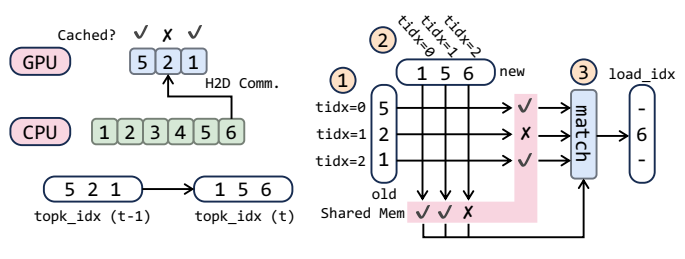

# NOSA: Native and Offloadable Sparse Attention

来源：[EMNLP 2026 正式版](https://aclanthology.org/2026.emnlp-main.279.pdf)，并用仓库已有的 [PDF 副本](resources/nosa-emnlp2026.pdf)核对图表。阅读范围为正文 §1–7、Limitations，以及附录 B、C、E 中与消融、实验口径和局部性证明有关的部分。下文引用 PDF 页码。重点看两件事：模型怎样限制下一步要从主存取回多少 KV，以及这种限制什么时候能换成解码吞吐。

## 决定 PCIe 开销的是换了多少块

KV 卸载把历史留在主存，给显存腾出空间。每步只看 4K 个 token，也不等于每步要搬 4K 个：上一步选中、本步还要看的 KV 可以继续留在 GPU。反过来，只知道每步的选中量，并不能保证相邻两步的集合重合。

论文用 $\gamma(t)=|\Gamma(t)\cap\Gamma(t-1)|/|\Gamma(t)|$ 计量这种重合。图 2d（PDF 第 2 页）在 1B 模型、PG19 的 16K-token 输入、4,096-token 预算下测得 InfLLM-V2 的平均局部性为 88.9%。这给了卸载一个可行起点，但 PCIe 4.0 ×16 的标称带宽仅 31.5 GB/s，远低于示例 A800 80 GB 的 HBM 带宽。图 2b–c 改变命中率画出注意力时间占比和吞吐，属于理论估算；图 2d 的集合重合率才来自模型测量。NOSA 要解决的是：能否给重合率设一个下限，而不是指望下一步恰好选中同一批块？

## 先按 query 找远处，再用稳定的分数补足预算

NOSA 在 InfLLM-V2 的块稀疏模式上做改动。第一路用当前 query 给历史块打分，保留随问题变化的召回能力；第二路只看 KV 自身，轻量打分头从每个 token 的 V 产生重要性分数，不随未来的 query 重算。两路都先在小窗口求均值，再在目标块取最大值。先确定 query 相关的块，再从没选过的候选中按重要性补足预算。在第二路落选的旧块仍可被第一路找回；从 GPU 换出也不等于把主存里的数据永久删除。

主实验每块 64 token，总预算 $k=4{,}096$ token。64 个块中，16 块由当前 query 挑选，其余 48 块包括打分头选出的 31 块、16 个滑窗块和 1 个开头的 attention sink 块。按定理 3.1 的固定预算口径，作者给出的重合率下限为 $k_e/k=3{,}072/4{,}096=75\%$。上一步选中的块仍在 GPU 时，本步至多从主存召回 16 块旧 KV；新生成的 token 本就在 GPU 上。附录 E 用稳定的重要性排名证明这个下限（PDF 第 26 页）。同样的 PG19 测量中，NOSA 的平均局部性是 94.4%，对应的平均未命中份额从 11.1% 降到 5.6%；这是该样本的测量值，不是算法保证。

Top-k 没有变成可微操作。训练时，打分头的输出还会加到注意力 logit 上，梯度沿这条偏置路径回到打分头。作者把指数运算留到 softmax，不在选块前先做一次指数运算；表 1（PDF 第 5 页）里，1B 模型、16K-token RULER 上，原始 DMA 打分头为 56.2%，延迟做指数的 ED-DMA 为 61.9%，InfLLM-V2 为 60.3%。训练流程先用全注意力做 4K 短上下文预训练，再用 NOSA 做 16K 长上下文续训和 SFT。对作者的训练流程，这是替换长上下文阶段的注意力；对于已经训练完的稠密模型，不是免训练的推理插件。

## NOSI 只把缺的块搬上来

NOSI 是论文实现的推理系统。decode 时，它更新压缩 key 和重要性分数，算出本步的块列表，再用 CUDA kernel 比较前后两步的索引。命中块留在原 GPU 槽位，缺失块换进空出的槽位；一个 Triton kernel 通过 UVA 访问主存，把缺的块搬上 GPU，随后在驻留的 KV 上做注意力（算法 1、图 5，PDF 第 6 页）。CPU 和 GPU 都按块组织 KV。FlashInfer 提供若干基础算子，作者将打分头与 QKV 拆分、两路 max-pooling 分别融合，并用 CUDA Graph 减少选块过程中的 launch 开销。

图：截自 Huang 等，[NOSA，EMNLP 2026 正式版](https://aclanthology.org/2026.emnlp-main.279.pdf#page=6)图 5，PDF 第 6 页，© 2026 ACL，[CC BY 4.0](https://creativecommons.org/licenses/by/4.0/)。本步要读 1、5、6，GPU 已有 5 和 1；系统只搬块 6，不按新索引的顺序重新摆放全部数据。

局部性越高，每次要搬的字节越少，但按单 token 搬会变成一串小而散的请求。图 4a 中，同为 Triton + UVA，按块搬运在高局部性区间仍能维持较高带宽。表 2 测的是 8B 推理时的 CPU→GPU 传输，PCIe 4.0 上实际 batch 为 16、32、64 时分别为 17.04、20.36、22.35 GB/s。这里的单位是搬运带宽，不能和表 7 的生成 token/s 混用。

## 长输出先看质量，吞吐要分清两种比较

作者的质量实验覆盖 1B、3B 的 Llama-3 架构模型及 MiniCPM4-base 衍生的 8B 模型。以下取 8B；表 3–6 未逐项给出评测 batch。长输入测试用贪心解码，输出长度由各任务协议决定；推理实验使用约 22K-token 的两样例提示，最多生成 8K token（附录 C）。

| 测试 | 作者结果（%） |
| --- | --- |
| HELMET，16K 输入、稀疏 prefill 和 decode（表 3，PDF 第 7 页） | NOSA 37.6 ± 0.7，InfLLM-V2 40.3 ± 0.3。整体仍有差距，即使 NOSA 在检索子集上胜过许多免训练卸载方法。 |
| HELMET，128K 输入（表 4，PDF 第 7 页） | NOSA 20.4 ± 1.1、FullAttn 20.4 ± 0.6；均分显示到一位小数恰好相同，Recall 却是 13.2 ± 1.2 对 21.7 ± 0.3，不能据均分说长输入无损。 |
| 通用短任务（表 5，PDF 第 7 页） | 8B NOSA 53.6，FullAttn 52.9。该表所有模型在评测时用全注意力、不开重要性偏置，回答的是适配后切回稠密的表现。 |
| 四项长推理任务（表 6，PDF 第 8 页） | NOSA 平均 49.6，FullAttn 51.6，InfLLM-V2 48.2，ShadowKV 12.5。作者改过 ShadowKV 的长生成实现来维持同样的 4K 可见预算；图 7–8 的困惑度与失败样例只用来解释现象，不是总体评测。 |

表 7 的速度测试用 8B 模型、单张 A800 80 GB、最近 NUMA 域的 26 个 CPU 核和 PCIe 4.0 ×16，所列方法除 ArkVale（FP16）外用 BF16。每次只计解码 4 个 token，热身 1 次后平均 4 次。等效 batch（EB）用来对齐 **GPU 上的 KV 缓存预算**，括号里的才是实际 batch。以下是在表 7（PDF 第 9 页）上能直接重算的对照：

| 输入 / EB | NOSA + NOSI 卸载，tok/s（实际 batch） | 基线，tok/s（实际 batch） | 吞吐比 |
| --- | ---: | ---: | ---: |
| 96K token / 64 | 1,080.45（64） | FullAttn + SGLang：214.42（4） | 5.04× |
| 64K token / 64 | 1,378.82（64） | InfLLM-V2 + NOSI 卸载：717.65（64） | 1.92× |
| 16K token / 128 | 1,961.17（128） | ShadowKV 卸载：1,071.36（128） | 1.83× |

这三组可以复算摘要中的倍数，但不宜称为表 7 的逐格最大值。例如 64K、EB 64 时，1,378.82 ÷ 240.28（该组最快的 FullAttn 实现 vLLM）约为 5.74×。与稠密基线相比的倍数含了 batch 扩容；同批下的传输代价要看附录 B.3.4。16K 输入、实际 batch 16 时，NOSA + NOSI 从不卸载的 817.16 tok/s 降到卸载的 743.18 tok/s（−9.1%）；InfLLM-V2 + NOSI 从 824.09 降到 563.16 tok/s（−31.7%，PDF 第 19 页表 14）。这组更能说明 NOSA 改善了什么：卸载本身仍有代价，选块更稳定让它少付了一截。

## 怎么把这个结果带到端侧

与 [ECHO](https://www.usenix.org/conference/osdi26/presentation/liu-guangda) 保留模型原选块逻辑、只调整缓存或搬运时机的做法相比，NOSA 在训练阶段就改变了稀疏选择，让系统能给每步的换块量设上限。表 7 测的是长输入之后一小段 decode 的吞吐，不能代替单请求 TPOT、TTFT 或整段生成时间。论文在 NOSI 上报告 NOSA 的速度，没有验证更大模型、其他架构或端侧设备。

若目标是显存有限的独显，先用相同实际 batch 测开关卸载的差值，再用相同显存预算测可扩大的 batch，这两组数字回答不同问题。在 CPU 和 GPU 共享物理内存的设备上，则应重新量页迁移或映射、内存带宽争用和选块时间，不能套用 PCIe 的传输收益。本文只整理论文结果，未运行代码或做本机实测。

## 原生稀疏注意力训练资源消耗

按论文披露的数字，**NOSA-8B 的长上下文续训加 SFT 是 1,873 A800·小时；SparDA 只训练新增的选块投影，两套 8B 底座分别在 1,536 和 768 H100·小时以内。InfLLM-V2 和 NSA 披露了训练数据规模，但没有披露足以换算 GPU·小时的训练配置与时长。**

| 论文            | 训练范围                                                                                                      | 硬件与耗时                                                                                                                                                                                                                                                                                                                  |
| ------------- | --------------------------------------------------------------------------------------------------------- | ---------------------------------------------------------------------------------------------------------------------------------------------------------------------------------------------------------------------------------------------------------------------------------------------------------------------- |
| **NOSA**      | 从已有短上下文底座出发，用 16K 序列继续预训练，再做 SFT。                                                                         | **32 张 NVIDIA A800**，4 节点、每节点 8 卡；节点内 NVLink，节点间 HDR InfiniBand。**1B：336 + 78 = 414 GPU·小时**，按 32 卡折算约 **12.9 小时**；**3B：883 + 190 = 1,073 GPU·小时**，约 **33.5 小时**；**8B：1,496 + 377 = 1,873 GPU·小时**，约 **58.5 小时**。不含短上下文底座预训练，也不是整篇论文所有对照实验的总账。[正式版附录 C、表 17](https://aclanthology.org/2026.emnlp-main.279.pdf#page=20) |
| **InfLLM-V2** | 8B 底座先用 **8 万亿 token** 做 4K 稠密预训练，再用 **50 亿 token** 做最长 32K 的稀疏续训。                                        | 未披露训练卡型、卡数、墙钟时长或 GPU·小时。论文中的 **A100、RTX 4090** 是内核和推理测速设备，不能拿来算训练成本。[正式版 §4.1、§4.3](https://proceedings.iclr.cc/paper_files/paper/2026/file/716e60181e1782f5bd0a629033f85310-Paper-Conference.pdf#page=7)                                                                                                              |
| **SparDA**    | 冻结已有 8B 底座，只训练约 **3,350 万个 Forecast 参数（0.41%）**；训练 2,000 步，有效 batch 32。                                   | **32 张 NVIDIA H100**。基于 **MiniCPM4.1-8B** 的 64K 训练在 **48 小时内**完成，即 **≤1,536 H100·小时**；基于 **NOSA-8B** 的训练在 **24 小时内**完成，即 **≤768 H100·小时**。[arXiv v1 附录 B](https://arxiv.org/html/2606.04511v1#A2)                                                                                                                      |
| **NSA**       | 从预训练起就使用稀疏注意力；模型 **27B 总参数、3B 激活参数**。§3.1 写 **2,700 亿 token** 的 8K 预训练，引言写 **2,600 亿**，之后还做了 32K 续训和 SFT。 | 未披露整模型训练的卡数和时长。论文中的 **8 张 A100** 是注意力算子测试环境，不是训练配置。[论文 §3.1、§4.1](https://arxiv.org/html/2502.11089v2)                                                                                                                                                                                                                 |
