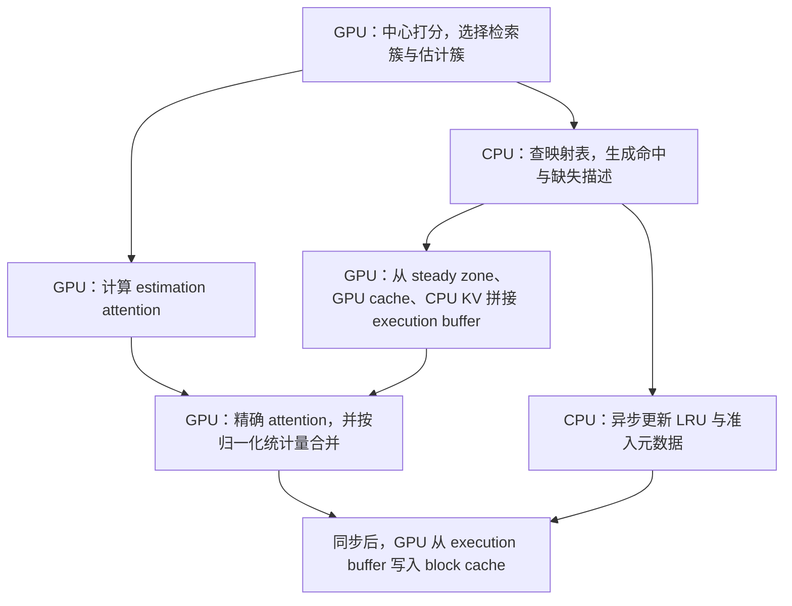

# RetroInfer: A Vector Storage Engine for Scalable Long-Context LLM Inference

- 来源版本：[arXiv:2505.02922v3](https://arxiv.org/abs/2505.02922v3)，2026-04-27

## 研究问题与核心思路

### 长上下文的瓶颈不只在显存容量

解码每生成一个 token，都要读取历史 KV。将 KV 放到 CPU 内存能扩大容量，却可能把瓶颈转移到 PCIe；用稀疏注意力减少访问量，又会遇到不同模型层、注意力头、query 和任务所需预算不同的问题。只取少量 top-k token，可能漏掉单个权重不高、合计贡献却不可忽略的部分。（§2–3，PDF 第 3–4 页）

RetroInfer 用 wave index 和 wave buffer 分别处理近似质量与执行效率：前者决定哪些 KV 精确计算、哪些按簇估计；后者负责 CPU–GPU 放置、缓存和传输。大部分 KV 留在 CPU 内存，向量索引的簇中心和统计量留在 GPU。解码时把需要精确计算的 KV 搬到 GPU，而不是在 CPU 上计算大部分注意力。（§4.1，图 5，PDF 第 5 页）

### 三分区如何减少检索量

| 分区 | 选取方式 | 注意力计算 | 数据访问 |
|---|---|---|---|
| steady zone | 固定开头和最近窗口，解码新 token 先追加到这里 | 对原始 KV 精确计算 | GPU 常驻 |
| retrieval zone | 按当前 query 对簇排序，选中排名靠前的簇 | 对选中簇的全部原始 KV 精确计算，不再逐 token 精排 top-k | 从 GPU block cache 或 CPU 取入 execution buffer |
| estimation zone | 对未检索簇中的一部分，用中心和簇统计量估计贡献 | 用簇中心代替 key、用簇内 value 和代替逐 value 读取 | 只读取 GPU 上的 meta index |

论文的概念描述将未检索簇归入 estimation zone，但实验没有估计所有剩余簇：默认精确检索约 1.8% 的簇、估计另 23.2% 的簇，其余更低排名部分不参与最终计算。因此，默认配置仍有截断误差，不能理解为“用估计完整补回全部历史”。（§4.2、§5.1，PDF 第 6–7、9 页；代码 `sparse_attention`）

我的理解是，estimation zone 能补上一部分未检索 KV 的贡献，而不必把它们都经 PCIe 搬来。能补得多准，取决于簇中心能否代表当前 query 下的簇内分数。

## 实现路径

### 1. Wave index：按 key 相似度聚类，按 query 重要性检索

索引以 key 相似度组织 KV，GPU 上每个簇保存中心 $c_i$、大小 $s_i$ 和 value 总和 $V_i^{\mathrm{sum}}$，CPU 上则按簇组织连续的 KV blocks。query 到来后，在 GPU 上计算它与中心的相关性，选择 retrieval 和 estimation 所需簇。（§4.2，图 5–6，PDF 第 5–7 页）

这不是传统 ANNS 的“先选候选簇，再从候选中找精确 top-k”：retrieval zone 直接读入选中簇内全部 KV，省掉逐 token 精排，同时改善传输局部性。一个簇有多少 token 并不固定，按簇数设置的预算只能近似对应 token 比例。

代码还处理了 GQA：`sparse_attention` 对共享一个 KV head 的多个 query heads 分别计算中心 softmax，再将组内结果求和排序，从而共享一组被检索簇。不能把它简单描述为每个 query head 都独立检索完全不同的 KV 集合。（[retroinfer_cache.py](https://github.com/microsoft/RetrievalAttention/blob/03f912c6e917c380d9d90c5ec85bb0f161ba53ef/cache_hub/retroinfer_cache.py)）

### 2. Estimation 的计算方式与界限

令簇 $C_i$ 有 $s_i$ 个 key，中心是其算术均值，$z_j=qk_j^T/\sqrt d$。论文用 Jensen 不等式得到：

$$
c_i=\frac{1}{s_i}\sum_{j\in C_i}k_j,\qquad
s_i e^{qc_i^T/\sqrt d}\leq\sum_{j\in C_i}e^{z_j}.
$$

这给出了簇内未归一化指数分数和的下界。图 8 展示了一个注意力头上估计值与真值较接近的样例，但不等式本身没有说明下界一定很紧。（式 2–3，图 8，PDF 第 6–7 页）

为解释最终合并，可将精确计算 token 的集合记为 $U$，实际参与估计且与 $U$ 不重叠的簇集合记为 $E$，将输出改写为：

$$
\widetilde o=
\frac{\displaystyle\sum_{j\in U}e^{z_j}v_j+
\sum_{i\in E}e^{qc_i^T/\sqrt d}V_i^{\mathrm{sum}}}
{\displaystyle\sum_{j\in U}e^{z_j}+
\sum_{i\in E}s_i e^{qc_i^T/\sqrt d}},\qquad
V_i^{\mathrm{sum}}=\sum_{j\in C_i}v_j.
$$

这是对论文分区计算与加权合并的解释性写法，不是原式的逐字转录。它说明簇大小必须参与归一化：只对中心做普通 softmax，会把大小不同的簇都当作一个 token。实现通过 weighted attention 和 log-sum-exp 统计量合并 estimation 与精确计算部分，而非直接相加两个已经归一化的输出。（式 4、§4.6，PDF 第 7、9 页；代码 `weighted_flash_decoding` 调用）

“Accuracy-bound”不能据此扩展成最终注意力输出或任务精度的通用保证：分母也被近似，value 可以有正负分量，默认预算又会略去部分簇。论文没有给出覆盖这些误差的最终输出范数界，也没有提供按用户误差阈值自动调节预算的算法。

### 3. 分段建索引与长输出更新

prefill 时，GPU 一边按段聚类，一边异步向 CPU 卸载原始 KV；CPU 再按聚类结果组织 KV blocks、构建映射表和缓存元数据。论文默认段长 8K tokens，平均每 16 个 token 一个中心，聚类迭代 10 次。GPU 继续执行注意力时，CPU 可以并行构建 buffer 数据结构。（§4.2、§4.4、§5.1，PDF 第 7–9 页）

作者将可分段的原因归于 key 的粗粒度位置局部性，并通过 Pre-/Post-RoPE 对照支持这一观察。它与“当前 query 的重要 token 散布在整个上下文”不矛盾：前者描述 key 之间的相似度，后者描述 query 与 key 的相关性。（§4.2，PDF 第 7 页）

在当前提交中，[`segment_k_means`](https://github.com/microsoft/RetrievalAttention/blob/03f912c6e917c380d9d90c5ec85bb0f161ba53ef/cache_hub/kmeans.py) 的前 9 轮在各段内执行，最后一轮将全部 key 和中心重新展开，做一次全局分配并计算未归一化的均值中心。因此，当前实现不能概括成“10 轮都严格独立分段”。聚类前会减去 key 均值，结束后再把均值加回中心；这与论文针对 Q/K 分布差异提到的 centering 对应。

解码生成的 token 先进入 GPU steady zone，积累到 1,024-token 更新段后，为这一段建立新簇并追加到索引，保留开头和最近窗口，不重新聚类全部历史。短输入推理在长度较小时使用 full attention，长度增加后才开始建索引。作者报告更新开销约占解码延迟的 0.2%，但没有单独给出足以外推到所有 batch、模型和设备的分项条件。（§4.2、§5.2，PDF 第 7、10 页）

当前代码只要预计解码中需要更新索引，就关闭 CUDA Graph；因此，短输出的 CUDA Graph 配置不能直接代表 32K 长输出时的执行开销。（代码 `__init__`、`_update_kv_cache`）

### 4. Wave buffer：逻辑簇、物理块和连续执行缓冲区

缓存访问以簇为逻辑单位，存储和搬运以固定大小的 block 为物理单位。一个簇可跨多个 block，CPU 上的 cluster mapping table 将簇 ID 映射到 CPU 地址或 GPU cache block IDs。GPU 上另有跨注意力层复用的 execution buffer，用来连续摆放本步的原始 KV，供 FlashAttention 类 kernel 使用。（§4.3，图 9，PDF 第 7–8 页）

每个解码层的依赖如下，CPU 缓存替换与 GPU 计算可以重叠：

“异步更新”并不表示没有等待：当前代码在写回 block cache 前调用 `wave_buffer.sync()`。被移出 GPU cache 的 KV 仍有 CPU 原本，缓存替换不等于永久淘汰历史 token。（§4.3、§4.6，PDF 第 8–9 页；代码 `sparse_attention`）

论文使用相当于全量 KV 5% 的 GPU block cache，跨任务平均命中率为 0.79–0.94，默认 LRU、block 大小 2KB。命中后仍要从 cache 复制到 execution buffer；5% 也不包括 meta index、steady zone、execution buffer、模型权重等显存开销。（§4.3、§5.1，PDF 第 7、9 页）

作者说明专用 CUDA copy kernel 会跳过块内无效区，并针对不同 head 的复制量调整线程数。论文举例中，128K 上下文的 Llama3-8B 单层 GPU 执行为 720 μs，普通缓存加 PyTorch 传输额外耗时约 1.5 ms；专用复制实现将 miss 时的复制耗时从 1.3 ms 降至 100 μs。这是局部系统开销比较，不是完整模型或请求的加速倍数；该段未单独列出 batch 和生成长度。（§4.3、§4.6，PDF 第 8–9 页）

## 实验条件与关键结果

### 平台、模型和预算

| 项目 | 条件 |
|---|---|
| 主平台 | NVIDIA A100 80GB；AMD EPYC 7V12；CPU 内存 1.7TB；4 个 NUMA node，每个 12 个核 |
| CPU 使用 | RetroInfer 使用一个 NUMA node 的 24 个逻辑线程；MagicPIG 按其原设置使用两个 NUMA node 的全部核 |
| 互连与软件 | PCIe 4.0 ×16，单向带宽 32GB/s；Ubuntu 22.04、CUDA 12.4、PyTorch 2.5 |
| 主模型 | Llama3.1-8B、Qwen2.5-7B、Llama3-8B-Instruct-Gradient-1048K、Qwen2.5-72B |
| GPU 数量 | 除 Qwen2.5-72B 使用 8 张 A100、按层均分外，默认单张 A100 |
| 三分区预算 | steady 初始 4 + 最近 64 tokens；retrieval 约 1.8% 的簇；estimation 另 23.2% 的簇 |
| 索引与缓存 | 默认 8K-token segment、10 轮 k-means、平均 16 tokens/中心；GPU cache 占全量 KV 的 5%，2KB/block |
| 质量基线 | FlashInfer full attention、Quest、MagicPIG、InfiniGen、PQCache；端到端性能另加入 vLLM |

1.8% 的具体解释是：128K 设置下共 8,192 个簇，论文取其中 150 个用于 retrieval。由于簇大小不均匀，这不保证每步恰好读入全上下文 1.8% 的 KV，更不代表仅保存 1.8% 的 KV。CPU 仍保存主体历史数据，GPU cache 命中后才进一步减少实际 PCIe 流量。（§5.1 脚注 5，PDF 第 9 页）

论文正文没有逐项列齐生成长度与 dtype。核查的 [`throughput_eval/test.py`](https://github.com/microsoft/RetrievalAttention/blob/03f912c6e917c380d9d90c5ec85bb0f161ba53ef/throughput_eval/test.py) 固定使用 BF16，默认生成 100 tokens、greedy decoding、忽略 EOS，并将同一 prompt 复制成整个 batch；这些是当前代码的测速条件，不能反推所有论文实验都使用相同精度或输出长度。该提交的 Llama 配置 `core=22`，与正文的 24 个逻辑线程也不一致。

### RULER、百万 token 检索与长输出质量

RULER 有 13 个任务，每任务 200 个样例，上下文为 8K–128K。图 10 中，RetroInfer 与 full attention 的曲线接近，但并非每一点都相同。作者在 128K 处分别报告 Llama3.1-8B、Qwen2.5-7B、Llama3-8B-1048K、Qwen2.5-72B 下降 0.66%、1.50%、1.97%、0.73%；这里保留原文的百分号口径。论文没有提供对应的逐点数值表，不据此计算相对降幅。（§5.2，图 10，PDF 第 9–10 页）

图 11 的 NIAH 在 Llama3-8B-1048K 上、最长约百万 token 上下文取得 100% 的检索准确率。这证明该实验中的“找针”任务可运行到这个长度，不等于百万 token 的复杂推理、聚合或任意文档问答都无损。（PDF 第 10 页）

长输出实验采用两个 DeepSeek-R1 蒸馏模型，输入为数百 tokens，最大生成长度 32K；AIME24 和 GPQA 指标为 pass@8，GPQA 只均匀抽取 50 个样例。模型默认使用单张 A100；该质量实验未单列 batch。表 1 的 full attention 与 RetroInfer 如下：（§5.1–5.2，表 1，PDF 第 9–10 页）

| 模型 | 方法 | AIME24 pass@8（%） | GPQA pass@8（%） |
|---|---|---:|---:|
| DeepSeek-R1-Distill-Llama-8B | full attention | 73.30 | 68.00 |
| DeepSeek-R1-Distill-Llama-8B | RetroInfer | 76.70 | 68.00 |
| DeepSeek-R1-Distill-Qwen-7B | full attention | 76.70 | 72.00 |
| DeepSeek-R1-Distill-Qwen-7B | RetroInfer | 73.30 | 68.00 |

Llama 蒸馏模型的一项得分上升，Qwen 蒸馏模型的两项则下降。作者用“过滤低信息 token”解释部分收益，但没有消融证明这是得分提升的原因；样本较少、未报告误差条，也不足以支持普遍优于 full attention 的结论。MagicPIG 因不支持该长输出设置所需的索引更新，没有参与这组比较。

### 解码吞吐：更大的可行 batch 是收益的重要来源

图 13 使用单张 A100、Llama3-8B-1048K、NIAH，扫描 batch size。下表倍数来自正文对各方法可达吞吐的比较，不是固定 batch 的单 token 延迟比；当前官方脚本补充的默认输出长度为 100 tokens。（§5.3，图 13，PDF 第 10–11 页）

| 输入上下文 | RetroInfer 相对 full attention 的解码吞吐 | 图 13 的 batch 范围与限制 |
|---|---:|---|
| 30K tokens | 4.1× | RetroInfer 曲线到 128；full attention 受显存限制更早停止 |
| 60K tokens | 4.4× | RetroInfer 曲线到 64；full attention 受显存限制更早停止 |
| 120K tokens | 4.4× | RetroInfer 曲线到 32；full attention 曲线到 4 |
| 1,024K tokens | 无可行 full attention 对照 | RetroInfer 测 batch 1、2、4；full attention、Quest、InfiniGen OOM |

在 1,024K 设置，RetroInfer 相对 MagicPIG、PQCache 的解码吞吐分别为 10.5×、12.2×。摘要的 12.2× 比较对象是 PQCache，不是 full attention。小 batch 时 full attention 或 Quest 可与 RetroInfer 相当，甚至略快；卸载版的主要优势是支持更大的 batch 并减少每步搬运成本。（§5.3，PDF 第 10–11 页）

### Prefill 与端到端请求不能混为一谈

图 15 在 120K 和约 1M 上下文测 prefill。为避免 1M 时 OOM，full attention 对照也卸载 KV；作者报告卸载只带来 0.4% 的 prefill 开销，而 RetroInfer 相对 full attention 的总 prefill 延迟分别增加 6% 和 3%。这也意味着 §4.4 所说“低于 5%”与 120K 实测的 6% 不能当成完全一致的上界。正文未在图 15 旁单独注明 batch。（§4.4、§5.3，PDF 第 8、11 页）

作者另报告约 1M 上下文结合 XAttention、MInference 后，prefill 分别约为 600 s、220 s。这是组合方案的 prefill 结果，不能记成 RetroInfer 自身的解码加速或独立 prefill 能力。（PDF 第 11 页）

端到端图 17 覆盖 prefill 与 decode，使用两种负载。以下范围是作者沿延迟–吞吐曲线报告的结果，并没有一个全方法共用、明确给出的固定平均延迟阈值。（§5.3，PDF 第 11 页；模型和生成长度另由 [`run_e2e.sh`](https://github.com/microsoft/RetrievalAttention/blob/03f912c6e917c380d9d90c5ec85bb0f161ba53ef/throughput_eval/run_e2e.sh) 核对）

| 负载 | 当前脚本中的模型与长度 | 作者报告的端到端比较 |
|---|---|---|
| 长输入 | 单 A100，Llama3-8B-1048K；120K 输入 + 4,096 输出 tokens，扫描 batch/负载 | 同延迟下相对基线吞吐为 1.8–7.8×；结合 XAttention 后为 2.1–10.5× |
| 长输出 | 单 A100，DeepSeek-R1-Distill-Llama-8B；正文称 512 输入 + 32K 输出，脚本从 AIME prompt 取实际输入，强制 32,768 输出 tokens | 负载提高后相对基线吞吐为 2.7–70.8×；MagicPIG 不参与 |

低负载下，卸载版 RetroInfer 并不优于 GPU-only full attention、Quest 或 vLLM；作者另提供 RetroInfer-GPU，使其低负载延迟接近 Quest。正文引言相对 vLLM 的端到端吞吐概括为 2.2–3.3×，不能拿其他基线对应的 70.8× 替代这一比较。（PDF 第 2、11 页）

当前脚本主要扫描固定 batch，并复制同一 prompt 形成批次；这些脚本未覆盖真实在线到达过程、连续批处理公平性或 P99 延迟。不同方法的 `prefill_bsz` 也不总相同。大 batch 的部分命令扩展到两个 NUMA node 分配内存，因此部署时还要核对实际 CPU 内存和 NUMA 亲和性，不能只对齐 GPU 型号。

### 消融说明了什么

- 图 16：只卸载、不加 GPU cache 时，吞吐随 batch 扩大很快受 PCIe 限制；加入 cache 后改善，异步更新又进一步提高吞吐。收益依赖完整执行路径，不能只凭索引检索量推算。（Llama3-8B-1048K、主 A100 平台；图旁未重新列出输入输出长度，PDF 第 11 页）
- 图 18：Llama3.1-8B、128K、RULER 的 s3_niah 与 qa_1 两任务，在 A100 和 RTX A6000 48GB 上扫描预算与最大解码吞吐。增加 retrieval budget 改善质量但增加 PCIe 开销；增大 estimation budget 的吞吐代价较小。该实验支持默认预算的取舍，不证明其他设备和模型存在相同最优点。（PDF 第 12 页）
- 图 19(b)：Llama3-8B-1048K 第 10 层、mv_niah、128K 输入的聚类微实验中，段长从全局 128K 改为 8K，作者报告 Recall@100 损失低于 1%、构建时间下降 80%。这是单层索引质量与构建耗时，不是整模型 prefill 快 80%；更小段长会继续损失召回。（PDF 第 12 页）

## 理解、局限与疑问

### 与 RetrievalAttention 的区别

两篇论文共用官方代码仓库，但机制和实验前提不同。下表对照本文与已有的 [RetrievalAttention 笔记](../retrievalattention/notes.md)；两者硬件不同，不直接比较加速倍数：

| 维度 | RetrievalAttention | RetroInfer |
|---|---|---|
| 主要使用前提 | 可复用的固定长前缀，提前离线准备 KV 与索引 | prefill 内建索引，并支持生成过程中增量更新 |
| 索引组织 | 用 Q–K 邻接关系投影得到注意力感知图索引 | 对 key 聚类，保存中心、簇大小及 value 和 |
| 主要动态注意力执行位置 | CPU 本地计算检索部分，向 GPU 返回部分输出和统计量 | GPU 计算；CPU 主要管理 KV、映射和缓存 |
| 减少 PCIe 的方式 | 尽量不搬运检索到的原始 KV | 少量簇精确搬运、部分簇估计、GPU block cache 复用 |
| 长输出管理 | 原论文对动态更新的交代有限 | 每 1K-token 段追加簇，测试至 32K 输出 |

这也解释了为什么两者对 CPU 的要求不同：RetrievalAttention 的检索与部分注意力会消耗 CPU 算力；RetroInfer 把主要浮点计算交给 GPU，但要求 CPU 控制面、内存放置和复制 kernel 足够快。不能因为同仓库就将 wave index、wave buffer 写成 RetrievalAttention 原论文的机制。

### 端侧部署判断

我更看重这套设计对独显工作站的参考价值：在完整 KV 放不进显存、CPU 内存充足、并发或上下文足够大时，用少量 GPU 缓存与簇级近似减少 PCIe 流量。若完整 KV 能留在 GPU 且只有单请求，卸载版未必值得采用；论文自己的低负载结果已经体现了这一点。

主性能平台有 80GB A100 和 1.7TB CPU 内存，72B 还用了 8 张 A100。A6000 48GB 只出现在预算敏感性实验中，不能据此认定全文的吞吐倍率已在消费级 24GB 显卡重现。论文没有验证 Jetson/Orin、手机、NPU 或 Apple Silicon；统一内存平台也没有相同的独立显存与 PCIe 成本模型。

### 仍需补齐的证据

1. 精度边界：Jensen 下界何时足够紧，如何约束归一化后的输出误差？簇内 value 差异较大、注意力较不稀疏或默认截断丢掉较多质量时，需要怎样增加预算？现有结论主要靠有限基准的经验结果。
2. 资源账本：meta index、GPU cache、steady zone、execution buffer、CPU KV 及 pinned-memory 临时区各占多少？5% cache 或 1.8% retrieval 都不能替代峰值显存与主存测量。
3. 长生成延迟：每 1K tokens 更新一次索引的平均开销很低，但更新会关闭 CUDA Graph，且更新时有同步与分配。论文缺少更新步的尾延迟、长期内存增长和更长输出的拆解。
4. 在线服务：还需要在混合长度请求、不同 prompt、真实到达率、连续批处理和明确延迟 SLO 下比较，而非仅由最大 batch 的吞吐推断服务体验。
5. 实现一致性：当前提交有最后一轮全局聚类分配、组内共享检索与 execution buffer 截断等细节；线程数也与正文不完全一致。复现前应固定提交、外部 kernel 版本和配置，先确认实际执行的近似集合。
6. 与量化的组合：本文没有量化 KV。作者把 KV 量化列为互补方向，但量化可能改变簇排序、中心代表性和估计误差，组合质量与收益仍需实测，不能直接相乘。

