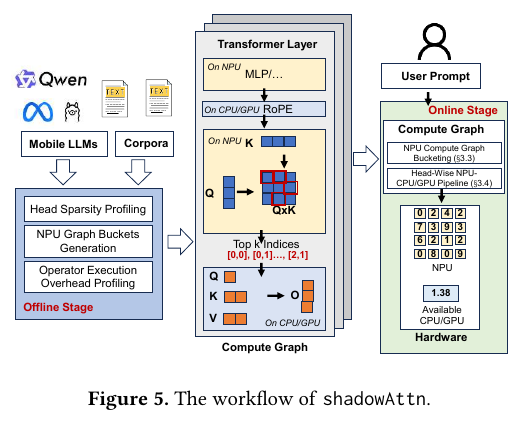
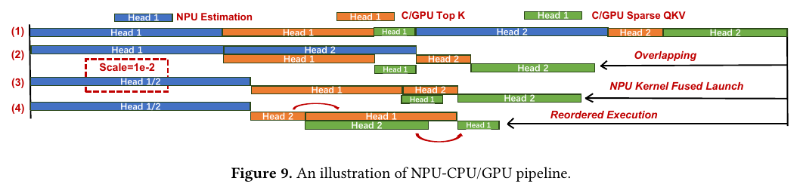
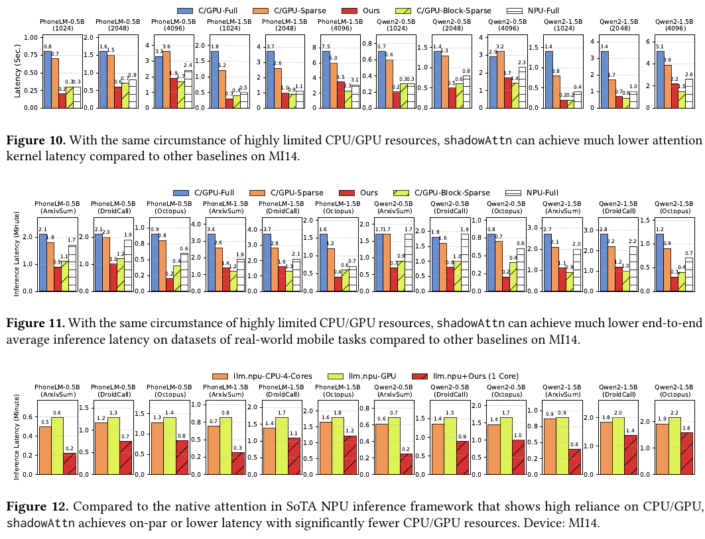
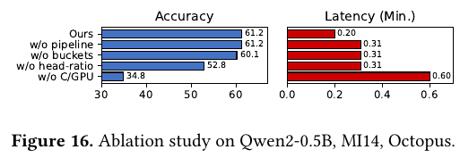

#NPU
# ShadowNPU: System and Algorithm Co-design for NPU-Centric On-Device LLM Inference

[arXiv v4](https://arxiv.org/abs/2508.16703v4)
[正式发表页面](https://doi.org/10.1145/3745756.3809205)
[原文 PDF](ShadowNPU_2508.16703v4.pdf)

## 1. 核心结论与要解决的问题

ShadowNPU 研究如何在保留注意力精度的同时，让移动端 LLM 推理尽量依赖 NPU，只占用少量 CPU/GPU 资源。

移动 NPU 擅长低精度整数矩阵计算，但注意力处理的 Q、K、V 激活对粗粒度静态量化敏感。完整注意力直接放到 NPU 上，质量会下降；留在 CPU/GPU 上，又容易与界面、视频等应用争用资源。稀疏注意力也无法直接解决这个问题，因为筛选重要 token 本身还需要密集计算。

论文让 NPU 用 INT8 密集计算估计重要位置，再用少量 CPU/GPU 资源对选中的 token 重算高精度稀疏注意力。实现还结合了逐 head 稀疏率、预编译量化图分桶、跨 head 流水线、融合启动和执行重排。

默认只使用一个 CPU 中核时，论文报告注意力算子最高加速 6.9×、平均 3.5×，端到端最高加速 4.5×、平均 2.9×；12 个模型–任务组合的平均分数下降约 0.4 个百分点。在另一台设备上，单个注意力算子的能耗最高改善约 7.7×。这些收益主要来自 prefill，decode 仍在 CPU/GPU 上执行完整注意力。因此，ShadowNPU 是以 NPU 为中心的异构设计，保留了高精度 CPU/GPU 路径。（§4–5）

## 2. 动机：为什么完整量化与直接稀疏都不理想

### 2.1 完整注意力量化损伤质量

llm.npu、HeteroLLM 等框架已将许多非注意力计算交给 NPU，注意力却仍在 CPU/GPU 上执行。论文认为有两个主要原因：

1. Q/K/V 是输入相关的激活，存在离群值和较大范围波动，比固定权重更难量化。
2. NPU 静态图需要预先确定量化常数与形状，限制运行时任意改变 scale 或采用灵活的细粒度量化。

原文表 3 比较了 FP32 CPU/GPU 注意力和 INT8 NPU 完整注意力。12 个模型–任务组合的平均分数从 36.8 降到 18.8。以 PhoneLM-0.5B 的 Octopus 结果为例，分数从 64.6 降到 24.1，下降 40.5 个百分点。作者因此考虑，只将需要排序的估计步骤交给低精度 NPU。（§2.1，PDF 第 3 页）

这些结果仅对应论文测试的小模型和静态量化路径，不足以判断所有 NPU、所有量化算法执行完整注意力时的精度。

### 2.2 稀疏注意力有潜力，但筛选成本抵消收益

作者用 WikiText-2 的 128 个样本分析 Qwen2 的注意力分布，发现很多 attention score 很小，少量位置可能承载大部分贡献。不过，即使最后只保留 20% 的 token，CPU/GPU 仍要先对所有 token 计算 QK，再执行 top-k。这两步的成本依然存在。

图 4a 中，保留 20% token 时，估计阶段占总计算约 66.7%，整个注意力算子只加速约 34.3%。改为 64×64 块级估计可以减少开销，却会漏掉块内重要位置；图 4b 的块稀疏方案平均约多损失 4 个百分点。

要保留细粒度估计的精度，又减少 CPU/GPU 占用，就需要将密集估计交给其他计算资源。这是论文接下来要解决的瓶颈。（§2.2，图 2–4）

## 3. 前期发现与关键假设

### 3.1 最关键的发现：排序比精确数值更耐量化

最终注意力输出需要准确的 score 数值，而识别 top-k 只需要保留相对排序。两个 score 向量即使数值不同，只要重要位置的排序相同，就能选出同一组 token。随后再由高精度路径重算这些位置的数值。

原文表 4 给出 INT8 NPU 相对于浮点 QK 的重要位置召回率：

| 模型 | 保留 20% | 保留 30% | 保留 40% | 保留 50% | 保留 80% |
| --- | ---: | ---: | ---: | ---: | ---: |
| PhoneLM-0.5B | 99.32% | 99.39% | 99.45% | 99.51% | 99.79% |
| PhoneLM-1.5B | 99.24% | 99.27% | 99.29% | 99.34% | 99.61% |
| Qwen2-0.5B | 99.03% | 99.32% | 99.51% | 99.59% | 99.86% |
| Qwen2-1.5B | 99.68% | 99.80% | 99.83% | 99.84% | 99.95% |

使用 128 个 WikiText-2 样本，取各 head 的平均召回率。该指标衡量重要位置的召回，不代表下游任务准确率。论文将保留比例称为 sparsity ratio，这里写作“保留 20%”，以免与丢弃比例混淆。

### 3.2 其他发现及其设计含义

| 前期发现 | 设计含义 |
| --- | --- |
| 各层、各 head 的重要性不均衡，删除不同 head 造成的 loss 变化很不同 | 全局相同保留比例浪费预算，应把更多 token 分配给重要 head |
| Q/K 的量化 scale 随 head 和输入明显变化 | 单一固定 scale 图不足；预先准备少数 scale 图，运行时选择 |
| 单 head 启动不能充分利用 NPU，多个同 scale head 可以合并 | 分桶不仅改善量化匹配，也创造融合启动的机会 |
| 各 head 的估计、top-k、稀疏 QKV 相互依赖，但不同 head 可交错 | 用流水线与执行顺序降低等待，而不只是缩减乘法数量 |

### 3.3 方法依赖的假设

1. **重要位置的排序能在低精度下稳定保留。** 表 4 为此提供了较强的经验支持，但没有覆盖所有输入分布或罕见的重要 token。
2. **离线 head 重要性可迁移到业务输入。** 运行时 token 位置会变化，但每个 head 的保留比例固定；这一比例依赖校准数据。
3. **少量离散 scale 桶能覆盖输入变化。** 默认 9 桶足够，是根据所测模型和任务得到的经验判断，并非适用于任意模型的理论界限。
4. **NPU 有较充足资源，CPU/GPU 才是稀缺资源。** 因此，默认设置只给推理一个 CPU 中核。如果 NPU 本身也很繁忙，收益可能改变。
5. **工作负载以 prefill 为主。** 实现中只有 prefill 使用 shadowAttn，decode 仍执行完整注意力，所以整体加速取决于两个阶段的占比。

## 4. 技术路径

### 4.1 整体数据流：低精度筛选，高精度重算

在每个注意力 head 中，稠密注意力为：

$$
O=\operatorname{softmax}\left(\frac{QK^{\top}}{\sqrt{d}}+M\right)V,
$$

其中 $M$ 为 causal mask。ShadowNPU 将它拆成以下步骤：

1. 在 CPU/GPU 上执行 RoPE，并为 Q/K 的 NPU 估计准备量化数据。
2. NPU 执行密集 INT8 QK，得到重要性估计。
3. 将 QK 估计结果交给 CPU/GPU，按每个 query 行筛选 top-k 有效位置。
4. CPU/GPU 对选中的 K/V 片段，用高精度路径重新计算 QK、softmax 和加权求和，得到稀疏近似输出。
5. 非注意力部分继续交给宿主框架的 NPU 路径。

这一流程还利用了两个细节：

- **估计阶段省略 softmax。** 同一行内，softmax 保持排序，$1/\sqrt{d}$ 也是正的公共因子，所以可直接从 QK 中选择有效位置的 top-k。CPU/GPU 做 top-k 时跳过 causal mask 对应的无效位置，不将它们纳入排序。
- **INT8 score 不用于最终高精度输出。** 保留位置的数值由高精度路径重算，从而避开完整 NPU 注意力量化的数值误差。

按 §3.2 的具体流程，CPU/GPU 先读取 NPU 的 QK 估计结果并执行 top-k，再用选出的索引驱动稀疏计算。因此，NPU–CPU 接口并非只传索引，score 传输、同步和量化准备的成本也仍需计入。

### 4.2 根据离线重要性分配逐 head 保留比例

在校准集 $C$ 上，将第 $j$ 层的 head $i$ 置零，测量 loss 增量：

$$
I_i^{\mathrm{head}}=L(\mathrm{head}_i=0,C)-L(C),\qquad
I_j^{\mathrm{layer}}=L(\mathrm{layer}_j=0,C)-L(C).
$$

以 head 与所在层重要性的乘积作为权重，并裁剪极端值：

$$
w_i=\operatorname{clamp}(I_i^{\mathrm{head}}I_j^{\mathrm{layer}}),\qquad
r_i=\frac{rNw_i}{\sum_{k=1}^{N}w_k}.
$$

$r$ 为全局平均保留比例，$N$ 为模型的 head 总数。重要 head 保留更多位置，不重要 head 保留较少位置。各 head 的比例在运行时固定，但具体选中的 token 位置随输入变化。

默认 $r=20\%$，即约保留五分之一、丢弃五分之四的位置。论文报告，逐 head profiling 在一张 A100 上约需 5 分钟；加上图构建和执行开销 profiling，§3.1 给出的离线预算示例是每模型少于 1 个云 GPU 小时。正文公式没有完整说明边界情形，实际实现还需核对 $r_i$ 的合法范围、取整，以及超限预算如何处理。（§3.1–3.2）

### 4.3 NPU 图分桶：用有限静态图适应动态输入

Q/K 的 scale 会变化，已编译 NPU 图的 scale 和形状却是固定的。运行时重新编译图太慢，论文便预先准备一组图，在线选择其中合适的一张：

- **离线：** 统计校准集上 Q/K scale 的中心，围绕这些中心生成多个量化图桶。一个桶对应一对固定 scale $(\lambda_Q,\lambda_K)$，桶内再包含不同融合 head 数等形状的图。
- **在线：** 获取当前输入所对应的 scale，将该 scale 对与各桶比较，以 MSE 距离选择最接近的桶，再选匹配形状的预编译图。

默认配置为 9 个 scale 桶，步长参数 0.5。QK 图不含模型权重，论文称单个图约占 10–100 KB。不过，一个桶可以包含多种形状的图，总缓存要按桶数和每桶形状数计算，不能仅按 9 个图估算。形状变化主要涉及 head 维度或融合规模，序列维度则依赖宿主框架的分块推理。（§3.3 及脚注）

每张图的参数是静态的，选择哪张图则在运行时决定，因此仍需在线处理 scale。这与 Quant.npu 在整个推理期间固定量化参数的目标不同。

### 4.4 跨 head 流水线、融合启动与执行重排

同一 head 内，估计、top-k 和稀疏 QKV 必须依次执行；不同 head 的阶段则可以交错。论文据此安排了三阶段流水线：

$$
\text{NPU 估计}\ \longrightarrow\ \text{CPU/GPU top-k}\ \longrightarrow\ \text{CPU/GPU 稀疏 QKV}.
$$

图示区分的是三个逻辑阶段。默认只有一个 CPU 中核，top-k 和稀疏 QKV 未必能各占一个核同时执行，具体调度仍受实际资源限制。

作者还做了两项调度优化：

1. **融合启动：** 相同桶中的 head 共享量化 scale，可合并到一次 NPU 启动，提升利用率。论文在 MI14 上的例子为：1 个 head 的 QK 约 2 ms，2 个 head 约 3 ms，4 个 head 约 4 ms；逐 head 启动 4 次则约为 8 ms。
2. **执行重排：** 不同 head 的保留比例和计算量不同，执行顺序影响流水线空隙。算法根据离线算子耗时，每步贪心选择使当前完成时间最小的组合；论文称 MI14 的在线规划开销低于 1 ms。

这一启发式不需要穷举排列，但也不保证全局最优。分桶让更多 head 共享 scale，融合启动又会改变后续任务的到达时间，因此量化图选择和调度会相互影响。（§3.4，算法 1）

### 4.5 集成范围与实现

原型约有 10,000 行 C++/Python。NPU 部分使用 QNN 和 Hexagon SDK，CPU/GPU 部分使用 ARM NEON、OpenCL 及 LLVM 相关实现，并融合 RoPE、量化、matmul、softmax 等操作，减少重复拷贝。部分不敏感指令采用半精度，因此“高精度 CPU/GPU 路径”并不表示每条指令都使用 FP32。

端到端实验将方法集成到 llm.npu，只替换 prefill 的注意力算子。decode 主要受内存带宽影响，仍在 CPU/GPU 上执行完整注意力。估计和后续生成还需要 KV 数据，论文也没有提出按 80% 比例永久删除完整 KV cache 的方案。（§4，PDF 第 7–8 页）

## 5. 基线、实验设置与效果

### 5.1 模型、设备与工作负载

| 模型 | Q heads | KV heads | Head dim | 层数 |
| --- | ---: | ---: | ---: | ---: |
| PhoneLM-0.5B | 16 | 16 | 64 | 24 |
| PhoneLM-1.5B | 16 | 16 | 160 | 19 |
| Qwen2-0.5B | 14 | 2 | 64 | 24 |
| Qwen2-1.5B | 12 | 2 | 128 | 28 |

来源：表 5。Qwen2 使用 GQA，PhoneLM 的 Q/KV head 数相同，实验因此覆盖了两类注意力配置。

主测试设备 MI14 使用 Snapdragon 8 Gen 3、Hexagon V75 和 Cortex-A720 中核；另一台 Redmi K60 Champion Edition 使用 Snapdragon 8 Gen 2、Hexagon V73 和 Cortex-A715 中核。默认情况下，NPU 资源全部可用，CPU/GPU 资源则只给一个 CPU 中核。论文还测试了不同 CPU 核、宿主框架的四核/GPU 注意力，以及与其他应用并发的情况。

| 数据集 | 任务与指标 | Prefill / Decode 长度 |
| --- | --- | ---: |
| ArxivSum | 论文摘要生成，ROUGE-L F1 | 3840 / 50 |
| DroidCall | 移动任务，top-5 单步完成准确率 | 4096 / 10 |
| Octopus | 系统 API 函数选择，top-5 准确率 | 1792 / 10 |

每个测试输入采用 5 个样本的 in-context learning。由于输入长、输出短，端到端延迟主要由 prefill 决定。设备描述中的“16+6 GB”“16+3 GB”缺少进一步说明，不宜直接视为全部可用的物理 DRAM 预算。（§5，表 5）

### 5.2 基线分别验证什么

| 基线 | 注意力路径 | 所验证的问题 |
| --- | --- | --- |
| C/G-Full | CPU/GPU 高精度完整注意力 | 精度参照与原始 CPU/GPU 负担 |
| C/G-Sparse | CPU/GPU 密集估计 + token 级稀疏计算 | 仅有稀疏是否足够快 |
| C/G-Block-Sparse | CPU/GPU，64×64 块级稀疏 | 降低估计开销会损失多少精度 |
| NPU-Full | NPU INT8 完整注意力 | 全部转为粗粒度整数计算的精度代价 |
| shadowAttn | NPU INT8 估计 + CPU/GPU 稀疏高精度计算 | 量化容错排序与系统协同的综合收益 |

四个替代方案先在相同 CPU 资源限制下比较，图 12 再加入 llm.npu 的四 CPU 核和 GPU 原生注意力配置。因此，一核之间的比较与一核对四核/GPU 的比较，需要分开看。

### 5.3 精度：平均接近完整注意力，但个别任务仍下降

下表摘录原文表 6，沿用 0–100 的分数标度。ArxivSum 使用 ROUGE-L F1，另外两项使用准确率，最终平均值因此是不同任务指标的算术平均。

| 模型 | 数据集 | C/G-Full | C/G-Sparse | C/G-Block-Sparse | NPU-Full | shadowAttn |
| --- | --- | ---: | ---: | ---: | ---: | ---: |
| PhoneLM-0.5B | ArxivSum | 14.7 | 14.9 | 10.0 | 0.0 | 15.2 |
| PhoneLM-0.5B | DroidCall | 27.5 | 24.0 | 25.5 | 20.5 | 25.5 |
| PhoneLM-0.5B | Octopus | 64.6 | 71.3 | 62.9 | 24.1 | 64.0 |
| PhoneLM-1.5B | ArxivSum | 11.9 | 12.1 | 6.0 | 0.0 | 12.0 |
| PhoneLM-1.5B | DroidCall | 20.5 | 23.5 | 28.5 | 19.0 | 25.5 |
| PhoneLM-1.5B | Octopus | 79.2 | 75.8 | 45.5 | 24.7 | 75.8 |
| Qwen2-0.5B | ArxivSum | 10.7 | 11.4 | 10.8 | 9.4 | 11.3 |
| Qwen2-0.5B | DroidCall | 34.5 | 34.5 | 26.0 | 27.5 | 37.5 |
| Qwen2-0.5B | Octopus | 60.6 | 42.1 | 37.6 | 34.8 | 61.2 |
| Qwen2-1.5B | ArxivSum | 8.5 | 2.0 | 4.2 | 9.1 | 8.4 |
| Qwen2-1.5B | DroidCall | 48.0 | 19.0 | 15.5 | 22.5 | 44.5 |
| Qwen2-1.5B | Octopus | 61.2 | 21.9 | 32.0 | 34.2 | 56.1 |
| **平均，按原表** | — | **36.8** | **29.4** | **25.4** | **18.8** | **36.4** |

从这些结果看，0.4 只表示平均分差，并非每项都只损失 0.4，更不代表严格无损。Qwen2-1.5B 在 Octopus 上下降 5.1 个百分点，PhoneLM-1.5B 在 DroidCall 上却上升 5.0 个百分点，不同任务的增减在平均值中相互抵消。论文没有提供足够的重复实验或置信区间，小幅提升是否代表能力增加，仍无法确定。

### 5.4 速度：受限 CPU 环境下的 prefill 收益显著

| 比较口径 | 论文报告结果 |
| --- | --- |
| MI14，相同一中核资源，注意力算子 vs C/G-Full | 最高 6.9×、平均 3.5× 加速 |
| MI14，相同一中核资源，端到端 vs C/G-Full | 最高 4.5×、平均 2.9× 加速 |
| MI14，一中核 shadowAttn vs llm.npu 四核/GPU 原生注意力 | 达到相当或更低延迟，论文报告最高约 3.0× 优势 |
| Redmi K60，PhoneLM-0.5B，ArxivSum | 1.2 min → 0.6 min，2.0× |
| Redmi K60，PhoneLM-0.5B，Octopus | 2.5 min → 2.0 min，1.25× |
| Redmi K60，PhoneLM-0.5B，DroidCall | 2.7 min → 2.2 min，约 1.23× |

最后一行根据原表舍入后的数值计算，正文写约 1.22×。旧一代 V73 上的收益明显低于 MI14，可见效果取决于 NPU 估计能力和 CPU 计算能力的相对关系。此外，很多任务的延迟仍为分钟级，即使加速比很大，也未必达到实时交互要求。（§5.1，表 7）

### 5.5 能耗：最高 7.7× 来自单注意力算子

原文表 8 在 Redmi K60 上测量单个注意力 kernel 的能耗，输入长度为 1024：

| 模型 | C/G-Full | shadowAttn | 基线能耗 / 本方法能耗 |
| --- | ---: | ---: | ---: |
| PhoneLM-0.5B | 3.72 J | 0.66 J | 5.64× |
| PhoneLM-1.5B | 8.59 J | 1.12 J | 7.67× |
| Qwen2-0.5B | 3.38 J | 0.56 J | 6.04× |
| Qwen2-1.5B | 5.29 J | 0.71 J | 7.45× |

表中的比值由原始数值计算。7.67× 相当于该算子能耗约下降 87%，这一结果不适用于整次 LLM 请求或整部手机，也不能据此认为它们的耗电下降 7.7 倍。测量使用电池电压、电流系统接口，但正文没有详细说明是否扣除闲置功耗、采样频率、积分方式和误差范围。（§5.1，表 8、脚注 2–3）

### 5.6 与并发应用共存

表 9 测试 MI14 上的 PhoneLM-0.5B 和 Octopus 工作负载：无并发应用时延迟为 14.7 s，拍照时为 14.5 s，视频 15.5 s，音乐 14.7 s，购物应用 15.2 s。在这一设置下，LLM 延迟变化较小。

不过，实验不允许其他应用使用选定的 CPU 中核，相当于为推理保留了执行资源。结果证明这种安排可行，但尚不能说明默认系统调度下也没有竞争。表中也没有 UI 帧率、触控响应或音频卡顿等应用侧体验指标。（§5.2，PDF 第 11 页）

## 6. 消融：哪些设计贡献了收益

原文图 16 在 MI14、Qwen2-0.5B、Octopus 上逐步移除设计。以下直接读取图中标注值：

| 设置 | 分数 | 端到端延迟 |
| --- | ---: | ---: |
| 完整方法 | 61.2 | 0.20 min |
| 去掉流水线 | 61.2 | 0.31 min |
| 再去掉 scale 桶 | 60.1 | 0.31 min |
| 再改为全 head 相同比例 | 52.8 | 0.31 min |
| 再去掉 CPU/GPU 稀疏高精度路径，改完整 NPU 注意力 | 34.8 | 0.60 min |

这些结果中，流水线主要改善速度，分桶改善量化匹配，逐 head 比例改善稀疏预算分配，而高精度稀疏路径避开了完整 INT8 注意力的质量损失。各步骤是累积移除的，因此每行差值并不等于某个组件完全独立的贡献。

参数敏感性实验也解释了默认设置。图 13 中，PhoneLM-0.5B 在 ArxivSum 上保留 20% 时处于所测质量–延迟曲线的拐点，降到 10%/5% 后质量明显下降。图 14 中，桶数从 5 增至 9 带来改善，再增加到 13/17 收益有限；步长 0.5 在所测设置下较好。新模型、设备或业务仍需重新校准，不能直接沿用这些经验参数。

## 7. 局限性分析

### 7.1 主要解决 prefill，并未解决长生成阶段

**本报告分析：** decode 仍执行完整 CPU/GPU 注意力，输出越长，未被优化部分的占比就越高。按 Amdahl 定律，若原请求中 prefill 占比为 $f$，其加速为 $s$，整体加速上限为：

$$
S_{\mathrm{total}}\leq\frac{1}{(1-f)+f/s}.
$$

所以，输入短、输出长的聊天或推理任务不能直接套用 4.5×。对于 KV cache 容量、磁盘 offload 和超长上下文等问题，这一方法也没有提供完整解决方案。

### 7.2 密集估计没有消失，渐近复杂度仍受限制

**本报告分析：** NPU 仍需对全部 Q/K 做密集估计，CPU/GPU 也要读取 score 并执行 top-k。全序列 prefill 的 pilot QK 仍有二次复杂度，分块只能改变峰值工作集，并不会自动消除计算总量的增长。上下文大幅扩展后，估计、score 存储、传输或 top-k 都可能成为新瓶颈。方法通过迁移计算和重叠执行获得收益，并没有证明注意力达到线性复杂度。

### 7.3 平均召回率和平均分数可能掩盖关键失败

**本报告分析：** 即使 top-k 位置召回达到 99%，仍可能漏掉影响工具选择或答案事实的关键位置。按 head 和样本平均，还会掩盖尾部错误。表 6 中，某些任务下降 3–5 个百分点，已经说明平均值不足以描述这些问题。还需检查最差样本、score 排序间隔、重要 token 权重和真实多步任务失败率。尤其是 top-5 单步指标，不能代表 top-1 或完整 agent 的成功率。

### 7.4 离线分配与有限桶对域变化敏感

**本报告分析：** head 保留比例由 128 个 WikiText-2 样本确定，不随实时业务变化重新分配，scale 桶也只覆盖离散范围。中文、代码、特殊工具 schema、异常激活或新的长度分布，都可能改变排序稳定性和 head 重要性。用 MSE 找到最接近的 scale，也不直接等价于优化 top-k 召回或最终任务质量。论文尚未给出分布外输入的保证，也没有明确的低置信度回退策略。

### 7.5 流水线依赖资源条件和稳定的耗时估计

**本报告分析：** 启发式调度使用离线测得的算子耗时，但运行时的 DVFS、热限频、共享内存带宽和其他 NPU 任务可能改变相对速度。融合更多 head 能提高利用率，也可能让第一批 top-k 更晚开始；分桶过多则会减少能融合的 head。论文没有全面联合搜索桶数、融合粒度、保留比例和动态资源约束，因此当前配置未必适合所有平台。

### 7.6 硬件与模型覆盖有限

**本报告分析：** 两部设备均使用 Qualcomm Hexagon，模型也仅覆盖 PhoneLM/Qwen2 的 0.5B/1.5B。虽然测试了 MHA/GQA 两类配置，其他 NPU 系列、较大模型、MoE、多模态和复杂原生稀疏注意力仍未覆盖。实现依赖 SDK 静态图、融合启动和算子支持，这会增加迁移到其他平台的工程量。[MobiSys 2026 官方公开评审](https://sigmobile.org/mobisys/2026/program/)也指出，跨 NPU 家族和真实移动应用的验证仍不足。

### 7.7 质量、能耗和用户体验证据仍有范围限制

**本报告分析：** 0.4 的平均分差混合了不同任务指标，统计不确定性也未充分报告；7.7× 的能耗改善来自单 kernel 的电池接口测量；并发测试保留了 CPU 核，只记录 LLM 延迟。这些结果尚不足以说明全天续航、持续热稳定性、界面流畅度或完整任务可靠性会获得同等收益。判断“NPU-centric”设计是否达到目标，还需同时看 NPU/CPU 占用、同步开销和应用侧体验。

### 7.8 基线有明确的资源定位

**本报告分析：** 主要的大幅加速来自只允许一个 CPU 中核的部署设置，不能推广为对所有不限资源的移动推理引擎都有 4.5× 收益。图 12 加入四核/GPU 比较，补充了这方面的证据。不过，仍需在质量、线程、频率和内存预算一致时，与充分优化的完整注意力、不同融合实现及更新的完整 NPU 注意力方案比较。

## 8. 技术价值与后续验证重点

这篇论文将需要准确数值的计算与只需要稳定排序的计算分开，分别安排精度和设备。稀疏注意力减少了高精度计算量，NPU 密集估计缓解了筛选瓶颈，再通过分桶、融合和流水线降低执行开销。这一分工思路也有迁移价值。

复现或部署到端侧系统时，可以优先验证以下几点：

1. 在目标输入上测量逐 head top-k 召回和下游任务变化，特别检查最坏样本，重新校准保留比例和 scale 桶。
2. 分别测 prefill、decode、TTFT、TPOT 与总延迟，并改变输入/输出长度比例。
3. 把在线 scale 处理、QK 传输、top-k、NPU 启动与等待全部计入成本，核对单核时的真实重叠方式。
4. 在 CPU 中核受限、CPU/GPU 资源充足以及 NPU 被其他任务使用三种状态下比较，补充热限频和共享带宽实验。
5. 测整次请求能耗与应用侧帧率、触控/音频指标，而不仅使用单 kernel 能耗和 LLM 延迟。

ShadowNPU 用低精度结果辅助筛选，再由高精度路径恢复最终数值；Quant.npu 则直接改善固定静态量化模型。两者都考虑 NPU 的约束，但处理的问题不同。把静态量化线性层与 ShadowNPU 的 prefill 注意力结合，可能有价值。不过，联合后的质量和速度需要重新测量，两篇论文各自的加速比不能直接相乘。

