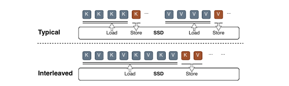
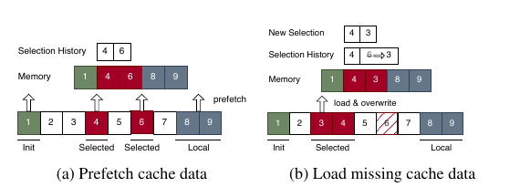
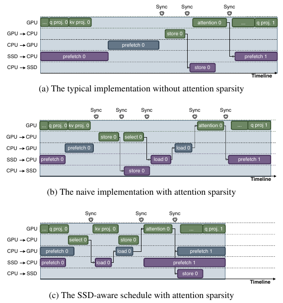

# SolidAttention: Low-Latency SSD-based Serving on Memory-Constrained PCs

来源版本：USENIX FAST 2026 正式版，[发表页](https://www.usenix.org/conference/fast26/presentation/zheng) · [本地 PDF](resources/solidattention-fast2026.pdf)。

讲解思路参考 marsggbo 的[这篇博客](https://zhuanlan.zhihu.com/p/2039385982823355233)：先弄清为什么内存不够、为什么直接搬到 SSD 仍然慢，再逐步看三个模块如何解决问题。技术细节和实验数字以论文为准；文中页码均为 PDF 页码。以下是论文阅读与个人分析，未运行代码或核验源码。

## 研究问题与核心思路

### 1. 权重装得下，不代表长上下文也装得下

在笔记本上跑 LLM，量化权重通常是第一步。但上下文拉长后，真正挤占内存的可能变成 KV cache。

decode 每生成一个 token，都要用当前 query 访问历史 token 的 Key 和 Value。把历史 K/V 缓存下来，可以避免重复计算；代价是上下文越长，缓存越大。论文以权重已量化到 INT4 的 Llama-3.1-8B 为例：128k-token 上下文的 FP16 KV cache 约需 16 GB，已经超过许多笔记本能留给推理的内存。（§1–§2.1、图 1，PDF 第 2–4 页。）

面对这个问题，可以从三个方向入手：

- **把 KV 也量化。**每个元素占用更少字节，但需要处理异常值和量化误差。论文中的朴素 INT4 KV 基线掉分明显，后面会看到具体结果；这不代表所有 KV 量化方案都不可用。
- **每次只用少量 KV。**动态稀疏注意力根据当前 query 挑选相关内容，少算一些 attention。不过，没选中的历史 KV 未来仍可能有用，不能直接删除。只减少参与计算的 KV，还没有解决完整缓存存在哪里的问题。
- **把完整 KV 放到 SSD。**容量压力转移到了存储端，但每次计算前要把相关数据读回来。新的问题是：读得够不够快？

SolidAttention 结合后两条路径：完整 KV 留在 SSD，每次只读取一小部分参与 attention，并尽量让读取与已有计算重叠。KV 仍使用 FP16。

### 2. 为什么“稀疏 attention + SSD”不一定快

稀疏 attention 关心的是“哪些 token 最相关”，SSD 关心的则是“每次读多大、发多少次请求”。细碎、分散的选取结果容易变成大量小 I/O，即使总读取量不大，也未必能用好 SSD 带宽。

还有一个更直接的等待：当前层 query 出来后，系统才知道真正需要哪些块。如果此时才发起读取，GPU 就得等数据到齐才能继续 attention。

FlexGen 等面向高吞吐的方案，可以用其他请求的计算遮住 I/O。可在本地单用户、batch=1 的场景下，没有另一个请求可供穿插。于是 GPU 等 SSD、SSD 又等下一次选块，两个设备都没能充分工作。（§2.2–§2.3、图 2，PDF 第 4–5 页。）

所以，SolidAttention 要同时回答三个问题：**每次怎么读、什么时候开始读、读写和计算怎样安全地交错执行。**下面的三个模块分别对应这三个问题。

## 实现路径

### 1. 先看每次 attention 到底选哪些 KV

SolidAttention 采用 InfLLM 式的块级动态注意力。历史 KV 按 token 切成 block，每块从 K cache 中提取代表向量。当前 query 先与这些代表向量比较，再把高相关块对应的 KV 取来做 attention，无需先计算所有历史 token 的完整 attention 分数。（§3.1，PDF 第 5 页。）

可以把代表向量理解成检索用的“摘要”，但它不是文本摘要：它只是帮助选块的向量表示。选块之后，真正参与 attention 的仍是块内 K/V。

每次使用的块分三类：

- **Init blocks**：固定保留开头一段，处理 attention sink。
- **Local blocks**：保留最近一段，覆盖最新上下文。
- **Selected blocks**：从更早的历史中，根据当前 query 动态选择。

默认每块 **32 tokens**。输入短于 4k tokens 时，context budget 为输入长度的 25%；其余情况固定为 **1k tokens**。预算的一半给 init 和 local，另一半给 selected；正文没有继续说明 init/local 之间如何分配。（§7，PDF 第 9 页。）

要区分三个量：**上下文长度**决定完整历史有多长，**context budget**决定本次 attention 最多使用多少 token，**block size**决定一次选取的粒度。输入可以有 128k tokens，本次只使用约 1k tokens，而其余历史依然保存在 SSD，留给后续 query 重新选择。

### 2. KV Consolidator：块不用变大，读请求也能合并

块切小一点，代表向量比较容易概括块内内容；但 SSD 又不擅长大量小请求。能不能直接把 block size 加大？

图 6 给出的代价是召回率下降：在 Llama-3.1-8B、Qwen-2.5-7B 的 LongBench PassageRetrieval-en/zh 实验中，block size 从 32 增至 256，召回率整体降低。一个代表向量需要概括更多 token，选块就可能变得不准。该图没有列全实验配置，不能把它概括成其他任务也会有固定幅度的精度损失。（§4，PDF 第 6 页。）

作者换了一个方向：**不增加每块的 token 数，而是把同一块的 K 和 V 放在一起读取。**

*图 7：K/V 分离存储与按 token 交错存储。裁自 FAST 2026 正式版 PDF 第 6 页；来源为本文开头链接的论文 PDF。*

上半图中，K 和 V 各自存放，同一块数据需要分别读取。下半图将它们按 token 交错放置，一次读取就能把这一块的 K/V 一起带走。相比原来的分离请求，传输单元加倍、请求数减半，而块里仍是同样多的 token，代表向量也不用概括更多内容。

这里增加的是每次请求的有效粒度，**不是把 KV 总字节数减半，也不是保证带宽翻倍**。实际收益取决于 SSD 能否从更大的请求中获益。

接下来还有一个工程问题：如果分别算出 K、V 后，再拷贝成交错布局，节省的 I/O 开销可能被重排吃掉。作者在模型初始化时预拼接 K/V 投影权重，让一次投影直接生成可 reshape 成交错布局的输出。attention kernel 用带 stride 的视图读取 K/V，不再把缓冲重新排成两块连续张量。（§4、图 8，PDF 第 6–7 页。）

论文用模型维度 H 表述 stride 为 2H；实际集成仍要结合 KV heads、head dimension 和张量布局，不能直接套用到所有 GQA 实现。作者报告带 stride 访问比连续布局增加的延迟不超过 2%，但未完整列出该微基准的形状和配置。这也只是访问布局的开销，不是端到端吞吐变化。

### 3. Speculative Prefetcher：等到选完再读，已经晚了

合并请求解决了“怎么读”，却没有解决“什么时候读”。正式选块依赖当前层 query，数据确定得太晚，attention 还是会等待 SSD。

预取利用的是选块的时间局部性。**为当前轮 layer L 预取时，参考上一轮 decode 中 layer L 的选块记录。**上一轮关注的历史块，这一轮往往还会用到；于是系统可以在当前层 query 尚未就绪时，先把可能需要的数据读进来。

论文在 Llama-3.1-8B、Qwen-2.5-7B、多种 LongBench 工作负载和 1k context budget 下观察到相邻迭代选块的较高相似性，正文概括为约 81%。这不是所有层、所有任务都固定达到的命中率。（§5、图 9，PDF 第 7 页。）

Init/local 的需求可以确定，直接预取；selected blocks 则根据历史结果推测。当前 query 到位后，系统仍要正式选块，再检查提前读来的数据是否够用。

*图 10：先按历史选择预取，再根据正式结果补读、覆盖。裁自 FAST 2026 正式版 PDF 第 7 页；来源为本文开头链接的论文 PDF。*

图中可以抓住两个动作来看：块 4 预取正确，留在原位；块 6 预取错误，用补读的块 3 直接覆盖。系统不必为了恢复逻辑顺序，再把所有命中块搬动一遍。

这样做成立，是因为单个 decode query 的 attention 只要求 K/V 成对对应，并保持位置语义和可见性一致，不要求历史 KV 在缓冲区里按原 token 顺序排好。置换关系的推导放在文末。它不适用于任意打乱 prefill 的 causal mask，也不保证有限精度下 bitwise 一致。（§5.2，PDF 第 7–8 页。）

因此，预取失误只会增加补读和等待；只要纠错、同步正确完成，误取块就不会代替正式选中的块参与计算。这里要把两件事分开：**稀疏选择决定哪些上下文参与计算，预取决定这些已选数据能否提前到位。**前者会引入近似，后者则有补读纠错路径。它也与生成候选输出 token 的推测解码不同。

博客把这一机制解释为“用上一层预测下一层”。论文 §5 开头的 cross-layer 措辞确实容易引起这种理解，但 §5.1 明确写的是各层上一轮推理的选择历史。这里按后者理解；尚未通过源码独立核验。

### 4. SSD-aware Scheduler：把当前层计算变成下一层的读盘窗口

有了预取，还得给它安排一段足够长、不会破坏数据的执行窗口。

先看独显机器的实际路径：数据从 SSD 读到主存 DRAM，再传到 GPU 显存，并非 GPU 直接读取 SSD。内存受限时，这些缓冲需要复用。如果 GPU 还在读旧数据，SSD 就把下一层数据覆盖进来，结果会出错。把所有任务串行执行当然安全，但也失去了重叠的收益。

*图 11：无稀疏、朴素稀疏实现与 SSD-aware 调度的时间线。裁自 FAST 2026 正式版 PDF 第 8 页；来源为本文开头链接的论文 PDF。图中箭头表示依赖，Sync 表示 CPU/GPU 同步。*

对照中间与下面两幅图，先看 `q proj.` 后面的变化。朴素实现等 K/V 投影也算完才继续选块；优化后，query 一出来就可以执行 `select`，随后补读漏块。与此同时，GPU 继续计算当前 token 的 `kv proj.`。**选块不依赖新 K/V 投影的结果，这段时间就可以用来遮住补读。**

再看图的右侧：当前层 attention 计算时，SSD 开始为下一层预取 KV 到 DRAM；当前层进入 FFN 后，再把已预取的数据送入下一层要用的显存，同时推进当前层新增 KV 的写回。上一层的计算，由此成为下一层准备数据的时间窗口。（§3.2、图 5，PDF 第 6 页；§6，PDF 第 8–9 页。）

调度器将 q projection、kv projection、select、load、attention、prefetch、store 拆成微任务，I/O 再按 KV block 拆分，用 DAG 表示数据依赖。算法 1 优先执行已就绪的关键路径任务，其次是 I/O 任务，最后是其余任务；同类中 latest start time 较小的优先。这个策略让可能拖慢后续计算的任务尽早开始，但论文没有证明它在一般异构资源约束下全局最优。

拆得细也有代价：每做一点就同步一次，CPU/GPU 握手会变得频繁。作者因此复用同步点。例如，attention 开始前本来就要确认漏块补读完成，可以顺便确认 init/local 的传输完成；非关键路径上的新增 KV 写回，也可与已有同步合并。图 11 展示的是减少重复等待，不是取消必要同步。

统一内存 iGPU 不需要独显平台那样显式搬运 DRAM/VRAM 数据，但 SSD I/O、缓冲复用和数据可见性约束仍然存在。

### 5. 最后把三个模块连起来

到这里，三个模块的分工就比较清楚了：KV Consolidator 让一次读盘更有效，Speculative Prefetcher 让读盘更早开始，SSD-aware Scheduler 则安排好它与计算的依赖和重叠。三者共同减少的是“attention 已准备好，却还在等 KV”的时间。

作者基于 llama.cpp 实现系统，用 liburing 发起 SSD I/O，支持 CUDA 和 SYCL。实现约 25k 行代码，其中约 12k 行 GPU kernels、1k 行 llama.cpp 适配；I/O 与 SSD–GPU 协调分别占用一个专用 CPU core。每层还设有 **32 KB 写缓冲**，合并新增 KV 的小写入，减少写放大与磨损。（§7，PDF 第 9 页。）

这些是论文报告的实现情况，不是本人源码核验或复现结果。

## 实验条件与关键结果

### 1. 共同配置与基线

下面先看系统速度与内存，再看准确性和各模块的贡献。除另有说明，均采用 §8.1 的共同设置：**batch=1，最大输出长度 512 tokens，模型权重 INT4，KV cache FP16**。512 是输出上限，各请求不一定生成相同长度。

| 项目 | 作者设置 |
| --- | --- |
| CUDA 平台 | Linux kernel 6.8.0，CUDA 12.8；16 核 Intel Core Ultra 9 185H；RTX 4070 Laptop GPU，8 GB GDDR6 显存 |
| SYCL 平台 | Linux kernel 6.11.0，oneAPI 2025.0；16 核 Intel Core Ultra 7 255H；Intel Arc 140T 集成 GPU |
| 物理主存与主 SSD | 两台笔记本均为 64 GB DDR5、1 TB Samsung 990 PRO PCIe 4.0 SSD；§8.2 端到端实验将 DRAM 使用限制为 16 GB |
| 主要模型 | Llama-3.2-3B、Llama-3.1-8B、Qwen-2.5-7B；扩展实验使用 Qwen2.5-14B |
| 默认稀疏预算 | block size=32 tokens；输入小于 4k 时 budget=输入长度的 25%，其余固定 1k tokens |
| 性能输入 | §8.2 使用 WikiText-2 截断 prompt，图示输入长度从 1k 至 128k tokens |
| Offload | 整个 KV 卸载 SSD，不使用注意力稀疏 |
| Offload+Sparse | 同样卸载 SSD，并结合 InfLLM 减少 attention 与 KV I/O；是主速度收益的关键基线 |
| FlexGen | 作者扩展以支持 Llama/Qwen；CUDA 平台，attention sparsity ratio=10%；超过 16k 输入出现 OOM |
| InDRAM / InDRAM+sparse | KV 全留主存的 llama.cpp，以及再加 InfLLM 稀疏的版本；用于 §8.4.1 的 SYCL 对照 |

### 2. 主结果：SSD 卸载场景下的系统吞吐

下表均为 **128k-token 输入**下，相对 **Offload+Sparse** 的系统 token/s 倍数；使用上表平台与共同配置，端到端实验限制 DRAM 为 16 GB。来源：§8.2、图 12–13，PDF 第 10 页。

| 模型 | CUDA 吞吐倍数 | SYCL 吞吐倍数 |
| --- | --- | --- |
| Llama-3.2-3B | 2.8× | 2.1× |
| Llama-3.1-8B | 3.1× | 2.5× |
| Qwen-2.5-7B | 2.4× | 1.9× |

这是系统层面的 token/s，而非单个 attention kernel 的加速。作者将其称为 end-to-end，但没有拆清 prefill 与 decode 的计时贡献，因此不直接等同于 TTFT 或整次请求延迟的改善。

16k-token 输入下，SolidAttention 相对 FlexGen 的吞吐倍数最高达 58.9×，再增加长度则 FlexGen 发生 OOM。FlexGen 原本面向高吞吐、高并发，此处又由作者扩展了模型支持。判断本文收益时，与 Offload+Sparse 的比较比这个极大倍数更有参考价值。

扩展到 **SYCL、INT4 Qwen2.5-14B、128k context** 时，相对 Offload+Sparse 的吞吐最高提升 1.7×，KV 内存占用下降 98%。实验仍沿用 batch=1、最大输出 512、KV FP16 的共同设置；该段虽以 larger memory 为题，却未单独说明内存限制，不能直接按 16 GB 受限配置理解。（§8.2，PDF 第 10–11 页。）

### 3. “节省 98%”节省的是哪部分内存

图 14 对照的是 llama.cpp 与 SolidAttention 的 **KV cache 内存分配**，不是模型权重、进程总 RSS 或整机峰值内存。在 §8.2 配置和长上下文测试中，三种主要模型的 KV 内存下降倍数最高分别为 61.9×、62.0×、61.9×，约等于减少 98%。（PDF 第 10 页。）

节省来自工作集的缩小和缓冲复用：内存中只为一层、1k-token budget 的 KV 分配工作缓冲，另存块代表向量。历史 KV 仍占 SSD 空间，也仍需持续读写。论文没有给出完整的主存、显存和各缓冲分项，不能只凭“一层缓冲”推导整个进程的内存占用。

图 15 在 SYCL 上测试 Llama-3.1-8B 与 Qwen-2.5-7B，输入范围为 1k–128k，batch、输出上限和精度配置相同。作者报告，SSD 版与内存对照的吞吐差距不超过 11%。长上下文时，应重点看同样采用稀疏注意力的 **InDRAM+sparse** 对照；这组结果不说明 SSD 的物理访问性能接近 DRAM。（§8.4.1，PDF 第 11 页。）

### 4. 准确性：平均接近，但长上下文分数不是完全不降

表 1 用 OpenCompass 比较 Origin（原始 llama.cpp、FP16 KV）、Quant（llama.cpp、INT4 KV）和 Ours（SolidAttention、FP16 KV）。**三者权重都为 INT4**，沿用 batch=1、最大输出 512 的共同设置。五项指标为 WinoGrande、ARC-Challenge、MMLU、GSM8K 和 LongBench；LongBench 包含问答、少样本、摘要等任务，上下文最高 64k tokens。（§8.3，PDF 第 11 页。）

| 模型 | Origin 五项平均分 | SolidAttention 五项平均分 | 平均分差（百分点） | Origin LongBench | SolidAttention LongBench | LongBench 分差（百分点） |
| --- | --- | --- | --- | --- | --- | --- |
| Llama-3.2-3B | 57.82 | 57.67 | −0.15 | 40.10 | 38.25 | −1.85 |
| Llama-3.1-8B | 65.76 | 65.93 | +0.17 | 46.75 | 45.35 | −1.40 |
| Qwen-2.5-7B | 71.39 | 70.76 | −0.63 | 45.77 | 43.75 | −2.02 |

分数来自原表，分差由我相减得到。五项平均接近，但三种模型的 LongBench 都有下降；通用任务的小幅上升也没有置信区间，无法判断是否显著。因此，更准确的说法是“这些测试中的总体准确性接近原模型”，而非“各项任务完全无损”。速度测到了 128k 输入，质量测试则不能据此自动延伸到 128k。

Quant 在 Qwen-2.5-7B 上的五项平均分只有 18.63，作者将其归因于 KV 异常值与低精度误差。这说明本次朴素 INT4 KV 基线不够稳健。由于论文没有完整比较针对异常值设计的先进方案，还不能据此判断 KV 量化整体不如 SSD 卸载。

### 5. 消融：区分局部延迟与系统速度

以下消融沿用共同的 batch、输出上限及权重/KV 精度设置。除预取实验外，相关段落未逐项重述输入长度，表中也不补填。

| 消融 | 平台、模型与输入条件 | 作者报告 | 指标边界 |
| --- | --- | --- | --- |
| 去掉推测预取 | 两个平台，三种主要模型；WikiText-2 截断的 16k-token prompt | SYCL 的 KV 加载阻塞延迟最多缩短至原来的 1/3.1，CUDA 最多至 1/3.9；Qwen-2.5-7B 对应 1/2.9、1/1.9 | 图 16 测的是等待 KV 的阻塞部分，不是同等幅度的系统吞吐提升 |
| 去掉 K/V 交错 | CUDA，三种主要模型；本段未单列输入长度 | 交错布局使 decode attention 延迟最多降低 22% | 图 17a，不是总请求延迟下降 22% |
| 朴素调度 → 细粒度重叠 → 同步复用 | SYCL，三种主要模型；本段未单列输入长度 | 正文称重叠带来最高 25% 性能改善，同步复用进一步降低 attention 延迟最高 22% | 图 17b 是归一化 decode attention 延迟；两者不能直接相加成系统收益 |

来源：§8.4.2–§8.4.4，PDF 第 11–12 页。

### 6. 敏感性：固定预算不是免费的扩展性

- **预算扩大后，SSD 可能重新成为瓶颈。**SYCL 上的图 18 显示，context budget 达到 4k tokens 时，I/O 不再能被充分隐藏，attention 延迟明显上升。已有准确性测试支持作者选择 1k budget，但其他任务若需要更多上下文，就要重新付出这部分代价。（§8.5.1，PDF 第 12 页。）
- **块大小要同时看速度与选块质量。**同组 SYCL 实验中，32 tokens/block 比 16 tokens/block 的吞吐约高 14%，继续增大则收益趋平。结合前面的召回率实验，作者选择 32，而不是一味增大 I/O 粒度。（§8.5.2。）
- **SSD 档位在大预算下更重要。**图 19 在 SYCL 上比较 1 TB Samsung 990 PRO（标称最高 7.5 GB/s、1.2M IOPS）与 1 TB KIOXIA BG6（5.0 GB/s、650k IOPS），输入为 1k、4k、16k、64k tokens。1k budget 下平均 token 延迟接近；4k budget 下，低档 SSD 的尾延迟上升。正文给出 45% 的增幅，却没有说明对应 P90 还是 P99，不能补成一个精确的 P99 结论。（§8.5.3，PDF 第 12–13 页。）
- **后台读盘会侵占用于重叠的带宽。**§8.6 在 CUDA、Samsung 990 PRO 上用 fio 制造竞争：顺序读占带宽，4 KB 随机读占 IOPS。4 GB/s 后台流量使吞吐下降 58%，800k IOPS 干扰使吞吐下降 54%；带宽干扰下，平均 decode 延迟约增至 2.4×，尾延迟约增至 2.9×。图 21 标的是 P99，正文却写 99.9th，这个口径尚不一致。（PDF 第 13 页。）

这些结果说明，原本藏在计算后面的 I/O，在共享 SSD 上仍可能拖慢关键路径。论文把干扰称为 minor fluctuations，并认为多 token 输出会摊薄请求级影响；但图中的吞吐与平均延迟变化并不小，也缺少足够的请求级尾延迟数据来支持普遍忽略它。

### 7. 能耗：J/token 下降与 tokens/J 上升是两个分母

§8.7 使用 LongBench GovReport 摘要任务，输入平均约 10k tokens，沿用 batch=1、最大输出 512、权重 INT4、SolidAttention KV FP16 的共同设置。表 2 给出了下面的结果。（PDF 第 13 页。）

| 指标 | llama.cpp | SolidAttention | 由表内数值换算 |
| --- | --- | --- | --- |
| 峰值功耗 | 32.98 W | 36.27 W | 增加约 10.0% |
| 每 token 能耗 | 5.37 J/token | 3.68 J/token | 降低约 31.5% |

正文写的“46% improvement”，按 tokens/J 计算是 `5.37 / 3.68 − 1 ≈ 45.9%`，与表内数据相符；若解释为“能耗降低 46%”，则与表 2 不符。这些只是对论文数字的换算，不是本人测量。

## 理解、局限与疑问

### 1. 这项工作的价值在哪里

我认为它最适合的场景是：模型权重能放进可用内存，长上下文 KV 却放不下；并发低，又希望输出 token 不要频繁停顿；本地 NVMe SSD 还有空闲带宽。这个判断来自论文的设计和实验，尚未在其他设备上实测。

它没有让 SSD 变成 DRAM，而是让稀疏 attention 少取数据、让 SSD 更早开始取，再把剩余等待藏进计算。值得借鉴的是这种配合：调整物理传输粒度，不必同时放大算法选块粒度；正式需求尚未确定时，可以先预测，但要有便宜且正确的补读路径；内存越紧，缓冲复用的依赖和同步开销就越值得仔细安排。统一内存可以省去主存与显存之间的显式搬运，仍省不掉 SSD I/O。

### 2. 哪些情况需要重新评估

- **上下文或质量要求继续增加。**固定 1k 工作集约束了 attention 与搬运量，但代表向量和选择空间仍随历史增长；图中速度平稳，不代表无限扩展。更高的质量要求可能需要更大 budget，而 4k budget 已显露 I/O 瓶颈。
- **权重也放不下。**本文主要处理 KV 卸载。§9 将与权重卸载的集成留待后续研究，两者还可能争用同一 SSD，不能直接把本文速度套到权重也需要卸载的更大模型。
- **换到其他端侧平台。**实际验证范围是 Linux x86 笔记本上的 NVIDIA CUDA 与 Intel SYCL，未见 Jetson/Orin、高通 NPU、Apple Silicon 或 Windows 路径的实验证据。
- **长时间运行或关注续航。**专用 CPU cores、逐层写缓冲都占资源。论文未给出长期写入量、TBW/寿命、低电量模式或持续温控降频结果；能耗实验也未明确单独的模型、测量平台、采样范围及 DRAM 配置，不能直接换算成某台笔记本的电池续航。
- **关注长 prompt 首次进入系统的代价。**正文重点是 decode 流水，没有充分展开首次 prefill 的峰值内存、完整 KV 落盘和 TTFT。KV 常驻工作集下降，不等于整个长 prompt 处理过程的峰值内存有同样保证。

### 3. 读论文和博客时，保留这几处口径

博客适合帮助建立直觉，但有些简化不能直接当作实验结论：

- **预取历史来自哪里**：博客按“上一层预测下一层”解释；论文 §5 也有 cross-layer 措辞，但 §5.1 明确写的是每层前次迭代的选择记录。前文按后者解释，尚无源码独立验证。
- **传输单元与带宽**：K/V 交错使单次传输单元加倍、请求数减半，不保证 SSD 有效带宽恰好翻倍；预拼接权重主要避免运行时拷贝重排，也不能笼统地说成消除了 reshape。
- **精度差距的单位和范围**：博客概括为各项 benchmark 差距不超过 2%，而原表中 Qwen-2.5-7B 的 LongBench 已下降 2.02 个百分点。应保留任务分数及其差值，不用一个统一的“无损”标签代替。

论文自身也有需要保留的疑点：图 21 的 P99 与正文的 P99.9 不一致；表 2 支持的是 J/token 下降约 31.5%、tokens/J 提升约 45.9%，不能写成能耗下降 46%。§9 还把 AWQ 放在 KV 量化讨论中，但所引文献研究的是 activation-aware **weight** quantization，不能据此认为本文已比较或集成 AWQ 式 KV 量化。（PDF 第 13、15–16 页。）

复现信息也不完整：尚未确认正式版对应的公开代码仓库、llama.cpp commit、权重量化子格式、启动命令或底层同步实现；INT4 KV 基线的分组、校准和异常值处理设置未完整公开。准确性实验未逐项说明后端，§8.5 的预算/块大小实验未单列模型和输入长度，SSD 档位实验未单列模型，§8.6 的干扰实验未单列模型与输入长度。基线调优和 prefill/TTFT/TPOT 计时口径也有缺口。这些空白不宜靠常见配置补齐，因此仍不标记 `evidence/*`，也不提供未经运行验证的复现命令。

### 4. 与 RetrievalAttention 的联系，以及复现时先看什么

[RetrievalAttention 元数据](../retrievalattention/meta.yaml) 侧重 CPU 中的注意力感知 ANNS 索引与 CPU–GPU 协同检索；SolidAttention 侧重 SSD 的传输粒度、时机和同步。两者都减少每次 decode 使用的 KV，但优化的环节不同，只按加速倍数排序容易失真。这里没有重新阅读全文，也没有运行两者做横向测评。

若后续获得复现授权，我会先查以下几项，而非先追求一个最高倍数：

- 在相同权重、稀疏预算和输出长度下，拆开 prefill、选块、预取命中、漏块阻塞、attention、写回及同步时间。
- 核对同层前次迭代历史的实际命中率、补读字节数，以及槽位覆盖和并发读写是否正确。
- 在质量任务上调整 budget，观察达到所需质量的工作集何时超出计算能隐藏的 I/O 量。
- 同时记录主存、显存、代表向量、SSD 读写量、CPU 占用和后台 I/O 干扰，不只记录 KV 缓冲大小。

### 5. 补充：为什么改变 KV 物理顺序不改变 attention

这一段是对原地覆盖机制的数学解释，不是论文新增的实验结论。对单个 decode query，设 P 是对已选历史条目的置换，K′=PK、V′=PV，则：

$$
\operatorname{softmax}(qK'^T)V'
=\operatorname{softmax}(qK^TP^T)PV
=\operatorname{softmax}(qK^T)V.
$$

直观上，K 换了顺序，与它对应的 attention 权重也随之换序；V 以相同方式换序后，加权求和的结果不变。前提始终是 K/V 配对、位置语义和可见性一致，不包含任意改动 prefill mask 的情况，有限精度下也不保证 bitwise 一致。正因为物理顺序不重要，漏块才可以直接覆盖误取槽位，而不必重排整段缓存。

