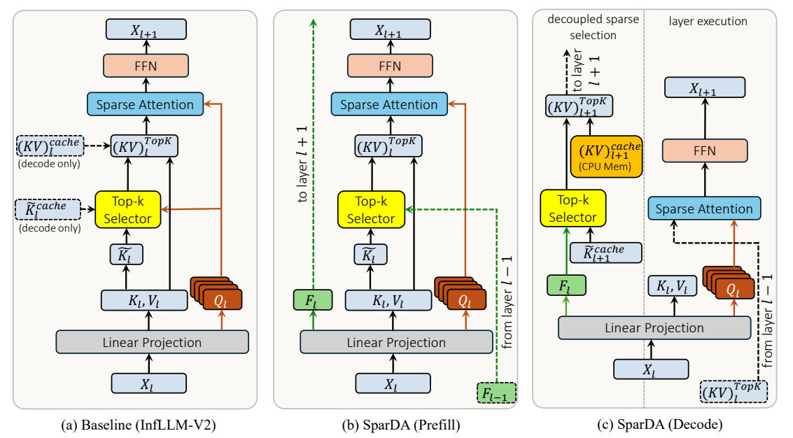

# SparDA: Sparse Decoupled Attention for Efficient Long-Context LLM Inference

来源：[arXiv:2606.04511v1](https://arxiv.org/abs/2606.04511v1)（[PDF](https://arxiv.org/pdf/2606.04511v1)，2026-06-03）。阅读正文 §1–7 及附录 A–D，下文页码均指 PDF 页码。读这篇主要想弄清一笔账：既然模型本来就只读少量 KV，剩下的时间花在选块还是搬数据？把选块提前一层，能省掉哪部分等待？

## §1–3　稀疏注意力少读 KV，选块还是要扫历史

InfLLM-V2 给每个 query 留下开头块、局部窗口和选出的历史块。它用平均池化的 key 摘要做粗筛：各 query 头先各自打分并归一化，同一 GQA 组内再合成分数，经最大池化得到块分数。选出的块用原精度 K、V 算注意力。即便每个 query 的选块预算固定，打分仍要扫历史摘要；在 prefill 中，所有 query 的选块成本仍随序列长度近似二次增长。

解码是另一笔账。把历史 KV 放到 CPU 主存能省显存，但原来的选块依赖本层 query；等它出来才知道该搬哪些块，PCIe 回读会卡在本层注意力前。InfiniGen 用上一层隐状态估计下一层的访问，SparDA 则专门训练一个投影来做这件事。

## §4.1　这一层算注意力，顺手给下一层选块

SparDA 从第 `l` 层的输入一起投影出 Q、K、V 和 Forecast。Q 仍用来计算本层注意力，Forecast 则与**下一层**已在 GPU 上的历史 key 摘要做点积，为下一层选远处的 top-k 块。开头和局部块按规则纳入，远处检索不需要等下一层新写入的 KV。第 0 层没有上一层，用单独的同层 Forecast；最后一层的 Forecast 不用。

图源：[Fu 等，SparDA，arXiv:2606.04511v1，图 2，PDF 第 4 页](https://arxiv.org/pdf/2606.04511v1#page=4)，[CC BY 4.0](https://creativecommons.org/licenses/by/4.0/)。从原页截取，保留三个子图和原标签，去掉页边及英文图注。右图左半边为下一层选块、回读，右半边是本层计算。

旧选块器按 query 头打分，再汇总到 GQA 组。新投影只需为每个 GQA 组产生一份排名，所以每组只有一个 Forecast 头，推理时无需先归一化多头分数再相加。省的是选块器的 softmax，最终稀疏注意力仍照常归一化。prefill 的 KV 已经在 GPU，这时主要省选块；decode 才用提前拿到的块索引发起回读。选块依然扫摘要，提前排进流水线没有改掉二次增长的量级。

## §4.2　底座冻结，Forecast 学原选择器的分数

原选择器在最终最大池化之前的组内分数是监督信号。训练时保留教师 top-k 位置各自的概率，把其他位置的概率合到一个「其余」桶，两边归一化后算 KL 散度。这样既能学到选中位置的相对顺序，也能约束没选中的位置总共分走多少概率。教师用更细的 key 摘要（窗口 2 token、步长 1），再把分数最大池化回学生的网格；学生保持窗口 32 token、步长 16，与推理路径一致。只改教师窗口的消融见附录 D 表 6（PDF 第 15 页）：MiniCPM4.1-8B 的四类任务均分从 60.4 到 61.7，NOSA-8B 从 50.1 到 51.7。

两套 8B 底座各只训练 3,350 万个新增参数（约 0.41%），仍用了 32 张 H100、有效 batch 32、2,000 个优化器步。附录 B（PDF 第 13 页）正文分别写 MiniCPM4.1-8B 训在 64K、NOSA-8B 训在 32K；紧接的表 5 把两者的训练长度统一列为 65,536 token，没有解释这处差异。复现时不能直接照表把 NOSA-8B 的长度定为 64K。

## §4.3　上一步取过的块，下一步能复用就不搬

测速沿用 NOSI 推理引擎。整份历史 KV 放在页锁定主存；GPU 留着压缩 key、第 0 层的完整 KV，以及各层上一步使用的 top-k 块。下一步只需为新选中的块发起传输。SparDA 用独立 CUDA stream 启动持久化 Triton UVA kernel：一小组 GPU 线程块（CTA）从主存持续搬数据，不必给每个离散 KV 块发一次拷贝。下一层开始算 attention 时，若数据还没到齐，仍要等。

预取会与主计算争 SM，CTA 不是越多越好。作者在 H100 的实现里，batch 小于 32 时分给预取 16 个 CTA，再大用 32 个；A100 的分界改为 batch 64（附录 D 表 7 及正文）。这两个值是吞吐调参结果，不是 SparDA 的模型参数。

## §5　选块更轻，解码吞吐还取决于 batch

**质量。** 两个底座都用 64-token 块，总预算 96 块；MiniCPM4.1-8B 的局部窗口是 2,048 token，NOSA-8B 是 1,024 token，并从总预算里只拨 24 块给 query-aware 检索（附录 C）。表 1（PDF 第 7 页）给四类任务的算术均分，SparDA 相对原 Sparse 在 MiniCPM4.1-8B 上是 61.7 对 61.4，在 NOSA-8B 上是 51.7 对 49.4。前者的 HELMET 反而低了 0.6 分（38.3 对 38.9，64K 上限、按任务贪心生成 50–200 token）。表 2 的 128K RULER 上，NOSA-8B 是 45.0 对 40.7；这组输入长度使用了推理时 RoPE 扩展，两边配置相同，输出上限随任务为 30–128 token。分数接近或上升，不代表两个索引器总选同一批块。

**吞吐。** 以下是作者数据，不是内核倍率。H100 和 A100 均为单卡 80 GB，分别经 PCIe Gen5 ×16 和 Gen4 ×16 连主机，两套机器各有 2 TB 主存。作者每组预热一次、测两次取平均，正文及附录未列吞吐实验的固定输出 token 数。

| 条件 | 对照 → SparDA（token/s） | 怎么读 |
| --- | ---: | --- |
| H100，MiniCPM4.1-8B，128K 输入，prefill，batch 4 | CPU 卸载的 Sparse：13,661.8 → 17,087.6 | 同 batch 为 1.25×（表 3，PDF 第 8 页）。图 3 的 2.50× 只指长输入时的选块，不能当作整段 prefill 的倍数。 |
| H100，MiniCPM4.1-8B，128K 上下文，decode，batch 8 | CPU 卸载的 Sparse：279.5 → 471.2 | 同 batch 为 1.69×（表 4，PDF 第 9 页）。同设备、长度、batch 下，NOSA-8B 为 285.4 → 399.3，约 1.40×。 |
| H100，MiniCPM4.1-8B，128K 上下文，decode，各取实验中最高可用吞吐 | 不卸载的 Sparse（batch 4）：189.5 → SparDA（batch 64）：1,000.1 | 5.28× 是把显存腾出来后增大 batch 得到的吞吐比，不是单条请求的时延比。 |
| A100，MiniCPM4.1-8B，128K 上下文，decode，batch 8 | CPU 卸载的 Sparse：195.1 → 303.3 | 同 batch 为 1.55×（表 9，PDF 第 16 页），不能把 H100 的数字直接套过来。 |

附录 D 表 10（PDF 第 16 页）把「只换选块器」和「选块器加异步预取」拆开了。在 H100、MiniCPM4.1-8B、128K decode 的 batch 4 下，开预取反而从 247.3 降到 240.2 token/s。到 batch 64 时，只换索引器的 696.9 token/s 慢于未换索引器的 Sparse（788.9 token/s）；完整 SparDA 才达到 1,000.1 token/s。预取值不值，得看回读是否已经占住解码的等待时间。

## §6–7　先区分：少搬、早搬、搬得更快

NOSA 的 query-agnostic 保留路径本来就减少按需回读，SparDA 给它换的是 query-aware 选块器。论文把 NOSA-8B 的增幅低于 MiniCPM4.1-8B 归因于可隐藏的传输原本就更少。与为原模型取齐精确 top-k 的 ECHO 不同，SparDA 用预测出来的块集直接做注意力；冻结底座也不能把它变成无损预取。作者在 §6 把 DSA、CSA 的适配留给后续工作，8B 块稀疏的结果还不能代表这些大型模型。

若看的是独显笔记本或单卡工作站，我会先测同 batch 下每步实际从主存读了多少 KV、回读能重叠多少时间，再看更大的 batch 能不能放得下。若 CPU 与 GPU 共享物理内存，优先看内存带宽竞争、选块与索引管理开销，而不是套 PCIe 预取收益。这里未运行作者代码，也没有端侧实测。
