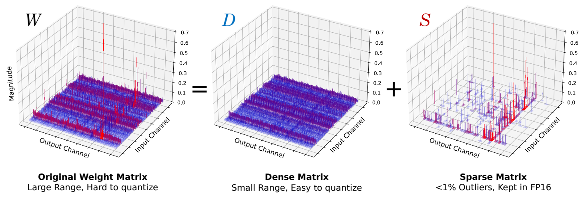
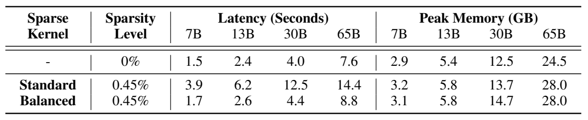

# SqueezeLLM: Dense-and-Sparse Quantization

阅读版本：[arXiv:2306.07629v4](https://arxiv.org/abs/2306.07629v4)，2024-06-05，[本地 PDF](resources/squeezellm.pdf)；对应 [ICML 2024 发表记录](https://proceedings.mlr.press/v235/kim24f.html)。已读全部 23 页，含附录 A–I；下文页码是 PDF 页码。2026-10-30 另只读核对官方代码 commit `a5fd71f353bf569feb7b55737c1c1493e78e8f31` 的量化、打包、CUDA 内核及基准入口。实验数字来自作者，未运行模型或基准。

## 研究问题与核心思路

**这篇适合研究“非均匀低比特表示如何真正成为可执行的权重格式”。** 它把精度优化与 GPU 带宽限制联系起来：batch=1 的逐 token 解码主要执行矩阵向量乘法，权重几乎不能跨 token 复用；即使解包后仍做浮点运算，少搬权重也可能加速。因此，不必为了整数乘法而强制使用均匀量化。（§3–4，p3–6）

方法有两层：

1. **敏感度加权的非均匀量化。** 每个输出通道学习一个含 $2^b$ 个浮点代表值的码本，权重存成 3/4-bit 索引。加权 k-means 优先保护对模型最终损失敏感的权重，而不是只最小化权重自身的均方误差。
2. **Dense-and-Sparse 分解。** 将少数大幅值离群点和高敏感度权重单独保存为高精度稀疏矩阵；剩下的大部分权重用码本压缩。这个“稀疏”不是把权重剪掉，而是另开一条高精度计算支路。

论文重点是 **weight-only PTQ + CUDA 解码实现**，不涉及 KV-cache 量化或 CPU/GPU 卸载。它的工程价值也不在于“低比特一定更快”，而在于展示了什么时候可用少量解包和查表计算换取较大的访存节约。

## 实现路径

### 从最终损失得到每个权重的重要性

在收敛点附近忽略一阶项，用二阶损失扰动衡量量化误差，再以 Fisher 信息近似 Hessian，并忽略跨权重相关项：

$$
\min_Q \sum_i F_{ii}\bigl(w_i-Q(w_i)\bigr)^2,
\qquad F_{ii}\approx \frac{1}{|\mathcal D|}\sum_{d\in\mathcal D}g_{d,i}^2.
$$

这变成一维加权 k-means：高 $F_{ii}$ 权重会更强地吸引中心。它仍是 PTQ，没有重新训练模型权重，但**需要校准数据和反向梯度**；“无需训练”不等于“无需梯度”。论文对普通模型用 100 条 C4 样本，对 Vicuna 用 100 条训练集样本，每个输出通道独立建码本。（§4.1、§5.1，p4–6）

附录 Table D.2 显示，单纯非均匀 k-means 对 LLaMA-7B 的 3-bit C4 PPL 为 18.08；加入敏感度后是 7.75。仅换量化网格而不考虑重要性，不能得到论文主要精度收益。（p15）

### 两种例外值共用一条稀疏支路

分解为 $W=D+S$，计算 $Wx\approx Q(D)x+Sx$。LLaMA 主实验的 0.45% 配置由 **0.05% 高敏感度值 + 0.4% 离群值**组成；dense-only 则没有这条支路。稀疏矩阵按 CSR 保存，需额外存行指针、列索引和值。这里的 0.45% 表示保留到稀疏支路的比例，不是整个模型只保留了 0.45% 权重。（§4.2，p5–6）

*原文 Figure 4，arXiv v4，PDF p5：LLaMA-65B 权重示意。原图裁剪，来源和坐标见 [asset-sources.yaml](resources/asset-sources.yaml)。*

稀疏分解不是越多越好。附录 Table D.4 在 LLaMA-2-7B 上比较相近容量：4-bit dense-only 平均 4.04 bit、WikiText2 PPL 5.62；3-bit + 1.5% 稀疏为 3.98 bit、PPL 5.81，3-bit + 2.5% 为 4.22 bit、PPL 5.80。保护真正的异常值之后，继续增加例外开销可能不如提高 dense 位宽。（p18）

### 码本与 CSR 都必须有对应内核

论文 §4.3 的路径是读取 packed 索引、查 LUT 恢复浮点数、执行浮点矩阵向量乘。3/4-bit 指的是**存储索引宽度**，不是原生 INT3/INT4 Tensor Core 运算。每个输出通道一个 LUT，避免细粒度分组额外复制大量码本。（p6、附录 D.3 p16）

稀疏支路真正的困难是行间非零数分布不均。一线程一行会让少数长行拖住执行；作者改为每线程约 10 个非零值的均衡分配，必要时让多个线程累加同一输出。dense 与 sparse 的结果直接累加，避免另起输出相加步骤。

*原文 Table C.1，arXiv v4，PDF p14。A6000、batch=1、3-bit LLaMA、128 个逐 token 步；延迟为秒、峰值显存为论文标注的 GB。表中 13B balanced 为 2.6 s，主文 Table 3 为 2.5 s，两处数值分别保留。*

7B 的普通 CSR 版本耗时 3.9 s，甚至慢于主文 FP16 基线 3.2 s；均衡后降到 1.7 s，才明显胜出。这是本文最直接的工程证据：**表示的精度收益只有配合负载均衡内核，才可能变成端到端收益。**

### 官方实现核对：不要把论文的 FP16 叙述照搬到当前代码

以下链接固定到本次查看的 commit：

| 环节 | 实际读到的实现 | 对使用者的含义 |
| --- | --- | --- |
| 校准结果到码本 | [`quantization/nuq.py`](https://github.com/SqueezeAILab/SqueezeLLM/blob/a5fd71f353bf569feb7b55737c1c1493e78e8f31/quantization/nuq.py)逐输出通道调用 sklearn `KMeans(...).fit(..., sample_weight=...)`，输入预先计算的 gradient 文件，支持 3/4 bit | 不是只在评测时临时做伪量化；生成 LUT 和离群数据是独立离线步骤 |
| 位打包及例外修正 | [`QuantLinearLUT.pack2`](https://github.com/SqueezeAILab/SqueezeLLM/blob/a5fd71f353bf569feb7b55737c1c1493e78e8f31/squeezellm/quant.py)把 3-bit 索引跨 32-bit 字边界打包；`qweight` 是 int32 存储容器，另存每通道 LUT 与 CSR | 不能按容器 dtype 把它误判成 32-bit 权重；例外位置的 sparse 值还减去 dense 对零的码本映射，避免双计 |
| 实际计算 dtype | 同文件 `forward` 对输入执行 `x.float()`；LUT、CSR 值和输出缓冲为 float32；[`quant_cuda_kernel.cu`](https://github.com/SqueezeAILab/SqueezeLLM/blob/a5fd71f353bf569feb7b55737c1c1493e78e8f31/squeezellm/quant_cuda_kernel.cu)的 NUQ kernel 用 float shared-memory LUT、float 累加及 `atomicAdd` | 论文 §4.3 描述 FP16 查表/运算，当前所查路径实际有 FP32 中间计算，再转换回输入 dtype。复现要记录真实 dispatch，不能仅写 W4A16 就推定全程 FP16 |
| dense/sparse 调用 | CUDA wrapper 中可见不同 kernel launch 共同累加输出；Python 有 standard、balanced 和 hybrid 路径 | “一次调用”不等于“单个融合 kernel”，更不自动证明两支并发重叠；需要 profiler 验证具体路径 |
| 模型与测时入口 | [`llama.py`](https://github.com/SqueezeAILab/SqueezeLLM/blob/a5fd71f353bf569feb7b55737c1c1493e78e8f31/llama.py)用量化层替换线性层，排除 `lm_head`；benchmark 逐个送入数据集 token，保留 past KV、每步同步 | 存在完整模型推理入口；这不是带长 prompt prefill 的聊天服务压测，也没有采样输出端到端链路 |

代码构造器和量化 CLI 只开放 3/4-bit。附录中的 **2-bit 精度结果不代表这份发布实现已有可用 2-bit 推理 kernel**。本次核对没有运行安装或性能测试。

## 实验条件与关键结果

### 先分清三类证据

| 证据 | 条件与指标 | 能支持的结论 |
| --- | --- | --- |
| Roofline 分析，Figure 2 | A5000 性能模型，LLaMA-7B，序列长度 128/2048，假设计算保持 FP16 | 解释 batch=1 的带宽瓶颈；它是模型预测，不是这张卡上的实测 |
| 完整模型硬件 profiling，Table 3 / G.11 | A6000，batch=1，3-bit LLaMA 7/13/30/65B，128/1024 token 步，Torch CUDA profiler | 低比特格式在作者所用执行路径上减少耗时与显存；论文未完整报告 CUDA/PyTorch 版本和独立 prompt 长度 |
| 内核 profiling，Table G.12 | A100，128 token 累计的矩阵向量 kernel 时间 | 3-bit dense 约 2.2–2.5× kernel 加速；不能当作同倍率端到端服务加速 |
| 精度 | LLaMA/LLaMA-2/OPT 的 C4、WikiText2，通常 chunk=2048；Vicuna 的 0/5-shot MMLU，80 问 GPT-4 双顺序判断，共 160 次 | 精度—容量权衡；附录 QuIP 对比单独使用 4096 长度，不能混为同一评测 |

### 7B 的精度、显存和速度应一起看

转录 Table 1 / Table 3（p7、p9），A6000、128 token 步；PPL 越低越好。平均位宽含量化表示的附加开销，峰值显存则还受模型其他状态影响。

| LLaMA-7B 配置 | 平均 bit | C4 PPL | 延迟 s | 峰值显存 GB |
| --- | ---: | ---: | ---: | ---: |
| FP16 | 16 | 7.08 | 3.2 | 12.7 |
| GPTQ，3-bit 无分组 | 3.00 | 9.55 | 1.4 | 2.9 |
| SqueezeLLM，3-bit dense-only | 3.02 | 7.75 | 1.5 | 2.9 |
| GPTQ，3-bit g128 + activation ordering | 3.24（Table 1） | 7.89 | 13.7 | 3.0 |
| SqueezeLLM，3-bit + 0.45% sparse | 3.24 | 7.56 | 1.7 | 3.1 |

SqueezeLLM 不比无分组 GPTQ 更快，但以接近的容量和延迟明显改善精度。稀疏支路相对 dense-only 增加约 13% 延迟（1.7/1.5−1），换来 C4 PPL 从 7.75 降到 7.56；相对 FP16 则约 1.88× 加速、峰值显存降约 76%。这些是由表内数值计算的比例。

“3-bit lossless”应理解为特定任务下的近似质量保持，不是无损数值压缩：上述 PPL 仍由 7.08 升至 7.56；Table 2 中 Vicuna-7B v1.1 的零样本 MMLU 从 FP16 39.1% 变为 3-bit + 0.45% 的 37.7%，下降 1.4 个百分点。（p8）

对更大模型，Table 3 给出 65B sparse 配置为 28.0 GB、8.8 s/128 步；FP16 在该单卡环境 OOM。不能用 OOM 基线计算一个实际加速比。1024 步时该配置达到 32.4 GB、82.35 s（Table G.11，p20），KV 等运行状态仍会随上下文增长。

### 基线和表格有几处会影响解释

- **不是现代 GPTQ/AWQ 引擎排行榜。** 作者自己实现基于 GPTQ-For-LLaMA 的内核；AWQ 使用无 activation ordering 的 GPTQ kernel，而非 AWQ 官方完整优化栈；SpQR 的速度引用其论文，而非同机实测。GPTQ g128 的极慢值与这份实现的离散 scale 访问相关，不能推成 GPTQ 算法必然慢十倍。（附录 B，p13–14）
- **Table G.11 的 PPL 列标注存在不一致。** 表头写 C4，但量化行如 SqueezeLLM-7B 的 6.32、sparse 的 6.13 与 Table 1 的 WikiText2 一致，基线 7.08 又是 C4。故本笔记只采用该表的延迟/显存，不把这列用作 C4 精度比较。（p20）
- **Table E.7 的位宽标题也需核对。** 标称 4-bit 的 100 样本行给出 7.72/6.18，而这与 Table H.14 的 3-bit dense-only 数值一致；4-bit 行是 7.12/5.62。它可提示少样本校准趋于稳定，但不能据此精确断言 4-bit 的校准样本收益。（p19、p22）

### 量化一次的资源成本不小

附录 E（p18）报告量化峰值内存：7B/13B/30B/65B 分别为 **33/61/149/292 GB**。需要对最终损失反向传播，准备成本可能高于逐层方法。

作者在 A100 系统计算 Fisher，7B 为 0.3 min、65B 为 2.5 min；随后在 Intel Xeon Gold 6126、48 核条件下做 k-means，分别为 11/80 min。CPU 核数是论文报告的系统配置；这些时间不能直接作为笔记本预算。对端侧应用更实际的流程是先在资源充足的机器离线量化，再分发 packed checkpoint。

## 理解、局限与疑问

### 对当前研究方向的用法

**优先把它作为“码本量化 + 稀疏例外 + CUDA GEMV”基线，而不是首选通用部署引擎。** 相比只提出量化目标的论文，它提供了位打包、LUT、CSR、负载均衡和模型执行入口，适合研究表示与内核协同；但其单请求解码假设、代码年代和特定内核路径决定了需要重新测目标设备。

- **独显台式机、笔记本、小工作站：** 最接近论文场景。先比较同质量预算下的 4-bit dense 与 3-bit+sparse，而不是只比较名义位宽；应一起测 LUT/索引流量、解包成本、稀疏支路时间和峰值显存。
- **Jetson Orin：** CUDA 路径提供移植起点，但论文没有 Orin 实测。共享 LPDDR、较小缓存和功耗预算可能改变 LUT/CSR 的得失；不能沿用 A6000 的倍率。
- **高通手机/NPU：** 任意码本解码和非结构化 CSR 不等于硬件原生低比特算子。需要 CPU/GPU 自定义实现或后端转换，本文没有 QNN/NPU 支持证据。
- **长上下文或高并发：** 只压缩权重，KV 与激活仍占内存；随着 batch、prefill 长度增大，算术强度和权重复用上升，原本划算的查表路径未必仍是最佳选择。

### 最值得进一步验证的两个问题

1. 将当前代码的 FP32 中间路径改成适合目标 GPU 的 FP16/向量化路径，收益来自减少解包、共享内存压力，还是提升浮点吞吐？需要同时检查误差和真实 dtype，不能只依据论文的 W3/W4 标记。
2. 固定端到端质量和总字节预算，稀疏例外比例何时开始不如增加 dense 位宽？附录已显示收益递减；结合通道非零分布和负载均衡成本，比继续堆更高稀疏比例更有研究价值。
