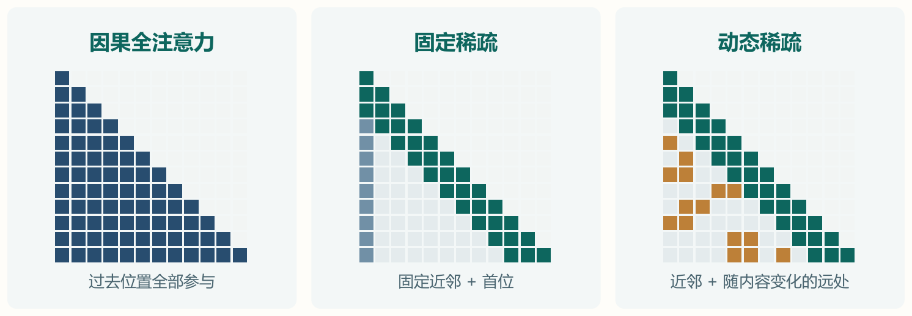
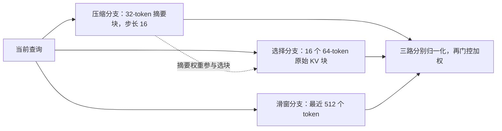

# 稀疏注意力与原生稀疏注意力

模型怎么挑出值得读的 token？少算注意力，回答就会更快吗？读一份设备手册时，下一个 token 可能只需要附近几句话，也可能要回查开头的故障码。**稀疏注意力**让每个查询只对部分位置计算主注意力；**原生稀疏注意力**在这里指模型在训练或续训时就使用这套规则。下文用 **NSA** 专指 DeepSeek 2025 年的三分支设计，不拿它代称整个类别。

## 稠密与稀疏注意力怎么算

### 从可见集合写出 softmax

先看单层单头。位置 $t$ 的隐状态 $x_t$ 投影成查询 $q_t$；位置 $j$ 的键 $k_j$ 用于打分，值 $v_j$ 按权重混合。推理时保存的键和值就是 KV cache。[Transformer 原论文][transformer]

$$
\begin{aligned}
q_t &= W_Qx_t,\qquad k_j = W_Kx_j,\qquad v_j = W_Vx_j,\\
z_{tj} &= \frac{q_t^\top k_j}{\sqrt{d_k}},\\
a_{tj} &= \frac{\exp(z_{tj})}{\sum_{u\in S_t}\exp(z_{tu})}\quad(j\in S_t),\\
o_t &= \sum_{j\in S_t} a_{tj}v_j .
\end{aligned}\tag{1}
$$

$d_k$ 是查询和键的向量维度，$S_t$ 是当前位置的可见集合。因果全注意力令 $S_t=\{1,\ldots,t\}$；稀疏注意力取它的子集。集合外的权重为零，等价于在 softmax 前把这些位置的分数置为负无穷。

*图 1：每行是一个 query，每列是一个 key；着色格参与打分。右图的棕色格是随查询选中的远处位置。*

**图 2：手算一个查询。** 三个位置的分数是 $(\ln 3,0,0)$，值是 $(0,15,20)$。

| 可见集合 | 权重 | 输出 |
| --- | --- | ---: |
| 位置 1、2、3 | $(3/5,1/5,1/5)$ | $7$ |
| 位置 1、3 | $(3/4,0,1/4)$ | $5$ |

略去中间位置后，分母从 5 变成 4。如果先做稠密 softmax，再直接把第二项清零，结果会是 4，而不是稀疏 softmax 的 5。

### 少算了多少，还要看怎么选

设序列长度为 $N$，每个查询最多读取 $k$ 个位置。只数单层单头在 prefill（读入提示）时的主注意力交互：

$$
C_{\mathrm{full}}=\frac{N(N+1)}2,\qquad
C_{\mathrm{sparse}}=\sum_{t=1}^N |S_t|\le Nk .\tag{2}
$$

在逐 token 生成的 decode 阶段，一个面对 131,072 个可见位置的查询，如果只读 2,048 个位置，主注意力交互数就是原来的 $1/64$。**这个比例不预测延迟**：动态选择还要付出扫描、top-k 和搬运成本；若先算完整 $QK^\top$ 再遮住大部分格子，那一轮点积并没省。读到的 KV 更少，也不表示只需存下这些条目，因为下一步可能选中不同位置。

## 经典方法：固定连边与推理时选边

连接可以按位置固定，也可以随输入变化。这和模型是否在训练阶段见过稀疏规则，是两回事。

| 路线 | 怎么选 | 代表方法 |
| --- | --- | --- |
| 固定局部与远距连接 | 局部块加跨步或固定远距连接 | [Sparse Transformer][sparse-transformer] 给出的注意力复杂度约为 $O(N\sqrt N)$ |
| 局部窗口与全局位置 | 用少数全局位置传递远距信息 | [Longformer][longformer]；[BigBird][bigbird] 另加随机连接 |
| 对已有模型做动态稀疏 | 运行时从输入或当前查询推断有用位置 | [MInference][minference] 优化 prefill；[Quest][quest] 按查询选 KV 页来做 decode |

MInference 先给不同注意力头选稀疏模式，运行时再确定其中部分模式的索引。原论文图 1 中，单张 A100 上的 LLaMA-3-8B-1M 处理一百万 token 提示，prefill 相对 FlashAttention-2 从约 30 分钟降到 3 分钟。这不是逐 token 生成的速度。

Quest 用 KV 页内键向量的逐维最小值与最大值来估计页的重要性；当前未选的页仍可在下一步被访问。论文图 10(b) 中，在 RTX 6000 Ada 上、32K 上下文、2,048-token 预算、batch 1、4-bit AWQ 权重的设置下，单步模型 decode 相对 FlashInfer 全量 KV 从约 29.6 ms 降到 13.3 ms，不含采样。

- **[FlashAttention][flashattention]** 的精确稠密版本靠分块和在线 softmax 降低访存，仍算同一批交互。
- **线性注意力**改写计算形式，常用可结合的汇总或递推；它不是先给位置打分再挑边。
- **KV 量化**减少每条 KV 的字节数，**卸载**改变 KV 放在哪里，两者都能与稀疏注意力叠加。

## NSA：摘要、精读与滑窗

[Native Sparse Attention（NSA）][nsa] 把历史分成三条读取路径。压缩分支读历史摘要，选择分支读相关的原始 KV，滑窗分支读最近的原始 KV。摘要既给精读分支提示要选哪些块，也直接参与当前 token 的预测。

*图 3：据 NSA 正式版图 2 和 §2 重绘。图中数字为论文默认配置，选择分支的预算含固定首块和局部块。*

### 先压缩完整可见的片段

令 $L$ 和 $s$ 分别为摘要块长和步长，$B$ 为精读块长。位置 $t$ 只使用已经完成的摘要：

$$
\bar{k}_i = \phi_K(k_{is+1:is+L}),
\qquad
\bar{v}_i = \phi_V(v_{is+1:is+L}),
\qquad
is+L\le t.
\tag{3}
$$

$\phi$ 是带块内位置信息的可学习 MLP。实验里 $L=32,\ s=16$，所以相邻摘要覆盖的原 token 有重叠。每个注意力头 $h$ 在已完成的摘要上做 softmax，得到摘要权重 $p^{\mathrm{cmp}}_{t,h}(i)$。

### 用摘要权重给精读块打分

原论文把附近的摘要权重映射到各个精读块，再汇总同一 GQA（分组查询注意力）组内各头的分数：

$$
\begin{aligned}
u_{t,h}(b) &=
  \sum_{m=0}^{B/s-1}\sum_{r=0}^{L/s-1}
  p^{\mathrm{cmp}}_{t,h}\!\left(\frac{bB}{s}-m-r\right),\\
u_{t,g}(b) &= \sum_{h\in g}u_{t,h}(b),\\
I_{t,g} &= \operatorname{TopK}_{n}(u_{t,g}).
\end{aligned}
\tag{4}
$$

第一行沿用论文的块索引对齐，假设 $L\le B$，且 $s$ 整除 $L$ 和 $B$；无效或未完成的摘要不计。选块还要遵守因果约束，固定首块和局部块按规则占用预算。$B=64,\ n=16$ 时，选择分支最多精读 1,024 个原始位置。按块读取能连续搬运 KV，同一 GQA 组的多个查询头也只需共享一份选块结果。

### 三路分别归一化，再加权相加

$$
\begin{aligned}
o_t &=
\sum_{c\in\{\mathrm{cmp},\mathrm{slc},\mathrm{win}\}}
  g_{t,c}\,\operatorname{Attn}(q_t,K_{t,c},V_{t,c}),\\
g_{t,c} &= \sigma\!\left(\operatorname{MLP}(x_t)_c\right).
\end{aligned}
\tag{5}
$$

各分支的 K、V 独立，不能先拼成一张表再做一次 softmax。$\sigma$ 是 sigmoid，门控权重也不要求加起来等于 1。硬 top-k 的选中下标没有普通梯度，但摘要分支参与预测，压缩器可以从语言模型损失学习。

**精读预算固定，解码成本并不固定。** 历史长到位置 $t$ 时，已完成的摘要数是 $\max(0,\lfloor (t-L)/s\rfloor+1)$。只细读 $nB$ 个原始位置，仍要扫描摘要：单步为 $O(t/s)$，对长度 $N$ 做 prefill 为 $O(N^2/s)$，均只计这部分扫描。

**实验怎么读。** 同一 27B MoE 骨架（激活 3B）中，作者选取的 LongBench 10 个子任务均分为全注意力 0.437、NSA 0.469。64K 的 Triton 算子实验在 8×A100 系统上对比 Triton FlashAttention-2，前向为 9.0×、反向为 6.0×。表 4 的 decode 11.6× 是按 KV 加载量推算（65,536 对 5,632 个等效位置），不是端到端解码实测。见[论文图 5 与表 4][nsa]。

## InfLLM 与 InfLLM-V2：从推理补丁到稀疏训练

两代 InfLLM 都先给远程块打分，再读入选块的原始 KV。区别在何时引入这套规则：原版给已有模型加推理期检索；V2 在长上下文续训中就走稀疏路径。

### InfLLM 2024：用代表 token 给远处整块排名

令 $L$ 为局部窗口长度。历史位置 $m$ 移出窗口后，系统可以用已经看到的 $L$ 个后续查询，估计它是否适合代表所在块 $B_b$：

$$
\begin{aligned}
a_m &= \frac{1}{L}\sum_{r=1}^{L}q_{m+r}^{\top}k_m,\\
R_b &= \operatorname{TopK}_{r_k}\!\left(a_m : m\in B_b\right),\\
s(X,b) &= \sum_{i\in X}\sum_{m\in R_b} q_i^\top k_m.
\end{aligned}
\tag{6}
$$

$R_b$ 是第 $b$ 块的代表集合，$r_k$ 是每块代表数。prefill 的一段输入 $X$ 共享一份检索结果；decode 时 $X$ 只有一个 token。远程全块可留在主存，GPU 保留代表和热块。取回的整块与近邻、初始 token 一起参加因果注意力。见[原论文 §3][infllm]。

### InfLLM-V2：用同一套投影，短序列稠密、长序列稀疏

V2 先沿序列维度做滑动平均，生成重叠摘要。各头先在合法摘要上归一化，同一 GQA 组再求和，最后用最大池化得到精读块分数：

$$
\begin{aligned}
\bar{k}_j &= \operatorname{Mean}(k_{16j:16j+31}),\\
p_{t,h,j} &=
 \operatorname{softmax}_j(q_{t,h}^{\top}\bar{k}_j),\\
s_{t,g,b} &= \max_{j=4b,\ldots,4b+4}\sum_{h\in g}p_{t,h,j}.
\end{aligned}
\tag{7}
$$

论文默认保留 1 个首块、32 个近邻块，并按分数选 63 个远处块；块长为 64，合计最多 6,144 个 token。**与 NSA 的分界在这里：** 摘要只负责挑选，入选的原始 KV 在因果并集上共同归一化一次。实现可先用较粗的池化估计分母，再细扫摘要、累加各头分数，省去不少中间分数表读写。近似发生在路由，选定之后的主注意力仍精确归一化。见[论文 §3][infllm-v2]。

8B 实验先做 4K 稠密预训练，再用 5B token 续训到 32K。ICLR 论文表 1 的 32K RULER 均分：V2 稀疏模式 82.62，同一 V2 切回稠密为 88.32，独立稠密续训基线为 84.26。均分接近，但 MK3 单项的 V2 稀疏模式为 62.00，独立稠密基线为 92.00。

论文图 7 的 8B W4A16 实验在 RTX 4090 上，以同模型稠密模式为基线，128K 的首 token 加速为 2.13×，32K 只有 1.16×。这是模型延迟；图 6 的 128K、batch 1、4.0× 是同卡相对 FlashAttention-2 的含选块算子结果。两组数字的测量范围不同。见 [InfLLM-V2 表 1、图 6–7][infllm-v2]。

## NOSA：让相邻解码步复用更多 KV

KV 移到主存后，解码还得付取回旧块的开销。[NOSA][nosa] 用短上下文做稠密训练，在长上下文续训时让两条路共享同一个稀疏预算：一部分块由当前查询决定，另一部分按块自身分数补足。后者的排名不随 query 改变，下一步更可能复用。

$$
\begin{aligned}
r_{tj} &= q_t^\top k_j,
& e_j &= \operatorname{softplus}(v_j W_1)W_2,\\
Q_t &= \operatorname{TopK}_{b_q}(R_t),
& E_t &= \operatorname{TopK}_{b_e}(D \mid \text{排除 } Q_t),\\
\Gamma_t &= Q_t\cup E_t,
& J_t &= \bigcup_{b\in\Gamma_t} B_b,\\
o_t &= \sum_{j\in J_t}
\frac{\exp(z_{tj}+e_j)}{\sum_{i\in J_t}\exp(z_{ti}+e_i)}v_j.
\end{aligned}
\tag{8}
$$

两条路都先对子块取均值，再取块内最大值，得到查询相关的块分数 $R_t$ 和查询无关的块分数 $D$。先用配额 $b_q$ 选查询路，再在查询路未选中的块里用 $b_e$ 补齐。$e_j$ 不是信息熵：它既给独立路排名，也作为偏置进入原始 token 的主注意力 logit；这一分数因此能够直接学习。上式未单列固定首块和滑窗。

设四块预算中只有一块由查询决定，共有候选按独立分数排序为 **A > B > C > D > E**：

| 步骤 | 查询路先选 | 独立路补齐 | 最终读到 |
| --- | --- | --- | --- |
| 第 $t-1$ 步 | E | A、B、C | A、B、C、E |
| 第 $t$ 步 | A | B、C、D | A、B、C、D |

*表 4：两步交集为 A、B、C。若前一步的块还在 GPU，第二步只取新块 D。A 能从独立路换到查询路，并不是被永久锁定。*

满足论文的两路模型条件时：

$$
\gamma_t =
\frac{\lvert\Gamma_t\cap\Gamma_{t-1}\rvert}{\lvert\Gamma_t\rvert}
\ge \frac{b_e}{b_q+b_e}.
\tag{9}
$$

证明的关键是：独立路排名前 $b_e$ 的共同候选，要么已被查询路选中，要么会由独立路补进并集。这个下界按同一层、同一组、预算选满且共有候选高分块可选、排名稳定来理解。系统说明另把新生成条目与窗口更新用的 KV 按已就绪处理。默认 4,096-token 预算中查询路占 1,024，论文的局部性下界为 75%；它不是对实际缓存命中率的无条件保证。减少查询配额还会损害远程召回。

[论文表 7][nosa] 的 96K、8B BF16、单 A800-80GB 测试中，两种方法同用 NOSI 卸载、batch 64，NOSA 吞吐为 1,080.45 tok/s，InfLLM-V2 为 725.26 tok/s。测试每次只解码 4 token，这个对照说明该设置下的批吞吐，不等于单用户延迟。

## SparDA：在当前层给下一层选块

[SparDA][sparda] 是给已有块稀疏模型加装的索引器和预取路径。InfLLM-V2 要拿到本层 query 才能选本层的块；SparDA 在第 $\ell$ 层从输入状态 $x_{\ell,t}$ 生成 Forecast，用它给**下一层**的历史 key 摘要打分。对位置 $t$、GQA 组 $g$ 和候选远块 $b$，选块打分可简写成：

$$
\begin{aligned}
f_{\ell,t,g} &= W^{F}_{\ell,g} x_{\ell,t},\\
s_{\ell+1,t,g,b} &= \max_{j\in I(b)}
  f_{\ell,t,g}^{\top}\bar{k}_{\ell+1,g,j}.
\end{aligned}
$$

$I(b)$ 是与块 $b$ 对齐的有效历史摘要位置。每个 GQA 组只有一个 Forecast 头，省去原选择器的逐头 softmax 和组内求和，再按分数选 top-k 远块。首块和近邻按底座规则保留；接在 NOSA 上时，只替换随 query 变化的那一路。第 0 层没有上一层，使用单独的同层 Forecast。真正做注意力时，仍用本层 query 对选中的原始 KV 归一化，预测出的块集可能和原索引器不同。[论文 §4.1–4.2][sparda]

**训练只更新 Forecast。** 两套 8B 底座分别冻结，只训练约 3,350 万个新增参数（约 0.41%）。教师用原选择器的池化前分数，细摘要按 2-token 窗、步长 1 计算，再汇到学生的 32-token 窗、步长 16 的网格。蒸馏保留教师 top-k 各项，把其余概率合成一项，再归一化并计算 KL。附录 B 报告 32 张 H100、有效 batch 32、2,000 步；下表的 GPU·小时由卡数乘时长上限得出，只计这次增量训练。附录正文写 NOSA-8B 的训练长度为 32K，同附录表 5 列 65,536，复现时需核对实际配置。

**Prefill 省选块，decode 还可省等待。** Prefill 先算本层的 K，再用上一层的 Forecast 选块；仍要扫描历史摘要，省的是多头打分和归一化。CPU 卸载解码时，GPU 已有下一层的历史 key 摘要，可以提前一层选块并发起回读，与当前层注意力及前馈计算重叠。上一步用过且仍在 GPU 的块不用搬；取不齐时，下一层还是要等。预取也占 GPU 算力：单 H100、MiniCPM4.1-8B、128K、batch 4 的消融里，开预取反而把 247.3 tok/s 降到 240.2 tok/s（表 10）。论文只在两套 8B 块稀疏底座上验证，尚未验证 DSA 或 CSA。[论文 §4.3、§6、附录 D][sparda]

### 四种方法的选块方式、训练成本与推理开销

| 方法                     | 选块方式                                                            | 训练范围与成本                                                                                 | 推理开销及证据                                                                                                                                                |
| ---------------------- | --------------------------------------------------------------- | --------------------------------------------------------------------------------------- | ------------------------------------------------------------------------------------------------------------------------------------------------------ |
| [NSA][nsa]             | 本层摘要注意力给原始块打分，GQA 组内合并后选 16 个 64-token 块；摘要、精读、滑窗三路都参与输出        | 27B MoE（激活 3B）；从 8K 原生稀疏预训练起步，再做 32K 续训与 SFT。整模型训练 GPU·小时未披露                            | 仍扫历史摘要，三路分别计算。64K、8×A100 系统中，前向注意力算子相对 Triton FlashAttention-2 为 9.0×；decode 的 11.6× 是按 KV 读取量推算，不是实测延迟                                                |
| [NOSA][nosa]           | 本层 query 先选；再按不依赖 query 的块重要性去重补齐。默认 4,096-token 预算中，查询路占 1,024 | 8B 从 4K 稠密底座接着训；16K 稀疏续训 1,496 + SFT 377 = **1,873 A800·小时**（32 张卡，不含底座，表 17）           | 稳定选集减少卸载回读量。96K、单 A800-80GB、8B BF16、NOSI 同卸载、实际 batch 64：1,080.45 vs InfLLM-V2 的 725.26 tok/s；表 7 每组只测 4 个 decode token                                |
| [InfLLM-V2][infllm-v2] | 本层 query 对重叠均值摘要逐头归一化、组内合并、最大池化选块；默认 1 首块 + 32 近邻块 + 63 远块      | 8B 先做 4K 稠密预训练（8 万亿 token），再做最长 32K 的稀疏续训（50 亿 token）。训练 GPU·小时未披露                      | 仍扫历史摘要；选定后只读原始 KV。128K、RTX 4090、8B W4A16，相对同模型稠密模式的整模型 TTFT／TPOT 加速是 2.13×／2.32×（图 7）                                                                  |
| [SparDA][sparda]       | 上一层 Forecast 给本层历史摘要打分；每 GQA 组一个评分头。接 NOSA 时保留其独立路              | 冻结已有 8B 底座，只蒸馏 Forecast。MiniCPM4.1-8B **≤1,536 H100·小时**；NOSA-8B **≤768 H100·小时**（附录 B） | 索引仍扫摘要；decode 可提前回读未命中块。128K、单 H100-80GB、MiniCPM4.1-8B、同 CPU 卸载基线：prefill batch 4 **1.25×**；decode batch 8 **1.69×**，同条件 NOSA-8B **1.40×**（表 3–4，均为吞吐） |

**NOSA 少换块，SparDA 让需要回读的块早点搬。** 两者可以叠加。表中 NOSA 的 1,873 A800·小时覆盖主模型续训和 SFT，SparDA 的 H100·小时只覆盖索引器。推理列分别列了算子时间、整模型延迟和服务吞吐，也不宜按倍率排名。另一个要对齐的是选块预算：NOSA 表 7 的 InfLLM-V2 对照用 4,096 token；SparDA 表 3–4 则把两套底座都设为 96 个 64-token 块，共 6,144 token。

## MoBA、MiniMax MSA 与 HySparse2：三种路由信号

### MoBA：先把键平均成块代表

$$
\begin{aligned}
s_{t,b} &= q_t^\top\operatorname{Mean}(K[B_b]),\\
\mathcal B_t &= \{b_{\mathrm{current}}\}\cup
       \operatorname{TopK}_{k-1}(s_{t,\mathrm{past}}).
\end{aligned}
\tag{10}
$$

当前块强制保留并在块内做因果遮罩，未来块排除，再从过去的块里补齐剩余名额。入选原始 KV 共享一次 softmax。路由不用额外参数，但模型仍要适应稀疏路径：[MoBA 论文 §3.2][moba] 在 1.5B、32K 的实验里，纯稀疏训练在序列尾部损失较高；先稀疏训练、最后 10% 切回稠密，可以缩小差距。

### MiniMax MSA：逐 token 轻量打分，再取块内最大值

$$
s_{t,b,g} =
\max_{\substack{j\in B_b\\j\le t}}
\frac{\widetilde{q}_{t,g}^{\top}\widetilde{k}_j}{\sqrt{d_{\mathrm{idx}}}}.
\tag{11}
$$

轻量索引器的键跨 GQA 组共享，各组分别选块。16 个 128-token 块最多读 2,048 个原 token，其中包含必留的本地块。索引器用主注意力分布做 KL 监督，仍扫所有可见位置。

用两个块说明均值和最大值的差别：若块内分数分别是 $(10,-10)$ 和 $(3,3)$，看均值会选第二块，看最大值会选第一块。最大值更容易留下孤立强信号，也更受异常高分影响。[论文表 3][minimax-msa] 的 128K 密转稀对照中，RULER 从 72.00 到 72.12，HELMET 从 46.53 到 45.93。

### HySparse2：复用少数全注意力层的选点信号

令 $a_{tj}$ 为全注意力层已经算出的选择信号，$W_t$ 为保留的近邻集合，略去头级细节可写成：

$$
S_t = W_t \cup \operatorname{TopK}_{1024}
  \!\left(a_{tj}:j\le t,\ j\notin W_t\right),
\qquad
\lvert W_t\rvert\le 128.
\tag{12}
$$

后续稀疏层既继承选中位置，也读取对应全注意力层的 KV，不另外建索引器。80B-A3B 配置中仍有 5/49 层做全注意力。[论文表 3][hysparse2] 的同预算消融中，由 64-token 块改为逐 token 选择后，32K 以内的 RULER-v2 从 49.56 到 56.13，预训练评测的 NoLiMa 却从 40.27 到 38.43。选择粒度要随目标任务和访存成本一起考虑。

## DeepSeek DSA、CSA/HCA 与 CSA2

### V3.2：用轻量索引做 token 级选择

[DSA][dsa] 的 Lightning Indexer 先在因果前缀里打分，再挑最多 2,048 个 token 给主注意力。

$$
\begin{aligned}
I_{t,j} &=
\sum_{h=1}^{H^I}w^I_{t,h}\,
  \operatorname{ReLU}\!\left(q^I_{t,h}\cdot k^I_j\right),\\
S_t &=
\operatorname{TopK}_{2048}\!\left(I_{t,j}:j\le t\right).
\end{aligned}
\tag{13}
$$

上标 $I$ 表示独立的索引器；各索引头共享历史键，当前 query 生成权重 $w^I_{t,h}$。模型从稠密检查点起步，用全注意力分布监督索引器，再切到稀疏续训。稀疏续训时，主干优化语言模型损失，索引器仅在所选集合上用 KL 拟合主注意力分布，索引器输入停梯度。主注意力读入选的 MLA 缓存条目，不用索引键替代值。

主注意力的 prefill 降到 $O(Nk)$，但索引器逐 query 扫整段因果前缀；这部分仍是二次量级。

### V4：先减少全局 KV 条目，再决定读哪些

[DeepSeek V4][deepseek-v4] 使用两类历史读取方式。CSA 每 4 个 token 产出一个压缩 KV 条目，再选 top-k；V4-Flash 选 512 条，V4-Pro 选 1,024 条。HCA 每 128 个 token 产出一条，对已完成的历史压缩条目做全注意力。两类层都加 128-token 的原粒度近邻窗口。

| 1M token 上下文 | DeepSeek-V3.2 | DeepSeek-V4-Pro |
| --- | ---: | ---: |
| 单 token 推理 FLOPs | 100% | 27% |
| 累计 KV cache 大小 | 100% | 10% |

*表 5：来自 V4 技术报告图 1。FLOPs 按等效 FP8 计，KV 容量也受精度影响；结果没有把换架构和换精度各自的收益拆开。*

### V4.1-Flash：让多层共用压缩历史

[V4.1-Flash][deepseek-v41] 改用 CSA2，不再交替使用 HCA。一层可以生成自己的全局 KV 与索引，可以共享现有 KV 但重新选，也可以连 top-k 下标一起继承。配置名 **Full** 指该层自己执行这些步骤，不指稠密注意力。首个索引层仍扫全历史的压缩候选，后续可在较小的候选池里重排。报告给出的常驻 HBM 全局 KV 是 890 字节/token，约为 V4-Flash 的 1/4；该数字包含 FP4 KV 的贡献，不是峰值显存比。

## 研究前沿：选择器、训练和推理系统

### 让索引少做工作

[LSA][lsa] 先把历史聚成簇，再精查候选。Flat 版逐簇筛选，Tree 版还可以跳过树枝，但超长上下文中的准确率下降得更快。[ADIndex][adindex] 则让相邻查询共享候选，分别精排，减少重复的大范围搜索。两篇都是预印本。

| 上下文 | D-LSA 首 token 加速 | D-LSA 每输出 token 加速 |
| ---: | ---: | ---: |
| 512K | 1.03× | 1.01× |
| 1M | 1.09× | 1.06× |
| 10M | 2.24× | 2.10× |

*表 6：数据来自 LSA 表 3。GLM-5.3-Flash，SGLang 单请求，8×H200，CP8 + DCP8；D-LSA（Flat）相对原稀疏注意力。10M 对照用的是蒸馏改造版，不是仅在约 0.5B 模型、128K 上验证的原生训练版。*

### 选集不变，也能减少训练开销

[HyScale][hyscale] 边扫描边取精确 top-k，不把整张分数表写回显存；重算激活时直接复用前向选好的下标。作者报告：GLM-5.1、512×H20、1M-token 序列、全局 batch 4M token，相对 Megatron-LM 的端到端训练速度是 2.07×（§4.2）。这是训练系统优化，没有令全历史索引变成线性。

[ASA][asa] 把 NSA 的局部窗口和全局压缩／选择排在不同层，并为两路配置不同的潜注意力。作者表 3 的 1.3B、8K 对照中，相对 NSA，数字针检索从 66% 升到 100%，UUID 针却从 65% 降到 62%。评估选块或压缩质量时，一个检索均分不足以说明它会在什么地方漏掉信息。

### 少读 KV 之后，还得管好它存在哪

~~~mermaid
flowchart LR
    Q["索引器确定本步需要的 KV"] --> G["GPU 热缓存"]
    G -->|"命中"| A["用选中的 KV 算注意力"]
    G -->|"未命中"| H["主机内存保存历史 KV"]
    H -->|"按需取回"| G
~~~

*图 7：按需回取保留了访问完整历史的能力；不等于永久删掉未命中的块。*

[ECHO][echo] 预取历史 KV，同时保持 DSA 的最终 top-k；[HiSparse][hisparse] 用固定大小的 GPU 热缓存和主机历史服务已选位置。它们以传输开销换显存容量。这里的“精确”指保留稀疏模型原有的选中结果，不是恢复稠密注意力。

若本步需要回取 $m$ 个块，每块实际占 $B_{\mathrm{block}}$ 字节，有效带宽为 $\mathrm{BW}_{\mathrm{eff}}$，可以先估算：

$$
B_{\mathrm{move}}\approx mB_{\mathrm{block}},\qquad
T_{\mathrm{transfer}}\approx\frac{B_{\mathrm{move}}}{\mathrm{BW}_{\mathrm{eff}}}.\tag{14}
$$

这个式子不含调度、索引和写回。NOSA 在模型侧减少的是 $m$；SparDA 则试着把剩余回读提前，让其中一部分传输时间落到当前层计算里。

[LeanSparse][leansparse] 用低精度索引粗筛候选，再回取原始索引键精排。4×H100、SGLang、DeepSeek-V4-Flash、950K 上下文的 decode 压测中，最大并发和吞吐分别是 HiSparse 的 2.95× 和 2.14×。在另一组 128 会话 Open-SWE 回放中，相对作者实现的 ECHO，中位 TTFT（首 token 时间）从 21.6 秒降到 0.6 秒，中位 TPOT（每输出 token 时间）却从 66.4 毫秒升到 81.7 毫秒。两组实验的基线不同，不能合成一个“总体加速比”。

## 端侧怎么验证

先用目标设备上最快的可用稠密内核作基线。固定模型、精度和后端，分别改变输入长度、输出长度与并发。优先拆开看 **TTFT、TPOT、KV 峰值驻留、每步搬运量和 P95 延迟**，再用远距检索、长文问答、跨文件定位和多跳问题确认有没有漏掉证据。长提示拖慢首字时，先试连续块 prefill；显存吃紧时，另测 KV 量化或分层缓存，并记录缓存未命中率。

仓库里的 [ShadowNPU 笔记](../papers/shadownpu/notes.md) 讨论手机 NPU 用 INT8 粗排、CPU/GPU 精算入选项，原方案的 decode 仍是稠密的。[SolidAttention 笔记](../papers/solidattention/notes.md) 讨论笔记本 NVMe 分层。两篇分别对应 [ShadowNPU 原文][shadownpu] 和 [SolidAttention 原文][solidattention]，适合借用实验思路，不能把硬件结果直接搬到 Orin。

### 仓库里的相关笔记

- 机制：[NSA](../papers/native-sparse-attention/notes.md)、[InfLLM-V2](../papers/infllm-v2/notes.md)、[NOSA](../papers/nosa/notes.md)、[SparDA](../papers/sparda/notes.md)
- 系统：[ECHO](../papers/echo/notes.md)、[HiSparse 资源卡](../papers/hisparse/resource.md)

[nsa]: https://aclanthology.org/2025.acl-long.1126/
[infllm]: https://proceedings.neurips.cc/paper_files/paper/2024/file/d842425e4bf79ba039352da0f658a906-Paper-Conference.pdf
[infllm-v2]: https://proceedings.iclr.cc/paper_files/paper/2026/file/716e60181e1782f5bd0a629033f85310-Paper-Conference.pdf
[nosa]: https://aclanthology.org/2026.emnlp-main.279/
[sparda]: https://arxiv.org/html/2606.04511v1
[moba]: https://papers.nips.cc/paper_files/paper/2025/file/19eae75beed66321d62272e794a9c2ac-Paper-Conference.pdf
[minimax-msa]: https://arxiv.org/html/2606.13392v2#S3
[hysparse2]: https://arxiv.org/html/2609.26368v1#S3
[dsa]: https://arxiv.org/html/2512.02556v1#S2.SS1
[deepseek-v4]: https://arxiv.org/html/2606.19348v1#S2.SS3
[deepseek-v41]: https://arxiv.org/html/2609.19969v1#S2.SS3
[transformer]: https://proceedings.neurips.cc/paper/7181--attention-is-all-you-need.pdf
[sparse-transformer]: https://arxiv.org/abs/1904.10509
[longformer]: https://arxiv.org/abs/2004.05150
[bigbird]: https://arxiv.org/abs/2007.14062
[minference]: https://proceedings.neurips.cc/paper_files/paper/2024/file/5dfbe6f5671e82c76841ba687a8a9ecb-Paper-Conference.pdf
[quest]: https://openreview.net/pdf/33999165c53a8778cce8830b43d58381eea3b389.pdf
[flashattention]: https://arxiv.org/abs/2205.14135
[lsa]: https://arxiv.org/html/2610.42147v2#S4.SS3
[adindex]: https://arxiv.org/abs/2611.12956v1
[hyscale]: https://arxiv.org/html/2610.32057v3#S4.SS2
[asa]: https://aclanthology.org/2026.findings-acl.695/
[echo]: https://www.usenix.org/system/files/osdi26-liu-guangda.pdf
[hisparse]: https://arxiv.org/abs/2608.07009v1
[leansparse]: https://arxiv.org/html/2611.04671v1#S6
[shadownpu]: https://arxiv.org/abs/2508.16703v4
[solidattention]: https://www.usenix.org/conference/fast26/presentation/zheng
